*Plateforme : Cisco Packet Tracer (postes PC-PT, concentrateurs Hub-PT).*

## Objectifs et prérequis

Pour que deux ordinateurs s'échangent des données, il faut un câble, une adresse pour chacun et un moyen de vérifier que tout fonctionne. Dans ce TP, vous construisez cela pas à pas, dans le simulateur, avec deux postes puis avec cinq postes.

Ce TP est la première partie de « Création et interconnexions des LAN ». Au fil des trois parties, vous allez :

- choisir le matériel pour construire un réseau poste à poste (Peer to Peer, P2P) ;
- comprendre l'adressage IP ;
- paramétrer des hôtes sur un même réseau pour qu'ils puissent communiquer entre eux ;
- comprendre le fonctionnement d'un concentrateur (hub).

Les parties suivantes traitent du commutateur, du routeur, de la passerelle, du réseau sans fil et d'un cahier des charges : voir la [partie 2](../tp-creation-lan-2/index.qmd) et la [partie 3](../tp-creation-lan-3/index.qmd).

Vous avez déjà utilisé Packet Tracer dans le [TP1 — Réseau domestique](../tp-reseau-domestique/index.qmd) : vous savez placer un équipement et le relier par un câble.

## Situation de départ

Vous devez équiper une petite salle informatique. Avant de passer au matériel réel, vous testez vos choix dans un simulateur. Vous commencez par le réseau le plus simple, deux ordinateurs reliés l'un à l'autre. Vous le faites ensuite grandir avec un concentrateur.

Résultat attendu en fin de séance : un réseau de cinq postes reliés à un concentrateur, puis un second concentrateur avec deux postes de plus, où chaque poste joint tous les autres.

## Matériel et environnement

::: {.callout-tip title="Support d'activité"}
- Cisco Packet Tracer, suite bureautique
- Internet
:::

Vous rédigerez un compte rendu numérique. Pensez aux captures d'écran pour illustrer votre compte rendu. Sauvegardez votre travail régulièrement ! Des modifications peuvent exister selon la version du logiciel utilisée.

| Section | Contenu |
|---|---|
| 1 | Prise en main du simulateur réseau |
| 2 | Faire communiquer les postes |
| 3 | Adressage des hôtes sur le réseau |
| 4 | Matériel nécessaire pour un réseau P2P |
| 5 | Création d'un réseau avec concentrateur (hub) |

: Contenu de cette partie {#tbl-sections}

## Travail à réaliser

### 1 — Prise en main du simulateur réseau

#### Création d'un réseau P2P

Vous allez dans un premier temps créer un réseau Peer-to-Peer constitué de deux ordinateurs. Lancez le logiciel « Cisco Packet Tracer ». Vous devez obtenir la fenêtre ci-dessous.

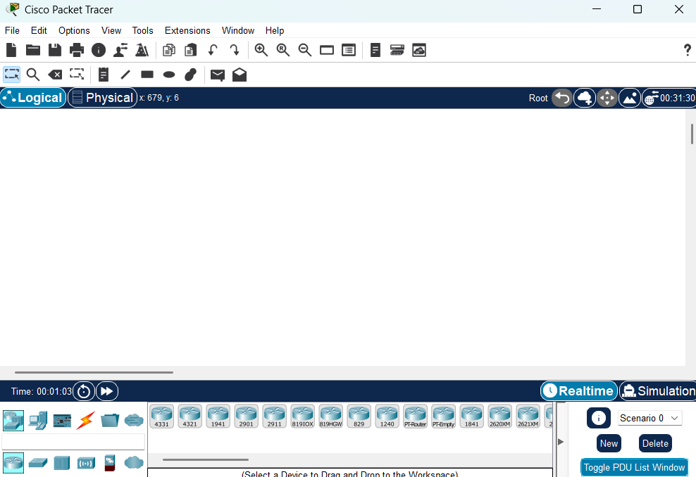{fig-alt="Capture d'écran de Packet Tracer au lancement : barre de menus et d'outils en haut, zone de travail logique vide au centre, palette des équipements et boutons Realtime et Simulation en bas."}

Pour ajouter un poste dans votre réseau, sélectionnez en bas à gauche de l'écran la rubrique « Terminaux » (End Devices), cliquez sur l'icône « Generic », puis cliquez dans la fenêtre pour y déposer un premier poste : PC-PT PC0. Pour supprimer ce poste ou tout autre élément, cliquez sur l'icône « Delete » à droite de l'écran, puis sélectionnez l'élément à supprimer. Créez 2 postes « Generic », puis renommez-les comme ci-dessous.

{fig-alt="Capture d'écran de Packet Tracer : deux postes PC-PT, PC0 à gauche et PC1 à droite, non reliés."}

Maintenant, il faut relier nos deux postes par un câble. Sélectionnez en bas à gauche la rubrique « Connexions » (Connections), puis choisissez un « câble droit » (Copper Straight-Through). Cliquez sur l'un et l'autre poste pour mettre le câble (choisissez FastEthernet). Vous devez obtenir le résultat suivant.

{fig-alt="Capture d'écran de Packet Tracer : PC0 et PC1 reliés par un trait plein noir. Un triangle rouge marque chaque extrémité du câble."}

La couleur rouge (aux extrémités du câble) indique qu'il y a un problème dans l'installation de votre réseau. Il s'agit ici du fait qu'un câble réseau droit a été utilisé. Pour relier des postes directement entre eux, il faut utiliser un câble croisé.

Modifiez votre réseau : effacez le câble droit (touche « Suppr ») et remplacez-le par un câble croisé (Copper Cross-Over).

{fig-alt="Capture d'écran de Packet Tracer : PC0 et PC1 reliés par un trait pointillé noir. Un triangle vert marque chaque extrémité du câble."}

La couleur verte indique que la configuration matérielle est correcte et que les postes ont maintenant la possibilité de communiquer entre eux.

### 2 — Faire communiquer les postes

Vous allez maintenant faire communiquer les deux postes d'un réseau P2P. Lorsqu'un poste envoie des données à un matériel connecté au réseau, il émet un message. Dans Packet Tracer, ce message s'appelle un **PDU** (Protocol Data Unit, « unité de données de protocole ») : c'est un bloc d'informations qui circule sur le support.

Cliquez sur l'icône « Add simple PDU » (à droite de l'écran). Cliquez ensuite, dans l'ordre, sur le poste émetteur de l'information (PC0 par exemple), puis sur le poste destinataire (PC1 par exemple).

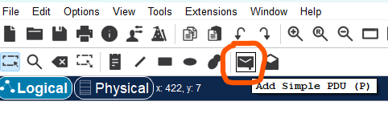{fig-alt="Capture d'écran de Packet Tracer : barre d'outils dont l'icône d'enveloppe fermée est entourée d'orange, avec l'info-bulle « Add Simple PDU (P) »."}

Vous obtenez le message suivant en fenêtre.

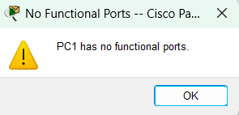{fig-alt="Capture d'écran d'une fenêtre « No Functional Ports -- Cisco Packet Tracer » indiquant « PC1 has no functional ports. » avec un bouton OK."}

### 3 — Adressage des hôtes sur le réseau

Lorsque vous envoyez un courrier à un destinataire, vous indiquez une adresse sur l'enveloppe. Cette adresse comprend la rue, le code postal et la ville. Lorsque La Poste achemine votre lettre, le code postal est utilisé pour savoir dans quel département elle doit être remise. Ensuite la ville est déterminée, et enfin la rue et le numéro de rue.

En matière de réseau, le fonctionnement est semblable. Un hôte du réseau qui souhaite envoyer des données à un autre hôte doit indiquer l'adresse de ce dernier sur le paquet qui est envoyé. Cette adresse s'appelle l'**adresse IP** (IP pour Internet Protocol).

Une adresse IP correspond à un et un seul hôte sur un réseau. Elle permet par conséquent d'identifier un hôte sur un réseau sans ambiguïté.

Vous allez définir des adresses IP pour chaque poste.

1. Cliquez sur l'icône « Select » (en haut à droite), puis sur l'hôte « PC0 » pour ouvrir sa fenêtre de configuration.

   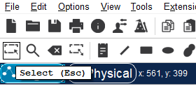{fig-alt="Capture d'écran de Packet Tracer : barre d'outils dont l'icône en forme de flèche pointillée porte l'info-bulle « Select (Esc) »."}

2. Choisissez l'onglet « Desktop », puis « IP Configuration ».
3. Tapez l'adresse 192.168.0.1.
4. Cliquez dans la zone du masque de sous-réseau. Celui-ci est défini automatiquement : c'est le masque par défaut de la classe C, 255.255.255.0.

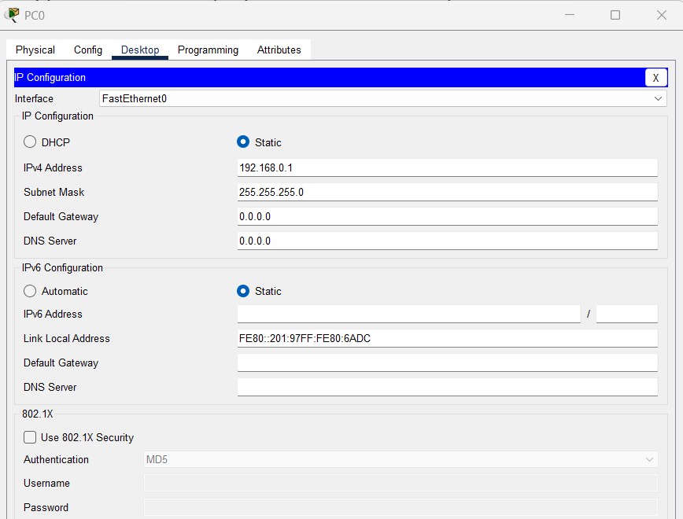{fig-alt="Capture d'écran de Packet Tracer : fenêtre de PC0, onglet Desktop, IP Configuration. L'option Static est cochée. IPv4 Address : 192.168.0.1. Subnet Mask : 255.255.255.0. Default Gateway : 0.0.0.0."}

5. Faites de même pour l'autre poste, avec l'adresse IP 192.168.0.2.
6. Recommencez l'envoi d'un PDU entre les 2 postes : cette fois, la transmission s'est normalement déroulée.
7. Pour voir les détails de la transmission des données, cliquez sur « Toggle PDU List Window ».

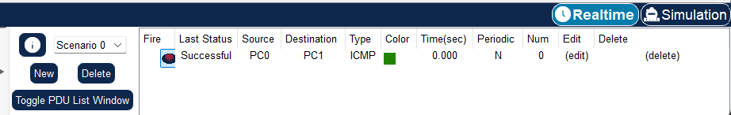{fig-alt="Capture d'écran de Packet Tracer : liste des PDU avec une ligne dont le statut est Successful, source PC0, destination PC1, type ICMP, couleur verte."}

Vous voyez que tout s'est bien déroulé, mais... en temps réel. C'est pourquoi vous n'avez rien vu : vous n'avez pas eu le temps de voir quelque chose.

Pour ralentir le temps et observer l'envoi et la réception des PDU étape par étape, passez en mode Simulation en cliquant sur l'icône en bas à droite de l'écran.

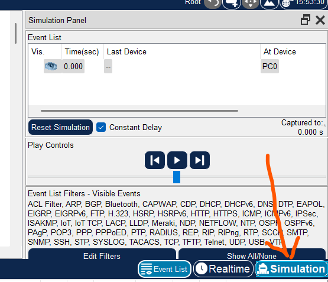{fig-alt="Capture d'écran de Packet Tracer : panneau de simulation avec la liste d'événements, les contrôles de lecture et la liste des filtres de protocoles. Une flèche orange désigne le bouton Simulation, en bas à droite."}

Ensuite, cliquez plusieurs fois sur le bouton d'avance et observez ce qui s'affiche dans la fenêtre de simulation. Ce bouton correspond à un mode « pas à pas » : il faut cliquer à chaque fois pour voir les échanges de données entre les postes.

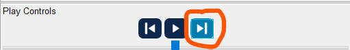{fig-alt="Capture d'écran des contrôles de lecture du panneau de simulation : le bouton d'avance pas à pas, à droite, est entouré d'orange."}

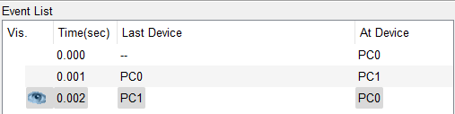{fig-alt="Capture d'écran de la liste d'événements en mode Simulation, avec trois lignes. À 0,000 s : appareil PC0. À 0,001 s : de PC0 vers PC1. À 0,002 s : de PC1 vers PC0."}

::: {.callout-note title="Question 1"}
Comment interprétez-vous ces informations ?
:::

::: {.callout-note title="Question 2"}
Cliquez sur l'enveloppe pour ouvrir le PDU. Dans quelle couche du modèle OSI retrouve-t-on les adresses IP des postes ?
:::

::: {.callout-warning title="Filtre ICMP"}
Cliquez sur « Edit Filters », puis cochez **uniquement** le protocole ICMP. Nous ferons cela pour chaque simulation tout au long de cette activité : nous ne visualiserons que l'échange des données au niveau du protocole ICMP. Pensez donc, à chaque nouvelle construction de réseau, à décocher l'ensemble des protocoles et à ne laisser que le protocole ICMP.
:::

#### Requête d'écho ICMP

Le `ping` (dont le nom s'inspire du son du sonar) est sans doute l'un des outils d'administration réseau les plus connus et les plus simples. Il permet, grâce à l'envoi de paquets ICMP (Internet Control Message Protocol), de vérifier si une machine distante répond et, par extension, si elle est bien accessible par le réseau.

Techniquement, `ping` envoie des paquets ICMP « Echo Request » vers la machine cible et attend des réponses ICMP « Echo Reply ». Cette communication permet de diagnostiquer la connectivité réseau et de mesurer le temps de réponse (la latence). Chaque paquet ICMP est transporté dans une trame sur le câble.

Sa mise en œuvre de base nécessite l'ouverture d'une fenêtre d'invite de commande sous Windows, ou d'un terminal sous Linux ou Unix, comme la plupart des outils de diagnostic réseau. La commande est : `ping [adresse IP]` ou `ping [nom d'hôte]`.

Le logiciel permet de simuler cette commande :

1. Cliquez sur le poste « PC0 », choisissez l'onglet « Desktop », puis « Command Prompt ».
2. Tapez la commande suivante (invite de commandes d'un PC Packet Tracer), puis validez par la touche « Entrée » pour envoyer un ping vers l'autre poste :

```text
ping 192.168.0.2
```

3. Réalisez la simulation en mode pas à pas.

::: {.callout-note title="Question 3"}
Combien d'échanges y a-t-il eu entre les postes ? Quel est le temps moyen d'échanges de données entre les postes ? En résumé, que permet de voir un « ping » ?
:::

::: {.callout-warning}
**ARRÊT : FAIRE VALIDER LE TRAVAIL PAR LE PROFESSEUR AVANT DE POURSUIVRE**
:::

### 4 — Matériel nécessaire pour un réseau P2P

Le réseau Peer-to-Peer est le type de réseau nécessitant le moins de matériel. Pour le mettre en place, il suffit d'utiliser :

- deux ordinateurs équipés chacun d'une carte réseau Ethernet ;
- un câble à paires torsadées croisées muni de connecteurs RJ45 pour relier les cartes réseau.

Pour travailler avec ce réseau dans le logiciel tout en préservant votre configuration, deux options s'offrent à vous :

1. Enregistrez votre réseau via le menu « File » (Fichier), puis « Save » (Enregistrer). Par défaut, le fichier est sauvegardé dans le dossier du logiciel : enregistrez-le dans votre dossier personnel, ainsi que sur votre clé USB.
2. Créez un nouveau scénario en cliquant sur « New » (Nouveau) en bas de l'interface. Une fois le nouveau scénario créé, vous pouvez supprimer tous les équipements du réseau actuel pour en concevoir un nouveau.

### 5 — Création d'un réseau avec concentrateur (hub)

Vous allez créer un réseau de cinq postes reliés par un concentrateur (hub).

::: {.callout-note title="Question 4"}
Construisez le réseau conformément au schéma ci-dessous.
:::

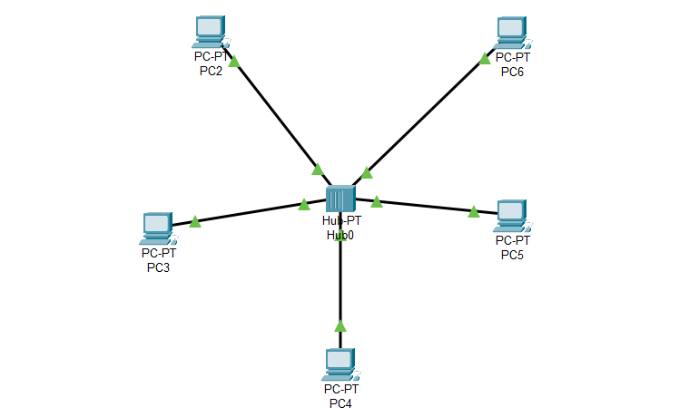{fig-alt="Schéma Packet Tracer : un concentrateur Hub-PT nommé Hub0 au centre. Cinq postes PC-PT sont reliés à lui par des traits pleins noirs : PC2 en haut à gauche, PC6 en haut à droite, PC3 à gauche, PC5 à droite et PC4 en bas. Tous les triangles sont verts."}

::: {.callout-note title="Question 5"}
Quel type de câble a été utilisé pour relier les postes au concentrateur ? D'après la topologie physique des réseaux, quel est le type de réseau que vous venez de construire ?
:::

::: {.callout-note title="Question 6"}
Configurez tous les postes en leur affectant une adresse IP statique de classe C et un masque de sous-réseau (par défaut). Les postes font partie d'un même réseau et peuvent donc communiquer ensemble.
:::

Pour vous aider, vous pouvez utiliser ces adresses, dans l'ordre des numéros de poste, avec le masque 255.255.255.0 :

| Poste | Adresse IP |
|---|---|
| PC2 | 192.168.0.3 |
| PC3 | 192.168.0.4 |
| PC4 | 192.168.0.5 |
| PC5 | 192.168.0.6 |
| PC6 | 192.168.0.7 |

: Adresses proposées pour le réseau à concentrateur {#tbl-adresses-hub}

Remarque : en plaçant le curseur sur un poste, vous visualiserez sa configuration.

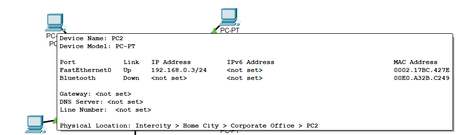{fig-alt="Capture d'écran de Packet Tracer : info-bulle du poste PC2, modèle PC-PT. Le port FastEthernet0 est Up, avec l'adresse IP 192.168.0.3/24 et l'adresse MAC 0002.17BC.427E. Le port Bluetooth est Down. Passerelle et serveur DNS non définis."}

::: {.callout-note title="Question 7"}
En mode « Simulation », envoyez un PDU de PC2 vers PC4. Observez ce qu'il se passe et visualisez le rôle du concentrateur. Envoyez un PDU de PC2 vers PC5. Observez ce qu'il se passe et visualisez le rôle du concentrateur. Quel est le rôle du concentrateur ? Comment travaille-t-il ?
:::

::: {.callout-note title="Question 8"}
En mode « Simulation », envoyez deux PDU simultanément : de PC2 vers PC4 et de PC4 vers PC2. Observez ce qu'il se passe. Que s'est-il passé ? Argumentez.
:::

En mode Simulation, vous pouvez avoir les informations d'un PDU (couche OSI et trame) en double-cliquant sur l'enveloppe.

::: {.callout-note title="Question 9"}
Modifiez votre réseau de façon à avoir le réseau ci-dessous, avec deux concentrateurs et deux autres postes configurés pour appartenir au même réseau (par exemple 192.168.0.8 pour PC7 et 192.168.0.9 pour PC8).
:::

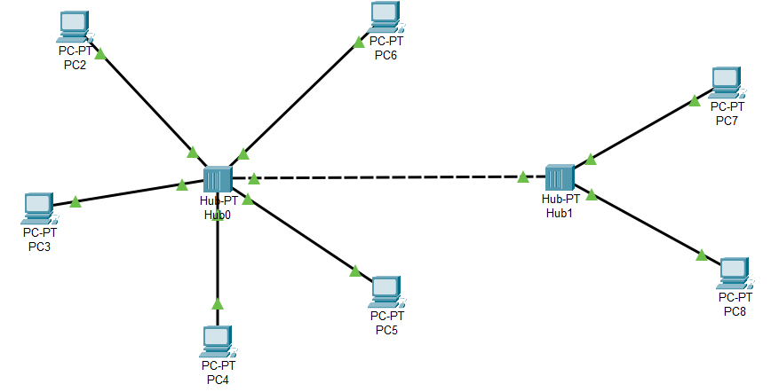{fig-alt="Schéma Packet Tracer : Hub0 relié aux postes PC2, PC3, PC4, PC5 et PC6 par des traits pleins noirs. Hub0 est relié à un second concentrateur, Hub1, par un trait pointillé noir. Hub1 est relié à PC7 et PC8 par des traits pleins. Tous les triangles sont verts."}

::: {.callout-note title="Question 10"}
Quel type de câble utilise-t-on pour relier deux concentrateurs ?
:::

::: {.callout-note title="Question 11"}
Envoyez un PDU de PC2 vers PC7. Observez ce qu'il se passe. Que pouvez-vous en conclure si le réseau compte un grand nombre d'hôtes reliés à des concentrateurs ?
:::

::: {.callout-warning}
**ARRÊT : FAIRE VALIDER LE TRAVAIL PAR LE PROFESSEUR AVANT DE POURSUIVRE**
:::

## Vérification et compte rendu

Votre travail est réussi si vous pouvez constater les points suivants :

- deux postes reliés par un câble croisé affichent des triangles verts ;
- `ping 192.168.0.2` lancé depuis PC0 reçoit des réponses ;
- les cinq postes reliés à Hub0 se joignent tous entre eux ;
- avec Hub1 et les postes PC7 et PC8, un PDU de PC2 atteint PC7.

Votre compte rendu contient :

- les réponses aux Questions 1 à 11 ;
- une capture des deux postes reliés par le câble croisé (section 1) ;
- une capture de la configuration IP de PC0 (section 3) ;
- une capture de l'Event List d'un `ping` en mode Simulation, filtre ICMP seul (section 3) ;
- une capture du réseau à un concentrateur (section 5) ;
- une capture du réseau à deux concentrateurs pendant l'envoi de PC2 vers PC7 (section 5).

Enregistrez votre maquette dans votre dossier personnel : les parties suivantes la prolongent.

## Synthèse

::: {.callout-important title="Synthèse à compléter"}
Recopiez et complétez ces phrases dans votre compte rendu.

1. Pour relier directement deux postes, on utilise un câble ………… .
2. Une adresse IP identifie un ………… sur un réseau. Le masque par défaut d'une adresse de classe C est ………… .
3. La commande `ping` envoie des paquets ICMP « ………… » et attend des paquets ICMP « ………… » .
4. Un concentrateur ………… sur tous ses autres ports ce qu'il reçoit sur l'un de ses ports.
5. Quand beaucoup de postes sont reliés à des concentrateurs, ………… .
:::

Notez enfin, en deux ou trois lignes, la difficulté principale rencontrée pendant ce TP et la manière dont vous l'avez résolue.

## Pour aller plus loin

Le `ping` repose sur le protocole ICMP, défini dans la RFC 792 (*Internet Control Message Protocol*, IETF, 1981). Les adresses de la plage 192.168.0.0/16, comme celles de ce TP, sont des adresses privées : elles sont réservées aux réseaux locaux par la RFC 1918 (*Address Allocation for Private Internets*, IETF, 1996).

Dans le simulateur, ajoutez un troisième poste à votre réseau P2P et essayez de le relier directement à PC0 et à PC1 : de quel matériel avez-vous besoin ? La partie 2 répond à cette question avec un commutateur.
