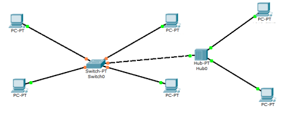
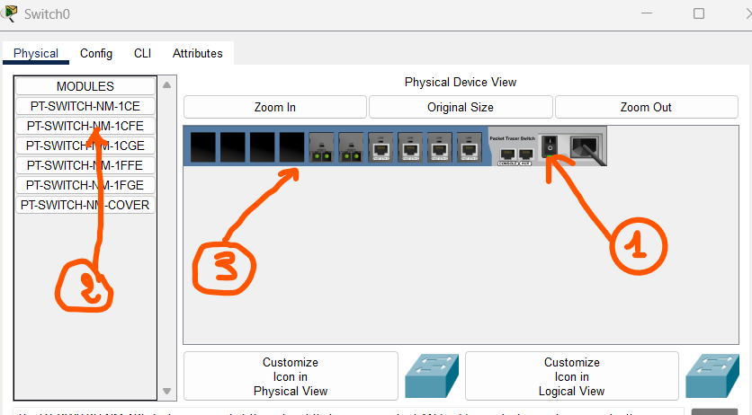
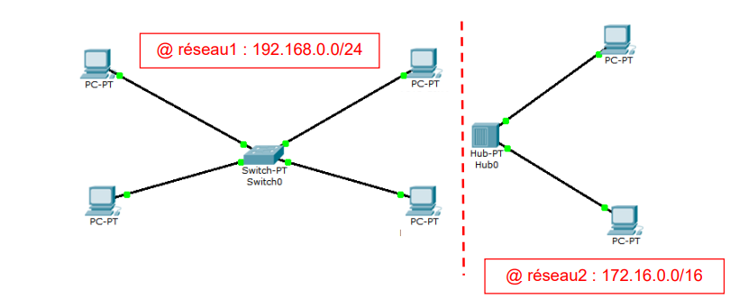

## Objectifs et prérequis

Dans la partie 1, vous avez relié des postes entre eux, puis à un concentrateur (hub). Vous avez vu qu'un concentrateur répète chaque message vers tous ses ports. Cette partie 2 va plus loin.

Vous allez :

- construire un réseau avec un **commutateur** (switch) et le comparer au concentrateur ;
- constater que deux postes d'adresses réseau différentes ne se parlent pas ;
- les faire communiquer grâce à un **routeur**.

Prérequis : avoir réalisé la [partie 1 de ce TP](../tp-creation-lan-1/index.qmd) et savoir configurer l'adresse IP d'un poste dans Packet Tracer.

## Situation de départ

Votre réseau de la partie 1 compte maintenant plusieurs postes. Un concentrateur fait vite perdre en efficacité : tous les postes reçoivent tous les messages. Vous testez un matériel plus intelligent, le commutateur.

Dans la réalité, il existe des millions de réseaux avec des adresses réseau différentes, et pourtant ils communiquent très bien entre eux. Cela est possible grâce au **routage** : un routeur choisit le chemin sur lequel les données vont transiter. Le routage est la détermination d'une route pour acheminer des données jusqu'au(x) destinataire(s). Vous allez le mettre en œuvre.

## Matériel et environnement

- Plateforme : **Cisco Packet Tracer**.
- Un nouveau fichier Packet Tracer (ou la suite de celui de la partie 1).
- Six postes (PC-PT), un commutateur « Generic Switch-PT », un concentrateur (Hub-PT) et un routeur « 1941 » ou « 2941 ».
- Câbles : choisissez le type adapté à chaque liaison (vous le justifierez dans les questions).

## Travail à réaliser

Dans ce TP, les postes sont nommés **PC0 à PC5** : PC0 à PC3 sont reliés au commutateur, PC4 et PC5 au concentrateur. Les schémas ci-dessous ne portent pas de noms : vous nommez vos postes ainsi. Packet Tracer peut numéroter vos postes autrement : relevez vos propres noms avant de répondre.

### 1. Création d'un réseau avec commutateur (switch)

Vous allez créer un réseau de quatre postes reliés par un commutateur.

::: {.callout-note title="Remarque"}
Pour le commutateur, prenez le « Generic Switch-PT ». Les points oranges signifient que le commutateur est en cours de configuration avec les postes. Attendez quelques secondes qu'ils soient tous verts (rappel : vous êtes en temps réel).
:::

::: {.callout-note title="Question 1"}
Quel type de câble est utilisé pour relier les postes au commutateur ?
:::

::: {.callout-note title="Question 2"}
Configurez tous les postes en leur affectant une adresse IP statique de classe C et un masque de sous-réseau (le masque par défaut de la classe C est 255.255.255.0). Les postes font partie d'un même réseau et peuvent donc communiquer ensemble.
:::

::: {.callout-note title="Question 3"}
Simulez l'envoi d'un PDU de PC0 vers PC3. Observez ce qu'il se passe. Simulez l'envoi d'un PDU de PC1 vers PC3. Observez ce qu'il se passe. Simulez l'envoi de deux PDU simultanés de PC1 vers PC3 et de PC3 vers PC1. Observez ce qu'il se passe.

Quel est le rôle du commutateur ? Comment travaille-t-il ? Quel est l'avantage du commutateur (switch) par rapport au concentrateur (hub) ?
:::

### 2. Ajout d'un concentrateur

::: {.callout-note title="Question 4"}
Modifiez votre réseau de façon à obtenir le réseau ci-dessous, avec l'ajout d'un concentrateur et de deux autres postes (PC4 et PC5) configurés pour appartenir au même réseau.
:::

{fig-alt="Capture d'écran de Packet Tracer : quatre PC-PT reliés au Switch0 par des traits pleins, un trait pointillé relie le Switch0 au Hub0, deux autres PC-PT sont reliés au Hub0. Les points sont orange côté commutateur (liens en cours de configuration) et verts côté concentrateur et postes."}

Vous constaterez que vous ne pouvez pas connecter le commutateur au concentrateur, car il manque un port FastEthernet au commutateur. Vous allez donc ajouter un port au commutateur :

1. Cliquez sur le commutateur pour ouvrir sa fenêtre de propriétés et choisissez l'onglet « Physical » (physique) pour visualiser sa face arrière. **(1)** Éteignez le commutateur en cliquant sur l'interrupteur I/O.
2. **(2)** Choisissez dans la liste de gauche un module de type « CFE ».
3. **(3)** Faites-le glisser vers un emplacement libre de la face arrière du commutateur.
4. Rallumez le commutateur, puis fermez la fenêtre. Attendez quelques secondes que tout se remette en fonctionnement (connexions vertes).

{fig-alt="Capture d'écran de la fenêtre Switch0, onglet Physical. La liste de modules à gauche (PT-SWITCH-NM-1CE, 1CFE, 1CGE, 1FFE, 1FGE, COVER) porte la flèche 2 sur le module CFE. La flèche 1 désigne l'interrupteur et la flèche 3 un emplacement libre de la face arrière."}

::: {.callout-note title="Question 5"}
Simulez l'envoi d'un PDU de PC0 vers PC4. Décrivez ce qu'il se passe.
:::

::: {.callout-note title="Question 6"}
Modifiez l'adresse IP de PC5 de telle sorte qu'il ne fasse plus partie du réseau, puis essayez d'émettre un PDU de PC1 vers PC5. Que se passe-t-il ?
:::

::: {.callout-warning}
**ARRÊT : FAIRE VALIDER LE TRAVAIL PAR LE PROFESSEUR AVANT DE POURSUIVRE**
:::

### 3. Mise en œuvre d'un routeur

Vous venez de constater que deux ordinateurs ne possédant pas la même adresse réseau ne peuvent pas communiquer entre eux. Un routeur résout ce problème.

::: {.callout-note title="Question 7"}
Modifiez les adresses IP du ou des postes du réseau précédent de façon à avoir deux réseaux, comme ci-dessous : PC0 à PC3 dans le réseau 1, PC4 et PC5 dans le réseau 2.
:::

{fig-alt="Schéma de Packet Tracer : à gauche, quatre PC-PT reliés au Switch0, avec l'étiquette « adresse réseau 1 : 192.168.0.0/24 ». À droite, séparés par un trait pointillé vertical, deux PC-PT reliés au Hub0, avec l'étiquette « adresse réseau 2 : 172.16.0.0/16 »."}

Supprimez d'abord le câble qui relie le commutateur au concentrateur : les deux réseaux ne doivent plus avoir aucun lien physique entre eux.

Ajoutez ensuite un routeur entre les deux réseaux (choisissez le routeur « 1941 » ou « 2941 »). Connectez le routeur aux deux réseaux différents, via le hub et via le switch.

::: {.callout-note title="Question 8"}
Quel type de câble est utilisé pour relier un hub ou un switch à un routeur ?
:::

Vous observez que les deux connexions sont de couleur rouge : la communication entre les deux réseaux ne fonctionne pas dans l'état actuel. En déplaçant le curseur sur le routeur, vous pouvez lire dans la fenêtre d'information « Link Down » (ou « Liaison Bas »). Les interfaces ne sont donc pas opérationnelles.

Il faut configurer le routeur en lui attribuant deux adresses IP appartenant respectivement aux deux réseaux à interconnecter. Pour cela :

1. Cliquez sur le routeur pour ouvrir la fenêtre de propriétés.
2. Sélectionnez l'onglet « Config ».
3. Dans le menu de gauche, cliquez sur « INTERFACE > GigabitEthernet0/0 ».
4. Saisissez une adresse IP disponible et le masque de sous-réseau correspondant au premier réseau.
5. Cochez la case pour activer le port (Port Status : On).
6. Répétez la même procédure pour l'interface « GigabitEthernet0/1 », avec une adresse IP et le masque appropriés pour le second réseau.

Cette configuration permet au routeur de faire le lien entre les deux réseaux. Les connexions passent du rouge au vert.

::: {.callout-note title="Question 9"}
Simulez l'envoi d'un PDU entre PC0 et PC4. L'essai est-il concluant ?
:::

Cela ne fonctionne toujours pas. PC4 n'est pas joignable, car PC0 n'appartient pas au même réseau. Il faut indiquer à PC0 qu'il peut le joindre en passant par le routeur.

Lorsqu'un poste envoie des données à un hôte qui n'est pas sur son réseau, il doit les envoyer à un routeur. C'est seulement ensuite que le routeur se charge d'acheminer (router) les données sur l'autre réseau. Cliquez sur PC0, onglet « Desktop », puis « IP Configuration ». Entrez dans « Default Gateway » (ou « Passerelle ») l'adresse IP de l'interface du routeur située sur le réseau de PC0.

::: {.callout-note title="Question 10"}
Simulez à nouveau l'envoi d'un PDU entre PC0 et PC4. L'essai est-il concluant ? Observez où le PDU est transmis, puis où il s'arrête. Pourquoi PC4 ne peut-il pas répondre à PC0 ?
:::

::: {.callout-note title="Question 11"}
Indiquez la passerelle pour PC4. Simulez à nouveau l'envoi d'un PDU entre PC0 et PC4. L'essai est-il concluant ? Décrivez le trajet de l'aller et celui du retour.
:::

::: {.callout-note title="Question 12"}
Modifiez la configuration des autres hôtes de manière à ce que tous les postes puissent communiquer entre eux. Vérifiez le fonctionnement.
:::

## Vérification et compte rendu

Avant de demander la validation, vérifiez que :

- les liens du commutateur, du concentrateur et du routeur affichent tous un point vert ;
- un PDU envoyé de n'importe quel poste vers n'importe quel autre poste est acquitté (marque verte dans la liste des événements) ;
- chaque poste a une adresse IP, un masque et une passerelle cohérents avec son réseau.

Livrables : vos réponses aux questions 1 à 13 et votre fichier Packet Tracer enregistré.

## Synthèse

::: {.callout-note title="Question 13"}
Conclusions sur les observations effectuées. Expliquez comment un hôte sur un réseau peut communiquer avec un hôte d'un réseau différent. Que doit-on faire pour configurer un routeur ? Qu'est-ce qu'une « passerelle » ?
:::

::: {.callout-warning}
**ARRÊT : FAIRE VALIDER LE TRAVAIL PAR LE PROFESSEUR AVANT DE POURSUIVRE**
:::

La suite se trouve dans la [partie 3 : réseau sans fil et cahier des charges](../tp-creation-lan-3/index.qmd).

## Pour aller plus loin

- Documentation de Cisco Packet Tracer (Cisco Networking Academy) : <https://www.netacad.com/cisco-packet-tracer>
- RFC 1812, *Requirements for IP Version 4 Routers* : <https://www.rfc-editor.org/rfc/rfc1812>
