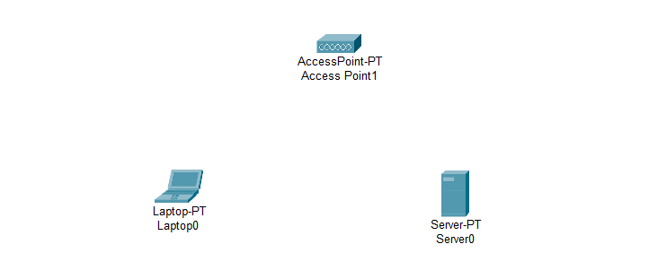
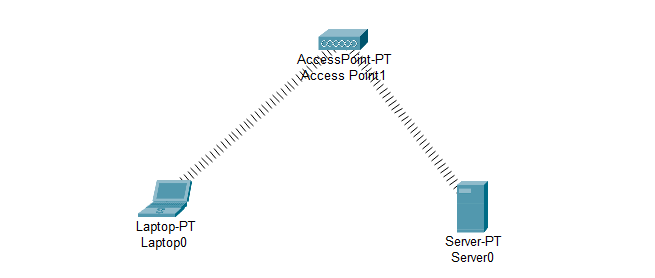
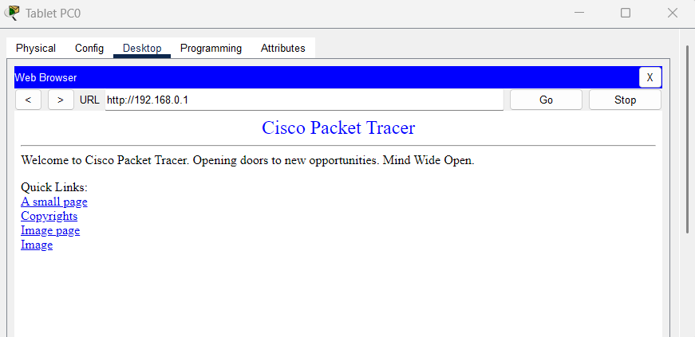
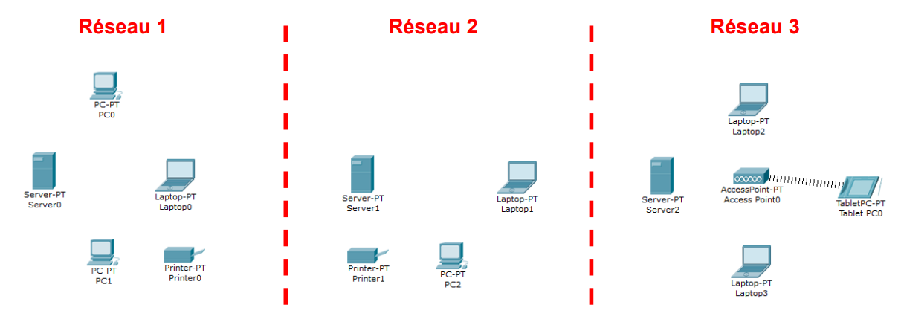

*Plateforme : Cisco Packet Tracer.*

## Objectifs et prérequis

Votre téléphone se connecte à la box sans aucun câble. Dans ce TP, vous reproduisez cette situation dans Packet Tracer. Vous terminez ensuite le TP2 par un projet : trois réseaux à construire et à relier.

Dans cette dernière partie du TP2, vous allez :

- simuler un réseau sans fil (Wi-Fi) ;
- comprendre pourquoi un appareil reçoit parfois une adresse inattendue ;
- créer des réseaux qui répondent à un cahier des charges ;
- configurer des réseaux différents pour qu'ils communiquent entre eux ;
- calculer l'adresse réseau et l'adresse de diffusion d'un réseau.

Vous avez réalisé les parties 1 et 2 du TP2 : vous savez créer un réseau, adresser des postes, utiliser un commutateur et un routeur. Reprenez au besoin la [partie 2](../tp-creation-lan-2/index.qmd) et le [TP1 — Réseau domestique](../tp-reseau-domestique/index.qmd).

::: {.callout-tip title="Support d'activité"}
- Cisco Packet Tracer, suite bureautique
- Internet
:::

Vous rédigerez un compte rendu numérique. Pensez aux captures d'écran pour illustrer votre compte rendu. Sauvegardez votre travail régulièrement ! Des différences peuvent exister selon la version du logiciel utilisée.

## Situation de départ

Vous avez relié des postes avec des câbles, des concentrateurs, un commutateur et un routeur. Il reste deux défis. Le premier est de se passer de câbles : c'est le rôle du point d'accès Wi-Fi. Le second est de concevoir vous-même des réseaux à partir d'un cahier des charges, sans schéma de câblage fourni.

Résultat attendu en fin de séance :

- un réseau Wi-Fi sécurisé où un serveur, un ordinateur portable, une tablette et un smartphone communiquent ;
- trois réseaux construits selon leur cahier des charges, puis reliés par un seul routeur ;
- les adresses réseau et de diffusion du réseau 1, calculées.

## Matériel et environnement

- Cisco Packet Tracer, sur votre poste.
- Un nouveau fichier pour la partie A, puis un autre pour la partie B. Enregistrez-les sous des noms distincts.

| Partie | Contenu | Durée indicative |
|---|---|---|
| A | Créer un réseau sans fil (Wi-Fi) | 1 h |
| B | Créer trois réseaux et les relier | 1 h |

: Déroulement de la séance {#tbl-deroulement}

## Travail à réaliser

### Partie A — Création d'un réseau sans fil (Wi-Fi) (1 h)

::: {.callout-note title="Question 1"}
Créez un nouveau fichier, construisez le réseau conformément au schéma ci-dessous.
:::

{fig-alt="Capture d'écran de Packet Tracer : un point d'accès nommé Access Point1, de modèle AccessPoint-PT, est placé en haut. En bas, un ordinateur portable Laptop0 est à gauche et un serveur Server0 est à droite. Aucun lien ne relie encore les trois appareils."}

#### Installer les modules Wi-Fi

Un ordinateur ou un serveur de Packet Tracer est livré avec une carte réseau filaire. Pour qu'il se connecte au point d'accès, il faut la remplacer par un module sans fil.

**Pour le serveur** : cliquez sur le serveur pour ouvrir sa fenêtre de propriétés, onglet « Physical ». Sur la face arrière visible, éteignez le serveur. Remplacez le connecteur FastEthernet (PT-HOST-MM-1CFE) par un connecteur wireless (PT-HOST-NM-1W). Rallumez le serveur.

**Pour l'ordinateur portable** : cliquez sur le laptop pour ouvrir sa fenêtre de propriétés, onglet « Physical ». Éteignez l'ordinateur portable et ajoutez un module Wi-Fi tel que le WPC300N ou PT-LAPTOP-NM-1W dans un slot libre. Rallumez l'ordinateur portable.

::: {.callout-important title="Choisir le bon module"}
Assurez-vous d'utiliser les modules appropriés selon le type d'appareil :

- WPC300N ou PT-LAPTOP-NM-1W pour les ordinateurs portables ;
- PT-HOST-NM-1W pour les serveurs et les PC de bureau.
:::

Une fois les modules Wi-Fi installés sur tous les appareils, ils pourront détecter et se connecter au réseau sans fil du point d'accès.

#### Adresser les appareils

Vous allez maintenant donner au serveur une adresse IP statique et un masque de sous-réseau :

- adresse IP du serveur : 192.168.0.1 ;
- masque : 255.255.255.0.

Configurez de la même façon l'ordinateur portable, en remplaçant son connecteur. Laissez son adresse IP en dynamique (DHCP).

::: {.callout-note title="Question 2"}
Avez-vous remarqué un message lors de la configuration DHCP de l'ordinateur portable ? Comment l'interprétez-vous ?
:::

::: {.callout-tip collapse="true" title="Explication du message « DHCP failed. APIPA is being used » (à lire après avoir répondu)"}
Ce message indique que le laptop a tenté d'obtenir une adresse IP automatiquement auprès d'un serveur DHCP, sans succès. Le système a alors basculé sur l'**APIPA** (*Automatic Private IP Addressing*). Ce mécanisme attribue une adresse temporaire dans la plage 169.254.0.0/16, avec le masque 255.255.0.0, quand aucun serveur DHCP n'est joignable.

Cela se produit souvent dans les cas suivants :

- le point d'accès (AccessPoint-PT) ne joue pas le rôle de serveur DHCP ;
- il n'y a pas de serveur DHCP dans le réseau ;
- la connexion entre le laptop et le point d'accès est mal configurée.
:::

#### Configurer le point d'accès

Le point d'accès est l'élément qui diffuse le réseau Wi-Fi. Vous lui donnez un nom et un mot de passe.

1. Cliquez sur le point d'accès (Access Point1), puis ouvrez l'onglet « Config », section « Wireless ».
2. Paramétrez le réseau Wi-Fi :
   - SSID : donnez un nom à votre réseau sans fil (par exemple : MonRéseau) ;
   - Authentication : sélectionnez WPA2-PSK ;
   - PSK Pass Phrase : saisissez une clé de sécurité (mot de passe) si vous utilisez WPA2-PSK ;
   - Port Status : vérifiez que l'interface sans fil est activée (On).

#### Connecter le laptop au Wi-Fi

1. Cliquez sur le laptop, onglet « Desktop », puis « PC Wireless » et « Connect ».
2. Sélectionnez votre réseau (par exemple : MonRéseau) dès qu'il apparaît.
3. Cliquez sur « Connect ».
4. Si le mot de passe est demandé, saisissez-le (WPA2-PSK).
5. Vérifiez que le statut passe à « Connected » et qu'une adresse IP est attribuée.

Faites la même chose pour connecter le serveur au réseau Wi-Fi.

Vous devez constater à présent que le serveur et l'ordinateur portable sont bien connectés au point d'accès Wi-Fi.

{fig-alt="Capture d'écran de Packet Tracer : Access Point1 est en haut, Laptop0 en bas à gauche et Server0 en bas à droite. Une ligne en pointillé épais, qui représente une liaison sans fil, relie chacun des deux appareils au point d'accès."}

Ajoutez deux autres périphériques sans fil : une tablette et un smartphone, par exemple.

::: {.callout-note title="Question 3"}
Quelles remarques pouvez-vous faire au sujet de l'adresse IP des terminaux ajoutés et de celle de l'ordinateur portable ? À quoi cela est-il dû ?
:::

Passez en mode Simulation et simulez l'envoi de PDU entre ces différents périphériques.

::: {.callout-note title="Question 4"}
Tous ces appareils communiquent-ils entre eux ?
:::

#### Consulter la page web du serveur

1. Cliquez sur la tablette, puis ouvrez l'onglet « Desktop ».
2. Ouvrez le navigateur (« Web Browser »).
3. Dans la zone URL, saisissez l'adresse IP du serveur : `http://192.168.0.1`, puis cliquez sur « Go ».

La page web du serveur s'ouvre.

{fig-alt="Capture d'écran de la fenêtre Tablet PC0 de Packet Tracer, onglet Desktop, navigateur Web Browser. Le champ URL contient http://192.168.0.1. La page affiche le titre Cisco Packet Tracer, la phrase Welcome to Cisco Packet Tracer. Opening doors to new opportunities. Mind Wide Open., puis quatre liens : A small page, Copyrights, Image page et Image."}

### Partie B — Projet : trois réseaux et leurs cahiers des charges (1 h)

Vous n'avez plus de schéma de câblage à suivre. Pour chaque réseau, un cahier des charges fixe les contraintes, et vous choisissez le matériel et la configuration. La figure @fig-trois-reseaux montre les appareils de chaque réseau.

{#fig-trois-reseaux fig-alt="Capture d'écran de Packet Tracer, trois zones séparées par des traits verticaux rouges en pointillé. Réseau 1 : les postes PC0 et PC1, le serveur Server0, l'ordinateur portable Laptop0 et l'imprimante Printer0. Réseau 2 : le serveur Server1, l'ordinateur portable Laptop1, l'imprimante Printer1 et le poste PC2. Réseau 3 : le serveur Server2, les ordinateurs portables Laptop2 et Laptop3, un point d'accès Access Point0 et la tablette Tablet PC0, déjà reliée au point d'accès par une liaison sans fil."}

::: {.callout-note title="Question 5"}
Construisez puis configurez les hôtes du réseau 1 de manière à ce que la communication soit rendue possible entre les hôtes, tout en respectant le cahier des charges ci-dessous.

**Cahier des charges 1** : le réseau 1 est un réseau filaire avec un adressage statique, avec le masque par défaut de la classe C (255.255.255.0). L'ajout de concentrateur(s), de commutateur(s), de routeur(s) et de ports est possible.

Pour les questions 9 et 10, adoptez ce plan d'adressage : le réseau 1 est 192.168.1.0/24, le poste PC0 a l'adresse 192.168.1.10 et sa passerelle par défaut est 192.168.1.254.
:::

::: {.callout-note title="Question 6"}
Construisez puis configurez les hôtes du réseau 2 de manière à ce que la communication soit rendue possible entre les hôtes, tout en respectant le cahier des charges ci-dessous.

**Cahier des charges 2** : le réseau 2 est un réseau filaire avec un adressage statique, avec le masque par défaut de la classe B (255.255.0.0). L'ajout de concentrateur(s), de commutateur(s), de routeur(s) et de ports est possible.
:::

::: {.callout-note title="Question 7"}
Construisez et configurez les hôtes du réseau 3 de manière à ce que la communication soit rendue possible entre les hôtes, tout en respectant le cahier des charges ci-dessous.

**Cahier des charges 3** : le réseau 3 est un réseau « wireless » avec un adressage dynamique, avec le masque par défaut de la classe C (255.255.255.0). L'ajout de concentrateur(s), de commutateur(s), de routeur(s) et de ports est possible.
:::

::: {.callout-warning title="Attention"}
Pour créer un réseau efficace et qui fonctionne bien, il est recommandé de supprimer le point d'accès de base (AccessPoint-PT) et de le remplacer par le point d'accès WRT300N.

Vous devez, pour la création du réseau global, utiliser un seul routeur.
:::

::: {.callout-note title="Question 8"}
Il vous faut maintenant rendre la communication possible entre les 3 réseaux, tout en respectant le cahier des charges ci-après.

**Cahier des charges final** : les réseaux 1, 2 et 3 doivent pouvoir communiquer ensemble. Toutes les solutions matérielles et logicielles sont possibles.
:::

::: {.callout-note title="Question 9"}
Calculez l'adresse réseau et l'adresse de diffusion (« broadcast ») du réseau 1, avec le plan d'adressage imposé à la question 5.
:::

::: {.callout-note title="Question 10"}
La passerelle par défaut du poste PC0 (192.168.1.254) fait-elle partie du réseau 1 ? Justifiez votre réponse.
:::

## Vérification et compte rendu

Votre travail est réussi si vous pouvez constater les points suivants :

- le serveur, l'ordinateur portable, la tablette et le smartphone sont connectés au point d'accès, et la page `http://192.168.0.1` s'affiche sur la tablette ;
- chacun des trois réseaux respecte son cahier des charges (type de liaison, adressage statique ou dynamique, masque de la classe demandée) ;
- les hôtes de chaque réseau communiquent entre eux ;
- les hôtes des trois réseaux communiquent entre eux, avec un seul routeur ;
- les fichiers des parties A et B sont enregistrés.

Votre compte rendu contient :

- les réponses aux Questions 1 à 10 ;
- une capture du réseau Wi-Fi de la partie A, avec les quatre appareils connectés ;
- une capture de la configuration du point d'accès (SSID et WPA2-PSK) ;
- une capture de la page web affichée sur la tablette ;
- une capture du réseau global de la partie B, avec les adresses IP configurées ;
- une capture d'un test de communication entre deux hôtes de réseaux différents.

## Synthèse

::: {.callout-important title="Synthèse à compléter"}
Recopiez et complétez ces phrases dans votre compte rendu.

1. Un appareil sans fil doit être équipé d'un module ………… pour se connecter à un point d'accès.
2. Pour se connecter au réseau Wi-Fi, un appareil doit connaître le ………… du réseau et, avec WPA2-PSK, la ………… .
3. Quand un appareil en DHCP ne trouve aucun serveur DHCP, il utilise une adresse de la plage ………… (mécanisme appelé ………… ).
4. Dans un réseau d'adresse 192.168.1.0/24, l'adresse réseau est ………… et l'adresse de diffusion est ………… .
5. Pour que des réseaux différents communiquent, il faut les relier avec un ………… ; chaque hôte désigne alors son ………… comme passerelle par défaut.
:::

Notez enfin, en deux ou trois lignes, la difficulté principale rencontrée pendant ce TP et la manière dont vous l'avez résolue.

## Pour aller plus loin

Votre réseau 3 est à adressage dynamique : une machine doit donc distribuer les adresses. Dans la maquette du TP DHCP du chapitre 06, un serveur DHCP joue ce rôle. Cherchez comment obtenir le même résultat dans votre réseau 3, puis comparez vos solutions avec celles de vos camarades.

Sources :

- RFC 3927, *Dynamic Configuration of IPv4 Link-Local Addresses*, IETF, 2005 (plage 169.254.0.0/16, adressage automatique sans serveur) : <https://www.rfc-editor.org/rfc/rfc3927>
- RFC 2131, *Dynamic Host Configuration Protocol*, IETF, 1997 : <https://www.rfc-editor.org/rfc/rfc2131>
- Cisco, *Packet Tracer*, documentation et ressources : <https://www.netacad.com/cisco-packet-tracer>
