*Plateforme : Cisco Packet Tracer.*

## Configuration d'un routeur et d'un client sans fil

### Objectifs

**Partie 1 : Connecter les appareils**

**Partie 2 : Configurer le routeur sans fil**

**Partie 3 : Configurer l'adressage IP et tester la connectivité**

### Contexte / Scénario

Ton amie **Natsumi** t'a demandé de l'aider à connecter sa nouvelle maison à Internet via le réseau de télévision par câble.

Tu dois :

- connecter les câbles aux bons appareils,
- relier et configurer un **routeur sans fil domestique**,
- activer le **DHCP** pour attribuer des adresses IP,
- et mettre en place un **réseau sans fil local**.

Avec ton savoir-faire, tu es certain que tout sera prêt en un rien de temps !

Veuillez télécharger le fichier de travail suivant, puis l'ouvrir avec Packet Tracer : [fichier Packet Tracer du TP1 (Google Drive)](https://drive.google.com/file/d/15U_LBl-CLj4D-yImKI1_qSh0kh0QSkO5/view?usp=sharing)

## I. Connectez les périphériques

La zone de travail affiche l'intérieur de la maison de votre ami. Faites défiler la fenêtre pour vous familiariser avec l'agencement des pièces et l'emplacement des différents périphériques.

Dans cette étape, vous allez connecter tous les périphériques identifiés par une étiquette.

### 1. Connectez les câbles coaxiaux.

La compagnie de câble de Natsumi fournit à son domicile des services **Internet** et **TV** via un **câble coaxial** relié à une prise murale.

Un **séparateur (splitter)** permet de diviser ce signal en deux :

- une sortie pour le service **Internet**, à connecter au **modem câble**,
- une autre pour le service **vidéo**, à brancher au **téléviseur**.

Vous devez connecter chaque service au périphérique correspondant.

1. Dans Composants réseau, cliquez sur **Connections** (Connexions) (l'éclair).
2. Localisez et cliquez sur l'icône du câble **Coaxial**. Il s'agit de l'icône bleue en zigzag.

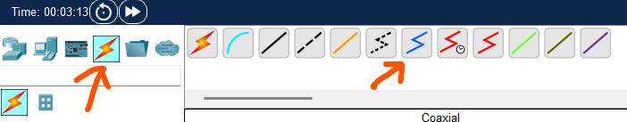{fig-alt="Capture d'écran de Packet Tracer : la palette des connexions avec l'icône du câble coaxial."}

1. Cliquez sur le **Cable Splitter** (séparateur de câble) et sélectionnez le port **Coaxial1**.
2. Cliquez sur le **Cable Modem** (modem câble) et sélectionnez le **port 0**.
3. Répétez les étapes précédentes pour connecter le câble **Coaxial2** (coaxial 2) du **Cable Splitter** (répartiteur de câble) au **port 0** du **TV** (téléviseur).
4. Cliquez sur le **TV** (téléviseur), puis sur **ON** pour **Status** (l'état). Si vos connexions sont correctes, une image représentant un programme télévisé doit apparaître.

::: {.callout-note title="Questions 1 et 2"}
**📝 QUESTION 1 :** Quel est le rôle du séparateur (splitter) dans cette installation ? Pourquoi est-il nécessaire ?

**📝 QUESTION 2 :** Si l'image TV n'apparaît pas après avoir allumé le téléviseur, quelles pourraient être les causes possibles ?
:::

### 2. Connectez les câbles réseau.

Dans la maison de Natsumi, il y a deux ordinateurs. Comme ils ne possèdent pas d'adaptateurs LAN sans fil, ils doivent être connectés à l'aide de câbles Ethernet. Le centre du réseau domestique est un routeur sans fil, qui permet aux différents appareils du réseau de communiquer entre eux et d'accéder à Internet. Ce routeur intègre un commutateur capable d'accueillir jusqu'à quatre connexions filaires.

Vous allez donc connecter les deux PC à ce routeur via ses ports Ethernet.

Pour que le **routeur sans fil domestique** puisse se connecter à Internet via le réseau du fournisseur de télévision par câble, il faut relier le **modem câble** au **port Internet** du routeur. Pour cela, utilisez un **câble droit en cuivre**.

Voici les étapes à suivre :

1. Cliquez sur **Connections** (Connexions), puis sélectionnez **Copper Straight-Through** (Câble droit en cuivre), représenté par une ligne noire continue.
2. Reliez le **port 1** du **modem câble** au **port Internet** du **routeur sans fil domestique**.
3. Cliquez sur le **PC du bureau (Office PC)** et connectez un câble au port **FastEthernet0**. Puis, cliquez sur le **routeur sans fil domestique** et branchez l'autre extrémité au **port GigabitEthernet 1**.
4. Répétez la même opération pour connecter le **PC de la chambre (Bedroom PC)** au **port GigabitEthernet 2** du routeur.

Votre réseau domestique filaire est maintenant entièrement connecté à Internet via le fournisseur de télévision par câble.

::: {.callout-note title="Questions 3 et 4"}
**📝 QUESTION 3 :** Pourquoi utilise-t-on un câble "droit" (straight-through) pour connecter le modem au routeur ? Quel type de câble faudrait-il utiliser pour connecter deux PC directement entre eux ? —> Demander de l'aide au prof

**📝 QUESTION 4 :** Le routeur intègre un commutateur (switch) à 4 ports. Combien d'appareils filaires peut-on connecter au maximum sur ce routeur ? Justifiez.
:::

## II. Configurer le routeur sans fil

La plupart des routeurs sans fil domestiques se configurent à l'aide d'une interface graphique (GUI) accessible depuis un navigateur web.

Dans cette partie, vous allez utiliser le navigateur du **PC de bureau (Office PC)** pour accéder à l'interface du **routeur sans fil domestique**, puis configurer le réseau domestique de Natsumi.

### 1. Accédez à l'interface graphique du routeur sans fil domestique.

1. Cliquez sur **Office PC** (PC de Bureau) > **Desktop** (Bureau), puis sur **Configuration IP**.
2. Cliquez sur le bouton **DHCP**. Cela permettra d'attribuer automatiquement une adresse IP au **PC de bureau**, afin qu'il se trouve sur le même réseau que le **routeur sans fil domestique (Home Wireless Router)**.
3. Après quelques instants, les valeurs de la configuration IP devraient se mettre à jour automatiquement. L'adresse IPv4 attribuée doit commencer par **192**. Si ce n'est pas le cas, cliquez sur **Fast Forward Time** (Avance rapide), situé juste en dessous de la topologie réseau, dans le coin inférieur gauche de l'écran. Cette action permet d'accélérer la simulation du protocole DHCP.

1. Notez l'adresse de la **passerelle par défaut**.

   La passerelle par défaut est l'équipement du réseau qui permet aux appareils de communiquer avec des réseaux externes, comme Internet.

   Dans ce cas, il s'agit de l'adresse IP du **routeur sans fil domestique (Home Wireless Router)**.

2. En laissant la fenêtre du **PC de bureau (Office PC)** ouverte, fermez simplement la fenêtre **IP Configuration** (Configuration IP), puis cliquez sur **Web Browser** (Navigateur Web). Dans le champ **URL**, saisissez l'adresse IP du **routeur sans fil domestique (Home Wireless Router)** — c'est-à-dire l'adresse de la **passerelle par défaut** — puis cliquez sur **Go** pour accéder à son interface de configuration.

3. Les routeurs domestiques nouvellement installés utilisent généralement des **identifiants par défaut**. Saisissez **admin** dans les champs **User Name** (Nom d'utilisateur) et **Password** (Mot de passe). L'**interface graphique** du **routeur sans fil domestique (Home Wireless Router)** devrait alors s'afficher, vous permettant de commencer la configuration du réseau de Natsumi. Si besoin, **ajustez la taille de la fenêtre** pour une meilleure visibilité de l'interface.

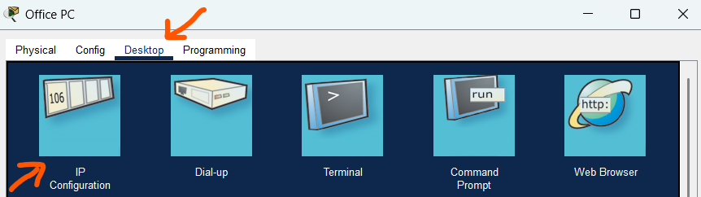{fig-alt="Capture d'écran de Packet Tracer : onglet Desktop de l'Office PC, avec l'icône IP Configuration signalée par une flèche."}

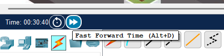{fig-alt="Capture d'écran de Packet Tracer : barre inférieure avec l'horloge et le bouton Fast Forward Time (Alt+D)."}

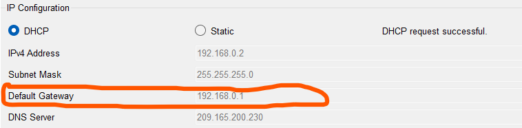{fig-alt="Capture d'écran de Packet Tracer : fenêtre IP Configuration de l'Office PC, mode DHCP sélectionné, requête réussie : adresse 192.168.0.2, masque 255.255.255.0, passerelle par défaut 192.168.0.1 entourée."}

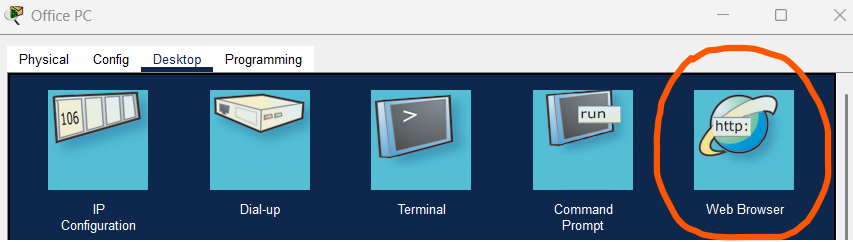{fig-alt="Capture d'écran de Packet Tracer : onglet Desktop de l'Office PC, icône Web Browser entourée."}

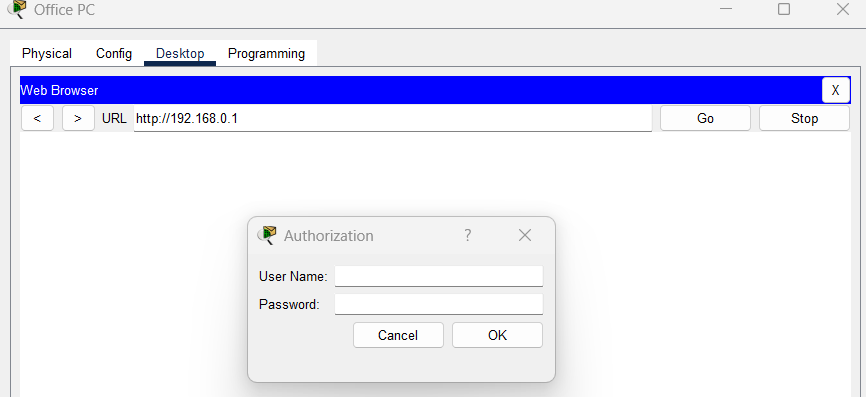{fig-alt="Capture d'écran de Packet Tracer : navigateur web de l'Office PC à l'adresse http://192.168.0.1, avec une fenêtre Authorization demandant un nom d'utilisateur et un mot de passe."}

::: {.callout-note title="Questions 5 à 7"}
**📝 QUESTION 5 :** Qu'est-ce que le DHCP ? Expliquez son rôle avec vos propres mots.

**📝 QUESTION 6 :** Quelle est la différence entre l'adresse IP de votre PC et l'adresse de la passerelle par défaut ? Laquelle correspond au routeur ?

**📝 QUESTION 7 :** Pourquoi faut-il changer immédiatement les identifiants par défaut (admin/admin) sur un routeur réel ?
:::

**Remarque** : Les mots de passe par défaut sur les appareils du monde réel doivent être modifiés immédiatement car ils sont largement connus, y compris des acteurs de la menace.

### 2. Configurez les paramètres de base

Dans cette étape, vous allez configurer un nouveau nom d'utilisateur et un nouveau mot de passe pour le routeur sans fil et limiter le nombre d'adresses IP que DHCP délivrera aux hôtes connectés au réseau.

Natsumi n'a que quelques appareils pour connecter le réseau, et elle n'aura pas beaucoup d'amis en visite. Elle pense que pas plus de 10 appareils se connecteront à son réseau à un moment donné. Vous décidez de réduire le nombre d'utilisateurs à 10. Votre amie vit dans un quartier très peuplé de la ville, il est donc possible que de nombreuses personnes puissent voir son réseau sans fil.

1. Les options de configuration sont actuellement affichées sous l'onglet **Configuration**. Localisez la zone de **Network Setup** (configuration du réseau). C'est ici que vous pouvez configurer les paramètres du serveur DHCP du routeur. Dans le champ **Maximum Number of Users** (Nombre maximum d'utilisateurs), saisissez **10**. Faites défiler la page jusqu'en bas, puis cliquez sur **Save Settings** (Enregistrer les paramètres). Vous devez enregistrer les paramètres sur chaque page de l'interface graphique que vous modifiez.

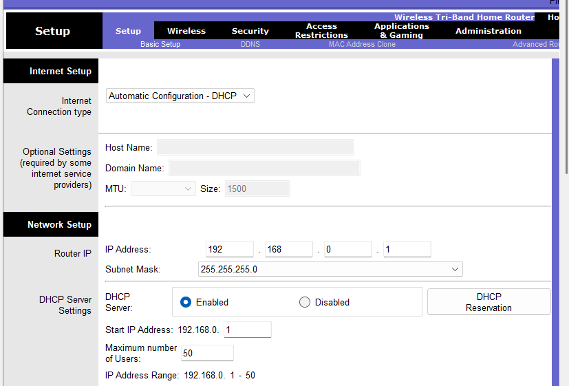{fig-alt="Capture d'écran de Packet Tracer : page Setup du routeur domestique : connexion Internet en DHCP automatique, adresse du routeur 192.168.0.1, masque 255.255.255.0, serveur DHCP activé, 50 utilisateurs maximum."}

**Remarque** : Il est possible que vous perdiez votre connexion au routeur. Cliquez sur **Go** dans le navigateur web pour recharger la page de l'interface utilisateur. Il se peut que vous deviez fermer le **Web Browser** (navigateur Web), cliquer sur **Configuration IP**, et basculer entre **DHCP** et **Static** (Statique) pour rafraîchir l'adressage IP de le **Office PC** (PC de bureau). Vérifiez ensuite que le **Office PC** (PC du bureau) a une configuration d'adresse IP qui commence par 192, ouvrez à nouveau le **Web Browser** (navigateur Web), entrez l'adresse IP du routeur et authentifiez-vous à nouveau avec **admin** comme informations d'identification par défaut.

1. Cliquez sur l'onglet **Administration**. Ici, vous pouvez changer le mot de passe **admin** par défaut. Saisissez et confirmez **MyPassword1!** comme nouveau mot de passe. Faites défiler la page jusqu'en bas, puis cliquez sur **Save Settings** (Enregistrer les paramètres).

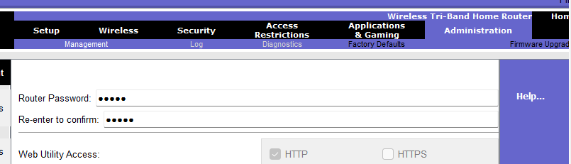{fig-alt="Capture d'écran de Packet Tracer : onglet Administration de l'interface du routeur, avec les champs du nouveau mot de passe."}

Vous serez invité à vous connecter à nouveau. Saisissez **admin** comme nom d'utilisateur et **MyPassword1!** comme nouveau mot de passe, puis cliquez sur **Continue**. Si tout se passe bien la page ci-contre apparait.

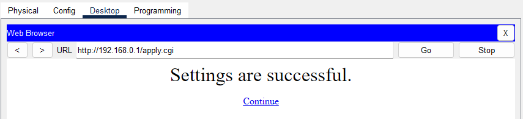{fig-alt="Capture d'écran de Packet Tracer : page de l'interface du routeur affichée après la connexion avec le nouveau mot de passe."}

::: {.callout-note title="Questions 8 et 9"}
**📝 QUESTION 8 :** Pourquoi limitons-nous le nombre d'utilisateurs DHCP à 10 ? Quels sont les avantages et inconvénients de cette limitation ?

**📝 QUESTION 9 :** Si le serveur DHCP est configuré pour 10 utilisateurs maximum, que se passe-t-il si un 11ème appareil tente de se connecter ?
:::

### 3. Configurez un réseau local sans fil.

À ce stade, vous êtes prêt à configurer le réseau sans fil de Natsumi pour qu'elle puisse connecter ses appareils sans fil à Internet via le Wi-Fi.

1. Revenez en haut de la fenêtre, puis cliquez sur l'onglet **Wireless** (Sans fil).
2. Pour le réseau **2.4 GHz**, cliquez sur **Enable** (Activer) pour activer la radio du réseau.
3. Modifier le **Network Name** (nom du réseau) **(SSID)** par **Default** (défaut) par **MyHome**. Lorsque les utilisateurs recherchent des réseaux Wi-Fi auxquels se connecter, ils voient ce nom de réseau. Le nom du réseau peut être masqué, ce qui complique la connexion des invités. Faites défiler la page jusqu'en bas, puis cliquez sur **Save Settings** (Enregistrer les paramètres).

1. Vous allez maintenant configurer la sécurité sur le réseau **MyHome**. Cela empêchera les personnes non autorisées de se connecter au réseau sans fil. Revenez en haut de la fenêtre, puis cliquez sur **Wireless Security** (Sécurité sans fil) sous l'onglet **Wireless** (Sans fil).
2. Notez que la sécurité est actuellement désactivée sur les trois réseaux sans fil. Vous utilisez uniquement le réseau **2,4 GHz**. Cliquez sur le menu déroulant du réseau **2,4GHz** et sélectionnez **WPA2 Personal**. Il s'agit du niveau de sécurité le plus élevé offert par ce routeur pour les réseaux sans fil.
3. D'autres paramètres s'affichent. WPA2 Personal nécessite une phrase secrète qui doit être saisie par toute personne souhaitant se connecter au réseau sans fil. Saisissez **Mypassword** comme **Passphrase** (phrase de passe). Notez que les majuscules sont importantes.
4. Faites défiler la page jusqu'en bas et cliquez sur **Save Settings** (Enregistrer les paramètres), puis fermez le **Web Browser** (navigateur web) du Office PC (PC du bureau).

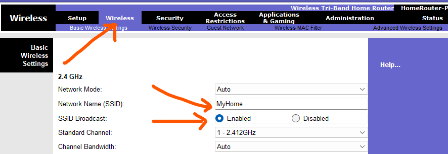{fig-alt="Capture d'écran de Packet Tracer : onglet Wireless du routeur, réseau 2,4 GHz : Network Name (SSID) MyHome, diffusion du SSID activée, canal 1 - 2.412 GHz."}

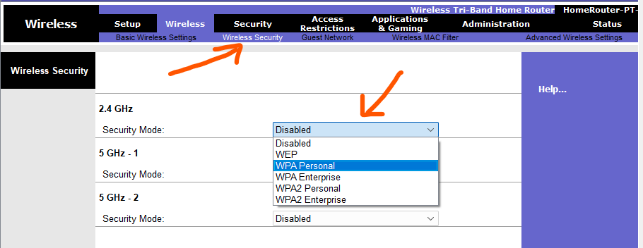{fig-alt="Capture d'écran de Packet Tracer : page Wireless Security, liste déroulante du mode de sécurité du réseau 2,4 GHz : Disabled, WEP, WPA Personal, WPA Enterprise, WPA2 Personal, WPA2 Enterprise."}

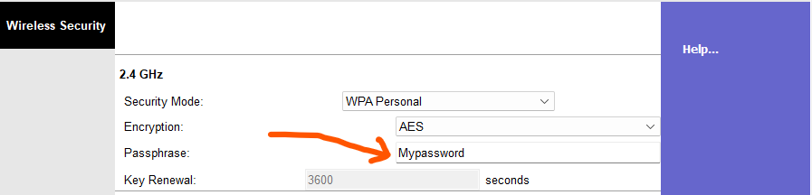{fig-alt="Capture d'écran de Packet Tracer : page Wireless Security : mode WPA Personal, chiffrement AES, phrase de passe saisie dans le champ Passphrase."}

::: {.callout-note title="Questions 10 à 12"}
**📝 QUESTION 10 :** Qu'est-ce que le SSID ? Pourquoi est-il recommandé de changer le SSID par défaut ?

**📝 QUESTION 11 :** Expliquez la différence entre un réseau WiFi "ouvert" et un réseau sécurisé avec WPA2. Quels sont les risques d'un réseau ouvert ?

**📝 QUESTION 12 :** Natsumi vit dans un quartier très peuplé. En quoi cela justifie-t-il le choix de sécuriser son réseau WiFi ?
:::

## III. Configurer l'adressage IP et tester la connectivité

Maintenant que le routeur est configuré, dans cette partie, vous allez configurer l'adressage IP pour les PC et l'ordinateur portable et vérifier qu'ils peuvent se connecter à Internet.

### 1. Connectez l'ordinateur portable au réseau sans fil.

1. Cliquez sur **Laptop** (Ordinateur portable) dans le salon, puis sur l'onglet **Desktop** (Bureau) > **PC Wireless** (PC sans fil).
2. Cliquez sur l'onglet **Connect** (connexion). Après un court délai, le réseau sans fil que vous avez configuré apparaît dans la liste des noms de réseau sans fil.
3. Cliquez sur le nom du réseau que vous avez créé, puis sur le bouton **Connect** (Connecter).
4. Saisissez la phrase de passe que vous avez configurée au préalable pour le réseau sans fil dans le champ **Pre-shared Key** (Clé pré-partagée), puis cliquez sur **Connect** (Connecter).
5. Cliquez sur l'onglet **Link Information** (Informations sur le lien). Vous devriez voir le message suivant : **You have successfully connected to the access point** (Vous vous êtes connecté avec succès au point d'accès).
6. Cliquez sur le bouton **More Information** (Plus d'informations) pour voir les détails de la connexion. Si l'adresse IP ne commence pas par **192**, cliquez plusieurs fois sur **Fast Forward Time** (Temps d'avance rapide) pour accélérer la simulation.
7. N'oubliez de configurer l'adresse IP du laptop en allant dans Desktop > Configuration IP
8. Fermez l'application **PC Wireless** (PC sans fil) et ouvrez le **Web Browser** (navigateur Web). Vérifiez que **Laptop** (l'ordinateur portable) peut maintenant se connecter à **skillsforall.srv**, en cliquant sur **Fast Forward Time** (Temps d'avance rapide) jusqu'à ce que la page se charge. Cela permet de vérifier que **Laptop** (l'ordinateur portable) dispose d'une connectivité Internet.

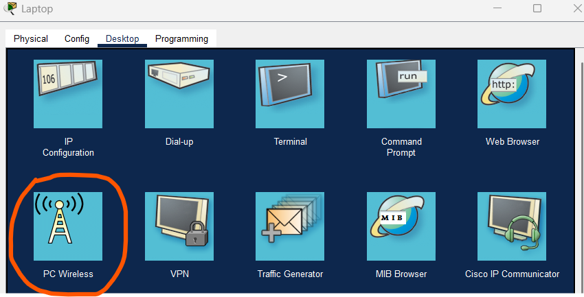{fig-alt="Capture d'écran de Packet Tracer : onglet Desktop du laptop, icône PC Wireless entourée."}

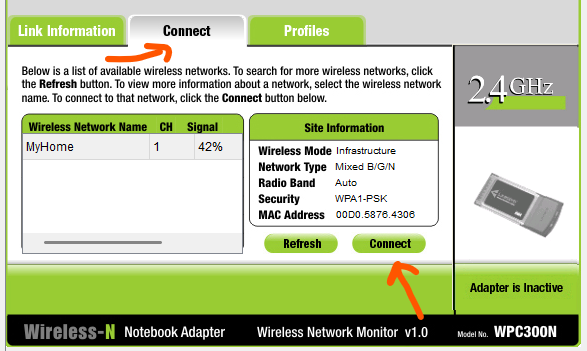{fig-alt="Capture d'écran de Packet Tracer : application PC Wireless, onglet Connect : le réseau MyHome (canal 1, signal 42 %) est listé ; le bouton Connect est signalé."}

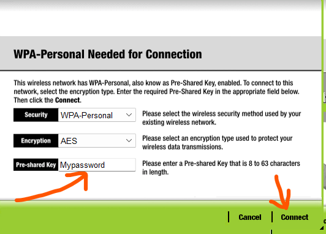{fig-alt="Capture d'écran de Packet Tracer : fenêtre « WPA-Personal Needed for Connection » : sécurité WPA-Personal, chiffrement AES, clé pré-partagée saisie, bouton Connect."}

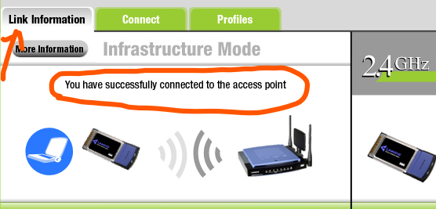{fig-alt="Capture d'écran de Packet Tracer : onglet Link Information de PC Wireless, avec le message « You have successfully connected to the access point »."}

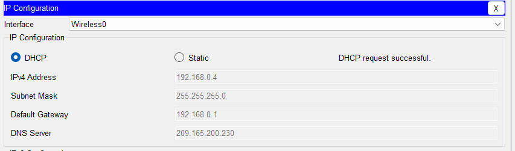{fig-alt="Capture d'écran de Packet Tracer : fenêtre de configuration IP du laptop."}

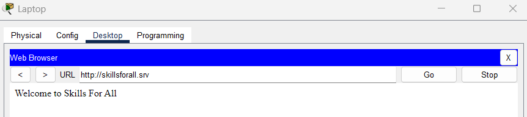{fig-alt="Capture d'écran de Packet Tracer : navigateur web du laptop avec l'adresse skillsforall.srv dans le champ URL."}

::: {.callout-note title="Questions 13 et 14"}
**📝 QUESTION 13 :** Le laptop obtient automatiquement une adresse IP. De quel équipement provient cette adresse ? Comment s'appelle ce processus ?

**📝 QUESTION 14 :** Relevez l'adresse IP obtenue par le laptop. Dans quelle plage d'adresses se trouve-t-elle ? Que pouvez-vous en déduire sur le réseau de Natsumi ?
:::

### 2. Testez la connectivité à partir du PC de bureau.

Vous avez déjà vérifié que le **PC du bureau (Office PC)** peut se connecter au réseau local, puisqu'il vous a permis d'accéder à l'interface du routeur. Mais peut-il également accéder à **Internet** ? Si oui, cela confirmera que le **réseau filaire est correctement connecté et configuré**.

1. Cliquez sur **Office PC** (PC de bureau) > **Desktop** (Bureau) > **Web Browser** (Navigateur Web).
2. Entrez **skillsforall.srv** et cliquez sur **Go**. Après un bref délai, la page web doit s'afficher. Si nécessaire, cliquez plusieurs fois sur **Fast Forward Time** (Avance rapide du temps) pour accélérer la convergence.

Le chargement d'un site web externe permet de vérifier la connectivité Internet du **Office PC** (PC de bureau).

Configurer le **PC de la chambre** (Bedroom PC)

1. Ouvrez la **Configuration IP** du **Bedroom PC**, puis sélectionnez **DHCP**.

   Vérifiez qu'une adresse IP a bien été attribuée, et qu'elle commence par **192**.

2. Fermez la fenêtre de **Configuration IP**, puis ouvrez le **Navigateur Web (Web Browser)**.

   Dans la barre d'adresse, entrez **skillsforall.srv**. Cliquez ensuite sur **Fast Forward Time** (Avance rapide) jusqu'à ce que la page se charge.

Cela vous permettra de confirmer que le **PC de la chambre** est bien connecté à **Internet**.

::: {.callout-note title="Questions 15 et 17"}
**📝 QUESTION 15 :** Le PC de bureau peut accéder à Internet. Décrivez le chemin que suivent les données depuis le PC jusqu'au serveur skillsforall.srv (quels équipements traversent-elles ?).

**📝 QUESTION 17 :** Tous les appareils peuvent maintenant accéder à Internet. Résumez en quelques phrases le rôle de chaque équipement dans cette architecture réseau :

- Le modem câble :
- Le routeur sans fil :
- Le serveur DHCP (intégré au routeur) :
:::

## 🎯 Questions de synthèse

::: {.callout-note title="Questions 18 à 20"}
**📝 QUESTION 18 :** Si Natsumi déménage et change de fournisseur d'accès Internet (de câble vers fibre optique), quels équipements devra-t-elle changer ? La configuration de son routeur restera-t-elle valable ?

**📝 QUESTION 19 :** Un ami de Natsumi lui demande le mot de passe WiFi pour connecter son smartphone. Que doit-elle lui communiquer exactement ? Dans quel ordre doit-il procéder pour se connecter ?

**📝 QUESTION 20 :** Identifiez deux améliorations de sécurité que Natsumi pourrait apporter à son réseau pour le sécuriser davantage.
:::
