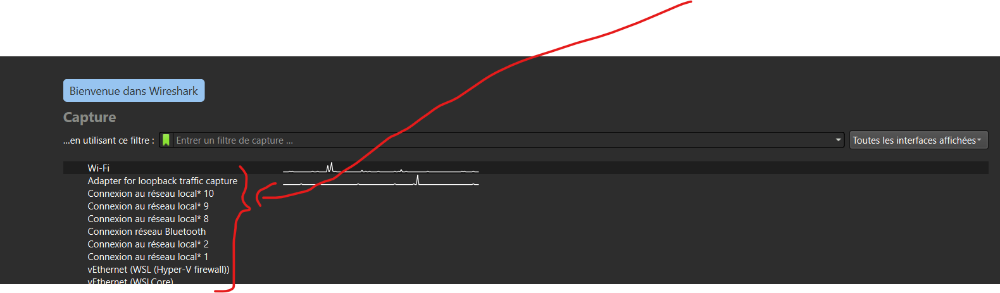
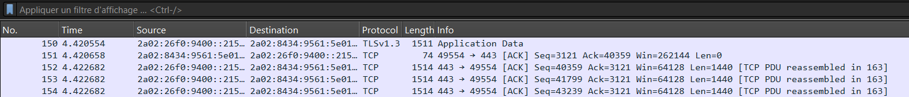
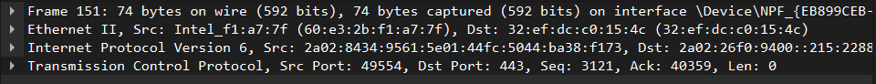
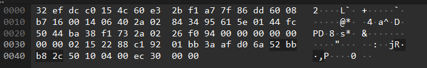
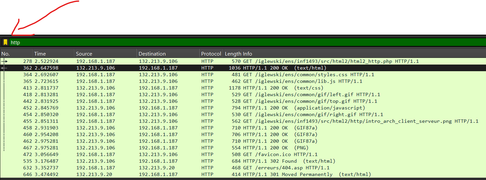
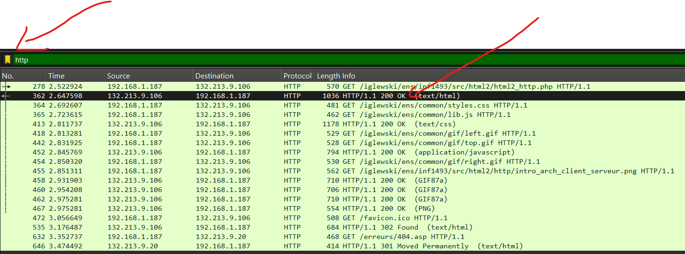
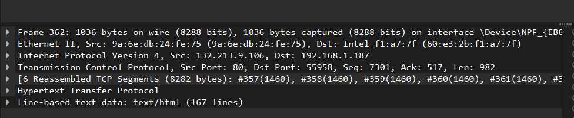
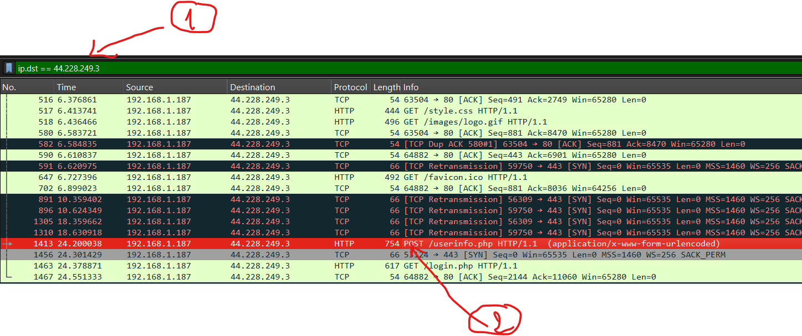
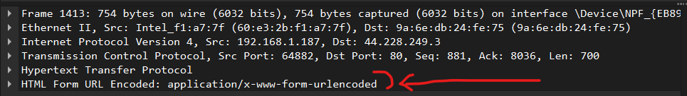

*Plateforme : poste Windows avec Wireshark installé et un accès au réseau local et à Internet.*

Wireshark est un analyseur de protocoles (analyseur de paquets) utilisé pour dépanner les réseaux, effectuer des analyses, développer des logiciels et des protocoles et s'informer. Un analyseur de paquets (ou analyseur de réseaux ou de protocoles) est un logiciel permettant d'intercepter et de consigner le trafic des données transférées sur un réseau de données. Une capture réseau est comme une photo à un instant t de ce qui transite sur un réseau informatique.

## Découvrir Wireshark

Pour pouvoir capturer des données, vous devez d'abord vous connecter au réseau depuis l'ordinateur sur lequel Wireshark est installé et exécuter Wireshark.

::: {.callout-note title="Question 1"}
Relevez l'adresse IP de votre PC, l'adresse de la passerelle et la noter
:::

::: {.callout-note title="Question 2"}
Lancer Wireshark et sélectionner l'interface de votre connexion réseau.
:::

{fig-alt="Capture d'écran de l'écran d'accueil de Wireshark : champ de filtre de capture et liste des interfaces réseau (Wi-Fi, Adapter for loopback traffic capture, plusieurs connexions au réseau local, Bluetooth, vEthernet), avec une grande flèche rouge et une accolade rouge désignant la liste des interfaces."}

Vous devez obtenir un résultat similaire à celui-ci-dessous composé de 3 fenêtres

**Section 1** : La liste des paquets capturés disponibles en dessous de la barre de menu avec un affichage synthétique du contenu des paquets

{fig-alt="Capture d'écran de Wireshark : liste des paquets avec les colonnes No., Time, Source, Destination, Protocol, Length et Info ; les lignes affichées sont des paquets TLSv1.3 et TCP entre adresses IPv6 sur le port 443."}

**Section 2** : La décomposition exacte du paquet actuellement sélectionné dans la liste. Cette décomposition permet de visualiser les champs des en-têtes des protocoles ainsi que l'imbrication des différentes couches de protocoles connus.

{fig-alt="Capture d'écran de Wireshark : détail d'une trame en quatre lignes repliées, Frame, Ethernet II (adresses MAC source et destination), Internet Protocol Version 6 et Transmission Control Protocol (ports source 49554 et destination 443)."}

**Section 3** : Cette zone contient la capture affichée en hexadécimal et en ASCII. Le trafic sur un réseau étant très important, il est nécessaire de mettre en place des filtres, c'est-à-dire sélectionner les communications destinées uniquement à votre carte, ou bien encore sélectionner un type de protocole.

{fig-alt="Capture d'écran de Wireshark : octets de la trame en hexadécimal à gauche, avec leur représentation en caractères ASCII à droite, sur cinq lignes numérotées de 0000 à 0040."}

::: {.callout-note title="Question 3"}
Repérez les différentes colonnes de la section 1, indiquez le type de contenu affiché dans ces différentes colonnes.
:::

::: {.callout-note title="Question 4"}
Effectuer une recherche de façon à définir les termes : trame Ethernet et protocole Ethernet (citez vos sources)
:::

::: {.callout-note title="Question 5"}
Donner le format d'une trame Ethernet, citez les différents champs.
:::

1. Lancez une capture à l'aide de Wireshark en sélectionnant l'interface « Ethernet ».

::: {.callout-note title="Question 6"}
Énumérez 3 différents protocoles exécutés par votre PC. et faites recherches sur ces protocoles.
:::

::: {.callout-note title="Question 7"}
(voir le tableau ci-dessous pour répondre aux questions)

Appliquez les filtres d'affichage suivants à votre capture :

a) Les paquets avec un port TCP de destination égal à 443.\
b) Tous les messages TCP sauf ceux dont le port de source ou de destination est 80.\
c) Seulement les paquets envoyés par votre machine.\
d) Tout sauf les paquets icmp.
:::

| Objectif | Filtre Wireshark | Explication | |
|---|---|---|---|
| Afficher tout le trafic d'une IP source | `ip.src == 192.168.1.10` | Affiche les paquets **envoyés par** cette IP | |
| Afficher tout le trafic d'une IP destination | `ip.dst == 192.168.1.10` | Affiche les paquets **reçus par** cette IP | |
| Afficher tout le trafic d'une IP (source ou destination) | `ip.addr == 192.168.1.10` | Combine les deux cas précédents | |
| Filtrer un protocole particulier | `http` ou `dns` ou `arp` | Affiche uniquement les paquets de ce protocole | |
| Exclure un protocole | `not arp` | Masque tous les paquets ARP | |
| Combiner plusieurs conditions | `ip.src == 192.168.1.10 and tcp.port == 80` | Filtre sur une IP **et** un port | |
| Ou logique | `tcp or udp` | Affiche les paquets TCP **ou** UDP | |
| **and** | `ip.src == 192.168.1.10 and tcp.dstport == 80` | Filtre les paquets venant de l'IP 192.168.1.10 **ET** dont le port de destination est 80 | Seuls les paquets HTTP provenant de 192.168.1.10 |
| **or** | `ip.src == 192.168.1.10 or ip.src == 192.168.1.11` | Filtre les paquets venant de l'IP 192.168.1.10 **OU** 192.168.1.11 | Tous les paquets provenant de l'une ou l'autre IP |
| **not** | `not arp` | Exclut tous les paquets ARP | Affiche tous les paquets sauf ARP |
| **and + not** | `tcp and not tcp.dstport == 22` | Sélectionne tous les paquets TCP **sauf** ceux destinés au port 22 (SSH) | Tout le trafic TCP sauf SSH |
| **or + and + not** | `(ip.src == 192.168.1.10 or ip.src == 192.168.1.11) and not tcp.port == 22` | Paquets venant de 192.168.1.10 **ou** 192.168.1.11 **mais pas** sur le port 22 | Tous les paquets des deux IP sauf SSH |

Lancez une capture de paquets dans Wireshark. Pendant la capture, exécutez la commande **ping** vers une machine du réseau local.

Une fois les paquets capturés, filtrez les trames correspondant à l'échange entre votre poste et la machine cible en saisissant dans la barre de filtre :

**ip.dst == "adresse_IP_de_la_machine_cible"**

------------------------------------------------------------------------

::: {.callout-note title="Question 8"}
Quel est le protocole utilisé suite à l'exécution du « ping »? A quelle couche appartient-il ?
:::

Démarrez une nouvelle capture de paquets dans Wireshark. Pendant la capture, ouvrez votre navigateur web et accédez à l'adresse suivante :

[**http://w3.uqo.ca/iglewski/ens/inf1493/src/html2/html2_http.php**](http://w3.uqo.ca/iglewski/ens/inf1493/src/html2/html2_http.php)

Une fois la page entièrement chargée, arrêtez la capture.

Appliquez un filtre d'affichage afin de ne conserver à l'écran que les paquets correspondant au protocole **HTTP**

{fig-alt="Capture d'écran de Wireshark : barre de filtre contenant « http » (flèche rouge) et liste de requêtes GET et de réponses « HTTP/1.1 200 OK » entre 192.168.1.187 et 132.213.9.106."}

Repérez et sélectionnez le premier message **HTTP** contenant la mention **"OK"** (réponse du serveur).

{fig-alt="Capture d'écran de Wireshark : même liste filtrée sur http ; la ligne 362 « HTTP/1.1 200 OK (text/html) » est sélectionnée et désignée par une flèche rouge."}

Dans la **zone 2** (détails du paquet), cliquez sur la ligne **"Line-based text data: text/html"**, puis faites défiler jusqu'en bas pour lire rapidement le contenu.

{fig-alt="Capture d'écran de Wireshark : détail de la trame 362 en sept lignes, Frame, Ethernet II, Internet Protocol Version 4 (source 132.213.9.106, destination 192.168.1.187), Transmission Control Protocol (port source 80), segments TCP réassemblés, Hypertext Transfer Protocol et Line-based text data: text/html."}

::: {.callout-note title="Question 9"}
Le protocole http est de quelle couche ?
:::

::: {.callout-note title="Question 10"}
Quel protocole de transport utilisé par http ?
:::

::: {.callout-note title="Question 11"}
Combien de temps a-t-il fallu pour recevoir la réponse à la requête HTTP envoyée par votre PC ?
:::

::: {.callout-note title="Question 12"}
Quelle-est l'adresse Internet du serveur du « [http://w3.uqo.ca/iglewski/ens/inf1493/src/html2/html2_http.php](http://w3.uqo.ca/iglewski/ens/inf1493/src/html2/html2_http.php) » ?
:::

Enregistrez la dernière capture effectuée.

## HTTP VS HTTPS

Pour voir si une transmission est chiffrée ou non

- un logiciel de capture de trames : ***Wireshark***.
- et plutôt ***Firefox*** (car Chrome refuse parfois les connections non sécurisées).

Voici 2 pages de connexion, l'une est sécurisée (https) et l'autre ne l'est pas (http) :

Démarrer une capture sur wireshark

Allez sur le site suivant : [http://testphp.vulnweb.com/login.php](http://testphp.vulnweb.com/login.php) :

- entrer n'importe quel identifiant/mot de passe
- puis filtrer les trames Wireshark avec `ip.dst == 44.228.249.3`

Puis revenez sur wireshark pour arrêter la capture

Tapez la commande "ip.dst == 44.228.249.3" pour filtrer que les échanges de données entre votre machine le serveur qui héberge le site web auquel vous venez de vous connecter.

Puis cliquez la ligne dont la colonne info contient : "754 POST /userinfo.php HTTP/1.1 (application/x-www-form-urlencoded)"

{fig-alt="Capture d'écran de Wireshark : filtre « ip.dst == 44.228.249.3 » repéré par un 1 et, en rouge, la ligne « POST /userinfo.php HTTP/1.1 (application/x-www-form-urlencoded) » repérée par un 2."}

Dans la zone 3 cliquez sur la ligne déroulante "**HTML Form URL Encoded: application/x-www-form-urlencoded**"

{fig-alt="Capture d'écran de Wireshark : détail de la trame 1413 (Ethernet II, IPv4, TCP port de destination 80, Hypertext Transfer Protocol) avec la ligne « HTML Form URL Encoded: application/x-www-form-urlencoded » soulignée en rouge."}

::: {.callout-note title="Question 13"}
Que remarquez-vous ?
:::

::: {.callout-note title="Question 14"}
Que représente `44.228.249`
:::

Refaites la même chose avec le site suivant :

- [https://nsirennes.fr/wp-login.php](https://nsirennes.fr/wp-login.php) :
  - Lancer une « Connexion » avec un login/password quelconque.
  - puis filtrer les trames Wireshark avec `ip.dst == 164.132.47.68`
