*Plateforme : Cisco Packet Tracer.*

## Création et interconnexions des LAN

### Objectif du TP

- Choisir le matériel pour construire un réseau Peer to Peer
- Comprendre l'adressage IP
- Paramétrer des hôtes sur un même réseau pour qu'ils puissent communiquer entre eux
- Comprendre le fonctionnement d'un concentrateur (hub)
- Comprendre le fonctionnement d'un commutateur (switch)
- Comprendre le fonctionnement d'un routeur
- Notion de passerelle (gateway)
- Configurer des réseaux différents pour qu'ils puissent communiquer entre eux
- Simuler un réseau sans fil (WiFi)
- Créer un réseau répondant à un cahier des charges

::: {.callout-tip title="Support d'activité"}
- Cisco Packet Tracer, suite bureautique
- Internet
:::

Vous rédigerez un compte-rendu numérique. Pensez aux captures d'écran pour imager votre compte-rendu. Sauvegardez votre travail régulièrement ! Des modifications peuvent exister selon la version du logiciel utilisée.

## 1 - PRISE EN MAIN DU SIMULATEUR RÉSEAU

**CRÉATION D'UN RÉSEAU P2P**

Vous allez dans un premier temps créer un réseau Peer-to-Peer constitué de deux ordinateurs. Lancer le logiciel « Cisco Packet Tracer ». Vous devez obtenir la fenêtre ci-dessous.

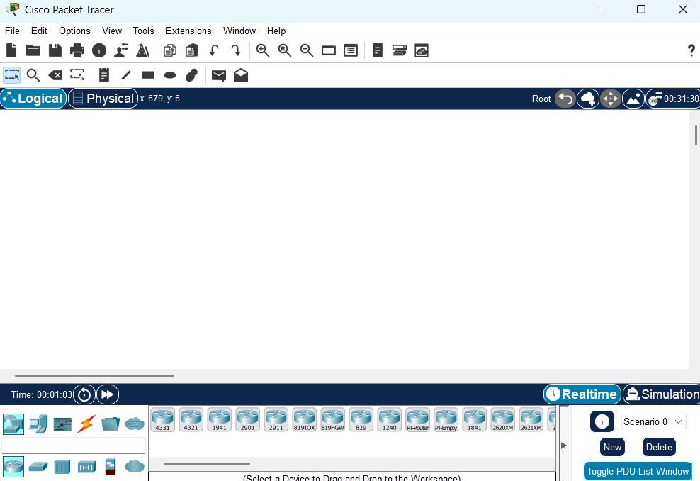{fig-alt="Capture d'écran de Cisco Packet Tracer au lancement : espace de travail vide, barre d'outils et palette d'équipements."}

**Pour ajouter un poste dans votre réseau, sélectionnez en bas à gauche de l'écran la rubrique « terminaux », cliquez sur l'icône « Generic » puis cliquez dans la fenêtre pour y déposer un premier poste : PC-PT PC0. Pour supprimer ce poste ou tout autre élément, cliquez sur l'icône « Delete » à droite de l'écran puis sélectionner l'élément à supprimer. Créez 2 postes « Generic », puis renommez les postes comme ci-dessous :**

{fig-alt="Capture d'écran de Packet Tracer : deux postes génériques placés dans l'espace de travail et renommés."}

Maintenant, il faut relier par un câble nos deux postes : sélectionnez en bas à gauche la rubrique « connexions » puis choisissez un « câble droit », cliquez sur l'un et l'autre poste pour mettre le câble (choisir FastEthernet), vous devez obtenir le résultat suivant :

{fig-alt="Capture d'écran de Packet Tracer : deux postes reliés par un câble droit, dont les extrémités sont rouges."}

La couleur rouge (aux extrémités du câble) indique qu'il y a un problème dans l'installation de votre réseau. Il s'agit ici du fait qu'un câble réseau droit a été utilisé. Pour relier des postes directement entre eux, il faut utiliser un câble croisé. Modifiez votre réseau : effacer le câble droit (utilisez la touche « suppr ») et remplacez-le par un câble croisé.

{fig-alt="Capture d'écran de Packet Tracer : deux postes reliés par un câble croisé, dont les extrémités sont vertes."}

La couleur verte indique que la configuration matérielle est correcte et que les postes ont maintenant la possibilité de communiquer entre eux.

## 2 - FAIRE COMMUNIQUER LES POSTES

Vous allez maintenant faire communiquer les deux postes d'un réseau P2P entre eux. Lorsqu'un poste envoi des données à un matériel connecté au réseau, on dit qu'il émet une trame. Une trame désigne un bloc d'informations qui circule sur un support « PDU » (Protocol Data Unit) ou « unité de données de protocole ».

Cliquez sur l'icône « Add simple PDU » (à droite de l'écran), cliquez ensuite dans l'ordre sur le poste émetteur de l'information (Poste1 par exemple) puis sur le poste destinataire (Poste2 par exemple). Vous obtenez le message suivant en fenêtre :

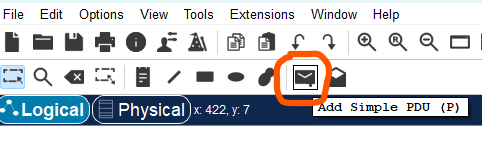{fig-alt="Capture d'écran de Packet Tracer : barre d'outils avec l'icône Add Simple PDU (P) entourée, au-dessus des onglets Logical et Physical."}

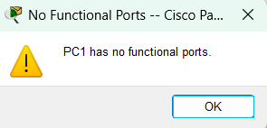{fig-alt="Capture d'écran de Packet Tracer : fenêtre d'avertissement « PC1 has no functional ports » avec un bouton OK."}

## 3 - ADRESSAGE DES HOTES SUR LE RÉSEAU

Lorsque vous envoyez un courrier à un destinataire, vous indiquez une adresse sur l'enveloppe. Cette adresse comprend la rue, le code postal et la ville. Lorsque La Poste achemine votre lettre, le code postal est utilisé pour savoir dans quel département elle doit être remise. Ensuite la ville est déterminée et enfin la rue et le numéro de rue

En matière de réseau, le fonctionnement est semblable. Un hôte du réseau qui souhaite envoyer des données à un autre hôte du réseau doit indiquer l'adresse de ce dernier sur le paquet qui est envoyé. Cette adresse s'appelle l'adresse IP (IP pour Internet Protocol).

Une adresse IP correspond à un et un seul hôte sur un réseau. Elle permet par conséquent d'identifier un hôte sur un réseau sans ambiguïté.

Vous allez définir des adresses IP pour chaque poste : cliquez sur l'icône « Select » (en haut à droite) puis cliquez sur l'hôte « PC0 » pour ouvrir sa fenêtre de configuration, choisissez l'onglet « Desktop » puis « IP Configuration », tapez l'adresse : 192.168.0.1, cliquez dans la zone du masque de sous-réseau, celui-ci sera défini automatiquement et par défaut : 255.255.255.0 (Classful).

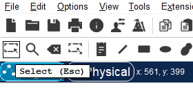{fig-alt="Capture d'écran de Packet Tracer : barre d'outils avec l'infobulle de l'outil Select (Esc)."}

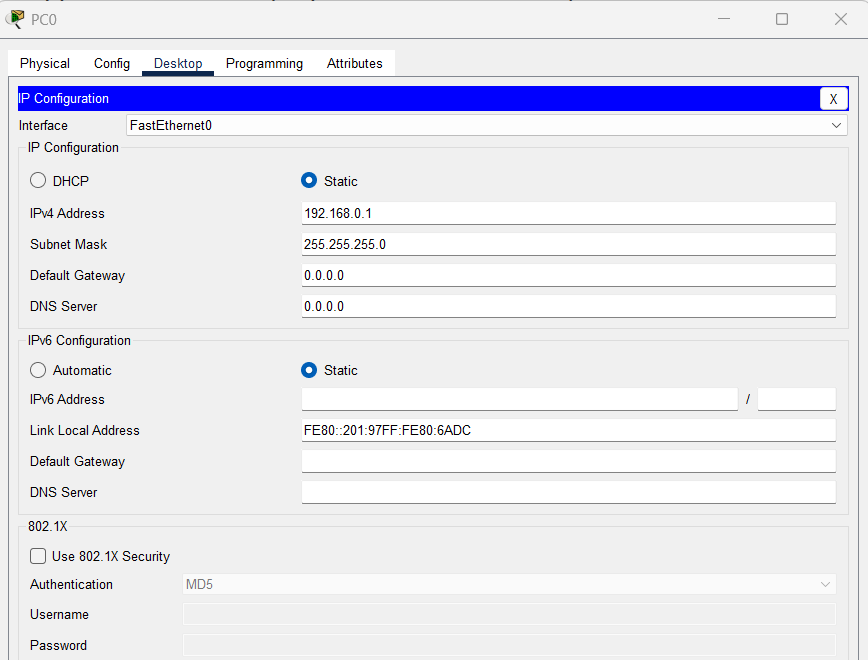{fig-alt="Capture d'écran de Packet Tracer : fenêtre IP Configuration de PC0 avec l'adresse 192.168.0.1 et le masque 255.255.255.0."}

Faites de même pour l'autre poste avec l'adresse IP 192.168.0.2

Recommencez l'envoi d'une trame entre les 2 postes : cette fois la transmission s'est normalement déroulée. Pour voir les détails de la transmission des données, cliquez sur "Toggle PDU List Window"

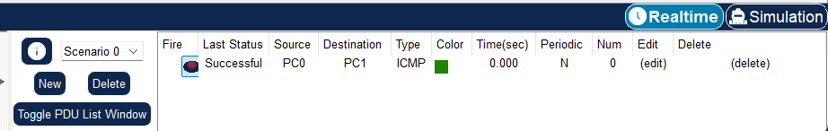{fig-alt="Capture d'écran de Packet Tracer : fenêtre de la liste des PDU avec l'état de la transmission entre les deux postes."}

Vous voyez que tout s'est bien déroulé mais .... en temps réel, ce qui explique que vous n'avez rien vu car vous n'avez pas eu le temps de voir quelque chose.

Pour ralentir le temps et observer l'envoi et la réception des PDU étape par étape, passez en mode simulation en cliquant sur l'icône en bas à droite de l'écran.

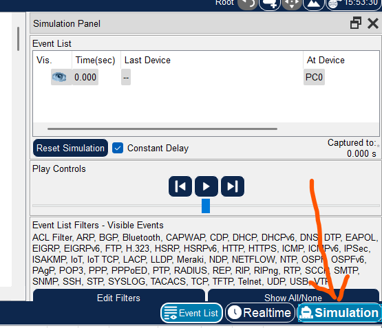{fig-alt="Capture d'écran de Packet Tracer : icône du mode simulation en bas à droite de l'écran."}

Ensuite cliquez sur le bouton "avance" plusieurs fois et observez ce qui s'affiche sur la fenêtre simulation. Ce bouton correspond à un mode « pas à pas » où il faut cliquez à chaque fois pour voir les échanges de données entre les postes.

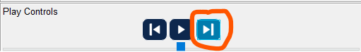{fig-alt="Capture d'écran de Packet Tracer : panneau de simulation avec les boutons de lecture pas à pas."}

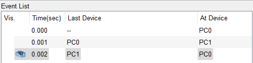{fig-alt="Capture d'écran de Packet Tracer : fenêtre Event List : trois événements, de PC0 vers PC1 puis de PC1 vers PC0, aux temps 0.000, 0.001 et 0.002 s."}

::: {.callout-note title="Question 1"}
**Question** 1 : Comment interprèterez-vous ces informations ?
:::

::: {.callout-note title="Question 2"}
**Question 2** : Cliquer sur l'enveloppe pour ouvrir le PDU. Dans quelle couche réseau du modèle OSI retrouve t'on les adresses IP des postes ?
:::

Note : Cliquez sur « Edit Filters » puis cochez UNIQUEMENT le protocole ICMP. Nous ferons cela pour chaque simulation tout au long de cette activité, nous ne visualiserons que l'échange des données au niveau du protocole ICMP. Il faudra donc penser à chaque nouvelle construction de réseau à décocher l'ensemble des protocoles et ne laisser que le protocole ICMP.

::: {.callout-warning}
**>>>> FAIRE VALIDER LE TRAVAIL PAR LE PROFESSEUR AVANT DE POURSUIVRE <<<<**
:::

**REQUÊTE D'ECHO « ICMP »**

Le Ping (dont le nom s'inspire du son du sonar) est sans nul doute l'un des outils d'administration de réseau le plus connu et le plus simple puisqu'il permet, grâce à l'envoi de paquets ICMP (Internet Control Message Protocol), de vérifier si une machine distante répond et, par extension, qu'elle est bien accessible par le réseau. Techniquement, ping fonctionne en envoyant des paquets ICMP Echo Request vers la machine cible et en attendant des réponses ICMP Echo Reply. Cette communication permet de diagnostiquer la connectivité réseau et de mesurer le temps de réponse (latence). Sa mise en œuvre de base nécessite l'ouverture d'une fenêtre invite de commande sous Windows ou d'un terminal sous Linux/Unix, comme la plupart des outils de diagnostic réseau. L'outil ping permet ainsi de diagnostiquer la connectivité d'un poste sur le réseau grâce à la commande : ping [adresse IP] ou ping [nom d'hôte].

Exemple d'utilisation dans un environnement de simulation:

Le logiciel permet de simuler cette commande : cliquez sur le poste « PC0 », choisissez l'onglet « Desktop » puis « Command Prompt », tapez ping 192.168.0.2 puis validez par la touche « Entrée » pour envoyer un ping vers l'autre poste. Réalisez la simulation en mode pas à pas.

::: {.callout-note title="Question 3"}
**Question 3** : Combien d'échanges y a-t-il eu entre les postes ? Quel est le temps moyen d'échanges de données entre les postes ? En résumé, que permet de voir un « ping » ?
:::

## 4 - MATÉRIEL NÉCESSAIRE POUR UN RÉSEAU P2P

Le réseau Peer-to-Peer est le type de réseau nécessitant le moins de matériel. Pour le mettre en place, il suffit d'utiliser :

deux ordinateurs équipés chacun d'une carte réseau Ethernet ; un câble à paires torsadées croisées muni de connecteurs RJ45 pour relier les cartes réseau. Pour travailler avec ce réseau dans le logiciel tout en préservant votre configuration, deux options s'offrent à vous :

1) Enregistrez votre réseau via le menu « Fichier » puis « Enregistrer ». Par défaut, le fichier sera sauvegardé dans le dossier du logiciel, mais vous devez l'enregistrer dans votre dossier personnel ainsi que sur votre clé USB.

2) Créez un nouveau scénario en cliquant sur « Nouveau » en bas de l'interface. Une fois le nouveau scénario créé, vous pouvez supprimer tous les équipements du réseau actuel pour en concevoir un nouveau.

## 5 - CRÉATION D'UN RÉSEAU AVEC CONCENTRATEUR (HUB)

Vous allez créer un réseau de cinq postes reliés par un concentrateur (hub)

::: {.callout-note title="Question 4"}
**Question 4** : Construisez le réseau conformément au schéma ci-dessous :
:::

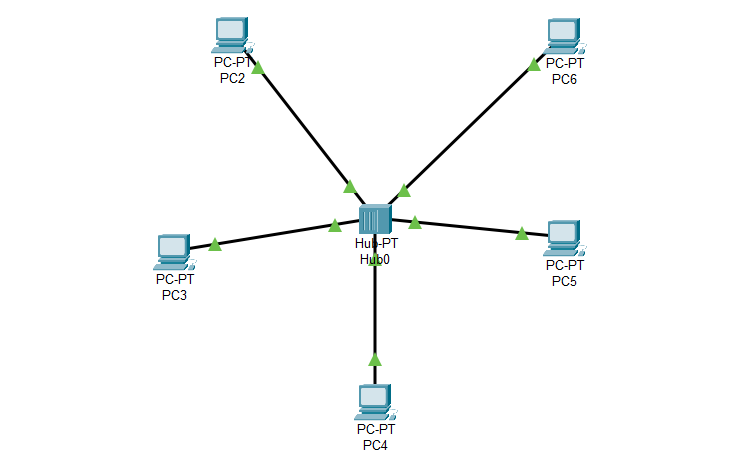{fig-alt="Schéma d'un réseau en étoile : cinq postes (PC1 à PC5) reliés à un concentrateur (hub)."}

::: {.callout-note title="Question 5"}
**Question 5** : Quel type de câble a été utilisé pour relier les postes au concentrateur ? D'après la topologie physique des réseaux, quel est le type de réseau que vous venez de construire ?
:::

::: {.callout-note title="Question 6"}
**Question 6** : Configurez tous les postes en leur affectant une @ IP statique de classe « C » et un masque de sous-réseau (par défaut). Les postes font partie d'un même réseau et peuvent donc communiquer ensemble
:::

---

Remarque : En plaçant le curseur sur un poste, vous visualiserez sa configuration

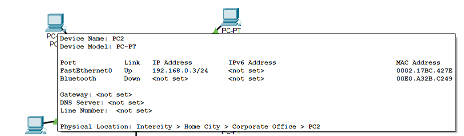{fig-alt="Capture d'écran de Packet Tracer : bulle d'information affichant l'adresse IP, le masque et l'adresse MAC d'un poste lorsque le curseur le survole."}

::: {.callout-note title="Questions 7 et 8"}
**Question 7** : En mode « Simulation », envoyez une trame de PC2 vers PC4. Observez ce qu'il se passe et visualisez le rôle du concentrateur. Envoyez une trame de PC2 vers PC5. Observez ce qu'il se passe et visualisez le rôle du concentrateur. Quel est le rôle du concentrateur ? Comment travaille-t-il ?

**Question 8** : En mode « Simulation », envoyez deux trames simultanément de PC1 vers PC4 et de PC4 vers PC1. Observez ce qu'il se passe. Vous devez obtenir un résultat ressemblant à ci-dessous. Que s'est-il passé ? Argumentez.
:::

En mode simulation, vous pouvez avoir les informations d'un PDU (couche OSI et trame) en double-cliquant sur l'enveloppe.

::: {.callout-note title="Question 9"}
**Question 9** Modifiez votre réseau de façon à avoir le réseau ci-dessous avec deux concentrateurs et deux autres postes configurés pour appartenir au même réseau.
:::

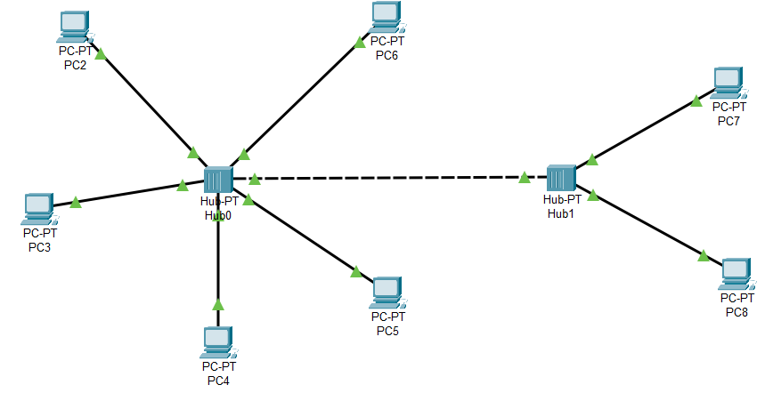{fig-alt="Schéma d'un réseau avec deux concentrateurs reliés entre eux, chacun portant plusieurs postes, tous dans le même réseau."}

::: {.callout-note title="Question 10"}
**Question 10** : Quel type de câble utilise-t-on pour relier deux concentrateurs ?
:::

::: {.callout-note title="Question 11"}
**Question 11** : Envoyer une trame de PC2 vers PC7. Observer ce qu'il se passe. Que pouvez-vous en conclure si le réseau compte un grand nombre d'hôtes reliés à des concentrateurs ?
:::

::: {.callout-warning}
**>>>>> FAIRE VALIDER LE TRAVAIL PAR LE PROFESSEUR AVANT DE POURSUIVRE <<<<<**
:::

## 6 - CRÉATION D'UN RÉSEAU AVEC COMMUTATEUR (SWITCH)

Vous allez créer un réseau de quatre postes reliés par un commutateur (switch).

Note : Pour le commutateur, vous prendrez le « generic switch-PT ». Les points oranges signifient que le commutateur est en cours de configuration avec les postes, il faut attendre quelques secondes pour qu'ils soient tous verts (rappel : vous êtes en temps réel).

::: {.callout-note title="Question 13"}
**Question 13** : Quel type de câble est utilisé pour relier les postes au commutateur ?
:::

::: {.callout-note title="Question 14"}
**Question 14** : Configurez tous les postes en leur affectant une @ IP statique de classe « C » et un masque de sous-réseau. Les postes font partie d'un même réseau et peuvent donc communiquer ensemble
:::

::: {.callout-note title="Question 15"}
**Question 15** : Simulez l'envoi d'une trame de PC0 vers PC3. Observez ce qu'il se passe. Simulez l'envoi d'une trame de PC1 vers PC3. Observez ce qu'il se passe. Simulez l'envoi de deux trames simultanées de PC1 vers PC3 et de PC3 vers PC1. Observez ce qu'il se passe. Quel est le rôle du commutateur ? Comment travaille-t-il ? Quel est l'avantage du commutateur (switch) par rapport au concentrateur (hub) ?
:::

::: {.callout-note title="Question 16"}
**Question 16** : Modifiez votre réseau de façon à avoir le réseau ci-dessous avec l'ajout d'un concentrateur et deux autres postes configurés pour appartenir au même réseau.
:::

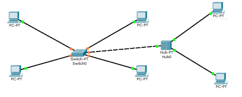{fig-alt="Schéma d'un réseau avec un commutateur relié à un concentrateur, chacun portant plusieurs postes."}

Vous constaterez que vous ne pouvez pas connecter le commutateur au concentrateur car il manque un port FastEthernet au commutateur. Vous allez donc ajouter un port au commutateur. Cliquez sur le commutateur pour ouvrir sa fenêtre de propriétés et choisissez l'onglet « physique » pour visualiser sa face arrière. (1) Éteignez le commutateur en cliquant sur l'interrupteur I/0. (2) Faites glisser un connecteur de type « CFE » (3) vers un emplacement libre de la face arrière du concentrateur.

Rallumez le concentrateur puis fermer la fenêtre. Il faut attendre quelques secondes pour que tout se remette en fonctionnement (connexions vertes).

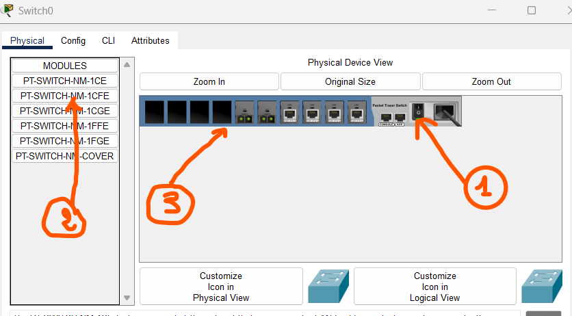{fig-alt="Capture d'écran de Packet Tracer : onglet Physical du commutateur, avec le connecteur CFE à glisser vers un emplacement libre de la face arrière."}

::: {.callout-note title="Question 17"}
**Question 17** Simulez l'envoi d'une trame de PC0 vers PC4. Décrivez ce qu'il se passe.
:::

::: {.callout-note title="Question 18"}
**Question 18** : Modifiez l'@ IP de PC5 de telle sorte qu'il ne fasse plus partie du réseau, puis essayer d'émettre une trame de PC1 vers PC5. Que se passe-t-il ?
:::

::: {.callout-warning}
**>>>>>>> FAIRE VALIDER LE TRAVAIL PAR LE PROFESSEUR AVANT DE POURSUIVRE <<<<<<**
:::

## 7 - MISE EN ŒUVRE D'UN ROUTEUR

Vous venez de constater que deux ordinateurs ne possédant pas la même @ réseau ne pouvaient pas communiquer entre eux. Dans la réalité, il existe des millions de réseaux avec des @ réseaux différentes et pourtant ils communiquent très bien entre eux.

Cela est possible grâce au routage. C'est-à-dire qu'un routeur choisi le chemin sur lequel les données vont transiter. Le routage correspond à la détermination d'une route afin d'acheminer des données jusqu'au(x) destinataire(s).

::: {.callout-note title="Question 19"}
**Question 19** : Modifiez les @ IP du ou des postes du réseau précédent de façon à avoir deux réseaux comme ci-dessous.
:::

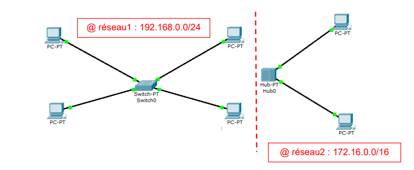{fig-alt="Schéma de deux réseaux distincts : l'un construit autour d'un concentrateur, l'autre autour d'un commutateur, avec des adresses IP de réseaux différents."}

Ajoutez un routeur entre les deux réseaux (choisissez le routeur « 1941 » ou "2941" ). Connectez le routeur aux deux réseaux différents via le hub et le switch.

::: {.callout-note title="Question 20"}
**Question 20** : Quel type de câble est utilisé pour relier un hub ou un switch à un routeur ?
:::

Vous observez que les deux connexions sont de couleur rouge, indiquant que la communication entre les deux réseaux ne fonctionne pas dans l'état actuel.

En déplaçant le curseur sur le routeur, vous pouvez lire dans la fenêtre d'information « Link Down » ou « Liaison Bas », confirmant que les interfaces ne sont pas opérationnelles.

Il est nécessaire de configurer le routeur en lui attribuant deux adresses IP appartenant respectivement aux deux réseaux à interconnecter.

Pour procéder à la configuration :

1. Cliquez sur le routeur pour ouvrir la fenêtre de propriétés
2. Sélectionnez l'onglet « Config »
3. Dans le menu de gauche, cliquez sur « INTERFACE > GigabitEthernet0/0 »
4. Saisissez une adresse IP disponible et le masque de sous-réseau correspondant au premier réseau
5. Cochez la case pour activer le port (Port Status : On)
6. Répétez la même procédure pour l'interface « GigabitEthernet0/1 » en utilisant une adresse IP et le masque appropriés pour le second réseau

Cette configuration permettra au routeur de faire le lien entre les deux réseaux et les connexions passeront du rouge au vert.

::: {.callout-note title="Question 21"}
**Question 21** : Simulez l'envoi d'une trame entre PC0 et PC4. L'essai est-il concluant ?
:::

Ça ne fonctionne toujours pas ! L'hôte PC6 n'est pas joignable car PC0 n'appartient pas au même réseau. Il faut lui indiquer qu'il peut le joindre en passant par le routeur. Lorsqu'un poste envoie des données à un hôte qui n'est pas sur son réseau, vous devez lui indiquer qu'il peut le faire en envoyant les données à un routeur. C'est seulement ensuite que le routeur se chargera d'acheminer (router) les données sur l'autre réseau. Cliquez sur PC0, onglet « Desktop » puis entrer l'@ IP du routeur dans « Default Gateway » ou « Passerelle ».

::: {.callout-note title="Question 22"}
**Question 22** : Simulez à nouveau l'envoi d'une trame entre PC0 et PC4. L'essai est-il concluant ? Les données sont bien envoyées au routeur qui les achemine correctement vers PC6 mais il n'y a aucune réponse de la part de PC4. PC6 doit envoyer un message indiquant à PC0 qu'il a bien reçu les données mais comme PC0 ne fait pas parti de son réseau, il ne peut donc pas l'atteindre. Il faut pour lui aussi, lui indiquer la passerelle.
:::

::: {.callout-note title="Question 23"}
**Question 23** : Indiquez la passerelle pour PC4. Simuler à nouveau l'envoi d'une trame entre PC0 et PC4. L'essai est-il concluant ? Le routeur a cette fois acheminé les données de PC0 vers PC4 et PC4 a renvoyé un message à PC1 lui indiquant qu'il a reçu les données.
:::

::: {.callout-note title="Question 24"}
**Question 24** : Modifiez la configuration des autres hôtes de manière à ce que tous les postes puissent communiquer entre eux. Vérifiez le fonctionnement.
:::

::: {.callout-note title="Question 25"}
**Question 25** : Conclusions sur les observations effectuées : Expliquez comment un hôte sur un réseau peut communiquer avec un hôte d'un réseau différent. Que doit-on faire pour configurer un routeur ? Qu'est-ce qu'une « passerelle » ?
:::

::: {.callout-warning}
**>>>>>> FAIRE VALIDER LE TRAVAIL PAR LE PROFESSEUR AVANT DE POURSUIVRE <<<<<<<**
:::

## 8 - CRÉATION D'UN RÉSEAU SANS FIL (WIFI)

::: {.callout-note title="Question 26"}
**Question 26** : Créez un nouveau fichier, construisez le réseau conformément au schéma ci-dessous :
:::

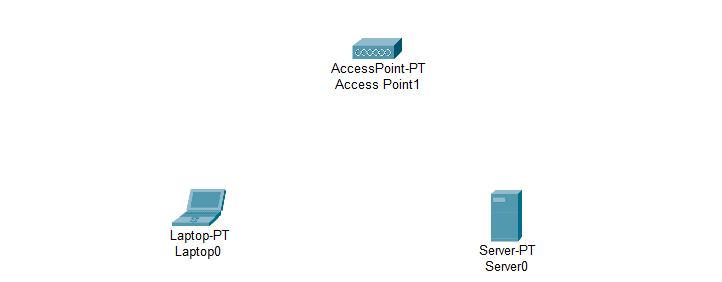{fig-alt="Capture d'écran de Packet Tracer : trois équipements non reliés : un point d'accès (AccessPoint-PT), un ordinateur portable (Laptop0) et un serveur (Server0)."}

Pour le serveur : Cliquez sur le serveur pour ouvrir sa fenêtre de propriétés, onglet « Physical », sur la face arrière visible, éteignez le serveur et remplacez le connecteur FastEthernet (PT-HOST-MM-1CFE) par un connecteur wireless (PT-HOST-NM-1W). Rallumez le serveur. Pour l'ordinateur portable : Cliquez sur le laptop pour ouvrir sa fenêtre de propriétés, onglet « Physical », éteignez l'ordinateur portable et ajoutez un module Wi-Fi tel que le WPC300N ou PT-LAPTOP-NM-1W dans un slot libre. Rallumez l'ordinateur portable. Note importante : Assurez-vous d'utiliser les modules appropriés selon le type d'appareil :

WPC300N ou PT-LAPTOP-NM-1W pour les ordinateurs portables PT-HOST-NM-1W pour les serveurs et PC de bureau

Une fois les modules Wi-Fi installés sur tous les appareils, ils pourront détecter et se connecter au réseau sans fil du point d'accès.

Vous allez maintenant lui donner une @ IP **statique** et un masque de sous-réseau. @ IPserveur : 192.168.0.1 Masque : 255.255.255.0 De la même façon, configurez l'ordinateur portable en remplaçant le connecteur. Laissez l'@ IP en **dynamique** (DHCP).

::: {.callout-note title="Question 27"}
**Question 27** : Avez-vous remarqué un message lors de la configuration DHCP de l'ordinateur portable ? commen t'interprétez-vous ?
:::

Explication du message "DHCP failed. APIPA is being used" Le message "DHCP failed. APIPA is being used" indique que le laptop (Laptop0) a tenté d'obtenir une adresse IP automatiquement via un serveur DHCP, mais cette tentative a échoué. En conséquence, le système a basculé sur l'Automatic Private IP Addressing (APIPA). APIPA attribue une adresse IP temporaire dans la plage 169.254.0.0/16 (comme 169.254.227.85 dans votre cas) avec un masque de sous-réseau 255.255.0.0 lorsque aucun serveur DHCP n'est disponible ou accessible. Cela se produit souvent si :

Le point d'accès (AccessPoint-PT) n'est pas configuré comme serveur DHCP. Il n'y a pas de serveur DHCP dans le réseau. La connexion entre le laptop et le point d'accès est mal configurée.

Configurez maintenant le point d'accès

Accédez au point d'accès : Cliquez sur AccessPoint-PT-A, puis allez dans l'onglet Config, section Wireless.

Paramétrez le réseau Wi-Fi :

- SSID : Donnez un nom à votre réseau sans fil (par exemple : MonRéseau).
- Authentication : Sélectionnez WPA2-PSK.
- PSK Pass Phrase : Saisissez une clé de sécurité (mot de passe) si vous utilisez WPA2-PSK.
- Port Status : Vérifiez que l'interface sans fil est activée (On).

{fig-alt="Capture d'écran de Packet Tracer : les mêmes trois équipements que sur la figure précédente : point d'accès, ordinateur portable et serveur, sans liens."}

**🔗 Connexion du Laptop au Wi-Fi (Packet Tracer)**

1. Cliquez sur le **Laptop** → onglet **Desktop** → **PC Wireless** → **Connect**
2. Sélectionnez votre réseau (ex. : *MonRéseau*) dès qu'il apparaît
3. Cliquez sur **Connect**
4. Si demandé, entrez le **mot de passe** (WPA2-PSK)
5. Vérifiez que le statut passe à **Connected** et qu'une **adresse IP** est attribuée

Faites la même chose pour connecter le serveur au réseau wifi

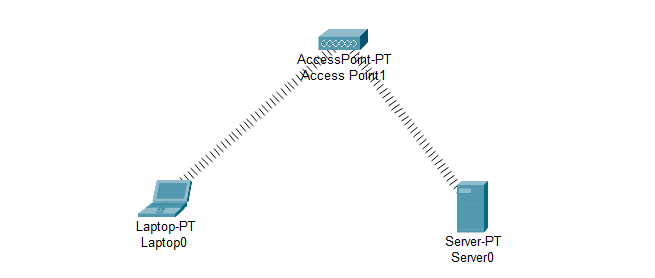{fig-alt="Capture d'écran de Packet Tracer : le point d'accès relié sans fil, par deux liens en pointillés serrés, à l'ordinateur portable et au serveur."}

Vous devez constater à présent que le serveur et l'ordinateur portable sont bien connectés au point d'accès WiFi. Ajoutez deux autres périphériques sans fils : une tablette et un smartphone par exemple.

::: {.callout-note title="Question 27 (bis)"}
**Question 27** Quelles remarques pouvez-vous faire au sujet de l'@ IP des terminaux rajoutés et de l'ordinateur portable ? À quoi cela est-il dû ?
:::

Simulez l'envoi de trames entre ces différents périphériques.

::: {.callout-note title="Question 28"}
**Question 28** : Tous ces appareils communiquent-ils entre eux ?
:::

Requête d'une page web sur le serveur : Cliquez sur la tablette puis onglet « Bureau ». Ouvrez le « Navigateur web » et tapez dans la zone URL l'@ IPserveur : <http://192.168.0.1> puis cliquez sur GO. La page web du serveur s'ouvre.

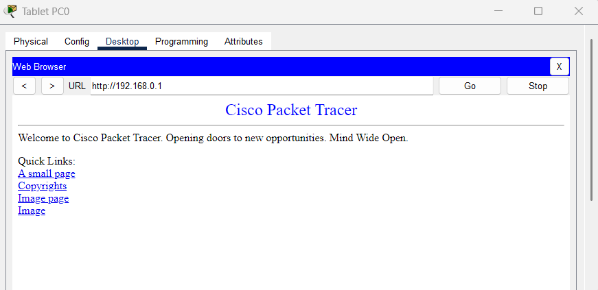{fig-alt="Capture d'écran de Packet Tracer : navigateur web de la tablette affichant la page web du serveur à l'adresse 192.168.0.1."}

::: {.callout-note title="Question 29"}
**Question 29** : Construisez puis configurez les hôtes du réseau 1 de manière à ce que la communication soit rendue possible entre les hôtes tout en respectant le cahier des charges ci-dessous.
:::

> **Cahier des charges 1** : Le réseau 1 est un réseau filaire avec un adressage statique de classe C. L'ajout de concentrateur(s), de commutateur(s), de routeur(s) et de ports sont possibles.

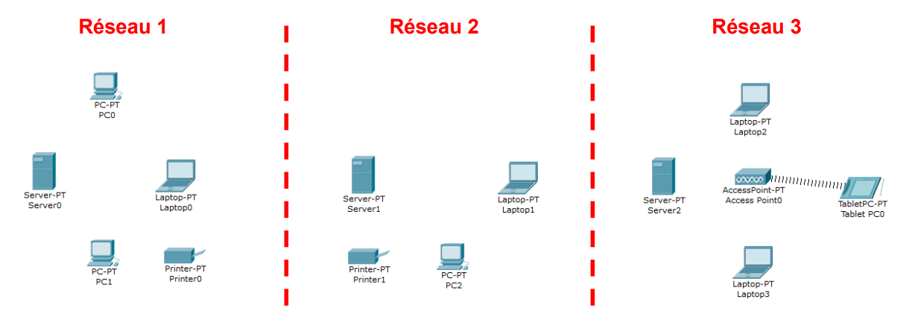{fig-alt="Schéma du réseau 1 à construire selon le cahier des charges 1 : plusieurs postes et équipements à relier."}

::: {.callout-note title="Question 30"}
**Question 30** Construisez puis configurez les hôtes du réseau 2 de manière à ce que la communication soit rendue possible entre les hôtes tout en respectant le cahier des charges ci-dessous.
:::

> **Cahier des charges 2** : Le réseau 2 est un réseau filaire avec un adressage statique de classe B. L'ajout de concentrateur(s), de commutateur(s), de routeur(s) et de ports sont possibles.

::: {.callout-note title="Question 31"}
**Question 31** Construisez et configurez les hôtes du réseau 3 de manière à ce que la communication soit rendue possible entre les hôtes tout en respectant le cahier des charges ci-dessous.
:::

> **Cahier des charges 3** : Le réseau 3 est un réseau « wireless » avec un adressage dynamique de classe C. L'ajout de concentrateur(s), de commutateur(s), de routeur(s) et de ports sont possibles.

**Atttention** : Pour créer un réseau efficace et qui tourne bien il est recommandé de supprimer l'access point de base (AccessPoint-PT) en le remplaçant par l'access point WRT300N.

A noter que vous devez pour la création du réseau global utiliser un seul routeur.

::: {.callout-note title="Question 32"}
**Question 32** : Il vous faut rendre maintenant la communication possible entre les 3 réseaux tout en respectant le cahier des charges ci-après.
:::

> **Cahier des charges final** : Les réseaux 1, 2 et 3 doivent pouvoir communiquer ensemble. Toutes les solutions matérielles et logicielles sont possibles.

::: {.callout-note title="Question 33"}
**Question 33** Calculez l'adresse réseau et l'adresse de diffusion « broadcast » du réseau 1.
:::

::: {.callout-note title="Question 34"}
**Question 34** La passerelle par défaut du poste « PC0 » fait-elle partie du réseau 1, justifiez votre réponse.
:::
