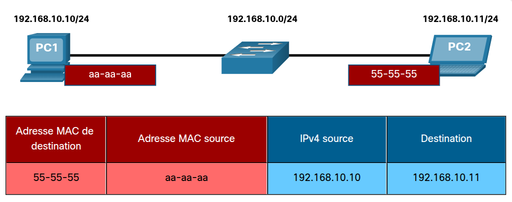
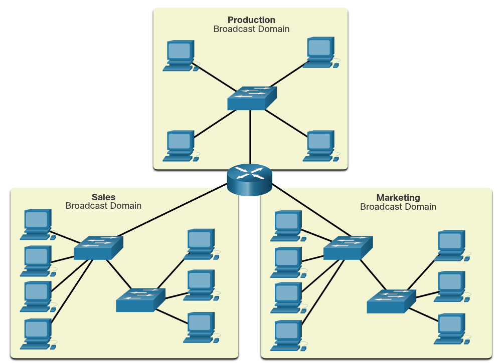
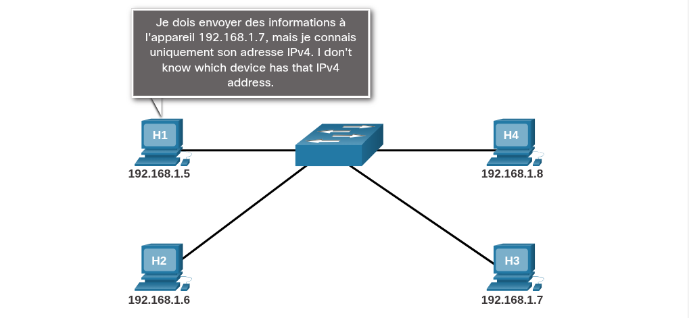
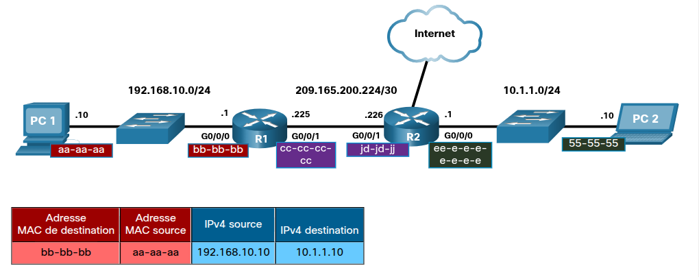
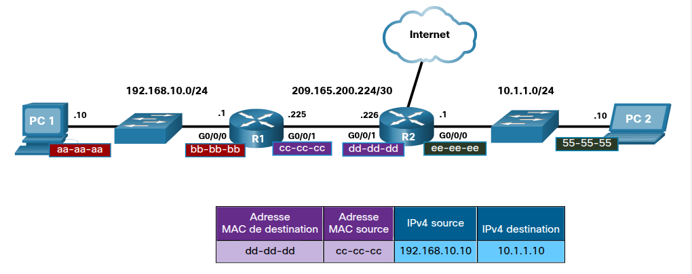
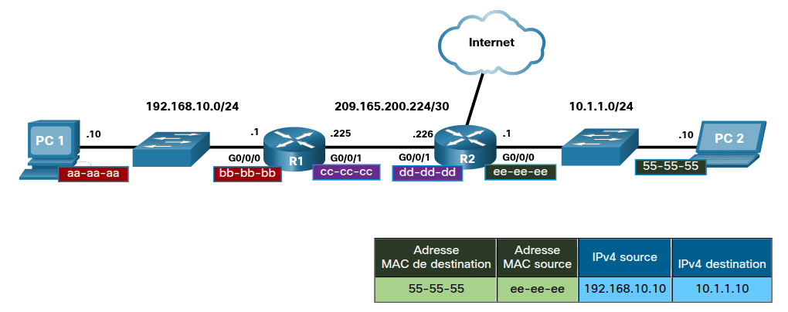

## I. Introduction - Pourquoi ARP ?

### 1.1 Le problème à résoudre

- Communication sur un réseau Ethernet nécessite deux types d'adresses
- Les applications utilisent des adresses IP
- Le matériel réseau utilise des adresses MAC
- **Question centrale** : Comment faire le lien entre IP et MAC ?

### 1.2 Les deux types d'adresses

- **Adresse MAC (physique, couche 2)**
  - Identifie la carte réseau
  - Utilisée pour la communication sur le réseau local
  - Format et permanence
- **Adresse IP (logique, couche 3)**
  - Identifie l'hôte sur le réseau
  - Utilisée pour le routage
  - Peut être sur le même réseau ou distant

## II. Destination sur le même réseau

Parfois, un hôte doit envoyer un message, mais il ne connaît que l'adresse IP du périphérique de destination. L'hôte doit connaître l'adresse MAC de ce périphérique, mais comment peut-elle être découverte? C'est là que la résolution des adresses devient critique.

Chaque périphérique possède deux adresses principales sur un LAN Ethernet:

- **Adresse physique (l'adresse MAC)** Utilisée pour les communications entre cartes réseau situées sur le même réseau Ethernet.
- **Adresse logique (l'adresse IP)** Utilisée pour envoyer les paquets depuis le périphérique source vers le périphérique de destination. L'adresse IP de destination peut se trouver soit sur le même réseau IP que la source, soit sur un réseau distant.

Les adresses physiques de couche 2 (c'est-à-dire les adresses MAC Ethernet) sont utilisées pour acheminer la trame de liaison de données avec le paquet IP encapsulé d'une carte réseau à une autre carte réseau sur le même réseau. Si l'adresse IP de destination appartient au même réseau, l'adresse MAC de destination est celle du périphérique de destination.

Prenons l'exemple suivant en utilisant des représentations d'adresses MAC simplifiées.

{fig-alt="PC1 (192.168.10.10/24, MAC aa-aa-aa) et PC2 (192.168.10.11/24, MAC 55-55-55) sont reliés par un commutateur dans le réseau 192.168.10.0/24. Une trame contient : MAC de destination 55-55-55, MAC source aa-aa-aa, IPv4 source 192.168.10.10, IPv4 de destination 192.168.10.11."}

Dans cet exemple, PC1 veut envoyer un paquet à PC2. La figure affiche les adresses MAC source et destination de la couche 2 et l'adressage IPv4 de la couche 3 qui seraient inclus dans le paquet envoyé à partir de PC1.

La trame Ethernet de couche 2 contient:

- **Adresse MAC de destination** - Il s'agit de l'adresse MAC simplifiée de PC2, 55-55-55.
- **Adresse MAC source** - Il s'agit de l'adresse MAC simplifiée de la carte réseau Ethernet de PC1, aa-aa-aa.

Le paquet IP de couche 3 contient:

- **L'adresse IPv4 source** - Il s'agit de l'adresse IPv4 de PC1, 192.168.10.10.
- **Adresse IPv4 de destination** - Il s'agit de l'adresse IPv4 de PC2, 192.168.10.11.

## III. Domaines de diffusion

Lorsqu'un hôte reçoit un message adressé à l'adresse de diffusion, il accepte et traite le message comme s'il lui était directement adressé. Lorsqu'un hôte envoie un message de diffusion, les commutateurs acheminent le message jusqu'à chaque hôte connecté sur le même réseau local. C'est la raison pour laquelle un réseau local qui contient un ou plusieurs commutateurs Ethernet est également appelé domaine de diffusion.

Si les hôtes connectés au même domaine de diffusion sont trop nombreux, le trafic de diffusion peut devenir disproportionné. Le nombre d'hôtes et le volume de trafic réseau qui peuvent être pris en charge sur le réseau local sont limités par les capacités des commutateurs utilisés pour les connecter. Au fur et à mesure que le réseau s'étend et que d'autres hôtes sont ajoutés, le trafic du réseau, notamment le trafic de diffusion, augmente. Pour améliorer la performance, il est souvent nécessaire de scinder un réseau local en plusieurs réseaux, ou domaines de diffusion, comme illustré dans la figure. Les routeurs sont utilisés pour diviser le réseau en plusieurs domaines de diffusion.

{fig-alt="Un routeur central relie trois domaines de diffusion, nommés Production, Sales et Marketing. Chaque domaine contient un ou plusieurs commutateurs et plusieurs ordinateurs."}

## III. Communication de la couche d'accès

Sur un réseau local Ethernet, une carte réseau n'accepte une trame que si l'adresse de destination est l'adresse MAC de diffusion, ou si elle correspond à l'adresse MAC de la carte réseau.

La plupart des applications réseau, cependant, se fient à l'adresse IP logique de destination pour identifier l'emplacement des serveurs et des clients. La figure illustre un problème qui survient si un hôte émetteur ne possède que l'adresse IP logique de l'hôte de destination. Comment l'hôte émetteur détermine-t-il l'adresse MAC de destination à utiliser dans la trame?

L'hôte émetteur peut utiliser un protocole IPv4 appelé protocole ARP pour connaître l'adresse MAC d'un hôte sur le même réseau local. Le procotole IPv6 utilise une méthode similaire connue sous le nom de découverte des voisins.

{fig-alt="Quatre hôtes sont reliés à un commutateur : H1 (192.168.1.5), H2 (192.168.1.6), H3 (192.168.1.7) et H4 (192.168.1.8). Une bulle près de H1 dit : je dois envoyer des informations à l'appareil 192.168.1.7, mais je ne connais que son adresse IPv4."}

## IV. ARP

Le protocole ARP utilise un processus en trois étapes pour détecter et enregistrer l'adresse MAC d'un hôte sur le réseau local, lorsque seule l'adresse IPv4 de l'hôte est connue.

1. L'hôte émetteur crée et envoie une trame adressée à une adresse MAC de diffusion. La trame contient un message avec l'adresse IPv4 de l'hôte de destination souhaité.
2. Chaque hôte du réseau reçoit la trame de diffusion et compare l'adresse IPv4 du message à son adresse IPv4 configurée. L'hôte dont l'adresse IPv4 correspond renvoie son adresse MAC à l'hôte émetteur initial.
3. L'hôte émetteur reçoit le message et enregistre l'adresse MAC et l'adresse IPv4 dans une table appelée table ARP.

Une fois que l'hôte émetteur a consigné l'adresse MAC de l'hôte de destination dans **sa table ARP**, il peut envoyer directement des trames à l'adresse de destination, sans effectuer de requête ARP. Comme les messages ARP se basent sur des trames de diffusion pour transmettre les requêtes, tous les hôtes du réseau local IPv4 doivent être dans le même domaine de diffusion.

## IV. 1 La table ARP

### Qu'est-ce que la table ARP ?

La **table ARP** (Address Resolution Protocol table), aussi appelée **cache ARP**, est une table de correspondance stockée dans la mémoire d'un équipement réseau (routeur, switch, ordinateur) qui associe les adresses IP aux adresses MAC sur un réseau local.

**Point important** : Au démarrage, cette table est vide. Elle se remplit automatiquement au fur et à mesure que la machine communique sur le réseau.

---

### Comment fonctionne le protocole ARP en lien avec la table ARP?

#### 1️⃣ Chaque appareil possède sa propre table

Chaque appareil connecté à un réseau local (PC, routeur, imprimante, etc.) possède sa propre table ARP dans laquelle il enregistre les correspondances entre adresses IP et adresses MAC qu'il découvre.

#### 2️⃣ Besoin de communiquer

Lorsqu'un appareil veut envoyer des données à une adresse IP de son réseau local, il a besoin de connaître l'adresse MAC correspondante pour construire la trame Ethernet.

#### 3️⃣ Consultation de la table ARP

L'appareil consulte d'abord sa propre table ARP pour vérifier s'il possède déjà l'adresse MAC correspondant à cette adresse IP.

#### 4️⃣ Si l'entrée existe : communication directe

Si la correspondance est trouvée dans la table, l'appareil utilise directement l'adresse MAC pour encapsuler ses données dans une trame Ethernet et l'envoyer.

#### 5️⃣ Si l'entrée n'existe pas : requête ARP

Si l'adresse MAC n'est pas connue, l'appareil envoie une **requête ARP** (ARP Request) en broadcast sur tout le réseau local. Cette requête contient :

- L'adresse IP recherchée (« Qui possède cette IP ? »)
- L'adresse MAC de broadcast (`FF:FF:FF:FF:FF:FF`) pour que tous les appareils la reçoivent

#### 6️⃣ Réponse ARP

Seul l'appareil possédant l'adresse IP recherchée répond par une **réponse ARP** (ARP Reply) envoyée en unicast directement au demandeur. Cette réponse contient son adresse MAC.

#### 7️⃣ Mise à jour de la table

Le demandeur enregistre alors cette nouvelle correspondance IP–MAC dans sa table ARP en tant qu'**entrée dynamique**.

#### 8️⃣ Communication et mise en cache

L'appareil peut maintenant communiquer directement avec la destination en utilisant l'adresse MAC stockée, sans avoir à refaire de requête ARP pour les prochains échanges.

#### 9️⃣ Expiration des entrées

Les entrées dynamiques ont une **durée de vie limitée** (généralement 2 à 20 minutes selon les systèmes). Si une entrée n'est pas utilisée pendant ce délai, elle est automatiquement supprimée de la table pour libérer de la mémoire.

---

### Types d'entrées ARP

- **Entrées dynamiques** : créées automatiquement lors des échanges réseau, elles expirent après un certain délai d'inactivité.
- **Entrées statiques** : configurées manuellement par l'administrateur, elles persistent et ne expirent jamais.

---

### Limitations et cas particuliers

#### Portée limitée au réseau local

ARP fonctionne uniquement sur un **réseau local (couche 2 du modèle OSI)** et ne traverse pas les routeurs. Pour communiquer avec une machine située sur un autre réseau, l'appareil ne cherche pas l'adresse MAC de la destination finale, mais celle de sa **passerelle par défaut** (le routeur), qui se chargera ensuite de relayer les données.

#### Vulnérabilité de sécurité

Le protocole ARP ne possède aucun mécanisme d'authentification, ce qui le rend vulnérable aux attaques de type **ARP spoofing** (ou ARP poisoning). Un attaquant peut envoyer de fausses réponses ARP pour usurper l'identité d'un autre appareil et intercepter ou manipuler le trafic réseau.

---

### Commandes pratiques

Pour consulter ou gérer la table ARP de votre machine :

- **Afficher la table** : `arp -a` (Windows/Linux) ou `arp -n` (Linux)
- **Vider le cache** : `arp -d *` (Windows) ou `ip -s neigh flush all` (Linux)
- **Ajouter une entrée statique** : `arp -s <IP> <MAC>`

Ces commandes permettent de visualiser et manipuler les correspondances IP–MAC actuellement en mémoire.

## V. Destination sur un réseau distant

Lorsque l'adresse IP de destination (IPv4 ou IPv6) se trouve sur un réseau distant, l'adresse MAC de destination sera l'adresse de la passerelle par défaut de l'hôte (c'est-à-dire l'interface du routeur).

Prenons l'exemple suivant en utilisant une représentation d'adresse MAC simplifiée.

{fig-alt="PC1 (192.168.10.10, MAC aa-aa-aa) est relié par un commutateur à R1 (interface G0/0/0, MAC bb-bb-bb). R1 est relié à R2 par le réseau 209.165.200.224/30, puis R2 à PC2 (10.1.1.10, MAC 55-55-55) par le réseau 10.1.1.0/24. La trame de PC1 contient : MAC de destination bb-bb-bb, MAC source aa-aa-aa, IPv4 source 192.168.10.10, IPv4 de destination 10.1.1.10."}

Dans cet exemple, PC1 veut envoyer un paquet à PC2. PC2 est situé sur un réseau distant. Étant donné que l'adresse IPv4 de destination n'est pas sur le même réseau local que PC1, l'adresse MAC de destination est celle de la passerelle par défaut locale sur le routeur.

Les routeurs examinent l'adresse IPv4 de destination afin de déterminer le meilleur chemin pour acheminer le paquet IPv4. Lorsque le routeur reçoit la trame Ethernet, il décapsule les informations de couche 2. À l'aide de l'adresse IP de destination, il détermine le périphérique du tronçon suivant, puis décapsule le paquet IP dans une nouvelle trame liaison de données pour l'interface de sortie.

Dans notre exemple, R1 encapsulerait maintenant le paquet avec de nouvelles informations d'adresse de couche 2 comme indiqué sur la figure.

{fig-alt="Même réseau que la figure précédente. La trame sortant de R1 contient : MAC de destination dd-dd-dd (interface G0/0/1 de R2), MAC source cc-cc-cc (interface G0/0/1 de R1), IPv4 source 192.168.10.10, IPv4 de destination 10.1.1.10."}

La nouvelle adresse MAC de destination serait celle de l'interface R2 G0/0/1 et la nouvelle adresse MAC source serait celle de l'interface R1 G0/0/1.

Le long de chaque lien d'un chemin, un paquet IP est encapsulé dans une trame. La trame est spécifique à la technologie de liaison de données associée à cette liaison, telle qu'Ethernet. Si le périphérique du tronçon suivant est la destination finale, l'adresse MAC de destination est celle de la carte réseau Ethernet du périphérique, comme illustré dans la figure.

{fig-alt="Même réseau que les figures précédentes. La trame sortant de R2 contient : MAC de destination 55-55-55 (carte réseau de PC2), MAC source ee-ee-ee (interface G0/0/0 de R2), IPv4 source 192.168.10.10, IPv4 de destination 10.1.1.10."}

Comment les adresses IP des paquets IP d'un flux de données sont-elles associées aux adresses MAC de chaque liaison le long du chemin vers la destination? Cette opération est effectuée selon un processus appelé protocole ARP. Pour les paquets IPv6, le processus est ICMPv6 Neighbor Discovery (ND).
