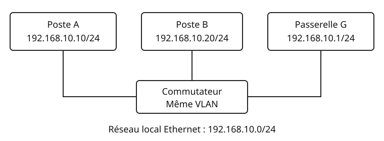

## Objectifs et prérequis

À l’issue du cours, vous saurez expliquer un échange ARP, interpréter les
adresses de ses participants et lire une correspondance IPv4/MAC. Vous devez
savoir déterminer si deux hôtes appartiennent au même sous-réseau IPv4.

## Situation de départ

Le poste A (`192.168.10.10/24`) veut envoyer un paquet IPv4 au poste B
(`192.168.10.20/24`). Les deux postes sont reliés au même commutateur Ethernet.
A connaît l’adresse IPv4 de B. Quelle adresse de destination doit-il placer
dans la trame Ethernet ?

{fig-alt="A, 192.168.10.10, et B, 192.168.10.20, sont reliés par un commutateur à la passerelle 192.168.10.1 ; le réseau local est 192.168.10.0/24."}

Les adresses MAC de cet exemple sont des adresses locales fictives :

| Équipement | Adresse IPv4 | Adresse MAC |
|:--|:--|:--|
| A | `192.168.10.10` | `02:00:00:00:00:0a` |
| B | `192.168.10.20` | `02:00:00:00:00:0b` |
| Passerelle G | `192.168.10.1` | `02:00:00:00:00:01` |

## Comprendre le mécanisme

### Deux adresses pour deux usages

Une adresse IPv4 sert à acheminer les paquets entre réseaux. Sur une liaison
Ethernet, une trame utilise des adresses MAC. Pour envoyer un paquet IPv4 au
prochain équipement du réseau local, un hôte doit donc obtenir sa MAC.

**ARP**, pour *Address Resolution Protocol*, permet cette résolution IPv4/MAC.
Une correspondance connue est conservée temporairement dans une table locale,
appelée cache ARP. Le système évite ainsi de refaire la résolution à chaque
paquet. Les durées de conservation dépendent de l’implémentation.

### Une résolution, étape par étape

Dans notre exemple, le cache de A ne contient pas encore B :

1. A émet une requête ARP demandant qui possède `192.168.10.20`.
2. La trame de requête est diffusée à `ff:ff:ff:ff:ff:ff` sur le réseau local.
3. B reconnaît son adresse IPv4 et répond à la MAC de A.
4. A mémorise la correspondance de B ; il peut adresser sa trame à B.

Le commutateur propage la diffusion dans le même VLAN. Le routeur ne relaie pas
cette diffusion ARP vers les autres réseaux.

::: {.callout-note}
## À retenir

Pour une résolution ordinaire, la requête ARP est diffusée et la réponse est
unicast. ARP est transporté directement dans Ethernet : ce n’est pas un message
TCP ou UDP, et il n’utilise pas de numéro de port.
:::

### Si la destination est dans un autre réseau

Si A veut joindre `192.168.20.20`, la route utilisée dans cet exemple passe par
G. A résout la MAC de **G (`192.168.10.1`)**, et non celle de la destination
distante. Dans la trame envoyée à G, le paquet IPv4 garde `192.168.20.20` comme
adresse IP de destination. Les adresses MAC concernent la liaison parcourue.

## Observer et appliquer

### Lire le cache sur Debian GNU/Linux

Plateforme visée : **Debian GNU/Linux avec iproute2**. La commande suivante
consulte les voisins IPv4 sans modifier la configuration :

```bash
ip -4 neigh show
```

Exemple de résultat fictif (l’interface peut porter un autre nom) :

```text
192.168.10.20 dev enp1s0 lladdr 02:00:00:00:00:0b REACHABLE
```

`dev` indique l’interface locale ; `lladdr` indique la MAC associée au voisin.
`REACHABLE` signifie que le voisin est considéré joignable. Une entrée
`INCOMPLETE` indique une résolution en cours ; `FAILED` signale son échec.

La [fiche d’observation téléchargeable](fichiers/observation.txt) permet de
consigner les adresses et les observations. Les commandes présentées ici sont
des exemples affichés ; elles ne sont jamais exécutées au rendu du site.

### Vérifier sa compréhension

::: {.content-visible when-format="html"}
<details>
<summary>Quelle MAC A doit-il obtenir pour joindre 192.168.20.20 via G ?</summary>
<p>La MAC de G : 02:00:00:00:00:01. La destination IPv4 du paquet reste 192.168.20.20.</p>
</details>
:::

::: {.content-visible unless-format="html"}
**Question.** Quelle MAC A doit-il obtenir pour joindre `192.168.20.20` via G ?

**Réponse.** La MAC de G : `02:00:00:00:00:01`. La destination IPv4 du paquet
reste `192.168.20.20`.
:::

## Exercices de vérification

1. Pour joindre B, quelles sont les adresses Ethernet de destination de la
   requête ARP, de la réponse de B, puis de la trame contenant le paquet IPv4 ?
2. Un élève écrit : « ARP demande à tous les routeurs d’Internet la MAC du
   serveur distant ». Corrigez cette phrase.
3. La table affiche `192.168.10.20 dev enp1s0 FAILED`. Peut-on en conclure que le
   câble de B est débranché ? Justifiez.

### Corrigé

1. Requête : `ff:ff:ff:ff:ff:ff`. Réponse : MAC de A,
   `02:00:00:00:00:0a`. Trame IPv4 de A vers B : MAC de B,
   `02:00:00:00:00:0b`.
2. ARP résout l’adresse du prochain équipement IPv4 sur une liaison locale.
   Pour atteindre un autre réseau via G, A recherche la MAC de G.
3. Non. Cela indique un échec de résolution. Un équipement arrêté, une mauvaise
   configuration IPv4 ou un VLAN incorrect peuvent aussi l’expliquer.

## Synthèse

- Déterminer le prochain saut à partir de la destination IPv4 et du routage.
- Consulter le cache local ; résoudre la MAC du prochain saut si nécessaire.
- Distinguer la destination IP du paquet de la destination MAC de la trame.

ARP n’authentifie pas les associations annoncées : des informations falsifiées
peuvent perturber les échanges. Les mécanismes de protection seront étudiés en
cybersécurité. Ce cours traite IPv4 sur Ethernet ; IPv6 utilise la découverte
de voisins, et non ARP.

## Pour aller plus loin

- [RFC 826 — spécification d’ARP](https://www.rfc-editor.org/rfc/rfc826.html).
- [Manuel ip-neighbour — lecture de la table de voisins](https://man7.org/linux/man-pages/man8/ip-neighbour.8.html).
