*Plateforme : Cisco Packet Tracer (modes Realtime et Simulation).*

## Introduction

::: {.callout-note title="Question 1"}
Construisez le réseau conformément au schéma ci-dessous :
:::

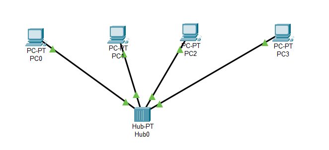{fig-alt="Capture d'écran de Packet Tracer : quatre PC (PC0 à PC3) reliés chacun par un câble au hub Hub0, placé au centre en bas."}

### ✅ Attribuer des adresses IP à chaque PC

Va dans chaque PC \> Desktop \> IP Configuration et configure :

| PC | Adresse IP | Masque de sous-réseau |
|----|----|----|
| PC0 | 192.168.1.1 | 255.255.255.0 |
| PC4 | 192.168.1.2 | 255.255.255.0 |
| PC2 | 192.168.1.3 | 255.255.255.0 |
| PC3 | 192.168.1.4 | 255.255.255.0 |

Rappel :

- Le mode Simulation permet de voir une série d'évènements associés à une communication entre deux ou plusieurs matériels.
- Le mode temps réel (Realtime) fournit cette séquence d'évènements comme en réalité.
- Pour voir l'adresse IP, le masque de sous-réseau, la passerelle par défaut, l'adresse MAC d'un poste, mettre le curseur de la souris sur l'image d'un hôte. S'assurer que l'outil Sélection est sélectionné.

## Partie 1 : Rappels (Partie optionnelle)

### Tester la connectivité entre PC0 et PC1 à l'aide de la commande **ping**

La commande **ping** permet de vérifier la communication entre deux hôtes au sein d'un réseau. Elle génère un paquet IP encapsulé dans une requête **Echo Request** du protocole **ICMP** (Internet Control Message Protocol). Cette commande est couramment utilisée pour tester le bon fonctionnement des **couches 2 (liaison)** et **3 (réseau)** du modèle OSI.

Dans **Packet Tracer**, il est possible de réaliser ce test de deux façons :

- en utilisant la commande ping dans le terminal (Console \> Command Prompt),
- ou en utilisant l'outil graphique **"Add Simple PDU"**.

### 🔧 Utiliser la commande **ping** en mode réel (Realtime)

Avant de commencer, assurez-vous que **Packet Tracer est en mode réel**. Pour cela, cliquez sur l'onglet **"Realtime"** situé en bas à droite de l'interface.

Ensuite, suivez les étapes ci-dessous :

1. Cliquez sur **PC0** avec le bouton gauche de la souris.
2. Dans la fenêtre qui s'ouvre, sélectionnez l'onglet **Desktop**.
3. Cliquez sur **Command Prompt** pour ouvrir le terminal.
4. À l'invite de commande, tapez la commande suivante puis appuyez sur **Entrée** :

```text
ping 192.168.1.2
```

Cette commande permet de tester la connectivité entre **PC0** et **PC1**.

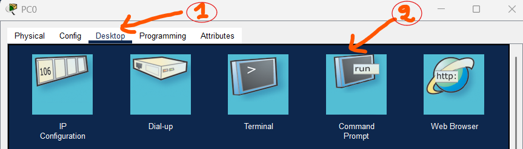{fig-alt="Capture d'écran de Packet Tracer : fenêtre de PC0, onglet Desktop repéré par un 1 et icône Command Prompt repérée par un 2."}

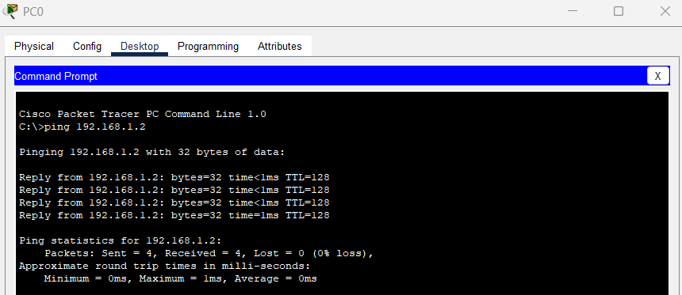{fig-alt="Capture d'écran de Packet Tracer : invite de commandes de PC0 ; le ping vers 192.168.1.2 reçoit quatre réponses (TTL=128) et affiche 0 % de perte."}

## Ping: Utiliser le mode Simulation

### 🧪 Utiliser la commande **ping** en mode Simulation

1. Cliquez sur l'onglet **Simulation** situé dans le coin inférieur droit de l'écran.
2. Si la **fenêtre de la topologie réseau** n'est plus visible, fermez la **fenêtre de la liste des événements (Event List)** pour la faire réapparaître.
3. Retournez sur **PC0**, ouvrez à nouveau le **Command Prompt**, puis saisissez la commande **ping**.

    👉 Astuce : Appuyez sur la **flèche vers le haut** du clavier pour rappeler la dernière commande utilisée.

4. Un **paquet ICMP** (Echo Request) est désormais généré et prêt à quitter **PC0**.

    Vous pouvez observer ce paquet dans :

    - la **fenêtre de gauche** (PC0 envoie le paquet),
    - et dans la **liste des événements (Event List)** au centre de l'écran.

Cela vous permet de visualiser le trajet du paquet étape par étape dans le réseau.

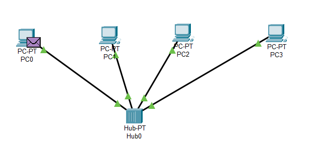{fig-alt="Capture d'écran de Packet Tracer : les quatre PC reliés au hub, avec une enveloppe violette (paquet ICMP) posée sur PC0."}

### 🔍 Observer l'exécution pas à pas de la commande **ping**

1. Pour suivre le cheminement des paquets pas à pas, cliquez sur le bouton **Capture / Forward**, situé dans la barre de contrôle (**Play Controls**) sous la fenêtre principale.

    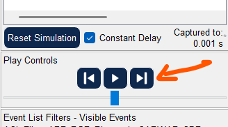{fig-alt="Capture d'écran de Packet Tracer : panneau Play Controls avec les boutons retour, lecture et Capture / Forward, ce dernier désigné par une flèche orange."}

2. Cliquez sur chaque événement dans la **liste des événements (Event List)** pour analyser comment le **hub (concentrateur)** traite chaque trame :
    - **Trame Ethernet**
    - **Paquet IP**
    - **Message ICMP**

    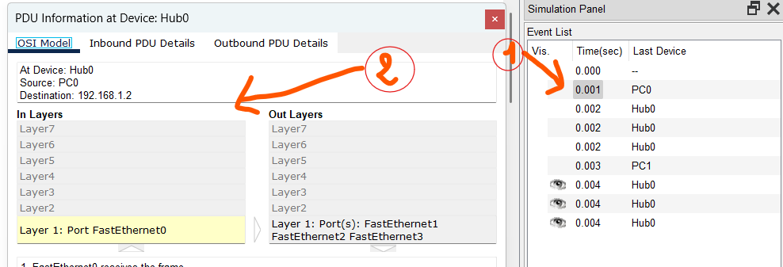{fig-alt="Capture d'écran de Packet Tracer : fenêtre « PDU Information at Device: Hub0 » (onglet OSI Model, source PC0, destination 192.168.1.2, entrée par FastEthernet0 et sortie par FastEthernet1, 2 et 3) et liste des événements avec une flèche vers la ligne 0.001 s."}

3. Observez que :
    - Chaque événement est enregistré dans la **Event List**.
    - La commande **ping** affiche une réponse **"Echo Reply"** du protocole ICMP envoyée par **PC1** vers **PC0**, confirmant que la communication fonctionne.
4. Continuez à cliquer sur **Capture / Forward** jusqu'à ce que tous les paquets aient été transmis.

💡 **Remarque importante :**

Le hub **diffuse** chaque trame reçue sur **tous ses ports**, **sauf celui par lequel elle est arrivée**. Cela illustre le comportement de diffusion typique d'un concentrateur, contrairement à un switch.

### Utiliser l'outil **Add Simple PDU** pour envoyer un ping

Une autre façon de tester la connectivité entre deux hôtes est d'utiliser l'outil **Simple PDU**. Cet outil permet d'envoyer une requête **ping** automatiquement, sans avoir à taper de commande.

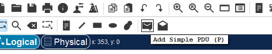{fig-alt="Capture d'écran de Packet Tracer : barre d'outils avec l'infobulle « Add Simple PDU (P) » sous l'icône d'enveloppe fermée."}

## Partie 2 : Quelques détails

### Voir une trame en utilisant l'analyseur de protocole

Pour examiner le protocole qui est en train d'être utilisé, cliquer sur la boite Info de couleur dans l'Event List

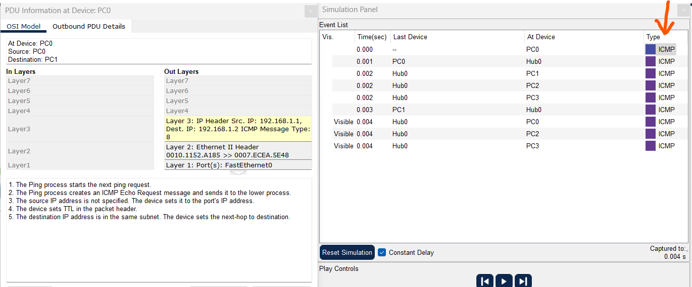{fig-alt="Capture d'écran de Packet Tracer : fenêtre PDU Information de PC0 (onglet Outbound PDU Details, trame Ethernet II 0010.1152.A185 vers 0007.ECEA.5E48, paquet IP 192.168.1.1 vers 192.168.1.2, message ICMP de type 8) et Event List dont tous les événements sont de type ICMP ; une flèche désigne la colonne Type."}

Par défaut, c'est le niveau 3 du modèle OSI qui est vu avec une description succincte du paquet :

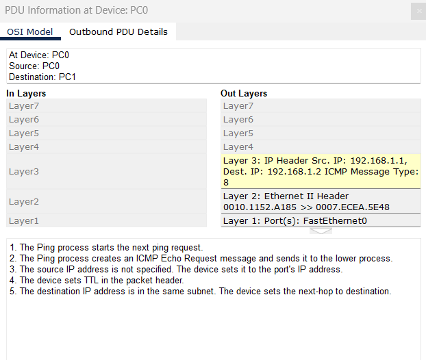{fig-alt="Capture d'écran de Packet Tracer : onglet OSI Model de PC0, avec les couches 7 à 1 ; la couche 3 est surlignée (IP source 192.168.1.1, destination 192.168.1.2, ICMP de type 8) ; cinq lignes de description du ping sous le schéma."}

Cliquer sur l'onglet Outbound PDU Details pour voir la trame Ethernet de niveau 2, le paquet IP de niveau 3 et le message ICMP.

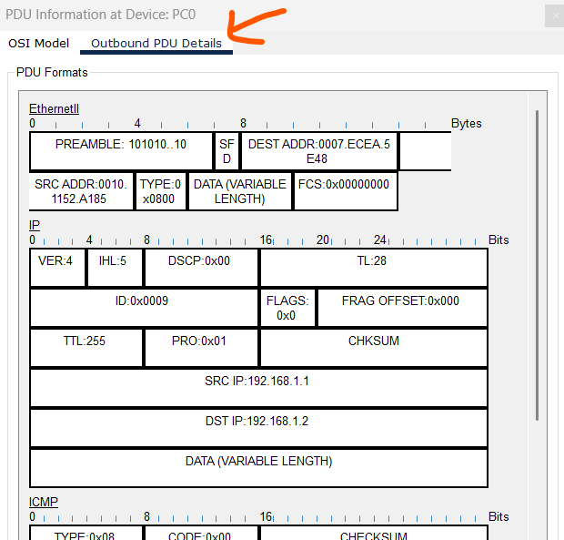{fig-alt="Capture d'écran de Packet Tracer : onglet Outbound PDU Details de PC0 (désigné par une flèche) montrant les champs de la trame Ethernet II (adresse destination 0007.ECEA.5E48, adresse source 0010.1152.A185, type 0x0800), de l'en-tête IP (192.168.1.1 vers 192.168.1.2, protocole 0x01) et le début du message ICMP (type 0x08)."}

Cliquer au niveau 2 sur la vue Outbound OSI Model pour avoir une description brève de ce qui se passé au niveau 2.

## Partie 3 : Étudier l'algorithme de commutation et la table d'adresses MAC

Dans cette activité, vous allez remplacer le **hub (concentrateur)** par un **switch (commutateur)** afin d'observer le fonctionnement du **niveau 2** du modèle OSI (couche liaison de données).

### Étapes à suivre :

1. **Supprimez le hub** de la topologie précédente.
2. Remplacez-le par un **switch** (commutateur de niveau 2).
3. Connectez les quatre PC au switch à l'aide de l'outil **connexion automatique** (icône de câble avec un éclair orange).
4. Cliquez sur l'onglet **Simulation** (en bas à droite) pour activer le **mode simulation**.

------------------------------------------------------------------------

L'objectif est d'analyser :

- Le **fonctionnement du switch**, qui apprend progressivement les adresses MAC de chaque machine.
- La **création de la table MAC** interne du switch.
- La **différence avec le hub**, qui diffuse tous les paquets, alors que le switch les envoie uniquement vers le bon port après apprentissage.

## Voir la table d'adresses MAC et la table ARP du switch

Utiliser l'outil Select pour voir l'adresse IP et MAC pour différents hôtes.

Utiliser l'outil Inspect pour voir la table d'adresses MAC du commutateur ou sa table ARP.

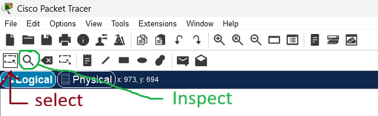{fig-alt="Capture d'écran de Packet Tracer : barre d'outils avec l'outil Select (flèche et légende « select ») et l'outil Inspect, une loupe (flèche verte et légende « Inspect »)."}

::: {.callout-note title="Question 2"}
Selon vous pourquoi la table d'adresses MAC du switch est vide ?
:::

Il y a aussi une colonne VLAN dans cette table qui sera étudiée plus tard.

**Remarque concernant STP dans Packet Tracer**

Lors de l'utilisation du protocole **STP (Spanning Tree Protocol)** dans Packet Tracer, il est normal que certaines interfaces de commutateurs apparaissent en **rouge** lorsque vous êtes en mode **Realtime**. Cela ne signifie pas qu'elles sont défaillantes : Packet Tracer utilise simplement cette couleur pour montrer que l'interface est temporairement bloquée par STP.

👉 **Pour forcer Packet Tracer à mettre à jour l'état des interfaces :**

1. Passez en mode **Realtime**.
2. Patientez un court instant, le temps que les interfaces passent **au vert**.
3. Revenez ensuite en mode **Simulation** pour poursuivre vos observations.

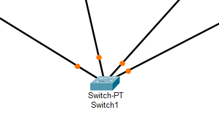{fig-alt="Capture d'écran de Packet Tracer : le switch Switch1 avec quatre câbles dont les extrémités côté switch portent un point orange."}

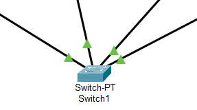{fig-alt="Capture d'écran de Packet Tracer : le switch Switch1 avec quatre câbles dont les extrémités côté switch portent un triangle vert."}

- Lancez un **ping** depuis la machine A vers la machine B.
- Allez dans **Event List Filters \> Edit Filters** et cochez uniquement **ARP** et **ICMP** pour n'afficher que ces paquets.

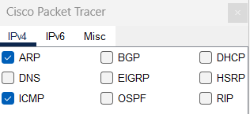{fig-alt="Capture d'écran de Packet Tracer : fenêtre de filtres, onglet IPv4, avec uniquement les cases ARP et ICMP cochées parmi ARP, BGP, DHCP, DNS, EIGRP, HSRP, ICMP, OSPF et RIP."}

### 🔍 ARP et ICMP en simulation

Le protocole **ARP** permet de trouver l'adresse MAC avant d'envoyer un paquet IP.

Lors d'un ping, le **paquet ARP** précède donc le **paquet ICMP**.

Effectuez la simulation comme précédemment (ping de **PC0** vers **PC1**) et observez, **à chaque clic du bouton "Avance"**, le déroulement des paquets dans le mode simulation.

### 🔹 Etape 1 : Mettez le PDU sur PC0 et PC1

::: {.callout-note title="Question 3"}
Combien de types de paquets (enveloppe) voyez-vous au départ sur PC0 ? Quelles sont leurs couleurs ? A quoi correspond chaque paquet ?
:::

Cliquez sur le (requête ARP) et observez son contenu.

::: {.callout-note title="Question 4"}
Quelle est l'adresse MAC de destination de la requête ARP ? Que signifie cette adresse ?
:::

::: {.callout-note title="Question 5"}
Quelles sont les adresses IP source et destination contenues dans la requête ARP ?
:::

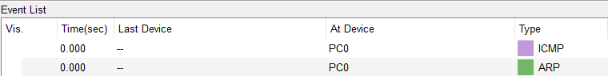{fig-alt="Capture d'écran de Packet Tracer : Event List avec deux lignes à 0.000 s sur PC0, une de type ICMP (violet clair) et une de type ARP (vert)."}

::: {.callout-note title="Question 6"}
Pourquoi la requête ARP est-elle envoyée en diffusion (broadcast) ?
:::

::: {.callout-warning}
\>\>\> (1) Appeler le professeur pour valider votre travail \<\<\<\<
:::

### 🔹 Etape 2 : Clic 1 sur le bouton avancer

À ce stade, la **table ARP** de **PC0** est encore vide.

Vérifiez-le en cliquant sur la **loupe** de PC0 pour observer que l'adresse MAC de PC1 n'a pas encore été apprise.

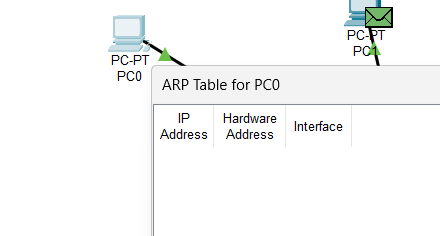{fig-alt="Capture d'écran de Packet Tracer : fenêtre « ARP Table for PC0 » avec les colonnes IP Address, Hardware Address et Interface, sans aucune ligne ; une enveloppe verte est posée sur PC1."}

### 🔹 Etape 3 : Clic 2 sur le bouton avancer

**PC0** transmet la trame contenant la **requête ARP** au **Switch0**.

Le commutateur **apprend l'adresse MAC source** de la trame.

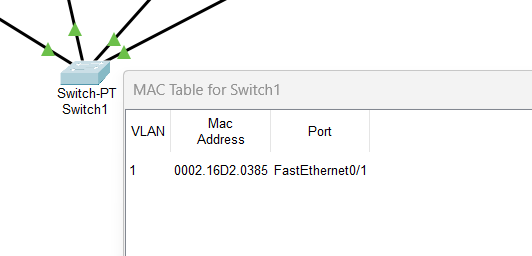{fig-alt="Capture d'écran de Packet Tracer : fenêtre « MAC Table for Switch1 » avec une ligne : VLAN 1, adresse 0002.16D2.0385, port FastEthernet0/1."}

### 🔹 Etape 4 : Clic 3 sur le bouton avance

Le paquet est envoyé en **broadcast** sur tous les ports du switch.

**PC2** et **PC3** ignorent (détruisent) la trame.

### 🔹 Etape 5 : Clic 4 sur le bouton avancer

**PC1** renvoie la **réponse ARP**.

**Switch0** apprend l'**adresse MAC source** de PC1.

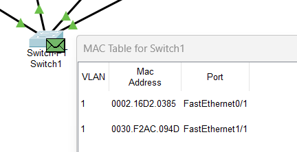{fig-alt="Capture d'écran de Packet Tracer : fenêtre « MAC Table for Switch1 » avec deux lignes : VLAN 1, adresse 0002.16D2.0385 sur FastEthernet0/1 et VLAN 1, adresse 0030.F2AC.094D sur FastEthernet1/1 ; une enveloppe est posée sur le switch."}

### 🔹 Etape 6 : Clic 5 sur le bouton avancer

Le **switch** transmet la trame directement vers **PC1**.

::: {.callout-note title="Question 7"}
Pourquoi le **switch** envoie la trame uniquement à **PC1** et pas à tous les PC comme le **hub** ?
:::

::: {.callout-note title="Question 8"}
Affichez la table ARP du PC0 . Que remarquez-vous ?
:::

::: {.callout-note title="Question 9"}
Affichez la table ARP du PC1 que remarquez-vous ?
:::

Une fois que le PC0 reçoit le paquet ARP deux paquets réapparaissent encore au niveau du PC0, il s'agit du paquet ARP reçu du pu paquet ICMP en attente d'envoi.

Maintenant envoyez le paquet ICMP en cliquant sur le bouton "avancer".

::: {.callout-note title="Question 10"}
Quelles sont maintenant les adresses MAC source et destination dans l'en-tête Ethernet du paquet ICMP ?
:::

::: {.callout-note title="Question 11"}
Pourquoi le premier paquet ping échoue-t-il parfois (Request Timeout) alors que les suivants réussissent ?

**Réponse (A expliquer au professeur) :**

Le premier paquet ping échoue parfois pour les raisons suivantes :

1. **Délai du protocole ARP** : Lors du premier ping, si l'adresse MAC de destination n'est pas dans la table ARP, le PC doit d'abord effectuer une requête ARP pour obtenir cette adresse MAC. **Ce processus prend du temps** :Émission de la requête ARP en diffusion+Propagation sur le réseau+Réception par le destinataire …..
2. **Dépassement du timeout ICMP** : Le protocole ICMP a un délai d'attente (timeout) limité. Si le processus ARP prend trop de temps, le premier paquet ICMP expire avant même d'avoir pu être envoyé, ce qui génère un "Request Timeout".
3. **Table ARP remplie pour les paquets suivants** : Une fois la réponse ARP reçue et l'adresse MAC stockée dans la table ARP, les paquets ping suivants peuvent être envoyés immédiatement sans attendre de nouvelle résolution ARP. C'est pourquoi ils réussissent.

**Résultat typique** : On obtient souvent 75% de succès (3 paquets sur 4 réussis) au lieu de 100% lors d'un premier ping vers une nouvelle destination.
:::

### 🔹 Nouvelle simulation de ping

Refaites un **ping** de **PC0** vers **PC1** en **mode simulation**.

Dans le **panneau Simulation**, observez la colonne **"Type"** :

Vous verrez apparaître les protocoles **ARP** et **ICMP**.

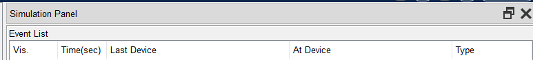{fig-alt="Capture d'écran de Packet Tracer : panneau Simulation avec l'Event List et ses colonnes Vis., Time(sec), Last Device, At Device et Type, sans aucune ligne."}

::: {.callout-note title="Question 12"}
- Quelle différence avec la simulation précédente et pourquoi ? Y a-t-il une requête ARP cette fois-ci ? Pourquoi ?
- Où est stockée l'adresse MAC de PC1 qui permet d'éviter une nouvelle requête ARP ?
- Que constatez-vous dans la colonne **"Type"** cette fois-ci ?
:::

::: {.callout-warning}
\>\>\> (2) Appeler le professeur pour valider votre travail \<\<\<\<
:::

## Partie 4 : La table ARP autrement

### Manipulation 3.1 : Consultation de la table ARP

Sur PC0, ouvrez le Command Prompt et tapez : `arp -a`

::: {.callout-note title="Question 13"}
Combien d'entrées voyez-vous ? Que contiennent-elles ? Que signifie le type "dynamique" ?
:::

### Suppression de la table ARP

Sur PC0, tapez : `arp -d`\
Puis affichez à nouveau la table : `arp -a`

::: {.callout-note title="Question 14"}
Que contient maintenant la table ARP ?
:::

::: {.callout-note title="Question 15"}
Si vous relancez le ping vers PC3, que va-t-il se passer ?
:::

### Enrichissement de la table ARP

1. Pinguez PC2 depuis PC0
2. Pinguez PC3 depuis PC0
3. Affichez la table ARP de PC0

::: {.callout-note title="Question 16"}
Combien d'entrées avez-vous maintenant dans la table ARP ? Listez-les.
:::

::: {.callout-note title="Question 17"}
Pourquoi est-il avantageux que les entrées de la table ARP soient temporaires (dynamiques) ?

**Réponse (A expliquer au professeur) :**

Les entrées de la table ARP sont temporaires car :

1. **Le réseau change** : si un appareil est débranché ou remplacé, son adresse MAC devient fausse. L'entrée ARP disparaît donc automatiquement.
2. **Mise à jour facile** : si un appareil change d'IP ou de carte réseau, la table ARP se mettra à jour toute seule lors de la prochaine communication.
3. **Moins de mémoire utilisée** : les entrées inutiles (adrese MAC-IP) s'effacent avec le temps, ce qui allège la table.
4. **Pas d'infos dépassées** : si un appareil ne communique plus, l'entrée expire (adrese MAC-IP) et s'efface, évitant de garder de mauvaises informations.
:::

::: {.callout-warning}
\>\>\> (3) Appeler le professeur pour valider votre travail \<\<\<\<
:::

## Partie 5 : Communication inter-réseaux avec routeur

### 1. Création de la topologie

1. Copiez votre topologie précédente (Ctrl+C, Ctrl+V)
2. Modifiez les adresses IP du second réseau :
    - PC0(0) : 192.168.2.1
    - PC1(1) : 192.168.2.2
    - PC2(2) : 192.168.2.3
    - PC3(3) : 192.168.2.4
3. Ajoutez un routeur entre les deux commutateurs (câbles droits) (N'oubliez pas de configurer les interfaces du routeur et les passerelles par defaut)

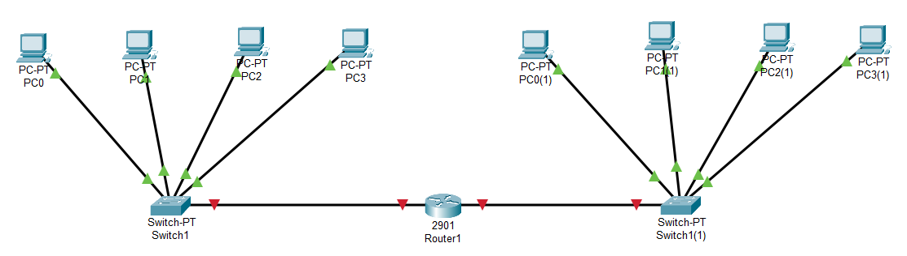{fig-alt="Capture d'écran de Packet Tracer : à gauche quatre PC (PC0 à PC3) reliés à Switch1, à droite quatre PC (PC0(1) à PC3(1)) reliés à Switch1(1), et au centre un routeur 2901 (Router1) relié à chacun des deux switches ; les liaisons entre les switches et le routeur portent des triangles rouges."}

### 2. Ping inter-réseaux en mode simulation

1. Passez en mode simulation
2. Ajouter un PDU de PC0 (réseau 1) vers PC0 (réseau 2)
3. Observez la requête ARP

::: {.callout-note title="Question 18"}
Qui répond à la requête ARP émise par PC0 du réseau 1 ? Est-ce PC0 du réseau 2 ?
:::

::: {.callout-note title="Question 19"}
Pourquoi PC0 doit-il connaître l'adresse MAC du routeur (passerelle) et non celle du PC distant ?
:::

### 3. Analyse des en-têtes Ethernet

Observez le paquet ICMP qui traverse le routeur, attendez que le paquet atteigne le routeur puis cliquez dessus :

1. Notez les adresses MAC avant le routeur (inbound)
2. Notez les adresses MAC après le routeur (outbound)

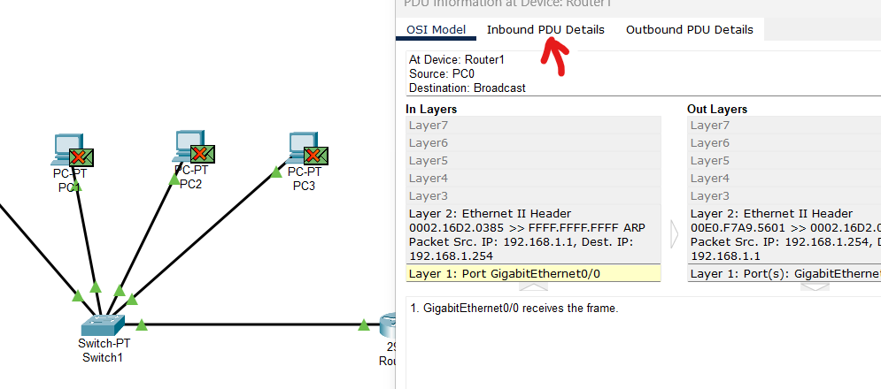{fig-alt="Capture d'écran de Packet Tracer : fenêtre « PDU Information at Device: Router1 » avec l'onglet Inbound PDU Details désigné par une flèche rouge ; trame ARP de PC0 en broadcast (0002.16D2.0385 vers FFFF.FFFF.FFFF), reçue sur GigabitEthernet0/0 ; à gauche, des enveloppes marquées d'une croix sur PC1, PC2 et PC3."}

::: {.callout-note title="Question 20"}
Les adresses MAC source et destination changent-elles au passage du routeur ? Pourquoi ?
:::

**Question :** Complétez le tableau suivant pour un paquet allant de PC0 (LAN1) vers PC0 (LAN2)

| Position | MAC Source | MAC Destination |
|----|----|----|
| PC0 (LAN1) émetteur |  |  |
| Entrée routeur |  |  |
| Sortie routeur |  |  |
| PC0 (LAN2) récepteur |  |  |

### 4. Requête ARP du routeur

Observez que le routeur émet également une requête ARP.

::: {.callout-note title="Question 21"}
Pourquoi le routeur émet-il une requête ARP vers le réseau 2 ?
:::

::: {.callout-note title="Question 22"}
Le routeur peut-il formuler des requêtes ARP comme un PC ? Est-ce surprenant ?
:::

::: {.callout-warning}
\>\>\> (4) Appeler le professeur pour valider votre travail \<\<\<\<
:::

## Partie 6 : Tables ARP et routage

### Table ARP du routeur

Sur le routeur, tapez : `show ip arp`

::: {.callout-note title="Question 23"}
Combien d'entrées contient la table ARP du routeur initialement (après quelques pings) ?
:::

::: {.callout-note title="Question 24"}
Que remarquez-vous de particulier ? Le routeur stocke-t-il ses propres interfaces dans sa table ARP ?
:::

### Table ARP du PC

Sur PC0 du réseau 1, affichez la table ARP : `arp -a`

::: {.callout-note title="Question 25"}
Combien d'entrées voyez-vous ? Le PC stocke-t-il sa propre adresse MAC ?
:::

::: {.callout-note title="Question 26"}
Voyez-vous l'adresse MAC de PC0 du réseau 2 dans cette table ? Pourquoi ?
:::

::: {.callout-note title="Question 27"}
En général, combien d'entrées maximum peut-on avoir dans la table ARP d'un PC appartenant à un réseau de N équipements (en comptant le PC lui-même) ? (question mathématique 😎 )
:::

::: {.callout-warning}
\>\>\> (5) Appeler le professeur pour valider votre travail \<\<\<\<
:::
