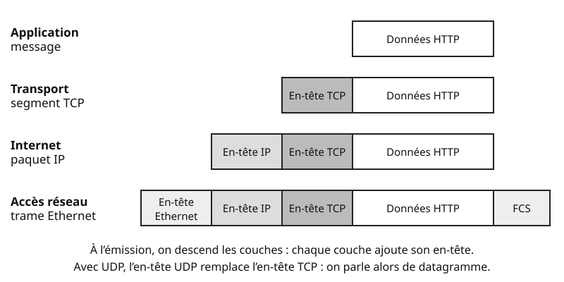
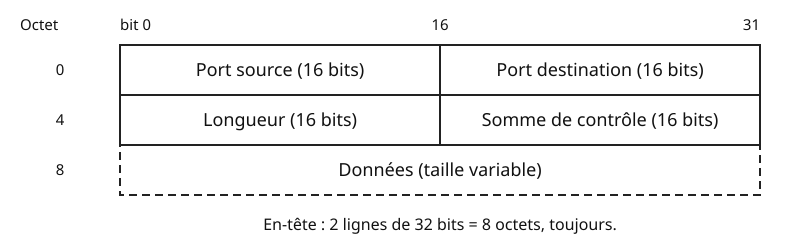
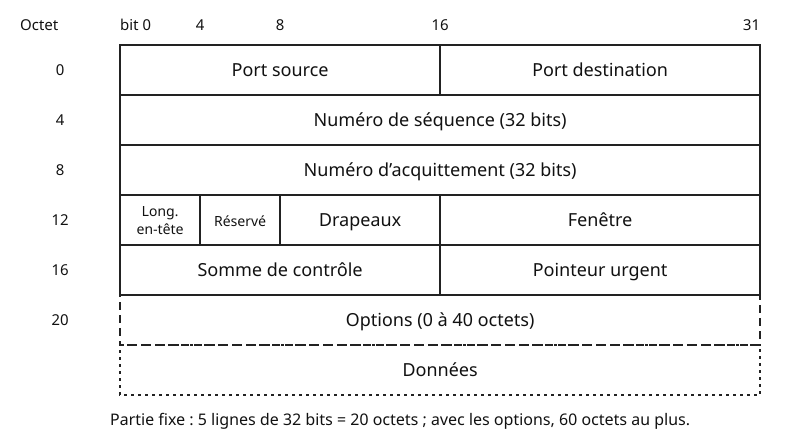
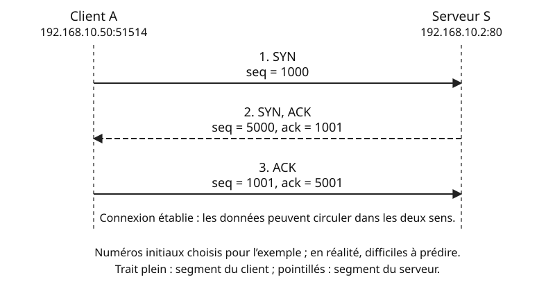

## Objectifs et prérequis

À l’issue du cours, vous saurez expliquer comment un paquet arrive au bon
programme. Vous saurez aussi décrire comment TCP rend l’échange fiable,
par des acquittements (accusés de réception) et des retransmissions. Enfin, vous saurez choisir entre TCP et UDP et observer ces deux
protocoles sur une machine réelle.

Vous devez connaître l’adressage IPv4 et le fonctionnement de la couche
liaison : trame Ethernet, adresse MAC, ARP.

Les observations utilisent **Debian 12** (commande `ss` du paquet `iproute2`)
et **Wireshark**, dans un réseau pédagogique isolé.

## Situation de départ

Reprenons le réseau de la salle informatique, `192.168.10.0/24`. Le serveur S,
à l’adresse `192.168.10.2`, héberge trois services : un site web, un serveur
DNS et un accès d’administration SSH.

Depuis le poste A (`192.168.10.50`), vous faites trois choses en même temps :

| Action sur A | Service sur S | Transport | Port sur S |
|:---|:---|:-:|:-:|
| Consulter l’intranet | Serveur web HTTP | TCP | 80 |
| Résoudre le nom `intranet.lycee.lan` | Serveur DNS | UDP | 53 |
| Administrer S à distance | Serveur SSH | TCP | 22 |

Tous ces paquets portent la même adresse IP de destination : `192.168.10.2`.
Deux questions se posent :

1. Comment S remet-il chaque paquet au bon programme ?
2. Que se passe-t-il si un paquet se perd en route ?

IP ne répond à aucune de ces deux questions. C’est le travail de la
**couche transport**, et de ses deux protocoles principaux : **TCP** et **UDP**.

## Comprendre le mécanisme

### La couche transport dans le modèle TCP/IP

Quand votre navigateur demande une page, la requête HTTP ne part pas seule.
Elle est d’abord placée dans un segment TCP. Ce segment est placé dans un
paquet IP, lui-même placé dans une trame Ethernet.

{fig-alt="Quatre lignes empilées. Application : les données HTTP seules. Transport : en-tête TCP puis données HTTP, c’est le segment TCP. Internet : en-tête IP, en-tête TCP, données, c’est le paquet IP. Accès réseau : en-tête Ethernet, en-tête IP, en-tête TCP, données et FCS, c’est la trame Ethernet."}

Ce mécanisme s’appelle l’**encapsulation**. Chaque couche ajoute son en-tête
et confie le tout à la couche du dessous. À l’arrivée, chaque couche retire
son en-tête : c’est la **désencapsulation**.

| Couche TCP/IP | Rôle | Exemples | Unité de données | Identifiant |
|:---|:---|:---|:---|:---|
| Application | Rendre un service à l’utilisateur | HTTP, DNS, SSH | message | — |
| Transport | Relier deux programmes | TCP, UDP | segment (TCP), datagramme (UDP) | port |
| Internet | Acheminer d’une machine à l’autre | IPv4, IPv6 | paquet | adresse IP |
| Accès réseau | Transmettre sur un lien local | Ethernet, Wi-Fi | trame | adresse MAC |

IP livre un paquet **à une machine**, sans garantie. Un paquet peut être perdu,
dupliqué ou arriver dans le désordre. On dit qu’IP fonctionne « au mieux »
(*best effort*).

La couche transport ajoute deux services :

- le **multiplexage par ports**, assuré par TCP et UDP : plusieurs programmes
  partagent la même adresse IP ;
- la **fiabilité**, assurée par TCP seulement : accusés de réception,
  retransmission et remise dans l’ordre.

La fiabilité est donc optionnelle. L’application la choisit en choisissant TCP.

::: {.callout-note}
## À retenir

IP relie deux **machines** ; la couche transport relie deux **programmes**.
TCP et UDP fournissent tous deux les ports. Seul TCP ajoute la fiabilité.
:::

### Les ports et les sockets

Sur A, vous lancez en même temps deux téléchargements depuis l’intranet. Dans
cet exemple, chacun ouvre sa propre connexion vers `192.168.10.2`, port 80.
Pourtant, S ne mélange pas les réponses. Regardez les ports :

| Téléchargement | Adresse et port de A | Adresse et port de S |
|:---|:---|:---|
| Téléchargement 1 | `192.168.10.50:51514` | `192.168.10.2:80` |
| Téléchargement 2 | `192.168.10.50:51516` | `192.168.10.2:80` |

Un **port** est un numéro sur 16 bits, de 0 à 65 535. Il désigne un programme
sur une machine. Chaque en-tête TCP ou UDP en contient deux :

- le **port de destination** désigne le service visé, ici 80 ;
- le **port source** désigne le programme émetteur. Côté client, le système
  le choisit lui-même : on parle de **port éphémère**.

Le serveur répond en inversant les deux ports. La réponse du téléchargement 1 part
du port 80 vers le port 51514.

L’association d’une adresse IP, d’un port et d’un protocole s’appelle un
**socket**. Par exemple, le serveur web écoute sur le socket TCP
`192.168.10.2:80`. Une connexion TCP est identifiée par ses deux sockets :
celui du client et celui du serveur. Les deux téléchargements diffèrent par le
port source : ce sont deux connexions distinctes.

::: {.callout-warning}
## Un port appartient à un protocole

Le port UDP 53 et le port TCP 53 sont deux sockets différents. Un serveur DNS
écoute d’ailleurs sur les deux. Précisez donc toujours le protocole avec le
port.
:::

L’IANA, l’organisme qui gère ces numéros, découpe les ports en trois plages :

| Plage | Nom | Usage |
|:---|:---|:---|
| 0 à 1023 | ports systèmes ou « bien connus » | services standard (SSH, HTTP…) |
| 1024 à 49151 | ports enregistrés | services déclarés auprès de l’IANA (RDP, MySQL…) |
| 49152 à 65535 | ports dynamiques ou privés | ports éphémères, jamais attribués |

Les systèmes ne suivent pas tous cette dernière plage pour leurs ports
éphémères. Windows utilise bien 49152 à 65535. Linux utilise par défaut 32768 à
60999.

Voici les ports à connaître pour le BTS. Ce sont les ports **côté serveur**,
sauf pour DHCP : 67 côté serveur, 68 côté client.

| Service | Transport | Port(s) | Remarque |
|:---|:-:|:-:|:---|
| SSH | TCP | 22 | administration chiffrée |
| Telnet | TCP | 23 | administration non chiffrée, à éviter |
| SMTP | TCP | 25 | envoi de courriel entre serveurs |
| DNS | UDP et TCP | 53 | UDP pour les requêtes courantes |
| DHCP | UDP | 67 et 68 | 67 côté serveur, 68 côté client |
| TFTP | UDP | 69 | sauvegarde de configurations Cisco |
| HTTP | TCP | 80 | web non chiffré |
| NTP | UDP | 123 | synchronisation de l’heure |
| SNMP | UDP | 161 et 162 | 161 : agent ; 162 : notifications (*traps*) |
| HTTPS | TCP | 443 | web chiffré par TLS, le protocole de chiffrement de HTTPS |
| RDP | TCP | 3389 | bureau à distance Windows |

DNS passe par TCP quand la réponse est trop grande pour UDP ou pour copier
une zone entière entre serveurs. HTTPS peut aussi utiliser UDP 443 avec
HTTP/3 ; nous ne l’étudions pas ici.

### UDP : envoyer sans connexion

A doit connaître l’adresse de `intranet.lycee.lan`. Il envoie un seul
datagramme vers `192.168.10.2`, port UDP 53. S répond par un seul datagramme.
Il n’y a ni ouverture de connexion, ni accusé de réception. Si la question se
perd, c’est le programme de A qui la repose après un délai.

**UDP** (*User Datagram Protocol*) fonctionne exactement ainsi. Il est **sans
connexion** : chaque datagramme part seul. Il n’offre aucune garantie de
livraison ni d’ordre. En échange, il est simple et rapide.

{fig-alt="Grille de 32 bits de large. Première ligne : port source sur 16 bits, port destination sur 16 bits. Deuxième ligne : longueur sur 16 bits, somme de contrôle sur 16 bits. Ensuite, les données de taille variable. L’en-tête mesure toujours 8 octets."}

L’en-tête UDP compte **quatre champs de 16 bits**, soit **8 octets** :

| Champ | Taille | Rôle |
|:---|:-:|:---|
| Port source | 16 bits | port de l’émetteur ; peut valoir 0 si aucune réponse n’est attendue |
| Port destination | 16 bits | port du service visé |
| Longueur | 16 bits | taille de l’en-tête **et** des données, en octets ; 8 au minimum |
| Somme de contrôle | 16 bits | détection des erreurs ; facultative en IPv4 (0 = non calculée), obligatoire en IPv6 |

Exemple : la requête DNS de A contient 32 octets de données. Le champ
Longueur vaut donc 8 + 32 = **40**.

UDP convient dans trois cas :

- **les échanges courts** de type question-réponse : DNS, DHCP, NTP, SNMP ;
- **le temps réel**, où une donnée en retard est inutile : téléphonie sur IP
  (VoIP), visioconférence, diffusion en direct, jeux en ligne ;
- **la diffusion** à tout le réseau, impossible en TCP : la première demande
  d’un client DHCP, qui n’a pas encore d’adresse, est diffusée à tout le réseau.

::: {.callout-tip}
## UDP n’est pas un mauvais TCP

Dans un appel vocal, une syllabe retransmise arriverait trop tard : elle ne
servirait à rien. Si une application a besoin de fiabilité sur UDP, elle la
gère elle-même. TFTP,
par exemple, attend un accusé de réception après chaque bloc.
:::

### TCP : l’en-tête et les drapeaux

Vous téléchargez une image disque de 2 Go depuis S. Un seul octet perdu, et le
fichier est inutilisable. Il faut que tout arrive, sans erreur et dans
l’ordre.

**TCP** (*Transmission Control Protocol*) répond à ce besoin. Il est
**fiable** et **orienté connexion** : les deux extrémités s’accordent avant d’échanger. Il
numérote chaque octet envoyé, attend des accusés de réception et retransmet
ce qui manque. Son en-tête est donc plus riche que celui d’UDP.

{fig-alt="Grille de 32 bits de large. Ligne 1 : port source et port destination, 16 bits chacun. Ligne 2 : numéro de séquence sur 32 bits. Ligne 3 : numéro d’acquittement sur 32 bits. Ligne 4 : longueur d’en-tête sur 4 bits, réservé sur 4 bits, drapeaux sur 8 bits, fenêtre sur 16 bits. Ligne 5 : somme de contrôle et pointeur urgent, 16 bits chacun. Puis options, de 0 à 40 octets, et données. La partie fixe mesure 20 octets, l’en-tête complet 60 octets au plus."}

| Champ | Taille | Rôle |
|:---|:-:|:---|
| Port source, port destination | 16 bits chacun | comme en UDP |
| Numéro de séquence | 32 bits | numéro du premier octet de données du segment |
| Numéro d’acquittement | 32 bits | numéro du **prochain octet attendu** ; valable si le drapeau ACK est levé |
| Longueur d’en-tête | 4 bits | taille de l’en-tête en mots de 32 bits : 5 donne 20 octets, 15 donne 60 octets |
| Réservé | 4 bits | inutilisé, à 0 |
| Drapeaux | 8 bits | type et rôle du segment (voir ci-dessous) |
| Fenêtre | 16 bits | nombre d’octets que l’émetteur du segment accepte encore de recevoir |
| Somme de contrôle | 16 bits | détection des erreurs ; obligatoire |
| Pointeur urgent | 16 bits | utilisé seulement si le drapeau URG est levé |
| Options | 0 à 40 octets | par exemple la taille maximale de segment (MSS) |

L’en-tête mesure **20 octets au minimum**, sans options, et 60 octets au
plus.

Chaque drapeau est un bit. Un drapeau « levé » vaut 1. Six drapeaux sont à
connaître :

| Drapeau | Nom anglais | Signification quand il vaut 1 |
|:-:|:---|:---|
| SYN | *synchronize* | ouverture de connexion : « voici mon numéro de séquence initial » |
| ACK | *acknowledgment* | le numéro d’acquittement est valable |
| FIN | *finish* | « je n’ai plus de données à envoyer » |
| RST | *reset* | interruption immédiate, ou refus d’une connexion |
| PSH | *push* | remettre les données à l’application sans attendre |
| URG | *urgent* | le pointeur urgent est valable ; rarement utilisé |

Les deux autres bits, CWR et ECE, servent à signaler une congestion du
réseau. Ils seront vus en deuxième année.

### La poignée de main en trois temps

Avant d’envoyer la requête HTTP, A doit ouvrir une connexion avec S. Les deux
machines échangent trois segments :

{fig-alt="Diagramme de séquence entre le client A, 192.168.10.50 port 51514, et le serveur S, 192.168.10.2 port 80. 1 : A envoie SYN avec seq égal à 1000. 2 : S répond SYN, ACK avec seq égal à 5000 et ack égal à 1001. 3 : A envoie ACK avec seq égal à 1001 et ack égal à 5001. La connexion est alors établie."}

1. **SYN** : A propose d’ouvrir la connexion et annonce son numéro de séquence
   initial, ici 1000.
2. **SYN, ACK** : S accepte. Il annonce son propre numéro initial, 5000, et
   acquitte celui de A : `ack = 1001`.
3. **ACK** : A acquitte le numéro de S : `ack = 5001`.

Cet échange s’appelle la **poignée de main en trois temps** (*three-way
handshake*). Chaque côté connaît alors le numéro de départ de l’autre.

Ici, le SYN ne transporte aucune donnée. Pourtant, il **consomme un numéro de
séquence**. C’est pourquoi S répond `ack = 1001` et non `ack = 1000`. Le FIN
consomme lui aussi un numéro.

Si aucun programme n’écoute sur le port demandé, S répond par un segment
**RST**. La connexion est refusée.

::: {.callout-note}
## Numéros initiaux difficiles à prédire

Nous prenons 1000 et 5000 pour simplifier. En réalité, chaque côté calcule son
numéro initial à partir d’une horloge et d’un secret propre à la machine. Le
résultat est difficile à prédire. Un attaquant extérieur à la communication
a ainsi plus de mal à deviner les numéros pour injecter de faux segments.
:::

### Séquence et acquittement

La connexion est ouverte. A envoie sa requête HTTP de 200 octets. S répond par
une page de 1 000 octets. Suivez les numéros :

| N° | Sens | Drapeaux | seq | ack | Données |
|:-:|:-:|:-:|:-:|:-:|:-:|
| 1 | A → S | SYN | 1000 | — | 0 |
| 2 | S → A | SYN, ACK | 5000 | 1001 | 0 |
| 3 | A → S | ACK | 1001 | 5001 | 0 |
| 4 | A → S | PSH, ACK | 1001 | 5001 | 200 |
| 5 | S → A | ACK | 5001 | 1201 | 0 |
| 6 | S → A | PSH, ACK | 5001 | 1201 | 1 000 |
| 7 | A → S | ACK | 1201 | 6001 | 0 |

Le segment 4 porte les octets numérotés de 1001 à 1200. S attend donc ensuite
l’octet 1201 : il répond `ack = 1201`. De même, le segment 6 porte les octets
5001 à 6000, d’où `ack = 6001`.

Le **numéro de séquence** indique la place des données dans le flux.
Le **numéro d’acquittement** annonce le prochain octet attendu. Il confirme
du même coup tous les octets précédents : on dit que l’acquittement est
**cumulatif**.

::: {.callout-note}
## La règle de calcul

**ack = premier octet que le destinataire n’a pas encore reçu**

Dans le cas simple, le segment reçu est celui attendu et rien n’est conservé
au-delà. On calcule alors : **ack = seq reçu + nombre d’octets de données**.
Ajoutez 1 si le segment porte SYN ou FIN. Un segment sans données, sans SYN ni
FIN, ne fait pas avancer le numéro de séquence.

Si un segment arrive hors ordre, après un trou, l’ack ne bouge pas. Il reste
sur le premier octet manquant. Quand le trou est comblé, l’ack saute après les
données déjà conservées : vous le verrez dans la section suivante.
:::

### La retransmission

Reprenons après le segment 7. A envoie deux segments de 500 octets. Le premier
se perd en route.

| Segment de A | seq | Octets portés | Sort |
|:---|:-:|:---|:---|
| Segment X | 1201 | 1201 à 1700 | perdu |
| Segment Y | 1701 | 1701 à 2200 | reçu par S |

S reçoit Y, mais il attend toujours l’octet 1201. Il répond donc encore
`ack = 1201`. Il conserve Y de côté.

Quand A envoie des données, il démarre un **minuteur de retransmission**,
s’il ne tourne pas déjà. Ici, le minuteur expire sans acquittement au-delà
de 1201. A **retransmet** alors le segment X. S
possède maintenant les octets 1201 à 2200 : il répond `ack = 2201`.

Les acquittements en double peuvent aussi déclencher une retransmission plus
rapide. Ce mécanisme sera détaillé en deuxième année.

Si les retransmissions échouent trop longtemps, TCP abandonne la connexion. Il
signale alors l’échec à l’application : la fiabilité n’est pas une garantie
absolue de livraison.

### La fenêtre

Supposons que S annonce une fenêtre de 4 000 octets. A peut alors envoyer
jusqu’à 4 000 octets sans attendre d’acquittement. Par exemple, il envoie
quatre segments de 1 000 octets, puis il attend.

Le champ **Fenêtre** indique combien d’octets le destinataire peut encore
recevoir. Il dépend de la place libre dans sa mémoire de réception. Si cette
mémoire est pleine, le destinataire annonce une fenêtre de 0 : l’émetteur
s’arrête. Ce mécanisme s’appelle le **contrôle de flux**. Il protège le
destinataire contre un émetteur trop rapide.

Sur 16 bits, la fenêtre vaut au plus 65 535 octets. Une option de l’en-tête,
l’échelle de fenêtre (*window scale*), permet d’aller au-delà.

Le contrôle de flux protège le **destinataire**. Le contrôle de congestion,
qui protège le **réseau**, sera vu en deuxième année.

### La fermeture de connexion

A a reçu sa page et ferme la connexion. Chaque sens se ferme séparément, par
un FIN acquitté. Pour simplifier, nous repartons du segment 7 du tableau de
séquence, sans la retransmission :

| N° | Sens | Drapeaux | seq | ack |
|:-:|:-:|:-:|:-:|:-:|
| 1 | A → S | FIN, ACK | 1201 | 6001 |
| 2 | S → A | ACK | 6001 | 1202 |
| 3 | S → A | FIN, ACK | 6001 | 1202 |
| 4 | A → S | ACK | 1202 | 6002 |

Le FIN de A consomme un numéro : S acquitte 1202. Souvent, S regroupe les
segments 2 et 3 en un seul FIN, ACK : la fermeture tient alors en trois
segments.

Un segment **RST**, au contraire, coupe la connexion d’un coup, sans
échange de FIN.

::: {.callout-note}
## À retenir sur TCP

- Ouverture : SYN, puis SYN-ACK, puis ACK.
- seq = numéro du premier octet porté ; ack = prochain octet attendu.
- Un octet non acquitté à temps est retransmis.
- La fenêtre limite ce que l’émetteur peut envoyer sans acquittement.
- Fermeture : un FIN acquitté dans chaque sens ; RST pour couper net.
:::

### Comparer TCP et UDP et choisir

| Critère | TCP | UDP |
|:---|:---|:---|
| Connexion | oui : poignée de main en trois temps | non |
| Livraison | fiable : acquittements et retransmissions ; en cas d’échec persistant, l’application est prévenue | non garantie, perte non signalée |
| Ordre | rétabli à l’arrivée | non garanti |
| Contrôle de flux | oui, par la fenêtre | non |
| Taille de l’en-tête | 20 à 60 octets | 8 octets |
| Diffusion à tout le réseau | impossible | possible |
| Délai | plus élevé : ouverture, attentes, retransmissions | faible |
| Exemples | HTTP, HTTPS, SSH, SMTP | DNS, DHCP, NTP, VoIP, TFTP |

Pour choisir, posez-vous trois questions, dans l’ordre :

1. **Une donnée en retard est-elle inutile ?** Voix, vidéo en direct, jeu :
   choisissez **UDP**.
2. **L’échange tient-il en une question et une réponse, ou doit-il être
   diffusé ?** Choisissez **UDP** ; l’application reposera la question si
   besoin.
3. **Toutes les données doivent-elles arriver, complètes et dans l’ordre ?**
   Fichier, page web, commande d’administration : choisissez **TCP**.

## Observer et appliquer

### Lister les sockets d’une machine Debian

**Plateforme : Debian 12, commande `ss` du paquet `iproute2`.** La commande
`ss` liste les sockets ouverts sur la machine. On la lance ici sur le
serveur S.

```bash
# Sockets TCP et UDP en écoute, avec numéros de port bruts
ss -tuln
# Connexions TCP et UDP établies (sockets non en écoute)
ss -tun
# Même liste que ss -tuln, avec le programme associé (droits root nécessaires)
sudo ss -tulnp
```

| Option | Effet |
|:-:|:---|
| `-t` | afficher les sockets TCP |
| `-u` | afficher les sockets UDP |
| `-l` | afficher seulement les sockets en écoute |
| `-n` | afficher les numéros de port, sans les traduire en noms de service |
| `-p` | afficher le programme qui utilise chaque socket |

Voici un extrait simplifié de `ss -tuln` sur S :

```text
Netid State  Recv-Q Send-Q Local Address:Port Peer Address:Port Process
udp   UNCONN 0      0       192.168.10.2:53        0.0.0.0:*
tcp   LISTEN 0      10      192.168.10.2:53        0.0.0.0:*
tcp   LISTEN 0      128          0.0.0.0:22        0.0.0.0:*
tcp   LISTEN 0      511          0.0.0.0:80        0.0.0.0:*
```

Lisez-le colonne par colonne :

- **Netid** donne le protocole : `udp` ou `tcp` ;
- **State** vaut `LISTEN` pour un socket TCP en écoute. UDP est sans
  connexion : un socket UDP en attente, associé à aucun correspondant,
  apparaît `UNCONN` ;
- **Local Address:Port** est le socket local. `0.0.0.0` signifie « toutes les
  adresses IPv4 de la machine » ;
- **Peer Address:Port** vaut `0.0.0.0:*` (adresse et port quelconques) tant
  qu’aucun correspondant n’est connecté.

On retrouve bien les trois services : DNS sur UDP 53 et TCP 53, SSH sur TCP
22, HTTP sur TCP 80.

Pendant que A administre S en SSH, `ss -tun` sur S affiche :

```text
Netid State Recv-Q Send-Q Local Address:Port  Peer Address:Port Process
tcp   ESTAB 0      0       192.168.10.2:22   192.168.10.50:51520
```

`ESTAB` signifie que la connexion est établie. Le port 51520 de A est un port
éphémère. A tourne sous Debian : ce port fait partie de la plage par défaut de
Linux.

### Filtrer TCP et UDP dans Wireshark

**Plateforme : Wireshark sous Debian 12, filtres d’affichage.** Saisissez ces
filtres dans la barre de filtre, au-dessus de la liste des paquets.

| Filtre | Ce qui reste affiché |
|:---|:---|
| `tcp` ou `udp` | tout le trafic TCP, ou tout le trafic UDP |
| `udp.port == 53` | le DNS sur UDP, dans les deux sens |
| `tcp.port == 80` | le trafic HTTP, dans les deux sens |
| `tcp.dstport == 22` | les segments envoyés vers un serveur SSH |
| `tcp.flags.syn == 1` | les SYN et les SYN-ACK |
| `tcp.flags.syn == 1 && tcp.flags.ack == 0` | seulement les demandes d’ouverture |
| `tcp.flags.fin == 1` | les segments de fermeture |
| `tcp.flags.reset == 1` | les segments RST |
| `tcp.analysis.retransmission` | les retransmissions détectées par Wireshark |

Attention : le champ du drapeau RST s’écrit `tcp.flags.reset`, et non
`tcp.flags.rst`.

Observation guidée, sur le poste A sous Debian 12 :

1. Lancez une capture Wireshark sur l’interface reliée au réseau de la salle.
2. Dans un terminal, lancez `curl http://192.168.10.2/` (paquet `curl`) pour
   demander la page d’accueil de S.
3. Arrêtez la capture et appliquez le filtre `tcp.port == 80`.
4. Repérez les trois segments de la poignée de main, puis les segments de
   fermeture.
5. Vérifiez la règle de calcul des numéros d’acquittement sur chaque segment.

::: {.callout-warning}
## Numéros relatifs

Par défaut, Wireshark affiche des numéros de séquence **relatifs** : le SYN
porte `seq = 0`. Les vraies valeurs, difficiles à prédire, sont dans les champs
`tcp.seq_raw` et `tcp.ack_raw`.
:::

### Vérifier sa compréhension

::: {.content-visible when-format="html"}
<details>
<summary>Un segment reçu dans l’ordre, celui qui était attendu, porte seq = 8000 et 300 octets de données, sans SYN ni FIN. Quel numéro d’acquittement renvoie le destinataire ?</summary>
<p>ack = 8000 + 300 = 8300. Les octets reçus vont de 8000 à 8299 ; le prochain attendu est le 8300.</p>
</details>

<details>
<summary>Pourquoi DHCP ne peut-il pas utiliser TCP ?</summary>
<p>Le client DHCP n’a pas encore d’adresse et ne connaît pas le serveur : il doit diffuser sa demande. Or TCP ne relie que deux machines précises et ne permet pas la diffusion.</p>
</details>
:::

::: {.content-visible unless-format="html"}
**Question 1.** Un segment reçu dans l’ordre, celui qui était attendu, porte
seq = 8000 et 300 octets de données, sans SYN ni FIN. Quel numéro
d’acquittement renvoie le destinataire ?

**Réponse.** ack = 8000 + 300 = 8300. Les octets reçus vont de 8000 à 8299 ;
le prochain attendu est le 8300.

**Question 2.** Pourquoi DHCP ne peut-il pas utiliser TCP ?

**Réponse.** Le client DHCP n’a pas encore d’adresse et ne connaît pas le
serveur : il doit diffuser sa demande. Or TCP ne relie que deux machines
précises et ne permet pas la diffusion.
:::

## Exercices de vérification

1. **Ports et plages.** Pour chaque port, donnez sa plage IANA. S’il s’agit
   d’un port usuel côté serveur, donnez aussi le service et le protocole de
   transport : 22, 53, 123, 443, 3389, 51514.
2. **Tailles d’en-têtes.**

   a. Un datagramme UDP transporte 48 octets de données. Que vaut son champ
      Longueur ?
   b. Le champ Longueur d’en-tête d’un segment TCP vaut 8. Quelle est la
      taille de l’en-tête ? Celle des options ?
   c. Une trame Ethernet transporte au plus 1 500 octets de paquet IP. Un
      en-tête IPv4 sans options mesure 20 octets. Combien d’octets de données
      un segment TCP sans options peut-il porter ? Et un datagramme UDP ?
3. **Séquence et acquittement.** Le client C ouvre une connexion vers le
   serveur W. Le numéro initial de C est 2000, celui de W est 7000. C envoie
   300 octets, W les acquitte. W envoie ensuite 1 200 octets, C les acquitte.
   Complétez le tableau des sept segments : sens, drapeaux, seq, ack, nombre
   d’octets de données.
4. **Retransmission.** Juste après l’exercice 3, C envoie trois segments de
   500 octets. Le deuxième se perd. W conserve les segments reçus hors
   ordre.

   a. Donnez le numéro de séquence de chaque segment.
   b. Quel ack W renvoie-t-il après le premier, puis après le troisième
      segment ?
   c. Quel segment C retransmet-il ? Quel ack W renvoie-t-il ensuite ?
5. **Choisir le transport.** Pour chaque application, indiquez TCP ou UDP et
   justifiez en une phrase : une visioconférence ; la consultation d’une page
   d’administration HTTPS ; la synchronisation de l’heure d’un commutateur ;
   la sauvegarde de la configuration d’un routeur Cisco en TFTP.
6. **Observer.**

   a. Écrivez le filtre Wireshark qui affiche seulement les demandes
      d’ouverture de connexion vers un serveur SSH.
   b. Interprétez cette ligne de `ss -tun`, relevée sur S (Debian 12) :

      ```text
      tcp   ESTAB 0      0       192.168.10.2:80   192.168.10.51:43018
      ```

### Corrigé

1. Plages et services :

   | Port | Plage | Service et transport |
   |:-:|:---|:---|
   | 22 | systèmes (0 à 1023) | SSH, TCP |
   | 53 | systèmes | DNS, UDP et TCP |
   | 123 | systèmes | NTP, UDP |
   | 443 | systèmes | HTTPS, TCP |
   | 3389 | enregistrés (1024 à 49151) | RDP, TCP |
   | 51514 | dynamiques (49152 à 65535) | aucun : port éphémère d’un client |

2. Tailles d’en-têtes :

   a. 8 + 48 = **56**.
   b. 8 × 4 = **32 octets** d’en-tête, dont 32 − 20 = **12 octets**
      d’options.
   c. TCP : 1 500 − 20 − 20 = **1 460 octets**. UDP : 1 500 − 20 − 8 =
      **1 472 octets**.

3. Les segments arrivent dans l’ordre : ack = seq + données (+ 1 pour SYN) :

   | N° | Sens | Drapeaux | seq | ack | Données |
   |:-:|:-:|:-:|:-:|:-:|:-:|
   | 1 | C → W | SYN | 2000 | — | 0 |
   | 2 | W → C | SYN, ACK | 7000 | 2001 | 0 |
   | 3 | C → W | ACK | 2001 | 7001 | 0 |
   | 4 | C → W | PSH, ACK | 2001 | 7001 | 300 |
   | 5 | W → C | ACK | 7001 | 2301 | 0 |
   | 6 | W → C | PSH, ACK | 7001 | 2301 | 1 200 |
   | 7 | C → W | ACK | 2301 | 8201 | 0 |

   Vérification : 2001 + 300 = 2301 et 7001 + 1 200 = 8201.

4. Retransmission :

   a. Les segments commencent en **2301**, **2801** et **3301**.
   b. Après le premier : `ack = 2801`. Après le troisième, l’octet 2801
      manque toujours : `ack = 2801` de nouveau.
   c. C retransmet le segment **seq = 2801**. W possède alors les octets 2301
      à 3800 : il renvoie `ack = 3801`.

5. Choix du transport :
   - visioconférence : **UDP**, car une image ou un son en retard est inutile ;
   - page HTTPS : **TCP**, car la page doit arriver complète et dans l’ordre ;
   - heure du commutateur (NTP) : **UDP**, car l’échange tient en une question
     et une réponse ;
   - sauvegarde TFTP : **UDP**. TFTP assure lui-même la fiabilité : chaque
     bloc est acquitté avant l’envoi du suivant.

6. Observer :

   a. `tcp.dstport == 22 && tcp.flags.syn == 1 && tcp.flags.ack == 0`.
   b. Une connexion TCP est établie entre le serveur web de S
      (`192.168.10.2`, port 80) et un client, `192.168.10.51`. Le client
      utilise le port éphémère 43018, dans la plage par défaut de Linux.

## Synthèse

- La couche transport relie deux **programmes** ; IP ne relie que deux
  machines.
- Un **port** (16 bits) désigne un programme ; un **socket** associe adresse
  IP, port et protocole.
- Plages IANA : 0–1023 systèmes, 1024–49151 enregistrés, 49152–65535
  dynamiques.
- **UDP** : sans connexion, en-tête de 8 octets, aucune garantie ; idéal pour
  les échanges courts, le temps réel et la diffusion.
- **TCP** : orienté connexion, en-tête de 20 octets au minimum ; ouverture en
  trois temps, acquittements, retransmission, fenêtre, fermeture par FIN. En
  cas d’échec persistant, la connexion est abandonnée et l’application
  prévenue.
- **ack = premier octet pas encore reçu**. Cas simple (segment attendu, rien
  de conservé au-delà) : ack = seq + octets de données, plus 1 pour SYN ou
  FIN. Hors ordre, l’ack reste sur le premier octet manquant.
- Limites de ce cours : le contrôle de congestion et la retransmission rapide
  de TCP seront vus en deuxième année.

## Pour aller plus loin

- [RFC 768 — User Datagram Protocol](https://www.rfc-editor.org/rfc/rfc768.html),
  la définition d’UDP en trois pages.
- [RFC 9293 — Transmission Control Protocol](https://www.rfc-editor.org/rfc/rfc9293.html),
  la spécification actuelle de TCP.
- [RFC 6335 — gestion des numéros de port par l’IANA](https://www.rfc-editor.org/rfc/rfc6335.html),
  qui définit les trois plages.
- [Registre IANA des ports](https://www.iana.org/assignments/service-names-port-numbers/service-names-port-numbers.xhtml),
  pour retrouver le port officiel d’un service.
- [Page de manuel de `ss`](https://manpages.debian.org/bookworm/iproute2/ss.8.en.html),
  sur le site des manuels Debian.
- [Référence des champs TCP pour les filtres Wireshark](https://www.wireshark.org/docs/dfref/t/tcp.html).
