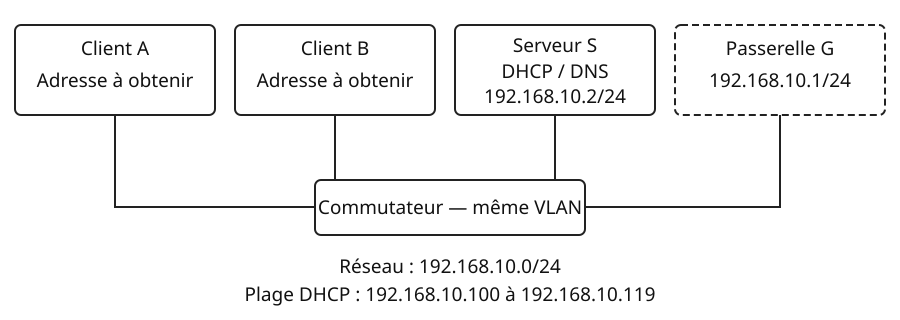
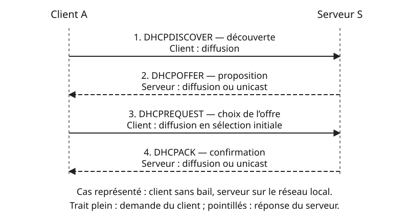
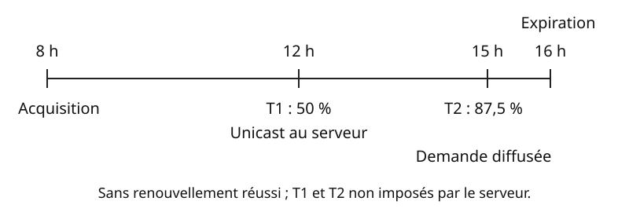

## Objectifs et prérequis

À l’issue du cours, vous saurez expliquer comment un poste obtient sa
configuration IPv4, reconnaître les principaux messages DHCP et interpréter
la durée d’un bail. Vous devez savoir déterminer le sous-réseau d’une adresse
IPv4, distinguer adresse IP et adresse MAC et expliquer les rôles de la
passerelle et de DNS.

Ce cours porte sur **DHCPv4**. Les manipulations d’observation utilisent
**Cisco Packet Tracer**, dans un réseau pédagogique isolé.

## Situation de départ

Une salle dispose de vingt postes. Un ordinateur supplémentaire est branché au
commutateur. Pour communiquer, il lui faut une adresse IPv4 et un masque ; pour
atteindre un autre réseau ou résoudre des noms, il lui faut aussi les paramètres
appropriés de passerelle et de DNS.

L’administrateur pourrait saisir ces valeurs sur chaque poste. Mais il faudrait
éviter les doublons et recommencer après chaque changement. **DHCP**, pour
*Dynamic Host Configuration Protocol*, permet au client de recevoir une
configuration depuis un serveur.

{fig-alt="Les clients A et B, le serveur S à l’adresse 192.168.10.2 et la passerelle G à l’adresse 192.168.10.1 sont reliés au même commutateur, sur le réseau 192.168.10.0/24. La plage DHCP va de 192.168.10.100 à 192.168.10.119."}

Nous utiliserons les paramètres suivants :

| Élément | Valeur dans l’exemple |
|:---|:---|
| Réseau local | `192.168.10.0/24` |
| Masque | `255.255.255.0` |
| Serveur DHCP S, configuré statiquement | `192.168.10.2` |
| Passerelle G, configurée statiquement | `192.168.10.1` |
| Serveur DNS annoncé aux clients | `192.168.10.2` |
| Plage dynamique | `192.168.10.100` à `192.168.10.119` incluses |

Dans cet exemple, S peut héberger DHCP et DNS. Ce sont deux services distincts :
DHCP annonce l’adresse du serveur DNS ; DNS répond ensuite aux demandes de
résolution de noms. Le service DNS doit être configuré séparément si on veut
l’utiliser.

## Comprendre le mécanisme

### Client, serveur et plage d’adresses

Le **client DHCP** demande une configuration. Le **serveur DHCP** choisit une
adresse dans une plage administrée, souvent appelée *pool*, et lui associe un
bail. Il peut transmettre notamment :

- l’adresse IPv4 proposée au client ;
- le masque de sous-réseau ;
- l’adresse de la passerelle par défaut ;
- une ou plusieurs adresses de serveurs DNS ;
- la durée d’utilisation de l’adresse.

L’adresse attribuée figure dans le champ `yiaddr` du message de réponse. Les
autres paramètres sont transmis par des options : masque (option 1), routeur
(option 3), serveurs DNS (option 6) et durée du bail (option 51).

Une **exclusion** empêche le serveur d’attribuer certaines adresses de son
ensemble d’allocation. Il faut protéger les adresses des équipements configurés
manuellement. Ici, les adresses `.1` et `.2` sont déjà hors de la plage dynamique.

Une **réservation** associe un client identifié à une adresse déterminée par
l’administrateur. Le client continue à utiliser DHCP. Le critère d’identification
peut être une adresse MAC ou un identifiant client, selon le serveur. Une
réservation n’est donc pas une configuration statique saisie sur le poste.

### L’attribution initiale : DORA

Supposons que A démarre sans adresse IPv4 utilisable ni bail à réutiliser.
La séquence usuelle de première attribution comporte quatre messages. Le moyen
mnémotechnique **DORA** reprend leurs initiales :

| Message | Émetteur | Rôle |
|:---|:---|:---|
| **DHCPDISCOVER** | Client | Chercher des serveurs disponibles. |
| **DHCPOFFER** | Serveur | Proposer une adresse et des paramètres. |
| **DHCPREQUEST** | Client | Indiquer l’offre retenue et demander l’attribution. |
| **DHCPACK** | Serveur | Confirmer l’attribution et ses paramètres. |

{fig-alt="Le client envoie DHCPDISCOVER en diffusion ; le serveur répond avec DHCPOFFER ; le client envoie DHCPREQUEST en diffusion pour annoncer son choix ; le serveur confirme par DHCPACK. Les réponses du serveur peuvent être diffusées ou envoyées en unicast."}

Plusieurs serveurs peuvent faire une offre. Dans l’état de sélection initiale,
le client annonce son choix dans un DHCPREQUEST diffusé, contenant notamment
l’identifiant du serveur choisi. Les autres serveurs peuvent ainsi reconnaître
que leur offre n’a pas été retenue. Une offre seule n’autorise pas encore le
client à utiliser l’adresse ; il attend la confirmation et vérifie normalement que
l’adresse n’est pas déjà utilisée avant de l’employer.

Si un serveur refuse une demande qu’il ne peut pas accepter, il peut émettre
**DHCPNAK**, une réponse négative. Le client doit alors reprendre la procédure
appropriée ; ce message ne fait pas partie d’un DORA réussi.

### Transport, ports et adresses

DHCPv4 utilise **UDP**. Pour un échange direct client/serveur :

```text
Client → serveur : port UDP source 68, destination 67
Serveur → client : port UDP source 67, destination 68
```

Au tout premier DHCPDISCOVER de notre exemple, le client utilise `0.0.0.0`
comme adresse IPv4 source et `255.255.255.255` comme destination. La destination
Ethernet est `ff:ff:ff:ff:ff:ff` : il ne connaît pas encore de serveur.
Le DHCPREQUEST de sélection initiale est lui aussi diffusé.

**DHCPOFFER et DHCPACK ne sont pas nécessairement diffusés.** Pour une réponse
directe au client en phase initiale, le serveur tient notamment compte du drapeau
*BROADCAST* : la réponse peut être une diffusion ou un unicast vers l’adresse
proposée et l’adresse matérielle du client. Lors d’un renouvellement, le client
possède déjà une adresse et utilise normalement l’unicast vers son serveur.

::: {.callout-note}
## À retenir

DORA décrit une attribution initiale réussie, pas tous les échanges DHCP.
La diffusion ou l’unicast dépendent du message et de l’état du client.
Contrairement à ARP, DHCPv4 utilise IP et UDP.
:::

### Bail, renouvellement et expiration

Un **bail** autorise le client à utiliser l’adresse pendant une durée déterminée.
Le client essaie de le prolonger avant son expiration. Le serveur peut fournir
les échéances T1 et T2 ; à défaut, leurs valeurs usuelles sont :

- **T1 = 50 % du bail** : tentative de renouvellement auprès du serveur initial,
  par DHCPREQUEST en unicast ;
- **T2 = 87,5 % du bail**, si le renouvellement n’a pas abouti : tentative auprès
  de tout serveur approprié, par DHCPREQUEST en diffusion ;
- **expiration**, si aucun renouvellement n’aboutit : le client doit cesser
  d’utiliser l’adresse attribuée et rechercher une nouvelle configuration.

Une confirmation DHCPACK renouvelle le bail. Pour un bail de huit heures acquis
à 8 h, sans échéances particulières fournies par le serveur, T1 correspond à
12 h, T2 à 15 h et l’expiration à 16 h, **si aucun renouvellement n’a réussi**.

{fig-alt="Bail acquis à 8 heures. À 12 heures, T1 déclenche le renouvellement unicast. À 15 heures, T2 déclenche une demande diffusée. À 16 heures, le bail expire si aucune confirmation n’a été reçue."}

### Un serveur dans un autre sous-réseau : le relais

Un routeur ne transmet pas simplement les diffusions limitées du client vers
un autre réseau. Un **relais DHCP**, configuré sur le réseau du client, reçoit
ses demandes et les transmet à un serveur distant.

Le relais renseigne notamment `giaddr`, l’adresse du relais du côté du client.
Le serveur s’en sert pour identifier le sous-réseau à desservir et lui retourne
la réponse. Le relais la remet ensuite au client. Un pool approprié doit exister
pour ce sous-réseau. Le relais est un rôle distinct de celui du serveur DHCP.
Les échanges relais/serveur utilisent le port UDP 67 aux deux extrémités.

## Observer et appliquer

### Préparer le réseau dans Cisco Packet Tracer

**Plateforme : Cisco Packet Tracer, appareils Server-PT et PC-PT.** Les intitulés
ci-dessous correspondent à l’interface en anglais. Cette observation porte sur
l’attribution locale ; le relais et les temporisations de renouvellement restent
étudiés à partir des schémas et exercices.

1. Relier un serveur S et deux postes à un commutateur avec des câbles Ethernet.
   Une passerelle G à `192.168.10.1/24` peut être préparée par l’enseignant ;
   elle n’est pas nécessaire pour observer le DORA sur le réseau local.
2. Sur S, ouvrir **Desktop → IP Configuration** et choisir **Static**.
   Saisir `192.168.10.2`, le masque `255.255.255.0` et, pour la topologie complète,
   la passerelle `192.168.10.1`.
3. Sur S, ouvrir **Services → DHCP** et activer le service avec **On**.
   Utiliser un seul pool actif pour cette observation, avec les valeurs suivantes.
   Éviter de conserver un autre pool local dont la plage recouvre celle du cours.

| Champ du pool | Valeur |
|:---|:---|
| Pool Name | `salle-ciel` |
| Default Gateway | `192.168.10.1` |
| DNS Server | `192.168.10.2` |
| Start IP Address | `192.168.10.100` |
| Subnet Mask | `255.255.255.0` |
| Maximum Number of Users | `20` |

Enregistrer les paramètres du pool avec **Add** ou **Save**, selon que l’on crée
ou modifie le pool. La plage contient vingt adresses : `.100` à `.119` incluses.
L’annonce d’une passerelle ou d’un serveur DNS ne vérifie pas leur disponibilité.

### Suivre les messages et relever les paramètres

1. Passer en mode **Simulation**. Dans **Edit Filters**, ne conserver que DHCP
   pour simplifier l’observation.
2. Sur A, ouvrir **Desktop → IP Configuration** et sélectionner **DHCP**.
3. Avancer avec **Capture/Forward**. Ouvrir les événements DHCP pour relever le
   type du message, son émetteur, les adresses et les ports affichés.
4. Vérifier ensuite les paramètres de A dans **IP Configuration**. Refaire
   l’observation avec B : les deux clients doivent avoir des adresses distinctes.

Une configuration reçue pourrait être :

```text
Adresse IPv4 : 192.168.10.100
Masque : 255.255.255.0
Passerelle : 192.168.10.1
Serveur DNS : 192.168.10.2
```

L’adresse exacte dépend de l’état du pool et des baux déjà attribués. Consigner
les résultats dans la [grille d’observation CSV](fichiers/observation-dhcp.csv).
Pour chaque message, expliquer pourquoi la destination est diffusée ou unicast ;
ne pas supposer que toutes les implémentations montrent la même variante de
réponse. Packet Tracer est un simulateur : ses champs et temporisations peuvent
simplifier le comportement d’un équipement réel.

### Vérifier sa compréhension

::: {.content-visible when-format="html"}
<details>
<summary>Un DHCPACK prouve-t-il que le poste peut accéder à Internet ?</summary>
<p>Non. Il confirme une attribution et ses paramètres. La passerelle, le routage, la résolution DNS et la connectivité extérieure doivent être vérifiés séparément.</p>
</details>
:::

::: {.content-visible unless-format="html"}
**Question.** Un DHCPACK prouve-t-il que le poste peut accéder à Internet ?

**Réponse.** Non. Il confirme une attribution et ses paramètres. La passerelle,
le routage, la résolution DNS et la connectivité extérieure doivent être
vérifiés séparément.
:::

## Exercices de vérification

1. **Les messages.** Remettre dans l’ordre DHCPACK, DHCPDISCOVER, DHCPREQUEST,
   DHCPOFFER pour une première attribution réussie. Indiquer l’émetteur et le
   rôle de chaque message.
2. **La configuration.** A reçoit `192.168.10.105`, le masque `255.255.255.0`,
   la passerelle `192.168.10.1` et le DNS `192.168.10.2`. Déterminer son réseau.
   Est-il dans la plage prévue ? Peut-on garantir un accès Internet ?
3. **Le bail.** Un client obtient un bail de huit heures à 9 h. T1 et T2 ne sont
   pas précisés par le serveur. Sans aucun renouvellement réussi, donner les
   heures de T1, de T2 et de l’expiration. Quelle destination utilise la demande
   à T1 ? Que change T2 ?
4. **Le diagnostic.** Proposer une vérification pour chacun des cas suivants :
   aucun DHCPOFFER ; DHCPACK reçu mais aucun nom ne se résout ; deuxième client
   sans adresse alors que le pool ne contient qu’une adresse disponible.
5. **Le relais et la réservation.** Le serveur est déplacé vers un autre
   sous-réseau. Pourquoi le client ne peut-il pas compter sur le routeur pour
   transmettre son DHCPDISCOVER ? Quel rôle faut-il configurer ? Une réservation
   oblige-t-elle à saisir l’adresse manuellement sur le poste ?

### Corrigé

1. **Discover → Offer → Request → ACK**. Le client cherche les serveurs ; le
   serveur propose ; le client annonce son choix et demande ; le serveur confirme.
2. Le réseau est `192.168.10.0/24`. `.105` est entre `.100` et `.119`.
   La configuration reçue ne prouve pas que la passerelle fonctionne, que DNS
   répond ou qu’un accès extérieur existe.
3. **T1 : 13 h ; T2 : 16 h ; expiration : 17 h.** À T1, le client contacte
   normalement le serveur initial en unicast. À T2, il diffuse sa demande pour
   tenter d’obtenir une prolongation auprès d’un serveur approprié. À expiration,
   sans confirmation reçue, il cesse d’utiliser l’adresse louée.
4. Sans offre : vérifier les liens, le VLAN, l’activation du service, la plage
   disponible et, si nécessaire, le relais. Avec ACK mais sans résolution de nom :
   vérifier l’adresse du serveur DNS annoncé, son accessibilité et son service.
   Avec une seule adresse disponible déjà louée : examiner les baux et la
   capacité du pool ; dimensionner la plage sans empiéter sur les adresses fixes.
5. Le routeur ne relaie pas spontanément cette diffusion limitée : il faut un
   **relais DHCP** configuré et un pool correspondant au réseau client. Une
   réservation reste une attribution par DHCP ; le poste reste client DHCP.

## Synthèse

- DHCPv4 fournit une configuration IPv4 et gère la durée d’utilisation d’une
  adresse ; DNS assure la résolution des noms.
- DORA décrit la première attribution usuelle. Un renouvellement n’exige pas
  nécessairement de refaire ces quatre messages.
- Prévoir une plage suffisante, protéger les adresses fixes et surveiller les baux.
- Un relais permet de desservir un sous-réseau depuis un serveur distant.
- Une configuration reçue doit être confrontée aux observations du réseau.

Un serveur DHCP non autorisé peut annoncer une mauvaise passerelle ou un mauvais
serveur DNS. Les mécanismes de contrôle, notamment le *DHCP snooping* sur certains
commutateurs, seront étudiés en cybersécurité.

## Pour aller plus loin

DHCPv6 utilise d’autres messages et ports et ne suit pas le DORA de DHCPv4.
En IPv6, la découverte de la passerelle relève des annonces de routeur. Ne pas
transposer directement les mécanismes de ce cours à IPv6.

Références techniques utilisées pour ce cours, dont les exemples et schémas sont
originaux :

- [RFC 2131 — DHCPv4](https://www.rfc-editor.org/rfc/rfc2131.html), notamment les
  échanges, ports UDP et échéances de renouvellement.
- [RFC 2132 — options DHCP](https://www.rfc-editor.org/rfc/rfc2132.html).
- [RFC 1542 — agents relais BOOTP, utilisés par DHCPv4](https://www.rfc-editor.org/rfc/rfc1542.html).
- [Aide officielle Packet Tracer — configuration des serveurs](https://tutorials.ptnetacad.net/help/default/config_servers.htm)
  et [mode Simulation](https://tutorials.ptnetacad.net/help/default/mode_simulation.htm).
