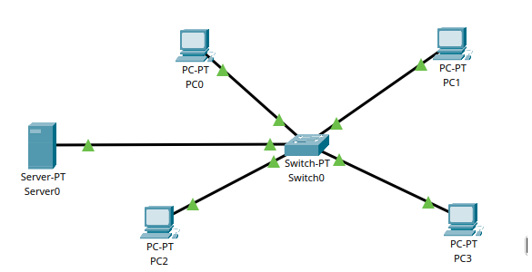
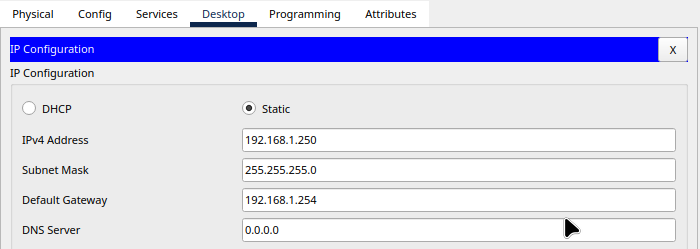
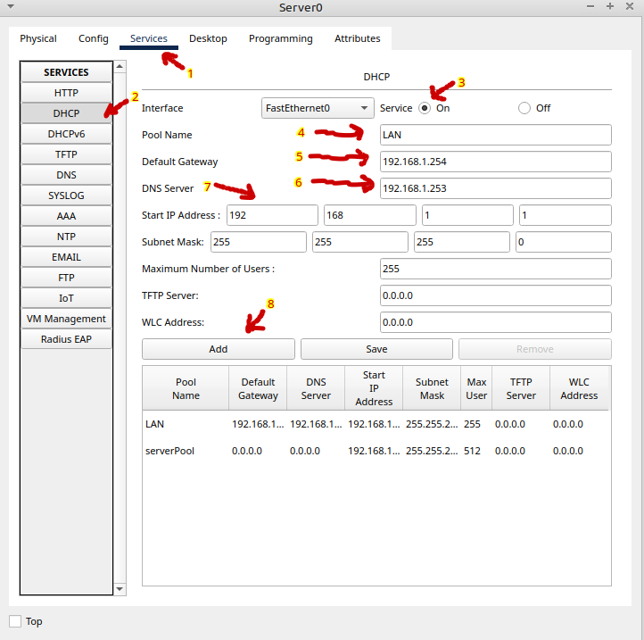
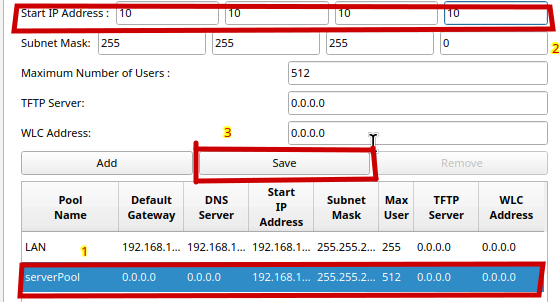

*Plateforme : Cisco Packet Tracer (postes PC-PT, serveur Server-PT, commutateur Switch-PT).*

## Objectifs et prérequis

Imaginez une salle de 30 postes. Saisir 30 adresses IP à la main prend du temps. Une seule faute de frappe peut créer un conflit d'adresses (deux postes avec la même adresse). Un serveur DHCP fait ce travail à votre place : chaque poste demande ses paramètres et les reçoit automatiquement.

Dans ce TP, vous allez :

- configurer un service DHCP sur un serveur ;
- configurer quatre postes clients en DHCP et vérifier ce qu'ils reçoivent ;
- observer, pas à pas, les messages échangés entre un client et le serveur ;
- régler la taille du pool pour protéger les adresses fixes ;
- reconnaître le symptôme d'une panne du serveur DHCP.

Vous avez besoin de savoir lire une adresse IPv4 et son masque. Vous devez aussi savoir placer et relier des équipements dans Packet Tracer. Le diaporama « Le protocole DHCP » donne le vocabulaire utilisé ici.

::: {.callout-tip title="Support d'activité"}
- Cisco Packet Tracer, suite bureautique
- Diaporama « Le protocole DHCP »
:::

Vous rédigerez un compte rendu numérique. Pensez aux captures d'écran pour illustrer votre compte rendu. Sauvegardez votre travail régulièrement ! Des différences peuvent exister selon la version du logiciel utilisée.

## Situation de départ

Vous installez le réseau local d'une petite entreprise. Il comporte un commutateur, quatre postes clients et un serveur. Les postes ne doivent pas être configurés à la main : le serveur leur distribuera leurs adresses.

Le réseau utilise le plan d'adressage suivant. Gardez-le précieusement : les TP HTTP, DNS et FTP du chapitre le réutilisent.

| Adresse | Rôle |
|---|---|
| 192.168.1.0/24 | Réseau local (masque 255.255.255.0) |
| 192.168.1.250 | Serveur DHCP (Server0) |
| 192.168.1.251 | Serveur HTTP (TP suivant) |
| 192.168.1.252 | Serveur FTP (TP suivant) |
| 192.168.1.253 | Serveur DNS (TP suivant) |
| 192.168.1.254 | Passerelle par défaut (réservée pour un routeur) |

: Plan d'adressage de la maquette du chapitre {#tbl-plan}

Résultat attendu en fin de séance : chaque poste reçoit automatiquement une adresse, un masque, une passerelle et un serveur DNS. Aucun poste ne reçoit une adresse réservée aux serveurs ou à la passerelle.

## Matériel et environnement

- Cisco Packet Tracer, sur votre poste.
- Aucun fichier fourni : vous construisez la maquette vous-même.
- En fin de séance, vous enregistrez la maquette sous le nom `tp-services-reseau.pkt`. Les TP HTTP, DNS et FTP repartent de ce fichier.

| Partie | Contenu | Durée indicative |
|---|---|---|
| A | Préparer la maquette | 15 min |
| B | Configurer le service DHCP | 25 min |
| C | Observer l'échange DHCP en mode Simulation | 20 min |
| D | Vérifier et renouveler côté client | 15 min |
| E | Dimensionner le pool sans conflit | 15 min |
| F | Panne : plus de serveur DHCP | 15 min |
| — | Sauvegarde et compte rendu | 15 min |

: Déroulement de la séance {#tbl-deroulement}

## Travail à réaliser

### Partie A — Préparer la maquette (15 min)

1. Construisez la topologie ci-dessous. Prenez un commutateur « Switch-PT », quatre postes « PC-PT » (PC0 à PC3) et un serveur « Server-PT » (Server0). Reliez chaque équipement au commutateur avec un câble droit (« Copper Straight-Through » dans la rubrique « Connections »).

{fig-alt="Capture d'écran de Packet Tracer : Server0 et les postes PC0, PC1, PC2 et PC3 sont chacun reliés par un câble au commutateur Switch0. Tous les voyants des liaisons sont verts."}

2. Attendez que tous les voyants des liaisons passent au vert.
3. Attribuez au serveur l'adresse statique 192.168.1.250. Cliquez sur Server0, puis ouvrez l'onglet « Desktop » > « IP Configuration ». Choisissez « Static » et saisissez :
   - IPv4 Address : 192.168.1.250 ;
   - Subnet Mask : 255.255.255.0 ;
   - Default Gateway : 192.168.1.254.

{fig-alt="Capture d'écran de Packet Tracer : fenêtre IP Configuration de Server0, onglet Desktop. L'option Static est cochée. IPv4 Address 192.168.1.250, Subnet Mask 255.255.255.0, Default Gateway 192.168.1.254, DNS Server 0.0.0.0."}

::: {.callout-note title="Remarque : la passerelle 192.168.1.254"}
Aucun équipement ne porte encore l'adresse 192.168.1.254 : la maquette n'a pas de routeur. Cette adresse est réservée pour un routeur futur. Son absence n'a aucun effet sur les échanges à l'intérieur du réseau local.
:::

### Partie B — Configurer le service DHCP (25 min)

Le serveur a maintenant une adresse fixe. Vous allez lui confier la distribution des adresses. Pour cela, vous créez un **pool** : la plage d'adresses que le serveur peut prêter, avec les paramètres qui l'accompagnent.

1. Sur Server0, ouvrez l'onglet « Services », puis « DHCP ».
2. Cochez « Service : On ».
3. Remplissez les champs du pool :
   - Pool Name : `LAN` ;
   - Default Gateway : 192.168.1.254 ;
   - DNS Server : 192.168.1.253 (retenez bien cette adresse : elle servira à configurer le serveur DNS plus tard) ;
   - Start IP Address : 192.168.1.1 ;
   - Subnet Mask : 255.255.255.0.
4. Cliquez sur « Add ». Le pool `LAN` apparaît dans le tableau du bas.

{fig-alt="Capture d'écran de Packet Tracer : Server0, onglet Services, section DHCP. Des flèches numérotées de 1 à 8 désignent : 1 l'onglet Services, 2 le bouton DHCP, 3 l'option Service On, 4 le champ Pool Name rempli avec LAN, 5 Default Gateway 192.168.1.254, 6 DNS Server 192.168.1.253, 7 Start IP Address 192.168.1.1, 8 le bouton Add. Le tableau du bas liste deux pools : LAN avec Max User 255 et serverPool avec Max User 512."}

::: {.callout-note title="Question 1"}
1. Combien d'adresses IP le serveur DHCP peut-il attribuer aux clients ?
2. Quelle est la première adresse disponible dans le réseau ?
3. Quelle est la dernière adresse disponible ?
:::

Le tableau contient un second pool, `serverPool`, créé par défaut par Packet Tracer. Sa plage commence elle aussi dans le réseau 192.168.1.0. Pour éviter toute confusion ou tout conflit d'adressage avec le pool `LAN`, déplacez sa plage :

1. Cliquez sur `serverPool` dans le tableau de la section DHCP.
2. Remplacez la valeur du champ « Start IP Address » par 10.10.10.10.
3. Cliquez sur « Save » pour enregistrer la modification.

{fig-alt="Capture d'écran de Packet Tracer : section DHCP de Server0. Le pool serverPool est sélectionné dans le tableau (repère 1). Le champ Start IP Address contient 10.10.10.10 (repère 2). Le bouton Save est encadré (repère 3)."}

Passez maintenant à la configuration des postes clients :

1. Sur chaque PC, ouvrez l'onglet « Desktop » > « IP Configuration ».
2. Sélectionnez l'option « DHCP ».
3. Vérifiez que chaque poste obtient automatiquement une adresse IP, un serveur DNS et une passerelle par défaut fournis par le serveur DHCP.

::: {.callout-note title="Question 2"}
Relevez, pour chacun des quatre postes, l'adresse IP, le masque, la passerelle et le serveur DNS reçus. Présentez-les dans un tableau. D'où viennent les valeurs de la passerelle et du serveur DNS ?
:::

::: {.callout-warning}
**>>>> FAIRE VALIDER LE TRAVAIL PAR LE PROFESSEUR AVANT DE POURSUIVRE <<<<**
:::

### Partie C — Observer l'échange DHCP en mode Simulation (20 min)

En mode temps réel, le poste reçoit son adresse en une fraction de seconde. Le mode Simulation ralentit le temps : vous allez voir chaque message échangé entre le client et le serveur.

1. Passez Packet Tracer en mode Simulation (icône en bas à droite de l'écran).
2. Dans le panneau de simulation, cliquez sur « Edit Filters ». Ne laissez coché que le protocole DHCP.
3. Sur PC0, ouvrez « Desktop » > « IP Configuration ». Choisissez « Static », puis de nouveau « DHCP ». Le poste lance une nouvelle demande d'adresse.
4. Avancez pas à pas avec le bouton d'avance du panneau de simulation. Observez les enveloppes qui circulent et la liste des événements (Event List).
5. Cliquez sur une enveloppe ou sur une ligne de la liste pour ouvrir le détail du message (PDU). Un **PDU** est le message tel qu'il circule, avec les en-têtes ajoutés par chaque couche.

Attention : un même message apparaît sur plusieurs lignes de l'Event List, une par équipement traversé. Le commutateur recopie par exemple une diffusion (un message destiné à tous les équipements du réseau local) vers tous les autres postes. Comptez donc les messages différents, pas les lignes.

::: {.callout-note title="Question 3"}
1. Combien de messages DHCP différents sont échangés entre PC0 et Server0 ?
2. Dans quel ordre circulent-ils ? Pour chacun, relevez son nom dans le détail du PDU, son émetteur et son destinataire.
:::

::: {.callout-note title="Question 4"}
Ouvrez le détail du premier message envoyé par PC0.

1. Relevez son adresse IP source et son adresse IP destination.
2. Expliquez ces deux valeurs. Pourquoi le client ne peut-il pas utiliser sa propre adresse ? Pourquoi ne s'adresse-t-il pas directement au serveur ?
:::

::: {.callout-note title="Question 5"}
Toujours dans le détail d'un message DHCP, cherchez la couche transport.

1. Quel protocole de transport DHCP utilise-t-il ?
2. Relevez le port source et le port destination du message envoyé par le client, puis ceux de la réponse du serveur.
:::

Repassez en mode temps réel (Realtime) avant la partie suivante.

### Partie D — Vérifier et renouveler côté client (15 min)

La fenêtre « IP Configuration » montre l'essentiel. L'invite de commandes du poste donne plus de détails et permet d'agir sur le bail. Le **bail** est le prêt de l'adresse au poste, pour une durée limitée.

Sur PC0, ouvrez « Desktop » > « Command Prompt ». Saisissez les trois commandes suivantes, l'une après l'autre (invite de commandes d'un PC Packet Tracer) :

```text
ipconfig /all
ipconfig /release
ipconfig /renew
```

- `ipconfig /all` affiche la configuration IP complète du poste.
- `ipconfig /release` et `ipconfig /renew` agissent sur l'adresse obtenue par DHCP : observez ce qui change.

::: {.callout-note title="Question 6"}
1. Après `ipconfig /all`, relevez l'adresse IP, le masque, la passerelle et le serveur DNS de PC0. Relevez aussi l'adresse du serveur DHCP si elle est affichée.
2. Après `ipconfig /release`, relevez l'adresse IP affichée. Que fait cette commande ?
3. Après `ipconfig /renew`, relevez l'adresse obtenue. Que fait cette commande ? Est-ce la même adresse qu'avant ?
:::

::: {.callout-note title="Question 7"}
Repassez en mode Simulation, filtre DHCP seul. Relancez `ipconfig /release` puis `ipconfig /renew` sur PC0. Quels messages DHCP voyez-vous passer pour chaque commande ? Comparez avec la partie C.
:::

Repassez en mode temps réel avant la partie suivante.

### Partie E — Dimensionner le pool sans conflit (15 min)

Regardez le plan d'adressage (@tbl-plan). Les adresses 192.168.1.250 à 192.168.1.253 sont réservées aux serveurs du chapitre. L'adresse 192.168.1.254 est réservée à la passerelle. Le pool `LAN` ne doit donc jamais distribuer ces adresses : il doit s'arrêter à 192.168.1.249.

Le champ « Maximum Number of Users » fixe le nombre d'adresses du pool, à partir de « Start IP Address ».

::: {.callout-note title="Question 8"}
1. Le pool `LAN` commence à 192.168.1.1. Quelle valeur faut-il saisir dans « Maximum Number of Users » pour que sa dernière adresse soit 192.168.1.249 ? Justifiez par un calcul.
2. Que risquerait-on en gardant la valeur affichée par défaut ? Faites le lien avec votre réponse à la Question 1.
:::

Appliquez votre réponse :

1. Sur Server0, onglet « Services » > « DHCP », cliquez sur le pool `LAN` dans le tableau.
2. Saisissez votre valeur dans « Maximum Number of Users ».
3. Cliquez sur « Save ». Vérifiez la colonne « Max User » du tableau.
4. Sur un poste, lancez `ipconfig /renew` et vérifiez que son adresse appartient toujours au pool.

### Partie F — Panne : plus de serveur DHCP (15 min)

Que se passe-t-il si le serveur DHCP tombe en panne ? Vous allez simuler cette panne.

1. Sur Server0, onglet « Services » > « DHCP », cochez « Service : Off ».
2. Sur PC3, ouvrez « Desktop » > « IP Configuration ». Choisissez « Static », puis de nouveau « DHCP ».
3. Attendez la fin de la tentative. Observez le message affiché et l'adresse obtenue.
4. Depuis PC3, ouvrez « Desktop » > « Command Prompt » et tentez de joindre le serveur :

```text
ping 192.168.1.250
```

::: {.callout-note title="Question 9"}
1. Relevez le message affiché dans la fenêtre « IP Configuration » de PC3.
2. Relevez l'adresse IP et le masque obtenus. À quelle plage d'adresses cette adresse appartient-elle ? Comment appelle-t-on ce mécanisme ?
3. Relevez le résultat du `ping`. Expliquez pourquoi PC3 ne peut plus joindre le serveur, en comparant son adresse réseau à celle du serveur.
:::

Remettez le réseau en état :

1. Sur Server0, cochez de nouveau « Service : On ».
2. Sur PC3, repassez en « Static » puis en « DHCP ». Vérifiez qu'il reçoit une adresse du pool `LAN`.

### Sauvegarde

Enregistrez la maquette avec le menu « File » > « Save As », sous le nom `tp-services-reseau.pkt`. Gardez une copie dans votre dossier personnel : les TP HTTP, DNS et FTP repartent de ce fichier.

## Vérification et compte rendu

Votre travail est réussi si vous pouvez constater les points suivants :

- les quatre postes sont en mode DHCP et ont chacun une adresse comprise entre 192.168.1.1 et 192.168.1.249 ;
- chaque poste a reçu la passerelle 192.168.1.254 et le serveur DNS 192.168.1.253 ;
- la colonne « Max User » du pool `LAN` affiche votre valeur de la Question 8 ;
- le pool `serverPool` commence à 10.10.10.10 ;
- un `ping 192.168.1.250` lancé depuis un poste quelconque réussit ;
- le service DHCP est de nouveau sur « On » ;
- le fichier `tp-services-reseau.pkt` est enregistré.

Votre compte rendu contient :

- les réponses aux Questions 1 à 9 ;
- le tableau des adresses reçues par les quatre postes (Question 2) ;
- une capture de la liste des événements DHCP en mode Simulation (partie C) ;
- une capture du résultat de `ipconfig /all` sur un poste (partie D) ;
- une capture du tableau des pools après la partie E ;
- une capture de la fenêtre « IP Configuration » de PC3 pendant la panne (partie F) ;
- une capture d'un `ping` réussi vers 192.168.1.250 en fin de séance.

::: {.callout-warning}
**>>>> FAIRE VALIDER LE TRAVAIL PAR LE PROFESSEUR AVANT DE QUITTER LA SÉANCE <<<<**
:::

## Synthèse

::: {.callout-important title="Synthèse à compléter"}
Recopiez et complétez ces phrases dans votre compte rendu.

1. Un client DHCP obtient son adresse en quatre messages : ………… , ………… , ………… et ………… .
2. Le premier message est envoyé en ………… , car le client n'a pas encore d'adresse IP et ne connaît pas l'adresse du serveur.
3. DHCP utilise le protocole de transport ………… : le client utilise le port ………… et le serveur le port ………… .
4. Le ………… est la plage d'adresses que le serveur peut distribuer. Il fournit aussi le masque, la ………… et le serveur ………… .
5. L'adresse est prêtée au poste pour une durée limitée, appelée ………… .
6. Les serveurs ont une adresse ………… , choisie en dehors du pool, pour que les clients les trouvent toujours à la même adresse.
7. Sans serveur DHCP, un poste se donne une adresse de la plage ………… : il ne peut plus communiquer avec les postes du réseau 192.168.1.0/24.
:::

Notez enfin, en deux ou trois lignes, la difficulté principale rencontrée pendant ce TP et la manière dont vous l'avez résolue.

## Pour aller plus loin

Dans ce TP, le serveur DHCP et les clients sont dans le même réseau. Or le premier message du client est une diffusion, et un routeur ne transmet pas les diffusions. Comment faire si le serveur DHCP se trouve dans un autre réseau ?

La solution est le **relais DHCP**. Le routeur reçoit la diffusion du client sur son interface côté clients. Il la retransmet en monodiffusion (unicast), directement à l'adresse du serveur DHCP. Il fait de même, en sens inverse, pour les réponses du serveur.

Sur un routeur Cisco IOS, on configure le relais sur l'interface côté clients, avec la commande `ip helper-address`. Exemple, si le serveur DHCP avait l'adresse 10.0.0.5 dans un autre réseau :

```text
Router(config)# interface GigabitEthernet0/0
Router(config-if)# ip helper-address 10.0.0.5
```

Le serveur choisit alors le pool qui correspond au réseau des clients. Vous manipulerez ce mécanisme plus tard, quand la maquette comportera un routeur.

Sources :

- RFC 2131, *Dynamic Host Configuration Protocol*, IETF, 1997 : <https://www.rfc-editor.org/rfc/rfc2131>
- RFC 3927, *Dynamic Configuration of IPv4 Link-Local Addresses* (plage 169.254.0.0/16), IETF, 2005 : <https://www.rfc-editor.org/rfc/rfc3927>
- Cisco, *IP Addressing: DHCP Configuration Guide, Cisco IOS XE Release 2*, chapitre « Configuring the Cisco IOS XE DHCP Relay Agent » : <https://www.cisco.com/c/en/us/td/docs/ios-xml/ios/ipaddr_dhcp/configuration/xe-2/dhcp-xe-2-book/dhcp-relay-agent-xe.html>
