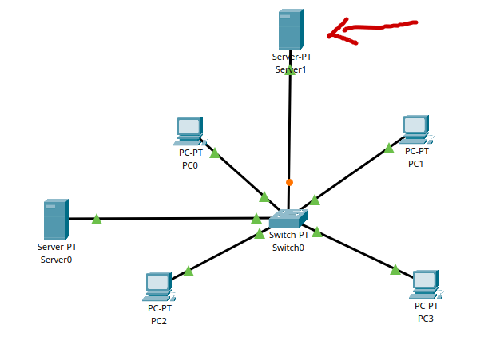
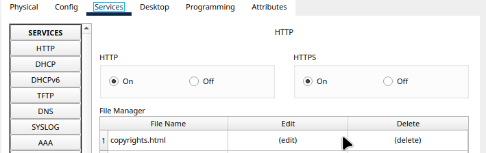
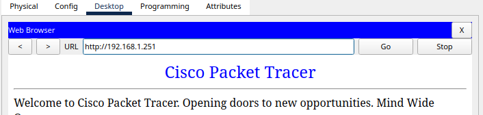

*Plateforme : Cisco Packet Tracer (postes PC-PT, serveurs Server-PT, commutateur Switch-PT).*

## Objectifs et prérequis

Vous tapez une adresse dans un navigateur, et une page s'affiche. Derrière ce geste, un serveur Web attend les demandes et renvoie des pages. Dans ce TP, vous installez ce serveur vous-même, dans votre maquette.

Dans ce TP, vous allez :

- ajouter un serveur Web à la maquette et lui donner une adresse fixe ;
- activer le service HTTP et consulter la page depuis un poste client ;
- modifier la page d'accueil hébergée par le serveur ;
- observer, pas à pas, les messages échangés entre le navigateur et le serveur ;
- demander une page qui n'existe pas et interpréter la réponse.

Vous repartez de la maquette du TP DHCP. Le diaporama « Le protocole HTTP » donne le vocabulaire utilisé ici : client, serveur, URL, requête, réponse, port.

::: {.callout-tip title="Support d'activité"}
- Cisco Packet Tracer, suite bureautique
- Fichier `tp-services-reseau.pkt` enregistré à la fin du TP DHCP
- Diaporama « Le protocole HTTP »
:::

Vous rédigerez un compte rendu numérique. Pensez aux captures d'écran pour illustrer votre compte rendu. Sauvegardez votre travail régulièrement ! Des différences peuvent exister selon la version du logiciel utilisée.

## Situation de départ

Le réseau local de l'entreprise fonctionne : les quatre postes reçoivent leur adresse du serveur DHCP. L'entreprise veut maintenant un site Web interne, consultable depuis chaque poste. Vous ajoutez donc un second serveur, chargé d'héberger ce site.

À la fin du TP DHCP, votre maquette contient :

- un commutateur (Switch0) ;
- quatre postes (PC0 à PC3), configurés en DHCP ;
- un serveur DHCP (Server0), à l'adresse statique 192.168.1.250 ;
- un pool `LAN` qui distribue les adresses 192.168.1.1 à 192.168.1.249, avec la passerelle 192.168.1.254 et le serveur DNS 192.168.1.253.

Rappel du plan d'adressage du chapitre :

| Adresse | Rôle |
|---|---|
| 192.168.1.0/24 | Réseau local (masque 255.255.255.0) |
| 192.168.1.250 | Serveur DHCP (Server0) |
| 192.168.1.251 | Serveur HTTP (Server1, ce TP) |
| 192.168.1.252 | Serveur FTP (TP suivant) |
| 192.168.1.253 | Serveur DNS (TP suivant) |
| 192.168.1.254 | Passerelle par défaut (réservée pour un routeur) |

: Plan d'adressage de la maquette du chapitre {#tbl-plan}

Résultat attendu en fin de séance : depuis n'importe quel poste, le navigateur affiche à l'adresse `http://192.168.1.251` une page d'accueil que vous avez personnalisée.

## Matériel et environnement

- Cisco Packet Tracer, sur votre poste.
- Le fichier `tp-services-reseau.pkt` enregistré à la fin du TP DHCP. Si vous ne l'avez plus, reconstruisez d'abord la maquette décrite ci-dessus.
- En fin de séance, vous enregistrez de nouveau ce fichier. Le TP DNS repart de cette version.

| Partie | Contenu | Durée indicative |
|---|---|---|
| A | Ajouter et adresser le serveur HTTP | 10 min |
| B | Activer le service et tester avec le navigateur | 10 min |
| C | Personnaliser la page d'accueil | 10 min |
| D | Observer l'échange en mode Simulation | 20 min |
| E | Demander une page inexistante | 5 min |
| — | Sauvegarde | 5 min |

: Déroulement de la séance {#tbl-deroulement}

## Travail à réaliser

### Partie A — Ajouter et adresser le serveur HTTP (10 min)

1. Ouvrez `tp-services-reseau.pkt`.
2. Ajoutez un serveur « Server-PT » à la topologie. Packet Tracer le nomme Server1.
3. Reliez Server1 au commutateur avec un câble droit (« Copper Straight-Through » dans la rubrique « Connections »).
4. Attendez que les voyants de la nouvelle liaison passent au vert. Un voyant orange indique que le port du commutateur est encore en cours d'activation.

{fig-alt="Capture d'écran de Packet Tracer : un nouveau serveur, Server1, est placé au-dessus du commutateur Switch0 et relié à lui. Une flèche tracée à la main le désigne. Sur ce lien, le voyant côté commutateur est orange. Server0 et les postes PC0 à PC3 restent reliés au commutateur, avec des voyants verts."}

5. Attribuez au serveur une adresse statique. Cliquez sur Server1, puis ouvrez l'onglet « Desktop » > « IP Configuration ». Choisissez « Static » et saisissez :
   - IPv4 Address : 192.168.1.251 ;
   - Subnet Mask : 255.255.255.0 ;
   - Default Gateway : 192.168.1.254 ;
   - DNS Server : 192.168.1.253, la même adresse DNS que celle configurée sur le serveur DHCP.

::: {.callout-note title="Question 1"}
Pourquoi choisit-on d'attribuer une adresse IP statique au serveur plutôt qu'une adresse IP dynamique obtenue via le DHCP ?
:::

### Partie B — Activer le service et tester avec le navigateur (10 min)

Un serveur ne rend un service que si le logiciel correspondant est lancé. Pour un site Web, ce logiciel est le **service HTTP**. Il attend les demandes des navigateurs et leur renvoie les pages.

1. Sur Server1, ouvrez l'onglet « Services », puis « HTTP ».
2. Vérifiez que le service HTTP est bien activé (positionné sur « On »).

{fig-alt="Capture d'écran de Packet Tracer : onglet Services d'un serveur, section HTTP sélectionnée dans la liste de gauche. Les cadres HTTP et HTTPS ont tous deux l'option On cochée. En dessous, le tableau File Manager comporte les colonnes File Name, Edit et Delete. Sa première ligne contient le fichier copyrights.html, avec les liens edit et delete."}

Avant d'ouvrir le navigateur, vérifiez que le poste client joint bien le serveur. C'est le rôle du `ping`.

3. Sur PC0, ouvrez « Desktop » > « Command Prompt ». Saisissez la commande suivante (invite de commandes d'un PC Packet Tracer) :

```text
ping 192.168.1.251
```

Si la première réponse échoue, relancez la commande : le poste doit parfois d'abord découvrir l'adresse MAC du serveur.

4. Si le ping réussit, ouvrez le navigateur du poste : « Desktop » > « Web Browser ».
5. Dans le champ « URL », saisissez `http://192.168.1.251`, puis cliquez sur « Go ».

Vous devriez alors accéder à la page Web hébergée par le serveur HTTP.

{fig-alt="Capture d'écran de Packet Tracer : onglet Desktop d'un poste, fenêtre Web Browser. Le champ URL contient http://192.168.1.251, à côté des boutons Go et Stop. La page affiche le titre Cisco Packet Tracer, puis le texte Welcome to Cisco Packet Tracer. Opening doors to new opportunities. Mind Wide, coupé en bas de la capture."}

::: {.callout-note title="Question 2"}
Pourquoi saisit-on l'adresse IP du serveur pour accéder au site Web, au lieu d'utiliser un nom de domaine (par exemple : `www.example.com`) ?
:::

::: {.callout-warning}
**>>>> FAIRE VALIDER LE TRAVAIL PAR LE PROFESSEUR AVANT DE POURSUIVRE <<<<**
:::

### Partie C — Personnaliser la page d'accueil (10 min)

La page affichée n'a rien de magique : c'est un fichier stocké sur le serveur. Le tableau « File Manager » liste ces fichiers. Vous allez modifier celui qui sert de page d'accueil.

1. Sur Server1, revenez à l'onglet « Services » > « HTTP ».
2. Faites défiler le tableau « File Manager ». Relevez la liste complète des fichiers. Vérifiez que `index.html` y figure.
3. Sur la ligne de `index.html`, cliquez sur le lien « (edit) ». Le contenu du fichier s'affiche : c'est du code HTML.
4. Repérez le texte « Cisco Packet Tracer » affiché en titre de la page. Remplacez-le par les prénoms de votre binôme.
5. Enregistrez le fichier. Si Packet Tracer demande de confirmer le remplacement du fichier existant, acceptez.
6. Sur PC0, dans le navigateur, cliquez de nouveau sur « Go » pour recharger `http://192.168.1.251`.

::: {.callout-note title="Question 3"}
1. Recopiez la liste des fichiers du « File Manager ».
2. Dans l'URL `http://192.168.1.251`, aucun nom de fichier n'apparaît. Pourtant, c'est votre fichier `index.html` modifié qui s'affiche. Que fait donc le serveur quand l'URL ne précise aucun fichier ?
3. Quelle URL complète permettrait de demander explicitement ce même fichier ? Testez-la.
:::

### Partie D — Observer l'échange en mode Simulation (20 min)

En mode temps réel, la page s'affiche en une fraction de seconde. Le mode Simulation ralentit le temps : vous allez voir chaque message échangé entre le navigateur et le serveur.

Deux protocoles travaillent ensemble ici :

- **TCP** ouvre d'abord une connexion entre le poste et le serveur, comme on décroche avant de parler au téléphone. Il veille ensuite à ce que les données arrivent complètes et dans l'ordre : il renvoie ce qui s'est perdu.
- **HTTP** transporte la demande du navigateur, appelée **requête**, puis la page renvoyée par le serveur, appelée **réponse**.

1. Passez Packet Tracer en mode Simulation (icône en bas à droite de l'écran).
2. Dans le panneau de simulation, cliquez sur « Edit Filters ». Ne laissez cochés que les protocoles HTTP et TCP.
3. Sur PC0, dans le navigateur, cliquez sur « Go » pour recharger `http://192.168.1.251`.
4. Avancez pas à pas avec le bouton d'avance du panneau de simulation. Observez les enveloppes qui circulent et la liste des événements (Event List).
5. Cliquez sur une enveloppe ou sur une ligne de la liste pour ouvrir le détail du message (PDU). Un **PDU** est le message tel qu'il circule, avec les en-têtes ajoutés par chaque couche.

Attention : un même message apparaît sur plusieurs lignes de l'Event List. Il y a une ligne quand il quitte PC0, une autre quand il traverse le commutateur, une autre quand il arrive au serveur. Comptez donc les messages différents, pas les lignes.

::: {.callout-note title="Question 4"}
1. Relevez, dans l'ordre, les messages différents qui circulent entre PC0 et Server1, jusqu'à l'affichage de la page. Pour chacun, notez son protocole (colonne « Type » de l'Event List), son émetteur et son destinataire.
2. Combien de messages TCP circulent avant le premier message HTTP ? À quoi servent-ils ?
:::

::: {.callout-note title="Question 5"}
Ouvrez le détail du premier message HTTP envoyé par PC0 et cherchez la couche transport.

1. Relevez le port source et le port destination.
2. Lequel de ces deux ports identifie le service HTTP du serveur ? Est-ce le numéro attendu pour HTTP ?
3. Ouvrez maintenant le détail de la réponse du serveur. Relevez ses ports source et destination. Que constatez-vous par rapport à la requête ?
4. Le port du client n'est pas un numéro fixe : le système du poste le choisit pour chaque connexion. Comment appelle-t-on ce type de port ?
:::

::: {.callout-note title="Question 6"}
Toujours dans le détail du premier message HTTP envoyé par PC0, cherchez la couche application.

1. Si elle est affichée, relevez la méthode de la requête. Que demande cette méthode au serveur ?
2. Relevez toute autre information lisible dans ce détail (ressource demandée, version du protocole…).
:::

Repassez en mode temps réel (Realtime) avant la partie suivante.

### Partie E — Demander une page inexistante (5 min)

Que se passe-t-il si vous demandez un fichier que le serveur ne possède pas ? Le serveur répond quand même. Sa première ligne contient un **code d'état** : un nombre à trois chiffres qui résume le résultat de la requête. Par exemple, 200 signifie que la requête a réussi.

1. Sur PC0, dans le navigateur, saisissez l'URL `http://192.168.1.251/absent.html`, puis cliquez sur « Go ».
2. Observez ce qu'affiche le navigateur.

::: {.callout-note title="Question 7"}
1. Relevez exactement ce qu'affiche le navigateur.
2. Quel code d'état HTTP signale qu'une ressource est introuvable sur le serveur ? Retrouvez-vous ce code, ou un message équivalent, dans l'affichage ?
3. Le réseau fonctionne-t-il ? Le serveur HTTP fonctionne-t-il ? Justifiez chaque réponse à l'aide de votre test de la partie B et de l'affichage obtenu. Que manque-t-il alors ?
:::

### Sauvegarde

Enregistrez la maquette avec le menu « File » > « Save », sous le nom `tp-services-reseau.pkt`. Gardez une copie dans votre dossier personnel : le TP DNS repart de ce fichier. Server1 doit garder l'adresse 192.168.1.251.

## Vérification et compte rendu

Votre travail est réussi si vous pouvez constater les points suivants :

- Server1 est relié au commutateur et ses voyants de liaison sont verts ;
- Server1 a l'adresse statique 192.168.1.251, le masque 255.255.255.0, la passerelle 192.168.1.254 et le serveur DNS 192.168.1.253 ;
- le service HTTP de Server1 est sur « On » ;
- un `ping 192.168.1.251` lancé depuis un poste quelconque réussit ;
- depuis un poste quelconque, `http://192.168.1.251` affiche la page avec les prénoms de votre binôme ;
- le fichier `tp-services-reseau.pkt` est enregistré.

Votre compte rendu contient :

- les réponses aux Questions 1 à 7 ;
- une capture de la fenêtre « IP Configuration » de Server1 (partie A) ;
- une capture du `ping` réussi vers 192.168.1.251 (partie B) ;
- une capture du navigateur affichant votre page personnalisée (partie C) ;
- une capture de l'Event List en mode Simulation, filtres HTTP et TCP (partie D) ;
- une capture du navigateur après la demande de `absent.html` (partie E).

::: {.callout-warning}
**>>>> FAIRE VALIDER LE TRAVAIL PAR LE PROFESSEUR AVANT DE QUITTER LA SÉANCE <<<<**
:::

## Synthèse

::: {.callout-important title="Synthèse à compléter"}
Recopiez et complétez ces phrases dans votre compte rendu.

1. Un serveur Web reçoit une adresse IP ………… , pour que les clients le trouvent toujours à la même adresse.
2. Le navigateur est le ………… : il envoie une ………… au serveur, qui renvoie une ………… .
3. Avant le premier message HTTP, le poste et le serveur ouvrent une connexion ………… .
4. La requête du navigateur est adressée au port ………… du serveur. Le port source du client est un port ………… , choisi par le poste.
5. Pour obtenir une page, le navigateur utilise la méthode ………… .
6. Quand l'URL ne précise aucun fichier, le serveur renvoie sa page d'accueil, ici le fichier ………… .
7. Une ressource introuvable sur le serveur est signalée par le code d'état ………… .
:::

Notez enfin, en deux ou trois lignes, la difficulté principale rencontrée pendant ce TP et la manière dont vous l'avez résolue.

## Pour aller plus loin

Dans la partie D, le contenu des messages HTTP circule en clair. Toute personne qui capture le trafic peut le lire. **HTTPS** protège cet échange en le chiffrant. La capture de la partie B montre que le service HTTPS de Server1 est déjà sur « On ».

En mode Simulation, filtres HTTP, HTTPS et TCP, chargez `https://192.168.1.251` dans le navigateur de PC0. Relevez le port destination de la requête et comparez-le avec celui de la partie D. Comparez aussi ce qui reste lisible dans le détail des PDU.

Sources :

- RFC 9110, *HTTP Semantics*, IETF, 2022 (méthodes, codes d'état, schémas `http` et `https`) : <https://www.rfc-editor.org/rfc/rfc9110>
- RFC 9112, *HTTP/1.1*, IETF, 2022 (format des messages) : <https://www.rfc-editor.org/rfc/rfc9112>
- MDN Web Docs, *HTTP* : <https://developer.mozilla.org/fr/docs/Web/HTTP>
