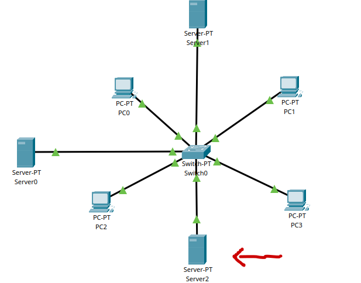
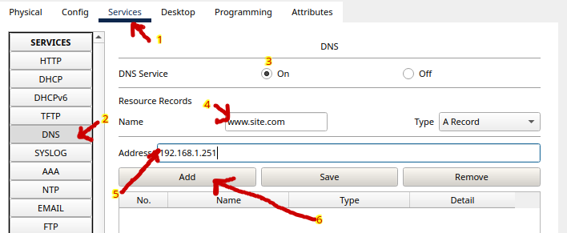

*Plateforme : Cisco Packet Tracer (postes PC-PT, serveurs Server-PT, commutateur Switch-PT).*

## Objectifs et prérequis

Pour ouvrir votre site Web, vous tapez aujourd'hui `http://192.168.1.251`. Imaginez maintenant dix serveurs, chacun avec son adresse. Personne ne retient dix adresses IP. Vous retenez plutôt des noms, comme `www.site.com`. Un serveur DNS fait le lien : il donne l'adresse IP qui correspond à un nom.

Dans ce TP, vous allez :

- ajouter un serveur DNS à la maquette et lui donner une adresse fixe ;
- vérifier que les postes connaissent déjà l'adresse de ce serveur ;
- créer, sur le serveur DNS, l'enregistrement qui associe le nom `www.site.com` à l'adresse du serveur Web ;
- consulter le site par son nom depuis un poste client ;
- observer, pas à pas, ce qui se passe quand un poste utilise un nom au lieu d'une adresse.

Vous repartez de la maquette du TP HTTP. Le diaporama « Le protocole DNS » donne le vocabulaire utilisé ici : serveur DNS, nom de domaine, enregistrement A, résolution de nom.

::: {.callout-tip title="Support d'activité"}
- Cisco Packet Tracer, suite bureautique
- Fichier `tp-services-reseau.pkt` enregistré à la fin du TP HTTP
- Diaporama « Le protocole DNS »
:::

Vous rédigerez un compte rendu numérique. Pensez aux captures d'écran pour illustrer votre compte rendu. Sauvegardez votre travail régulièrement ! Des différences peuvent exister selon la version du logiciel utilisée.

## Situation de départ

Le site Web interne de l'entreprise fonctionne. Mais les salariés doivent taper une adresse IP pour l'ouvrir, ce qui n'est pas pratique. L'entreprise veut qu'ils tapent simplement `www.site.com`. Vous ajoutez donc un troisième serveur, chargé de traduire ce nom en adresse IP.

À la fin du TP HTTP, votre maquette contient :

- un commutateur (Switch0) ;
- quatre postes (PC0 à PC3), configurés en DHCP ;
- un serveur DHCP (Server0), à l'adresse statique 192.168.1.250 ;
- un pool `LAN` qui distribue les adresses à partir de 192.168.1.1, avec la passerelle 192.168.1.254 et le serveur DNS 192.168.1.253 ;
- un serveur Web (Server1), à l'adresse statique 192.168.1.251, dont la page d'accueil affiche les prénoms de votre binôme.

Les postes reçoivent donc déjà l'adresse 192.168.1.253 comme serveur DNS. Pourtant, aucun équipement ne porte encore cette adresse. Dans ce TP, vous lui donnez enfin un serveur.

Rappel du plan d'adressage du chapitre :

| Adresse | Rôle |
|---|---|
| 192.168.1.0/24 | Réseau local (masque 255.255.255.0) |
| 192.168.1.250 | Serveur DHCP (Server0) |
| 192.168.1.251 | Serveur HTTP (Server1) |
| 192.168.1.252 | Serveur FTP (TP suivant) |
| 192.168.1.253 | Serveur DNS (Server2, ce TP) |
| 192.168.1.254 | Passerelle par défaut (réservée pour un routeur) |

: Plan d'adressage de la maquette du chapitre {#tbl-plan}

Résultat attendu en fin de séance : depuis n'importe quel poste, `http://www.site.com` affiche la page d'accueil personnalisée au TP HTTP.

## Matériel et environnement

- Cisco Packet Tracer, sur votre poste.
- Le fichier `tp-services-reseau.pkt` enregistré à la fin du TP HTTP. Si vous ne l'avez plus, reconstruisez d'abord la maquette décrite ci-dessus.
- En fin de séance, vous enregistrez de nouveau ce fichier. Le TP FTP repart de cette version.

| Partie | Contenu | Durée indicative |
|---|---|---|
| A | Ajouter et adresser le serveur DNS | 10 min |
| B | Vérifier le serveur DNS connu des postes | 5 min |
| C | Activer le service DNS et créer l'enregistrement | 15 min |
| D | Consulter le site par son nom | 10 min |
| E | Observer la résolution de nom en mode Simulation | 15 min |
| — | Sauvegarde | 5 min |

: Déroulement de la séance {#tbl-deroulement}

## Travail à réaliser

### Partie A — Ajouter et adresser le serveur DNS (10 min)

1. Ouvrez `tp-services-reseau.pkt`.
2. Ajoutez un serveur « Server-PT » à la topologie. Packet Tracer le nomme Server2.
3. Reliez Server2 au commutateur avec un câble droit (« Copper Straight-Through » dans la rubrique « Connections »).
4. Attendez que les voyants de la nouvelle liaison passent au vert.

{fig-alt="Capture d'écran de Packet Tracer : le commutateur Switch0 est au centre, relié à Server0 à gauche, à Server1 en haut et aux postes PC0, PC1, PC2 et PC3. Un nouveau serveur, Server2, est placé sous le commutateur et relié à lui. Une flèche tracée à la main le désigne. Tous les voyants des liaisons sont verts."}

5. Attribuez au serveur une adresse statique. Cliquez sur Server2, puis ouvrez l'onglet « Desktop » > « IP Configuration ». Choisissez « Static » et saisissez :
   - IPv4 Address : 192.168.1.253 ;
   - Subnet Mask : 255.255.255.0 ;
   - Default Gateway : 192.168.1.254.

L'adresse 192.168.1.253 n'est pas choisie au hasard. Vous l'avez fixée dès le TP DHCP, quand vous avez rempli le champ « DNS Server » du pool `LAN`.

### Partie B — Vérifier le serveur DNS connu des postes (5 min)

Pour traduire un nom, un poste doit savoir à qui poser la question. Il lui faut donc l'adresse du serveur DNS. Vérifiez qu'il la connaît.

1. Sur PC0, ouvrez « Desktop » > « Command Prompt ».
2. Saisissez la commande suivante (invite de commandes d'un PC Packet Tracer) :

```text
ipconfig /all
```

Vous pouvez aussi lire cette information dans « Desktop » > « IP Configuration », champ « DNS Server ».

::: {.callout-note title="Question 1"}
1. Relevez l'adresse du serveur DNS connue de PC0.
2. Quel serveur a fourni cette adresse au poste ? Au cours de quel TP l'avez-vous configurée ?
3. Pourquoi un poste doit-il connaître l'adresse IP du serveur DNS, et non son nom ?
:::

### Partie C — Activer le service DNS et créer l'enregistrement (15 min)

Un serveur DNS fonctionne comme un annuaire. Chaque ligne de l'annuaire associe un nom à une information. Cette ligne s'appelle un **enregistrement**. L'enregistrement de type **A** associe un nom de domaine à une adresse IPv4.

Vous allez créer l'enregistrement qui associe `www.site.com` à l'adresse du serveur Web, 192.168.1.251.

1. Sur Server2, ouvrez l'onglet « Services ».
2. Sélectionnez « DNS » dans la liste des services disponibles.
3. Activez le service : à la ligne « DNS Service », sélectionnez l'option « On ».
4. Dans la section « Resource Records », remplissez les champs suivants :
   - Name : `www.site.com`, le nom de domaine ;
   - Type : sélectionnez « A Record » dans le menu déroulant.
5. Dans le champ « Address », saisissez l'adresse IP correspondante : 192.168.1.251.
6. Cliquez sur le bouton « Add » pour ajouter l'enregistrement DNS.
7. Vérifiez que l'enregistrement apparaît dans le tableau, avec les colonnes « No. », « Name », « Type » et « Detail ».
8. Cliquez sur « Save » pour enregistrer la configuration.

{fig-alt="Capture d'écran de Packet Tracer : onglet Services d'un serveur, section DNS sélectionnée dans la liste de gauche. Des flèches numérotées désignent : 1 l'onglet Services, 2 le bouton DNS, 3 l'option On de la ligne DNS Service, cochée, 4 le champ Name rempli avec www.site.com, 5 le champ Address rempli avec 192.168.1.251, 6 le bouton Add. Le champ Type affiche A Record. À côté de Add se trouvent les boutons Save et Remove. Le tableau du bas, aux colonnes No., Name, Type et Detail, est encore vide."}

::: {.callout-note title="Question 2"}
1. Recopiez la ligne ajoutée dans le tableau : No., Name, Type et Detail.
2. Expliquez, avec vos mots, ce que dit cet enregistrement.
3. L'enregistrement contient-il la page Web du site ? Quelle machine héberge cette page ?
:::

::: {.callout-warning}
**>>>> FAIRE VALIDER LE TRAVAIL PAR LE PROFESSEUR AVANT DE POURSUIVRE <<<<**
:::

### Partie D — Consulter le site par son nom (10 min)

Le serveur DNS connaît maintenant le nom `www.site.com`. Testez-le depuis un poste client.

1. Sur PC0, ouvrez le navigateur : « Desktop » > « Web Browser ».
2. Dans le champ « URL », saisissez `http://www.site.com`, puis cliquez sur « Go ».

Vous devriez alors accéder à la page Web hébergée par le serveur HTTP.

::: {.callout-note title="Question 3"}
1. La page affichée est-elle la même qu'avec `http://192.168.1.251` ? À quoi le reconnaissez-vous ?
2. Pour afficher cette page, PC0 a contacté deux serveurs. Lesquels ? Quel rôle a joué chacun ?
3. Relisez votre réponse à la Question 2 du TP HTTP. Qu'est-ce qui a changé dans la maquette pour qu'un nom de domaine fonctionne maintenant ?
:::

Vérifiez maintenant la connectivité avec l'invite de commandes. Utilisez cette fois PC1.

3. Sur PC1, ouvrez « Desktop » > « Command Prompt ».
4. Effectuez un ping vers l'adresse IP du serveur HTTP (invite de commandes d'un PC Packet Tracer) :

```text
ping 192.168.1.251
```

Si la première réponse échoue, relancez la commande : le poste doit parfois d'abord découvrir l'adresse MAC du serveur.

### Partie E — Observer la résolution de nom en mode Simulation (15 min)

Trouver l'adresse IP qui correspond à un nom s'appelle la **résolution de nom**. En mode temps réel, elle dure une fraction de seconde. Le mode Simulation ralentit le temps : vous allez voir chaque message échangé.

Vous restez sur PC1, qui n'a pas encore utilisé le nom `www.site.com`. Un poste peut en effet garder une réponse DNS en mémoire un certain temps. Sur PC1, vous verrez donc l'échange complet.

1. Passez Packet Tracer en mode Simulation (icône en bas à droite de l'écran).
2. Dans le panneau de simulation, cliquez sur « Edit Filters ». Ne laissez cochés que les protocoles ARP, DNS et ICMP.
3. Dans l'invite de commandes de PC1, effectuez un ping vers le nom de domaine du serveur :

```text
ping www.site.com
```

4. Avancez pas à pas avec le bouton d'avance du panneau de simulation. Observez les enveloppes qui circulent et la liste des événements (Event List).
5. Cliquez sur une enveloppe ou sur une ligne de la liste pour ouvrir le détail du message, appelé unité de données de protocole (PDU).

Attention : un même message apparaît sur plusieurs lignes de l'Event List, une par équipement traversé. Comptez donc les messages différents, pas les lignes.

::: {.callout-note title="Question 4"}
Décrivez, étape par étape, ce qui se produit lors de l'exécution de la commande `ping www.site.com`, en vous aidant du mode Simulation pour observer les échanges.

Votre description précise au moins :

- les messages différents, dans l'ordre, avec pour chacun son protocole (colonne « Type » de l'Event List), son émetteur et son destinataire ;
- le protocole de transport et le port destination du premier message DNS, relevés dans le détail du PDU ;
- l'information que la réponse du serveur DNS apporte à PC1 ;
- l'adresse IP que la commande `ping` affiche dans l'invite de commandes, et d'où elle vient.
:::

Repassez en mode temps réel (Realtime) avant la sauvegarde.

### Sauvegarde

Enregistrez la maquette avec le menu « File » > « Save », sous le nom `tp-services-reseau.pkt`. Gardez une copie dans votre dossier personnel : le TP FTP repart de ce fichier. Server2 doit garder l'adresse 192.168.1.253 et son enregistrement `www.site.com`.

## Vérification et compte rendu

Votre travail est réussi si vous pouvez constater les points suivants :

- Server2 est relié au commutateur et ses voyants de liaison sont verts ;
- Server2 a l'adresse statique 192.168.1.253, le masque 255.255.255.0 et la passerelle 192.168.1.254 ;
- le service DNS de Server2 est sur « On » ;
- le tableau des enregistrements de Server2 contient la ligne `www.site.com`, de type A, vers 192.168.1.251 ;
- depuis un poste quelconque, `http://www.site.com` affiche la page avec les prénoms de votre binôme ;
- un `ping www.site.com` lancé depuis un poste quelconque réussit ;
- le fichier `tp-services-reseau.pkt` est enregistré.

Votre compte rendu contient :

- les réponses aux Questions 1 à 4 ;
- une capture de la fenêtre « IP Configuration » de Server2 (partie A) ;
- une capture du résultat de `ipconfig /all` sur PC0 (partie B) ;
- une capture du tableau des enregistrements DNS de Server2 (partie C) ;
- une capture du navigateur affichant `http://www.site.com` (partie D) ;
- une capture de l'invite de commandes de PC1, avec le `ping 192.168.1.251` et le `ping www.site.com` (parties D et E) ;
- une capture de l'Event List en mode Simulation, filtres ARP, DNS et ICMP (partie E).

::: {.callout-warning}
**>>>> FAIRE VALIDER LE TRAVAIL PAR LE PROFESSEUR AVANT DE QUITTER LA SÉANCE <<<<**
:::

## Synthèse

::: {.callout-important title="Synthèse à compléter"}
Recopiez et complétez ces phrases dans votre compte rendu.

1. Le DNS traduit un ………… en adresse IP.
2. Trouver l'adresse IP qui correspond à un nom s'appelle la ………… .
3. Sur le serveur DNS, un enregistrement de type ………… associe un nom de domaine à une adresse IPv4.
4. Le poste connaît l'adresse du serveur DNS grâce au serveur ………… , qui la lui a distribuée.
5. Lors d'un premier `ping www.site.com`, si le poste ne connaît pas encore l'adresse, il envoie d'abord une question au serveur ………… avant le premier message ICMP.
6. Le premier message DNS utilise le protocole de transport ………… et le port destination ………… .
7. Le serveur DNS reçoit une adresse IP ………… , car les postes doivent le trouver toujours à la même adresse.
:::

Notez enfin, en deux ou trois lignes, la difficulté principale rencontrée pendant ce TP et la manière dont vous l'avez résolue.

## Pour aller plus loin

La commande `nslookup` interroge seulement le serveur DNS et affiche sa réponse. Comparez avec ce que fait `ping`.

Sur un poste qui n'a encore utilisé aucun nom, ouvrez « Desktop » > « Command Prompt ». En mode Simulation, gardez les filtres ARP, DNS et ICMP de la partie E, puis saisissez la commande suivante (invite de commandes d'un PC Packet Tracer) :

```text
nslookup www.site.com
```

Relevez l'adresse affichée et les messages qui circulent. Comparez avec la partie E : quels messages ont disparu ? Recommencez ensuite avec un nom absent du serveur DNS, par exemple `www.inconnu.com`, et relevez la réponse obtenue.

Sources :

- RFC 1034, *Domain Names — Concepts and Facilities*, IETF, 1987 (rôle du DNS, noms de domaine, résolution) : <https://www.rfc-editor.org/rfc/rfc1034>
- RFC 1035, *Domain Names — Implementation and Specification*, IETF, 1987 (enregistrement A, port 53 en UDP et en TCP) : <https://www.rfc-editor.org/rfc/rfc1035>
