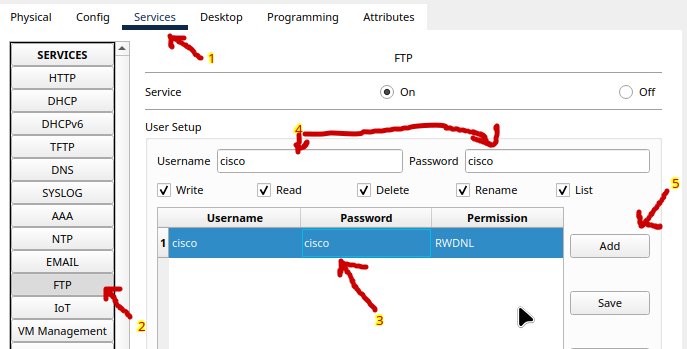
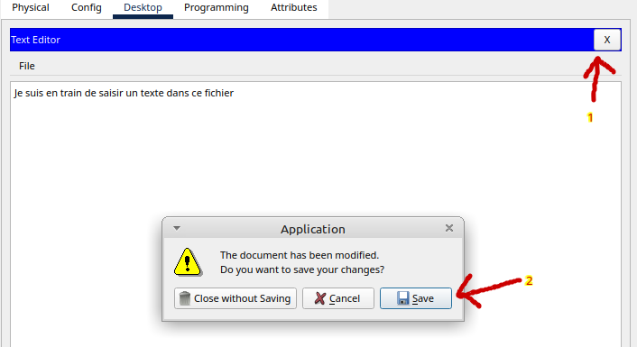
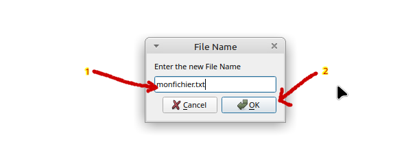
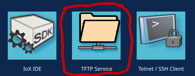
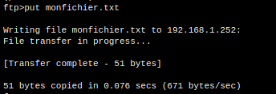
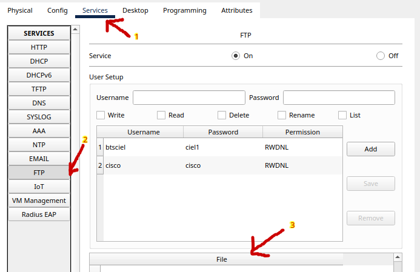

*Plateforme : Cisco Packet Tracer (postes PC-PT, serveurs Server-PT, commutateur Switch-PT).*

## Objectifs et prérequis

Vous avez rédigé un rapport sur votre poste. Un collègue doit le récupérer sur le sien. Vous pourriez passer par une clé USB. Dans une entreprise, on dépose plutôt le fichier sur un serveur, où chacun vient le chercher. Le protocole FTP sert à ces échanges de fichiers entre un client et un serveur.

Dans ce TP, vous allez :

- ajouter un serveur FTP à la maquette et lui donner une adresse fixe ;
- activer le service FTP et créer un compte utilisateur, avec ses permissions ;
- vous connecter au serveur depuis l'invite de commandes d'un poste client ;
- créer un fichier sur le poste, puis l'envoyer au serveur ;
- renommer, télécharger et supprimer ce fichier à distance.

Vous repartez de la maquette du TP DNS. Le diaporama « Le protocole FTP » donne le vocabulaire utilisé ici : client, serveur, identifiant et mot de passe, téléchargement et téléversement de fichiers.

::: {.callout-tip title="Support d'activité"}
- Cisco Packet Tracer, suite bureautique
- Fichier `tp-services-reseau.pkt` enregistré à la fin du TP DNS
- Diaporama « Le protocole FTP »
:::

Vous rédigerez un compte rendu numérique. Pensez aux captures d'écran pour illustrer votre compte rendu. Sauvegardez votre travail régulièrement ! Des différences peuvent exister selon la version du logiciel utilisée.

## Situation de départ

Les salariés de l'entreprise consultent le site Web interne par son nom, `www.site.com`. Ils veulent maintenant partager des documents. Vous ajoutez donc un quatrième serveur, chargé de stocker des fichiers. Chaque salarié pourra y déposer un fichier ou en récupérer un.

À la fin du TP DNS, votre maquette contient :

- un commutateur (Switch0) ;
- quatre postes (PC0 à PC3), configurés en DHCP ;
- un serveur DHCP (Server0), à l'adresse statique 192.168.1.250 ;
- un pool `LAN` qui distribue les adresses à partir de 192.168.1.1, avec la passerelle 192.168.1.254 et le serveur DNS 192.168.1.253 ;
- un serveur Web (Server1), à l'adresse statique 192.168.1.251 ;
- un serveur DNS (Server2), à l'adresse statique 192.168.1.253, qui associe le nom `www.site.com` à l'adresse 192.168.1.251.

Rappel du plan d'adressage du chapitre :

| Adresse | Rôle |
|---|---|
| 192.168.1.0/24 | Réseau local (masque 255.255.255.0) |
| 192.168.1.250 | Serveur DHCP (Server0) |
| 192.168.1.251 | Serveur HTTP (Server1) |
| 192.168.1.252 | Serveur FTP (Server3, ce TP) |
| 192.168.1.253 | Serveur DNS (Server2) |
| 192.168.1.254 | Passerelle par défaut (réservée pour un routeur) |

: Plan d'adressage de la maquette du chapitre {#tbl-plan}

Résultat attendu en fin de séance : depuis PC2, vous vous connectez au serveur FTP avec votre compte. Vous y avez envoyé, renommé, récupéré puis supprimé un fichier créé sur le poste.

## Matériel et environnement

- Cisco Packet Tracer, sur votre poste.
- Le fichier `tp-services-reseau.pkt` enregistré à la fin du TP DNS. Si vous ne l'avez plus, reconstruisez d'abord la maquette décrite ci-dessus.
- En fin de séance, vous enregistrez de nouveau ce fichier.

| Partie | Contenu | Durée indicative |
|---|---|---|
| A | Ajouter et adresser le serveur FTP | 10 min |
| B | Activer le service FTP et créer un compte | 15 min |
| C | Se connecter au serveur depuis un poste | 15 min |
| D | Créer un fichier sur le poste client | 10 min |
| E | Envoyer le fichier au serveur | 15 min |
| F | Renommer, télécharger et supprimer le fichier | 15 min |
| — | Sauvegarde et vérifications | 10 min |

: Déroulement de la séance {#tbl-deroulement}

## Travail à réaliser

### Partie A — Ajouter et adresser le serveur FTP (10 min)

1. Ouvrez `tp-services-reseau.pkt`.
2. Ajoutez un serveur « Server-PT » à la topologie. Packet Tracer le nomme Server3.
3. Reliez Server3 au commutateur avec un câble droit (« Copper Straight-Through » dans la rubrique « Connections »).
4. Attendez que les voyants de la nouvelle liaison passent au vert.
5. Attribuez au serveur une adresse statique. Cliquez sur Server3, puis ouvrez l'onglet « Desktop » > « IP Configuration ». Choisissez « Static » et saisissez :
   - IPv4 Address : 192.168.1.252 ;
   - Subnet Mask : 255.255.255.0 ;
   - Default Gateway : 192.168.1.254 ;
   - DNS Server : 192.168.1.253, la même adresse DNS que celle configurée sur le serveur DHCP.

Comme les serveurs HTTP et DNS, le serveur FTP garde une adresse fixe. Les postes doivent le trouver toujours à la même adresse.

### Partie B — Activer le service FTP et créer un compte (15 min)

Un serveur FTP ne s'ouvre pas à n'importe qui. Pour s'y connecter, il faut un **compte utilisateur** : un nom et un mot de passe. Chaque compte reçoit aussi des **permissions** : la liste des actions qu'il a le droit de faire sur les fichiers du serveur.

1. Sur Server3, ouvrez l'onglet « Services ».
2. Sélectionnez « FTP » dans la liste des services disponibles.
3. Vérifiez que le service est activé : à la ligne « Service », l'option « On » doit être sélectionnée.
4. Dans la section « User Setup », créez un compte utilisateur :
   - Username : `btciel` ;
   - Password : `ciel1`.
5. Cochez les cinq permissions : « Write », « Read », « Delete », « Rename » et « List ».
6. Cliquez sur le bouton « Add ». Le compte apparaît dans le tableau, avec les colonnes « Username », « Password » et « Permission ».

{fig-alt="Capture d'écran de Packet Tracer : onglet Services d'un serveur, section FTP sélectionnée dans la liste de gauche. Des flèches numérotées désignent : 1 l'onglet Services, 2 le bouton FTP, 3 le mot de passe cisco dans le tableau, 4 les champs Username et Password, tous deux remplis avec cisco, 5 le bouton Add. La ligne Service a l'option On cochée. Les cinq cases Write, Read, Delete, Rename et List sont cochées. Le tableau du bas, aux colonnes Username, Password et Permission, contient une ligne : cisco, cisco, RWDNL. Sous le bouton Add se trouve le bouton Save."}

La capture montre le compte `cisco` (mot de passe `cisco`), déjà présent sur le serveur. Ne le modifiez pas : créez à côté votre propre compte, `btciel`, avec le mot de passe `ciel1`. La colonne « Permission » résume les droits de chaque compte par des lettres.

::: {.callout-note title="Question 5"}
Expliquez la signification de chacune de ces permissions. Que permettent-elles concrètement à l'utilisateur lorsqu'il se connecte au serveur FTP ?
:::

### Partie C — Se connecter au serveur depuis un poste (15 min)

Le serveur est prêt. Vous allez maintenant jouer le rôle du client. Utilisez PC2 pour toute la suite du TP.

Avant de vous connecter, vérifiez que le poste joint bien le serveur.

1. Sur PC2, ouvrez « Desktop » > « Command Prompt ».
2. Saisissez la commande suivante (invite de commandes d'un PC Packet Tracer) :

```text
ping 192.168.1.252
```

Si la première réponse échoue, relancez la commande : le poste doit parfois d'abord découvrir l'adresse MAC du serveur.

3. Si le ping réussit, ouvrez une session FTP vers le serveur :

```text
ftp 192.168.1.252
```

4. Connectez-vous avec les identifiants du compte créé dans la partie B. Saisissez le nom d'utilisateur, puis le mot de passe, quand le serveur les demande.
5. Une fois connecté, l'invite devient `ftp>`. Tapez la commande `?` pour afficher la liste des commandes disponibles dans le client FTP.
6. Testez la commande `dir`. Elle affiche la liste des fichiers présents sur le serveur FTP.

Vous utiliserez ensuite les commandes essentielles suivantes, toutes à saisir à l'invite `ftp>` :

| Commande | Rôle |
|---|---|
| `dir` | Affiche la liste des fichiers présents sur le serveur FTP. |
| `get <fichier>` | Télécharge un fichier depuis le serveur vers le client. |
| `put <fichier_local>` | Envoie un fichier du client vers le serveur. |
| `rename` | Renomme un fichier sur le serveur. |
| `delete` | Supprime un fichier du serveur. |

: Commandes essentielles du client FTP de Packet Tracer {#tbl-commandes}

Gardez cette fenêtre ouverte : la session FTP vous servira dans les parties E et F.

::: {.callout-warning}
**>>>> FAIRE VALIDER LE TRAVAIL PAR LE PROFESSEUR AVANT DE POURSUIVRE <<<<**
:::

### Partie D — Créer un fichier sur le poste client (10 min)

Pour envoyer un fichier au serveur, il faut d'abord un fichier sur le poste. Vous allez en créer un, toujours sur PC2.

1. Sur PC2, revenez à l'onglet « Desktop » et ouvrez l'application « Text Editor ».
2. Rédigez un court texte dans le fichier, par exemple une phrase.
3. Fermez l'éditeur en cliquant sur la croix « X », en haut à droite. Une fenêtre vous demande si vous voulez enregistrer vos modifications. Choisissez « Save ».

{fig-alt="Capture d'écran de Packet Tracer : onglet Desktop d'un poste, fenêtre Text Editor avec un menu File. Le texte saisi est : Je suis en train de saisir un texte dans ce fichier. Une flèche numérotée 1 désigne le bouton X en haut à droite. Au centre, une boîte de dialogue intitulée Application affiche : The document has been modified. Do you want to save your changes? Elle propose trois boutons : Close without Saving, Cancel et Save. Une flèche numérotée 2 désigne le bouton Save."}

4. Une fenêtre « File Name » vous demande le nom du fichier. Saisissez `monfichier.txt`, puis cliquez sur « OK ».

{fig-alt="Capture d'écran de Packet Tracer : boîte de dialogue File Name, avec le texte Enter the new File Name. Le champ de saisie contient monfichier.txt, désigné par une flèche numérotée 1. Une flèche numérotée 2 désigne le bouton OK, à côté du bouton Cancel."}

5. Toujours dans l'onglet « Desktop » de PC2, ouvrez l'application « TFTP Service ». Elle permet de visualiser les fichiers enregistrés sur le PC.

{width=55% fig-alt="Capture d'écran de Packet Tracer : trois icônes de l'onglet Desktop d'un poste, sur fond bleu foncé. De gauche à droite : IoX IDE, TFTP Service et Telnet / SSH Client. L'icône TFTP Service, un dossier relié à un réseau, est entourée à la main."}

::: {.callout-note title="Remarque : le nom de l'application"}
Malgré son nom, vous n'utilisez pas ici le protocole TFTP. Vous vous servez seulement de cette application pour voir la liste des fichiers de PC2.
:::

::: {.callout-note title="Question"}
Combien de fichiers apparaissent actuellement dans la liste ?
:::

### Partie E — Envoyer le fichier au serveur (15 min)

Vous allez maintenant transférer le fichier texte que vous venez de créer vers le serveur FTP. Envoyer, ou téléverser, un fichier du client vers le serveur, c'est le rôle de la commande `put`.

1. Retournez dans le « Command Prompt » de PC2, la fenêtre où vous êtes connecté au serveur FTP.
2. Saisissez la commande suivante, à l'invite `ftp>` :

```text
put monfichier.txt
```

Cette commande envoie un fichier local, présent sur le poste client, vers le serveur FTP.

Si tout s'est bien déroulé, un message de confirmation semblable à celui-ci s'affiche dans la fenêtre. Le nombre d'octets dépend de la longueur de votre texte.

{width=55% fig-alt="Capture d'écran de l'invite de commandes d'un poste Packet Tracer, texte clair sur fond noir. Après l'invite ftp>, la commande put monfichier.txt. Puis les lignes : Writing file monfichier.txt to 192.168.1.252: ; File transfer in progress... ; [Transfer complete - 51 bytes] ; 51 bytes copied in 0.076 secs (671 bytes/sec)."}

::: {.callout-note title="Question 6"}
Que signifie ce message ? Expliquez ce qu'il indique concernant le transfert du fichier vers le serveur FTP.
:::

Vérifiez maintenant, côté serveur, que le fichier est bien arrivé.

3. Cliquez sur Server3, puis ouvrez l'onglet « Services ».
4. Sélectionnez « FTP » dans la liste des services disponibles.
5. Faites défiler la page jusqu'au tableau des fichiers du serveur, en bas (colonne « File »). Vérifiez que `monfichier.txt` apparaît bien dans la liste.

{fig-alt="Capture d'écran de Packet Tracer : onglet Services d'un serveur, section FTP. Des flèches numérotées désignent : 1 l'onglet Services, 2 le bouton FTP, 3 l'en-tête File d'un tableau situé en bas de la page. La ligne Service a l'option On cochée. Les champs Username et Password sont vides et les cinq cases de permissions décochées. Le tableau des comptes contient deux lignes : btsciel, ciel1, RWDNL, puis cisco, cisco, RWDNL. Le tableau des fichiers est coupé en bas de la capture."}

Sur cette capture, le compte créé porte un autre nom. Gardez bien le nom `btciel` demandé dans la partie B.

Si le fichier est présent, le transfert FTP a réussi.

### Partie F — Renommer, télécharger et supprimer le fichier (15 min)

Votre fichier `monfichier.txt` est maintenant sur le serveur FTP. Vous allez le manipuler à distance, pour mieux comprendre le fonctionnement du protocole. Toutes les commandes se saisissent à l'invite `ftp>` de PC2.

1. **Renommer le fichier.** La commande `rename` change le nom d'un fichier déjà présent sur le serveur FTP :

```text
rename monfichier.txt nouveau_nom.txt
```

2. **Télécharger le fichier renommé.** La commande `get` récupère le fichier depuis le serveur FTP vers le poste client :

```text
get nouveau_nom.txt
```

3. Ouvrez de nouveau l'application « TFTP Service » de PC2. Relevez la liste des fichiers du poste.
4. **Supprimer le fichier sur le serveur.** Revenez à l'invite `ftp>` et saisissez :

```text
delete nouveau_nom.txt
```

::: {.callout-note title="Question 7"}
Lorsque vous exécutez cette commande, où le fichier est-il supprimé ?

- Du poste client ?
- Du serveur FTP ?

Expliquez votre réponse.
:::

5. Pour justifier votre réponse, vérifiez où le fichier a disparu. Regardez la liste des fichiers de Server3 (« Services » > « FTP »), puis celle de PC2 (« TFTP Service »).
6. Fermez la session FTP avec la commande `quit`.

### Sauvegarde

Enregistrez la maquette avec le menu « File » > « Save », sous le nom `tp-services-reseau.pkt`. Gardez une copie dans votre dossier personnel. Server3 doit garder l'adresse 192.168.1.252 et le compte `btciel`.

## Vérification et compte rendu

Votre travail est réussi si vous pouvez constater les points suivants :

- Server3 est relié au commutateur et ses voyants de liaison sont verts ;
- Server3 a l'adresse statique 192.168.1.252, le masque 255.255.255.0, la passerelle 192.168.1.254 et le serveur DNS 192.168.1.253 ;
- le service FTP de Server3 est sur « On » ;
- le tableau des comptes de Server3 contient le compte `btciel`, avec les cinq permissions ;
- un `ping 192.168.1.252` lancé depuis PC2 réussit ;
- depuis PC2, la commande `ftp 192.168.1.252` ouvre une session avec le compte `btciel` ;
- le fichier `nouveau_nom.txt` ne figure plus dans la liste des fichiers de Server3 ;
- le fichier `tp-services-reseau.pkt` est enregistré.

Votre compte rendu contient :

- les réponses aux Questions 5, 6 et 7, et à la question de la partie D ;
- une capture de la fenêtre « IP Configuration » de Server3 (partie A) ;
- une capture du tableau des comptes du service FTP de Server3 (partie B) ;
- une capture de l'invite de commandes de PC2, avec la connexion au serveur et le résultat de `dir` (partie C) ;
- une capture de la liste des fichiers de PC2 dans « TFTP Service » (partie D) ;
- une capture du message affiché après `put monfichier.txt` (partie E) ;
- une capture de la liste des fichiers de Server3 contenant `monfichier.txt` (partie E) ;
- une capture de l'invite de commandes après `rename`, `get` et `delete` (partie F).

::: {.callout-warning}
**>>>> FAIRE VALIDER LE TRAVAIL PAR LE PROFESSEUR AVANT DE QUITTER LA SÉANCE <<<<**
:::

## Synthèse

::: {.callout-important title="Synthèse à compléter"}
Recopiez et complétez ces phrases dans votre compte rendu.

1. Le protocole FTP sert à transférer des ………… entre un client et un serveur.
2. Pour se connecter au serveur FTP, l'utilisateur fournit un nom d'utilisateur et un ………… .
3. Les ………… d'un compte indiquent les actions qu'il a le droit de faire sur les fichiers du serveur.
4. La commande `put` téléverse un fichier du ………… vers le ………… .
5. La commande `get` télécharge un fichier du ………… vers le ………… .
6. Les commandes `rename` et `delete` agissent sur les fichiers du ………… .
7. Le serveur FTP reçoit une adresse IP ………… , car les postes doivent le trouver toujours à la même adresse.
:::

Notez enfin, en deux ou trois lignes, la difficulté principale rencontrée pendant ce TP et la manière dont vous l'avez résolue.

## Pour aller plus loin

Dans la partie B, vous avez donné toutes les permissions au compte `btciel`. Que se passe-t-il avec un compte plus limité ?

Sur Server3, créez un second compte, par exemple `lecteur`, avec seulement les permissions « Read » et « List ». Depuis PC2, ouvrez une session FTP avec ce compte. Testez `dir`, `get`, puis `put` avec un fichier du poste. Relevez, pour chaque commande, la réponse du serveur. Reliez ces réponses à votre explication de la Question 5.

Vous pouvez aussi observer la connexion en mode Simulation. Dans « Edit Filters », ne laissez cochés que FTP et TCP. Relancez ensuite `ftp 192.168.1.252` depuis PC2. Ouvrez le détail du premier message envoyé par PC2 et relevez son port destination. Est-ce le port 21, attribué aux commandes FTP ?

Sources :

- RFC 959, *File Transfer Protocol (FTP)*, IETF, 1985 (modèle client-serveur, commandes, connexion de contrôle sur le port 21) : <https://www.rfc-editor.org/rfc/rfc959>
- RFC 1350, *The TFTP Protocol (Revision 2)*, IETF, 1992 (protocole TFTP, distinct de FTP) : <https://www.rfc-editor.org/rfc/rfc1350>
