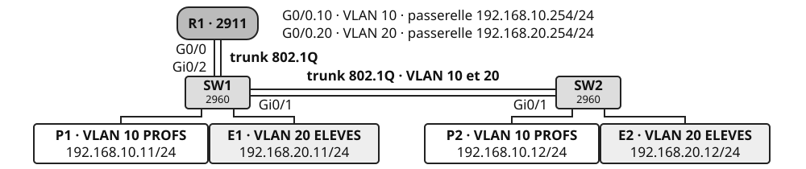

## Objectifs et prérequis

Vous allez configurer et vérifier le routage entre VLAN. Prérequis : cours « Les VLAN » et adressage IPv4.

## Situation de départ

Au lycée, P1 ne joint pas E1 : **deux VLAN, deux réseaux IP**. P1 doit envoyer la trame à sa **passerelle**.
La destination IP reste E1. Ajoutons **R1, équipement de niveau 3**, avec une adresse dans chaque VLAN.

{fig-alt="R1, routeur 2911, est au-dessus de SW1. G0/0 de R1 rejoint Gi0/2 de SW1 en trunk 802.1Q. Ses sous-interfaces G0/0.10 et G0/0.20 portent les passerelles 192.168.10.254/24 et 192.168.20.254/24. SW1 et SW2, des 2960, sont reliés en trunk par Gi0/1. SW1 dessert P1 192.168.10.11 et E1 192.168.20.11 ; SW2 dessert P2 192.168.10.12 et E2 192.168.20.12. P1 et P2 sont dans le VLAN 10 PROFS ; E1 et E2 dans le VLAN 20 ELEVES." width=85% fig-pos="H"}

## Comprendre le mécanisme

Le **routeur sur un bâton** (*router on a stick*) utilise une seule interface physique, G0/0.
Une **sous-interface** est une interface logique de G0/0, une par VLAN : elle traite son étiquette (`encapsulation dot1Q`) et porte sa passerelle. De P1 vers E1 :

1. P1 remet le paquet à **192.168.10.254**, via une trame du VLAN 10.
2. R1 reçoit par **G0/0.10** ; sa table associe **192.168.20.0/24** à **G0/0.20**.
3. R1 émet une nouvelle trame par **G0/0.20**, étiquetée VLAN 20 sur le trunk ; SW1 la livre à E1.

Autre solution : un **commutateur de niveau 3** assure le routage ; voir la fiche (autre topologie).

## Observer et appliquer

**Cisco Packet Tracer — SW1 : 2960 ; R1 : 2911 (IOS).** Conservez les VLAN, ports d’accès et Gi0/1 du cours précédent.

1. Sur chaque équipement, entrez `enable`, puis `configure terminal`. Appliquez sa partie :

```text
! SW1 (2960)
interface gi0/2
 switchport mode trunk
! R1 (2911)
interface g0/0
 no shutdown
interface g0/0.10
 encapsulation dot1Q 10
 ip address 192.168.10.254 255.255.255.0
interface g0/0.20
 encapsulation dot1Q 20
 ip address 192.168.20.254 255.255.255.0
end
```

Placez **`encapsulation dot1Q` avant `ip address`**, sinon IOS refuse l’adresse ; **`no shutdown` sur l’interface physique**.

2. Postes (**Desktop > IP Configuration**) : passerelle **192.168.10.254** (VLAN 10) ou **192.168.20.254** (VLAN 20).
3. R1, mode privilégié : `show ip interface brief` → `up/up` ; `show ip route` → deux réseaux **C** (plus leurs lignes **L** : adresses de R1).
4. P1 (**Command Prompt**) : `ping 192.168.20.11` (la 1re réponse peut manquer : ARP), puis `tracert 192.168.20.11` → R1, puis E1.

## Exercices de vérification

**À vous.** Quelle passerelle pour E2 ? **Corrigé :** 192.168.20.254, celle du VLAN 20.

## Synthèse

- Vers un autre réseau IP, le poste passe par sa passerelle.
- Un trunk vers R1 transporte les deux VLAN ; une sous-interface fournit chaque passerelle.
- Vérifiez les interfaces, les réseaux connectés, puis le trajet du paquet.

## Pour aller plus loin

[Cours — Les VLAN](../cours-vlan/index.qmd) · [VLAN et routage inter-VLAN : l’aide-mémoire](../fiche-vlan-inter-vlan/index.qmd) (autre topologie) ·
[TP 2 — Faire communiquer les VLAN](../tp-routage-inter-vlan/index.qmd).
