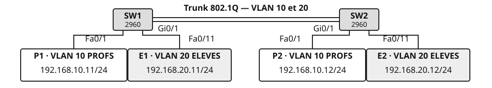

## Objectifs et prérequis

Vous allez séparer deux groupes de postes, configurer leurs ports et vérifier leur liaison.
Vous connaissez l’adressage IPv4 (réseau, masque) et le rôle d’un commutateur.

## Situation de départ

Sans séparation, une diffusion (*broadcast*) atteint tous les autres ports actifs du commutateur.
Tous les postes partagent un **domaine de diffusion**. Un lycée veut séparer professeurs et élèves, même entre bâtiments.
Il choisit **VLAN 10 PROFS : 192.168.10.0/24** et **VLAN 20 ELEVES : 192.168.20.0/24**.

{fig-alt="SW1 et SW2 sont reliés par Gi0/1 en trunk 802.1Q. Sur chaque commutateur, Fa0/1 dessert un professeur du VLAN 10, Fa0/11 un élève du VLAN 20. SW1 : P1 192.168.10.11, E1 192.168.20.11. SW2 : P2 192.168.10.12, E2 192.168.20.12. Masque /24 pour tous." width=95% fig-pos="H"}

## Comprendre le mécanisme

Un **VLAN** découpe le commutateur en commutateurs logiques. P1 diffuse : P2 reçoit, E1 et E2 ne reçoivent pas.
**Un VLAN = un domaine de diffusion** ; en pratique, on lui associe **un réseau IP**.

::: {tbl-colwidths="[18,82]"}
| Notion | Rôle |
|:---|:---|
| Port d’accès | Un seul VLAN ; trames sans étiquette vers le poste. |
| Trunk 802.1Q | Plusieurs VLAN ; étiquette de **4 octets** contenant le numéro de VLAN, sauf VLAN natif. |
| VLAN natif | Trames sans étiquette sur le trunk ; VLAN 1 par défaut. En pratique, on le change (voir la fiche). Ici, on garde le VLAN 1 pour simplifier. |
:::

Deux VLAN ne communiquent pas sans équipement de **niveau 3** : prochain cours, « Le routage inter-VLAN ».

## Observer et appliquer

**Cisco Packet Tracer — 2960 (IOS).** Sur **chacun** des deux commutateurs :

1. En mode de configuration globale (`enable`, puis `configure terminal`), créez le VLAN et affectez ses ports :

```text
vlan 10
 name PROFS
interface range fa0/1 - 10
 switchport mode access
 switchport access vlan 10
```

2. Répétez pour `vlan 20`, `name ELEVES`, `interface range fa0/11 - 20` et `switchport access vlan 20` (mode accès).
3. Forcez le trunk, puis vérifiez en mode privilégié :

```text
interface gi0/1
 switchport mode trunk
end
show vlan brief
show interfaces trunk
```

Contrôlez les ports des VLAN 10 et 20, puis Gi0/1 en état `trunking` avec ces VLAN actifs et autorisés.

## Exercices de vérification

**À vous.** P1 peut-il joindre P2 ? Et E2, sans routeur ? **Corrigé :** P2 oui (même VLAN et /24), E2 non.

## Synthèse

- Un VLAN limite la diffusion à ses membres, même sur plusieurs commutateurs.
- Accès : un VLAN ; trunk : plusieurs VLAN ; VLAN natif sans étiquette.
- Pour passer d’un VLAN à l’autre, il faut du routage de niveau 3.

## Pour aller plus loin

[VLAN et routage inter-VLAN : l’aide-mémoire](../fiche-vlan-inter-vlan/index.qmd) ·
[TP 1 — Segmenter un réseau avec des VLAN](../tp-vlan/index.qmd).
