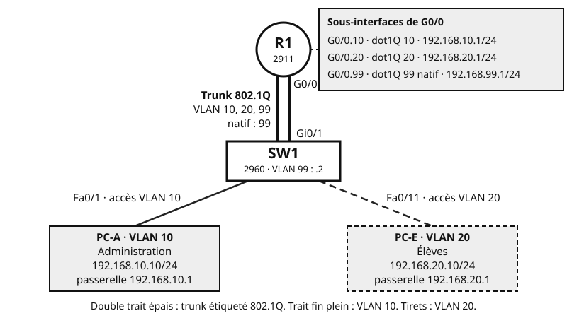

## Objectifs et prérequis

Cette fiche rassemble l’essentiel des VLAN et du routage inter-VLAN, vus en
classe. Gardez-la à portée de main en TP. Relisez-la avant le cours sur OSPF,
qui la suppose acquise.

Les commandes visent **Cisco Packet Tracer** : commutateur **2960**
(IOS 15.0), routeur **2911** (IOS 15.1) et commutateur de niveau 3
**3560**.

## Situation de départ

Dans un lycée, administration et élèves partagent le même commutateur. Au
départ, tous ses ports sont dans le même VLAN, le VLAN 1 par défaut : tous
les postes reçoivent donc les mêmes diffusions.

On veut séparer deux réseaux sans acheter un second commutateur :

| VLAN | Nom | Réseau | Passerelle | Ports du 2960 |
|:-:|:---|:---|:---|:---|
| 10 | Administration | `192.168.10.0/24` | `192.168.10.1` | Fa0/1 à Fa0/10 |
| 20 | Élèves | `192.168.20.0/24` | `192.168.20.1` | Fa0/11 à Fa0/20 |
| 99 | Gestion, VLAN natif | `192.168.99.0/24` | `192.168.99.1` | aucun port d’accès |

Le commutateur SW1 prend l’adresse `192.168.99.2` pour son administration à
distance. Le routeur R1 permettra aux deux VLAN d’échanger.

{fig-alt="En haut, le routeur R1, un Cisco 2911. Son interface G0/0 porte trois sous-interfaces : G0/0.10, dot1Q 10, adresse 192.168.10.1/24 ; G0/0.20, dot1Q 20, adresse 192.168.20.1/24 ; G0/0.99, dot1Q 99 natif, adresse 192.168.99.1/24. Un lien trunk 802.1Q, dessiné en double trait épais, relie G0/0 du routeur au port Gi0/1 du commutateur SW1, un Cisco 2960 d’adresse 192.168.99.2 dans le VLAN 99. Le trunk transporte les VLAN 10, 20 et 99, avec le VLAN 99 comme VLAN natif. En bas à gauche, PC-A, VLAN 10 Administration, adresse 192.168.10.10/24, passerelle 192.168.10.1, est relié au port d’accès Fa0/1 par un trait fin plein. En bas à droite, PC-E, VLAN 20 Élèves, adresse 192.168.20.10/24, passerelle 192.168.20.1, est relié au port d’accès Fa0/11 par un trait en tirets."}

## Notions essentielles

### VLAN et domaine de diffusion

Un **VLAN** (*Virtual LAN*) découpe un commutateur en plusieurs réseaux
locaux logiques. Chaque VLAN forme un **domaine de diffusion** distinct :
une trame de diffusion reste dans ce VLAN, sans atteindre les autres VLAN. On
lui associe en pratique **un sous-réseau IP**.

### Port d’accès et port trunk

- Un **port d’accès** appartient à un seul VLAN. Les trames y circulent sans
  étiquette. On y branche les PC, les imprimantes, les serveurs.
- Un **port trunk** transporte plusieurs VLAN sur un seul lien. Chaque trame
  y porte une étiquette qui indique son VLAN, sauf celles du VLAN natif.
  On l’utilise entre commutateurs, ou vers un routeur.

### L’étiquette 802.1Q

Sur le trunk, SW1 doit dire au routeur de quel VLAN vient chaque trame. La
norme **IEEE 802.1Q** insère pour cela une **étiquette de 4 octets** dans la
trame, juste après l’adresse MAC source.

| Champ | Taille | Rôle |
|:---|:-:|:---|
| TPID (*Tag Protocol Identifier*) | 16 bits | Valeur `0x8100` : signale une trame étiquetée |
| PCP (*Priority Code Point*) | 3 bits | Priorité de la trame (qualité de service) |
| DEI (*Drop Eligible Indicator*) | 1 bit | Trame pouvant être éliminée en priorité en cas de congestion |
| **VID** | **12 bits** | **Numéro du VLAN** |

Avec 12 bits, on obtient 2^12^ = 4 096 valeurs. Les valeurs 0 et 4095 sont
réservées : les VLAN utilisables vont donc de **1 à 4094**.

### Le VLAN natif

Sur un trunk 802.1Q, les trames d’un VLAN circulent **sans étiquette** : ce
VLAN est le **VLAN natif**. C’est le VLAN 1 par défaut.

::: {.callout-warning}
## Changez le VLAN natif

Laisser le VLAN 1 comme VLAN natif facilite certaines attaques, comme le
saut de VLAN par double étiquetage. L’attaquant envoie une trame à deux
étiquettes : le premier commutateur retire celle du VLAN natif, la seconde
fait entrer la trame dans un autre VLAN.

Choisissez un autre VLAN natif, sans aucun port d’accès. Il doit être
**le même aux deux extrémités** du trunk. En entreprise, on choisit souvent
un VLAN natif distinct du VLAN de gestion et inutilisé ; ici, le VLAN 99
joue les deux rôles pour simplifier.
:::

### Pourquoi un routage de niveau 3

Pour joindre un autre VLAN, donc un autre réseau, un PC passe par sa
**passerelle**. Un commutateur de niveau 2 n’y suffit pas : il faut un
équipement de **niveau 3** doté d’une adresse dans chaque VLAN.

## Méthode et exemple

### 1. Créer les VLAN et les ports d’accès

**Plateforme : Cisco Packet Tracer, commutateur 2960, IOS 15.0.**

```text
! SW1, mode de configuration globale
vlan 10
 name Administration
vlan 20
 name Eleves
vlan 99
 name Gestion
! un nom sans espace ni accent
interface range FastEthernet0/1 - 10
 switchport mode access
 switchport access vlan 10
interface range FastEthernet0/11 - 20
 switchport mode access
 switchport access vlan 20
```

### 2. Configurer le trunk vers le routeur

Gi0/1 ou Gig0/1 : abréviations de GigabitEthernet0/1 (Packet Tracer affiche
Gig0/1).

```text
! SW1, mode de configuration globale
interface GigabitEthernet0/1
 switchport mode trunk
! le 2960 ne connaît que 802.1Q : pas de switchport trunk encapsulation
 switchport trunk native vlan 99
 switchport trunk allowed vlan 10,20,99
! facultatif : limite le trunk aux VLAN utiles
interface Vlan99
 ip address 192.168.99.2 255.255.255.0
 no shutdown
! adresse d’administration du commutateur
ip default-gateway 192.168.99.1
```

### 3. Configurer le routeur sur un bâton

Le **routeur sur un bâton** (*router-on-a-stick*) relie le routeur au
commutateur par **un seul lien trunk**. L’interface physique est découpée en
**sous-interfaces**, une par VLAN. Chacune porte l’adresse de passerelle de
son VLAN.

**Plateforme : Cisco Packet Tracer, routeur 2911, IOS 15.1.**

```text
! R1, mode de configuration globale
interface GigabitEthernet0/0
 no shutdown
! l’interface physique n’a pas d’adresse IP, mais doit être activée
interface GigabitEthernet0/0.10
 encapsulation dot1Q 10
! encapsulation avant ip address, sinon IOS refuse l’adresse
 ip address 192.168.10.1 255.255.255.0
! dot1Q 10 : cette sous-interface traite les trames étiquetées VLAN 10
interface GigabitEthernet0/0.20
 encapsulation dot1Q 20
 ip address 192.168.20.1 255.255.255.0
interface GigabitEthernet0/0.99
 encapsulation dot1Q 99 native
 ip address 192.168.99.1 255.255.255.0
! native : reçoit les trames non étiquetées, comme le VLAN natif de SW1
```

Le numéro après le point est libre. Prenez le numéro du VLAN : la
configuration se relit plus facilement.

::: {.callout-note}
## Variante : le commutateur de niveau 3

Un **commutateur de niveau 3**, comme le 3560, route lui-même entre les VLAN.
Chaque passerelle devient une **interface VLAN**, ou SVI (*Switched Virtual
Interface*). Le routeur externe
disparaît.

**Plateforme : Cisco Packet Tracer, commutateur 3560.**

```text
! SW3560, mode de configuration globale
ip routing
! active le routage IPv4, désactivé par défaut
vlan 10
 name Administration
interface Vlan10
 ip address 192.168.10.1 255.255.255.0
 no shutdown
! même démarche pour le VLAN 20
interface GigabitEthernet0/1
! trunk vers un commutateur d’accès
 switchport trunk encapsulation dot1q
 switchport mode trunk
! sur le 3560, choisir l’encapsulation avant le mode trunk
```
:::

### 4. Vérifier

Ces commandes se tapent en mode privilégié. Les sorties sont des **extraits
simplifiés**.

```text
SW1# show vlan brief
VLAN Name                             Status    Ports
---- -------------------------------- --------- ------------------------------
1    default                          active    Fa0/21, Fa0/22, Fa0/23, Fa0/24
                                                Gig0/2
10   Administration                   active    Fa0/1, Fa0/2, … Fa0/10
20   Eleves                           active    Fa0/11, Fa0/12, … Fa0/20
99   Gestion                          active
```

Chaque port d’accès apparaît dans son VLAN. Le port trunk Gi0/1 n’apparaît
**dans aucun VLAN** : c’est normal.

```text
SW1# show interfaces trunk
Port        Mode         Encapsulation  Status        Native vlan
Gig0/1      on           802.1q         trunking      99

Port        Vlans allowed on trunk
Gig0/1      10,20,99
```

Contrôlez trois points : le statut `trunking`, le VLAN natif et la liste des
VLAN autorisés.

```text
R1# show ip interface brief
Interface              IP-Address      OK? Method Status                Protocol
GigabitEthernet0/0     unassigned      YES unset  up                    up
GigabitEthernet0/0.10  192.168.10.1    YES manual up                    up
GigabitEthernet0/0.20  192.168.20.1    YES manual up                    up
GigabitEthernet0/0.99  192.168.99.1    YES manual up                    up
```

Chaque sous-interface doit être `up`. Dans `show ip route`, chacune donne une
route `C` : aucune route statique n’est nécessaire.

Testez enfin depuis PC-A, dans **Desktop > Command Prompt** :

```text
C:\> ping 192.168.20.10
```

Les premières réponses peuvent manquer, le temps des résolutions ARP. Les
suivantes doivent arriver.

## Points de vigilance

| Symptôme | Cause probable | Commande de contrôle |
|:---|:---|:---|
| Un seul PC ne joint ni sa passerelle ni les postes de son VLAN ; les autres postes du VLAN fonctionnent | Port d’accès dans le mauvais VLAN | `show vlan brief` (SW1) |
| Aucun VLAN ne joint sa passerelle | Lien vers le routeur resté en mode accès | `show interfaces trunk` (SW1) |
| Un seul VLAN ne joint pas sa passerelle | VLAN non créé sur SW1, ou absent de la liste autorisée | `show vlan brief` et `show interfaces trunk` (SW1) |
| Une sous-interface est `up`, mais son VLAN ne répond pas | `encapsulation dot1Q` avec un mauvais VID | `show running-config` (R1) |
| Aucune sous-interface n’est `up` | Interface physique G0/0 restée `shutdown` | `show ip interface brief` (R1) |
| Le PC joint les postes de son VLAN, pas ceux de l’autre VLAN | Passerelle du PC absente ou erronée | **Desktop > IP Configuration** (PC) |

::: {.content-visible when-format="html"}
<details>
<summary>À vous : le ping de PC-A vers 192.168.20.10 échoue, mais PC-A joint 192.168.10.1. Où chercher ?</summary>
<p>Le VLAN 10 fonctionne jusqu’au routeur. Contrôlez la sous-interface G0/0.20 avec show running-config : VID et adresse. Contrôlez ensuite le VLAN 20 sur SW1 avec show interfaces trunk et show vlan brief. Vérifiez enfin la passerelle de PC-E : la réponse doit pouvoir revenir.</p>
</details>
:::

::: {.content-visible unless-format="html"}
**À vous.** Le ping de PC-A vers `192.168.20.10` échoue, mais PC-A joint
`192.168.10.1`. Où chercher ?

**Réponse.** Le VLAN 10 fonctionne jusqu’au routeur. Contrôlez la
sous-interface G0/0.20 avec `show running-config` : VID et adresse.
Contrôlez ensuite le VLAN 20 sur SW1 avec `show interfaces trunk` et
`show vlan brief`. Vérifiez enfin la passerelle de PC-E : la réponse doit
pouvoir revenir.
:::

## Synthèse

- Un VLAN est un domaine de diffusion ; il correspond en pratique à un
  sous-réseau IP.
- Port d’accès : un VLAN, sans étiquette. Port trunk : plusieurs VLAN,
  étiquetés 802.1Q (4 octets, VID de 12 bits, VLAN 1 à 4094).
- VLAN natif : non étiqueté, 1 par défaut ; changez-le, à l’identique des
  deux côtés.
- Entre deux VLAN, il faut un équipement de niveau 3 : routeur sur un bâton,
  avec une sous-interface par VLAN, ou commutateur de niveau 3.
- Vérifiez couche par couche : VLAN, trunk, interfaces du routeur, puis ping.

## Pour aller plus loin

- [Groupe de travail IEEE 802.1](https://www.ieee802.org/1/), qui publie la
  norme IEEE 802.1Q sur les VLAN.
- [Cisco Packet Tracer](https://www.netacad.com/cisco-packet-tracer), le
  simulateur utilisé en TP.
- Prolongement dans Packet Tracer : passez en mode Simulation. Suivez un ping
  de PC-A vers PC-E et ouvrez la trame sur le trunk : repérez l’étiquette
  802.1Q et son VID.
