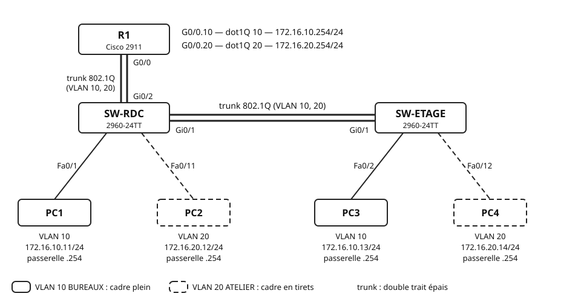
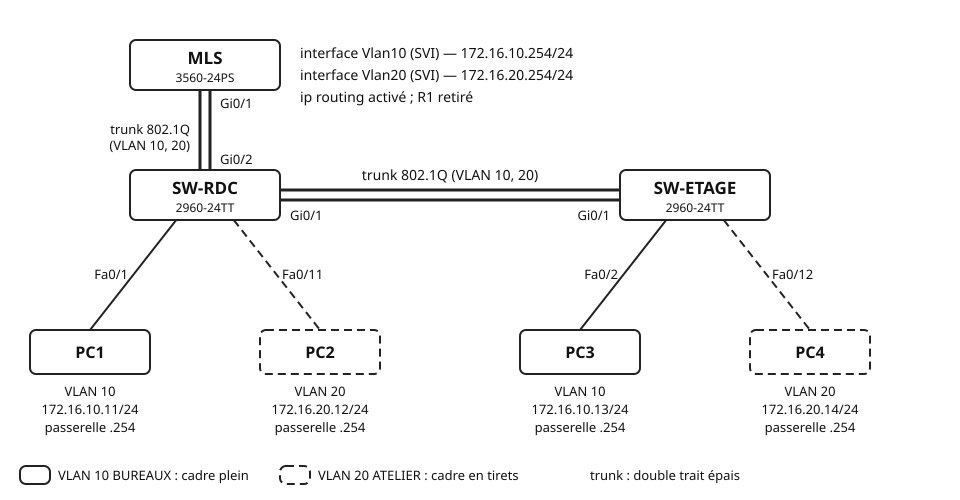

## Objectifs et prérequis

Au TP 1, vous avez séparé les bureaux et l'atelier de Celtis en deux VLAN.
Ils ne communiquent plus du tout. Ce TP les fait communiquer de nouveau,
mais en passant par un équipement de niveau 3. Vous ajouterez d'abord une
passerelle aux postes. Vous configurerez ensuite un routeur sur un bâton.
Vous provoquerez enfin des pannes, pour apprendre à les reconnaître.

Vous repartez du fichier `TP1_P3_NOM.pkt` du TP 1. Les commandes des VLAN
et du trunk sont supposées connues : elles ne sont plus fournies. Les
commandes nouvelles du routeur sont données une fois. Le cours
[« Le routage inter-VLAN »](../cours-routage-inter-vlan/index.qmd) doit être
connu. La
[fiche « VLAN et routage inter-VLAN »](../fiche-vlan-inter-vlan/index.qmd)
est autorisée.

## Situation de départ

Les VLAN 10 `BUREAUX` et 20 `ATELIER` fonctionnent aux deux niveaux du
bâtiment. Mais la séparation est trop stricte. Les dessinateurs des bureaux
doivent envoyer leurs fichiers aux machines de l'atelier.

Votre mission : relier les deux VLAN sans les fusionner. Chaque VLAN garde
son domaine de diffusion. Un routeur, R1, fera passer les paquets d'un VLAN
à l'autre. Il est branché sur le port Gi0/2 de SW-RDC, laissé libre au
TP 1.

Le résultat attendu : à la fin du TP, tous les postes se joignent, quel que
soit leur VLAN. Une diffusion, elle, reste toujours dans son VLAN.

| Partie | Ce que vous faites | Durée indicative |
|:-:|:---|:-:|
| 1 | Ajouter les passerelles aux postes | 15 min |
| 2 | Configurer le routeur sur un bâton | 45 min |
| 3 | Provoquer et diagnostiquer quatre pannes | 40 min |
| Bonus | Remplacer le routeur par un commutateur de niveau 3 | 20 min |

Chaque partie suit les quatre mêmes étapes que le TP 1.

| Étape | Ce que vous faites |
|:---|:---|
| 1. Configuration | réaliser la configuration demandée |
| 2. Vérification | relever l'état : commandes `show`, mode Simulation |
| 3. Tests | comparer chaque résultat au résultat attendu |
| 4. Réflexion | expliquer le résultat clé de la partie |

## Matériel et environnement

**Plateforme : Cisco Packet Tracer 9.0.1.** Matériel final : un routeur
**Cisco 2911** (R1), deux commutateurs **Cisco 2960-24TT** (SW-RDC,
SW-ETAGE) et quatre postes **PC-PT** (PC1 à PC4). Le bonus utilise en plus
un commutateur de niveau 3 **Cisco 3560-24PS**. Les commandes des
équipements Cisco se tapent dans l'onglet *CLI*. Les commandes des PC se
tapent dans *Desktop*, puis *Command Prompt*.

**VLAN.** Ils sont ceux du TP 1, sans changement.

| VLAN | Nom | Réseau IP | Passerelle | Ports d'accès |
|:-:|:---|:---|:---|:---|
| 10 | BUREAUX | `172.16.10.0/24` | `172.16.10.254` | Fa0/1 – Fa0/10 |
| 20 | ATELIER | `172.16.20.0/24` | `172.16.20.254` | Fa0/11 – Fa0/20 |

**Trunks 802.1Q.** SW-RDC Gi0/1 ↔ SW-ETAGE Gi0/1, déjà en place. SW-RDC
Gi0/2 ↔ R1 G0/0, à partir de la partie 2.

**Interfaces de R1.**

| Interface | Rôle | Adresse IP / masque |
|:---|:---|:---|
| G0/0 | interface physique, reliée à SW-RDC Gi0/2 | aucune |
| G0/0.10 | sous-interface du VLAN 10 | `172.16.10.254/24` |
| G0/0.20 | sous-interface du VLAN 20 | `172.16.20.254/24` |

**Équipements terminaux.** Seule la passerelle est nouvelle.

| Poste | Branché sur | VLAN | Adresse IP / masque | Passerelle (dès la partie 1) |
|:---|:---|:-:|:---|:---|
| PC1 | SW-RDC Fa0/1 | 10 | `172.16.10.11/24` | `172.16.10.254` |
| PC2 | SW-RDC Fa0/11 | 20 | `172.16.20.12/24` | `172.16.20.254` |
| PC3 | SW-ETAGE Fa0/2 | 10 | `172.16.10.13/24` | `172.16.10.254` |
| PC4 | SW-ETAGE Fa0/12 | 20 | `172.16.20.14/24` | `172.16.20.254` |

**Câblage.**

| Câble | De | Vers | Type |
|:-:|:---|:---|:---|
| 1 | PC | port du commutateur indiqué | droit |
| 2 | SW-RDC Gi0/1 | SW-ETAGE Gi0/1 | croisé (déjà en place) |
| 3 | R1 G0/0 (partie 2) | SW-RDC Gi0/2 | droit |
| 4 | MLS Gi0/1 (bonus) | SW-RDC Gi0/2 | croisé |

::: {.callout-note}
## Règles du jeu

- La fiche « VLAN et routage inter-VLAN » est autorisée. Les commandes
  nouvelles sont fournies une fois. Ensuite, c'est à vous de les réutiliser.
- Commencez par enregistrer `TP1_P3_NOM.pkt` sous un nouveau nom. Vous
  gardez ainsi intact le fichier du TP 1.
- Sauvegardez à la fin de chaque partie : `TP2_P1_NOM.pkt`,
  `TP2_P2_NOM.pkt`, `TP2_P3_NOM.pkt`, et `TP2_BONUS_NOM.pkt` pour le bonus.
- Sous Packet Tracer, le premier `ping` perd souvent un ou deux paquets : le
  temps de la résolution ARP. Relancez-le avant de conclure.
- Après un branchement, les voyants du lien passent à l'orange, puis au
  vert. Attendez le vert avant de tester.
:::

## Travail à réaliser

### Partie 1 — Ajouter les passerelles

Ouvrez `TP1_P3_NOM.pkt` et enregistrez-le aussitôt sous `TP2_P1_NOM.pkt`.
La topologie est celle de la fin du TP 1. Aucun routeur n'est encore
présent.

::: {.callout-note}
## Notion — passerelle par défaut

Au TP 1, PC1 refusait d'envoyer un paquet à PC2. L'adresse de PC2 était
hors de son réseau, et PC1 ne savait pas à qui le confier. Pour une
adresse hors de son réseau, un poste confie le paquet à un routeur de son
réseau. L'adresse de ce routeur s'appelle la **passerelle par défaut**.
Elle doit appartenir au réseau du poste. Ici, chaque VLAN aura sa
passerelle, en `.254`.
:::

**1.1 Configuration.** Sur chacun des quatre postes, ouvrez *Desktop*, puis
*IP Configuration*. Renseignez le champ *Default Gateway* avec la passerelle
du tableau « Équipements terminaux ». Ne changez ni l'adresse, ni le masque.

**1.2 Vérification.** Sur PC1 et PC4, tapez `ipconfig` dans le *Command
Prompt*.

| Commande et information | Valeur relevée |
|:---|:---|
| PC1, `ipconfig` : passerelle (*Default Gateway*) | |
| PC4, `ipconfig` : passerelle (*Default Gateway*) | |

**1.3 Tests.**

| ID | Test | Attendu | Vérifié |
|:-:|:---|:-:|:-:|
| G1 | PC1 → PC3 (même VLAN) | OK | |
| G2 | PC1 → `172.16.10.254` (sa passerelle) | ÉCHEC | |
| G3 | PC1 → PC2 (VLAN différents) | ÉCHEC | |

Recopiez le message affiché par le `ping` du test G3 :
`______________________________`.

**1.4 Observation en mode Simulation.** Vous allez voir à qui PC1 s'adresse
pour joindre PC2.

1. Sur PC1, videz le cache ARP avec `arp -d`.
2. Passez en mode *Simulation*, avec le seul filtre **ARP**.
3. Sur PC1, lancez `ping 172.16.20.12`.
4. Cliquez sur la première enveloppe émise par PC1. Ouvrez le détail de la
   requête ARP.

| Information | Valeur relevée |
|:---|:---|
| Adresse IP cible de la requête ARP | |
| Cette adresse est-elle celle de PC2 ? (oui / non) | |
| Un équipement répond-il à cette requête ? (oui / non) | |

Revenez en mode *Realtime*.

**1.5 Réflexion.**

a) PC1 ne cherche pas l'adresse MAC de PC2. Quelle adresse cherche-t-il,
   et pourquoi ?
b) Les tests G2 et G3 échouent. Quel équipement manque encore dans la
   topologie ?
c) Le test G1 réussit toujours. PC1 a-t-il eu besoin de sa passerelle pour
   joindre PC3 ? Justifiez avec les réseaux de PC1 et de PC3.

::: {.callout-important}
## Appelez le professeur

À montrer : `ipconfig` sur deux postes, les tests, le message relevé, le
tableau du mode Simulation, les réponses à la réflexion. Puis sauvegardez
sous `TP2_P1_NOM.pkt`.
:::

### Partie 2 — Le routeur sur un bâton

On repart du fichier de la partie 1. Vous ajoutez le routeur R1 sur le port
Gi0/2 de SW-RDC.

::: {.callout-note}
## Notion — routeur sur un bâton

R1 doit être passerelle de deux VLAN, mais un seul câble le relie à
SW-RDC. Ce câble est donc un trunk : il transporte les trames des deux
VLAN, avec leur étiquette 802.1Q. Côté routeur, l'interface physique G0/0
est découpée en **sous-interfaces**, une par VLAN. Chacune lit les trames
d'un seul numéro de VLAN, et porte l'adresse de passerelle de ce VLAN. Ce
montage s'appelle le **routeur sur un bâton** (*router-on-a-stick*).
:::

{fig-alt="En haut à gauche, le routeur R1, un Cisco 2911. À sa droite, deux lignes décrivent ses sous-interfaces : G0/0.10, dot1Q 10, adresse 172.16.10.254/24 ; G0/0.20, dot1Q 20, adresse 172.16.20.254/24. Un trunk 802.1Q, dessiné en double trait épais vertical, relie G0/0 de R1 au port Gi0/2 de SW-RDC ; il transporte les VLAN 10 et 20. SW-RDC et SW-ETAGE, deux commutateurs 2960-24TT, sont reliés entre leurs ports Gi0/1 par un second trunk 802.1Q, horizontal, en double trait épais, qui transporte aussi les VLAN 10 et 20. Sur SW-RDC : PC1 sur Fa0/1, VLAN 10, adresse 172.16.10.11/24 ; PC2 sur Fa0/11, VLAN 20, adresse 172.16.20.12/24. Sur SW-ETAGE : PC3 sur Fa0/2, VLAN 10, adresse 172.16.10.13/24 ; PC4 sur Fa0/12, VLAN 20, adresse 172.16.20.14/24. Chaque poste porte la mention passerelle .254. Les postes du VLAN 10 BUREAUX ont un cadre et un lien pleins, ceux du VLAN 20 ATELIER un cadre et un lien en tirets."}

**2.1 Configuration.**

**a) Raccordement.** Ajoutez un routeur **2911**, nommé R1 (*Display
Name*). Reliez son port G0/0 au port Gi0/2 de SW-RDC, avec un câble droit.

**b) Le trunk côté commutateur.** Configurez vous-même, sans aide, le port
Gi0/2 de SW-RDC en trunk, comme Gi0/1 au TP 1. Sauvegardez la configuration
de SW-RDC.

**c) Les sous-interfaces.** Sur R1, saisissez la configuration ci-dessous.

```text
! Packet Tracer, routeur R1 (Cisco 2911, IOS 15.1)
Router> enable
Router# configure terminal
Router(config)# hostname R1
R1(config)# interface gigabitEthernet 0/0
R1(config-if)# no shutdown
! active l'interface physique : elle n'a pas d'adresse IP
R1(config-if)# interface gigabitEthernet 0/0.10
! crée la sous-interface 10 ; le numéro après le point est libre
R1(config-subif)# encapsulation dot1Q 10
! cette sous-interface traite les trames étiquetées VLAN 10
R1(config-subif)# ip address 172.16.10.254 255.255.255.0
! adresse de passerelle du VLAN 10
R1(config-subif)# end
R1# show ip interface brief
```

::: {.callout-warning}
## Deux pièges du routeur sur un bâton

- Tapez `encapsulation dot1Q` **avant** `ip address`. Sinon, IOS refuse
  l'adresse sur la sous-interface.
- Le `no shutdown` se fait sur l'interface **physique** G0/0. Une
  sous-interface suit l'état de son interface physique.
:::

**d) La sous-interface du VLAN 20.** Créez vous-même G0/0.20, sans aide :
VLAN 20, adresse `172.16.20.254/24`. Sauvegardez ensuite la configuration
de R1 dans sa `startup-config`.

**2.2 Vérification.** Relevez sur R1 et sur SW-RDC :

| Commande et information | Valeur relevée |
|:---|:---|
| R1, `show ip interface brief` : adresse, *Status* et *Protocol* de G0/0 | |
| R1, `show ip interface brief` : adresse, *Status* et *Protocol* de G0/0.10 et G0/0.20 | |
| R1, `show ip route` : réseaux marqués `C`, avec leur interface | |
| R1, `show ip route` : adresses marquées `L`, avec leur masque | |
| SW-RDC, `show interfaces trunk` : ports en état *trunking* | |

Dans `show ip route`, une ligne `C` donne un réseau directement connecté.
Une ligne `L` donne l'adresse du routeur lui-même sur ce réseau.

**2.3 Tests.**

| ID | Test | Attendu | Vérifié |
|:-:|:---|:-:|:-:|
| C1 | PC1 → `172.16.10.254` (sa passerelle) | OK | |
| C2 | PC1 → PC2 (VLAN différents) | OK | |
| C3 | PC3 → PC4 (VLAN différents) | OK | |
| C4 | `tracert 172.16.20.14` depuis PC3 | 2 sauts | |

Pour le test C4, relevez chaque ligne affichée par `tracert` :

| Saut | Adresse IP affichée | Équipement correspondant |
|:-:|:---|:---|
| 1 | | |
| 2 | | |

**2.4 Observation en mode Simulation.** Vous allez suivre un paquet de PC3
vers PC4.

1. Passez en mode *Simulation*, avec le seul filtre **ICMP**.
2. Sur PC3, lancez `ping 172.16.20.14`.
3. Avancez pas à pas jusqu'à ce que la requête atteigne PC4. Cliquez sur
   l'enveloppe à chaque passage sur un trunk.

| Information | Valeur relevée |
|:---|:---|
| Liste des équipements traversés, de PC3 à PC4 | |
| Trame de SW-RDC vers R1 : numéro de VLAN de l'étiquette 802.1Q | |
| Trame de R1 vers SW-RDC : numéro de VLAN de l'étiquette 802.1Q | |
| Combien de fois la requête traverse-t-elle le trunk Gi0/1 ? | |

Revenez en mode *Realtime*.

**2.5 Réflexion.**

a) PC3 et PC4 sont branchés sur le même commutateur, SW-ETAGE. Pourquoi
   la requête monte-t-elle pourtant jusqu'à R1 ?
b) Dans le test C4, pourquoi les deux commutateurs n'apparaissent-ils pas
   comme des sauts ?
c) Le trunk R1–SW-RDC transporte les échanges entre VLAN de tout le
   bâtiment. Quelle limite voyez-vous si Celtis ajoute beaucoup de postes ?
d) Une diffusion émise par PC1 atteint-elle maintenant PC2 ou PC4 ?
   Vérifiez-le en mode Simulation : `arp -d` sur PC1, filtre ARP, puis
   `ping 172.16.10.13`.

::: {.callout-important}
## Appelez le professeur

À montrer : les relevés de R1 et de SW-RDC, les tests, le tableau de
`tracert`, celui du mode Simulation, les réponses à la réflexion. Puis
sauvegardez sous `TP2_P2_NOM.pkt`.
:::

### Partie 3 — Diagnostiquer

On repart d'une **copie** de `TP2_P2_NOM.pkt` : enregistrez-la d'abord sous
`TP2_P3_NOM.pkt`. Vous allez provoquer vous-même des pannes classiques.
Vous apprendrez ainsi à quoi chacune ressemble, vue de l'extérieur.

::: {.callout-tip}
## Méthode — une panne à la fois

1. **Prédisez** : quels tests vont échouer ? Notez-le avant de tester.
2. **Introduisez** une seule panne.
3. **Observez** : refaites les tests C1 à C4, puis cherchez la commande
   dont l'affichage a changé.
4. **Réparez**, puis refaites les tests : ils doivent tous redonner le
   résultat attendu.

Ne passez à la panne suivante qu'une fois la précédente réparée. Deux
pannes à la fois brouillent les symptômes.
:::

**3.1 Les pannes à provoquer.**

| Panne | Ce que vous changez |
|:-:|:---|
| a | sur R1, `shutdown` sur l'interface physique G0/0 |
| b | sur R1, la sous-interface G0/0.20 traite le VLAN 21 au lieu du VLAN 20 |
| c | sur SW-RDC, le port Gi0/2 passe en `switchport mode access` |
| d | sur PC4, la passerelle devient `172.16.20.1` |

Vos outils d'observation sont ceux de la partie 2 :

- sur R1 : `show ip interface brief`, `show ip route`, `show running-config` ;
- sur SW-RDC : `show interfaces trunk`, `show vlan brief` ;
- sur les postes : `ipconfig`, `ping`, `tracert`.

**3.2 Relevés.** Pour chaque panne, remplissez une ligne du tableau.

| Panne | Tests prévus en échec | Tests réellement en échec | Commande qui révèle la panne, et ce qui change dans son affichage | Réparée et retestée |
|:-:|:---|:---|:---|:-:|
| a | | | | |
| b | | | | |
| c | | | | |
| d | | | | |

::: {.callout-warning}
## Après la panne b

Une fois la panne b réparée, relancez `show ip interface brief` sur R1.
Vérifiez que G0/0.20 porte toujours l'adresse `172.16.20.254`. Sinon,
remettez-la.
:::

**3.3 Tests finaux.** Toutes les pannes sont réparées.

| ID | Test | Attendu | Vérifié |
|:-:|:---|:-:|:-:|
| D1 | Les tests C1 à C4 redonnent le résultat attendu | OK | |
| D2 | R1, `show ip route` : deux réseaux `C`, comme en partie 2 | OK | |

**3.4 Réflexion.**

a) Deux pannes ont-elles donné exactement les mêmes tests en échec ? Si
   oui, quelle commande permet de les distinguer ?
b) La panne d ne touche qu'un seul poste. En mode Simulation, suivez le
   ping de PC3 vers PC4 : jusqu'où va la requête ? Jusqu'où va la réponse ?
   Expliquez le résultat du test.
c) Pour la panne c, expliquez ce que R1 reçoit encore sur G0/0. Pensez au
   VLAN d'un port d'accès et aux étiquettes 802.1Q.
d) Proposez un ordre de vérification, du poste vers le routeur, pour
   dépanner un collègue dont le ping entre VLAN échoue.

::: {.callout-important}
## Appelez le professeur

À montrer : le tableau des pannes, les tests finaux, les réponses à la
réflexion. Puis sauvegardez sous `TP2_P3_NOM.pkt`, toutes pannes réparées.
:::

### Bonus — Le commutateur de niveau 3

On repart d'une **copie** de `TP2_P2_NOM.pkt` : enregistrez-la d'abord sous
`TP2_BONUS_NOM.pkt`. Le routeur R1 va céder sa place à un commutateur de
niveau 3, nommé MLS (*Multilayer Switch*).

::: {.callout-note}
## Notion — commutateur de niveau 3 et SVI

Au TP 1, le commutateur ne faisait que commuter des trames, dans un VLAN.
Un **commutateur de niveau 3** sait aussi router des paquets, d'un VLAN à
l'autre. Il n'a pas besoin de sous-interfaces. Chaque VLAN reçoit une
interface virtuelle, `interface vlan 10` par exemple, qui porte l'adresse
de passerelle. Cette interface s'appelle une **SVI** (*Switched Virtual
Interface*).
:::

{fig-alt="En haut à gauche, le commutateur de niveau 3 MLS, un Cisco 3560-24PS. À sa droite, trois lignes : interface Vlan10, SVI, adresse 172.16.10.254/24 ; interface Vlan20, SVI, adresse 172.16.20.254/24 ; ip routing activé, R1 retiré. Un trunk 802.1Q, dessiné en double trait épais vertical, relie le port Gi0/1 de MLS au port Gi0/2 de SW-RDC ; il transporte les VLAN 10 et 20. Le reste est inchangé : SW-RDC et SW-ETAGE, deux 2960-24TT, reliés entre leurs ports Gi0/1 par un trunk 802.1Q en double trait épais. Sur SW-RDC : PC1 sur Fa0/1, VLAN 10, adresse 172.16.10.11/24 ; PC2 sur Fa0/11, VLAN 20, adresse 172.16.20.12/24. Sur SW-ETAGE : PC3 sur Fa0/2, VLAN 10, adresse 172.16.10.13/24 ; PC4 sur Fa0/12, VLAN 20, adresse 172.16.20.14/24. Chaque poste porte la mention passerelle .254. Les postes du VLAN 10 BUREAUX ont un cadre et un lien pleins, ceux du VLAN 20 ATELIER un cadre et un lien en tirets."}

**B.1 Configuration.**

**a) Remplacement.** Supprimez R1. Ajoutez un commutateur **3560-24PS**,
nommé MLS. Reliez son port Gi0/1 au port Gi0/2 de SW-RDC, avec un câble
croisé. Ne touchez pas à SW-RDC : son port Gi0/2 est déjà en trunk.

**b) VLAN, trunk et routage.** Sur MLS, saisissez la configuration
ci-dessous.

```text
! Packet Tracer, commutateur de niveau 3 MLS (Cisco 3560-24PS)
Switch> enable
Switch# configure terminal
Switch(config)# hostname MLS
MLS(config)# vlan 10
MLS(config-vlan)# name BUREAUX
MLS(config-vlan)# exit
! le VLAN doit exister sur MLS pour que sa SVI fonctionne
MLS(config)# interface gigabitEthernet 0/1
MLS(config-if)# switchport trunk encapsulation dot1q
! sur le 3560, choisir l'encapsulation avant de forcer le trunk
MLS(config-if)# switchport mode trunk
MLS(config-if)# exit
MLS(config)# ip routing
! active le routage IPv4 entre les SVI, désactivé par défaut
MLS(config)# interface vlan 10
! crée la SVI du VLAN 10
MLS(config-if)# ip address 172.16.10.254 255.255.255.0
MLS(config-if)# no shutdown
MLS(config-if)# end
```

**c) Le VLAN 20.** Configurez-le vous-même, sans aide : VLAN 20 `ATELIER`
créé sur MLS, SVI d'adresse `172.16.20.254/24`. Sauvegardez la
configuration de MLS. Les postes ne changent pas : leurs passerelles sont
déjà les bonnes.

**B.2 Vérification.** Relevez sur MLS :

| Commande et information | Valeur relevée |
|:---|:---|
| `show ip interface brief` : adresse, *Status* et *Protocol* de Vlan10 et Vlan20 | |
| `show ip route` : réseaux marqués `C`, avec leur interface | |
| `show interfaces trunk` : mode, encapsulation et état de Gi0/1 | |

**B.3 Tests.** Avant les tests, videz le cache ARP de chaque poste avec
`arp -d`. MLS a les mêmes adresses IP que R1, mais une autre adresse MAC.

| ID | Test | Attendu | Vérifié |
|:-:|:---|:-:|:-:|
| M1 | PC1 → `172.16.10.254` | OK | |
| M2 | PC1 → PC2 | OK | |
| M3 | PC3 → PC4 | OK | |
| M4 | `tracert 172.16.20.14` depuis PC3 | 2 sauts | |

**B.4 Réflexion.**

a) Sur MLS, retirez temporairement la commande `ip routing` avec
   `no ip routing`. Refaites le test M2, notez le résultat, puis remettez
   `ip routing`. Que montre cette expérience ?
b) Comparez R1 et MLS. Citez un avantage du commutateur de niveau 3 sur le
   routeur sur un bâton. Pensez au nombre de liens et aux performances.
c) Citez une limite ou un inconvénient du commutateur de niveau 3. Pensez
   au coût, et à ce que fait un routeur en sortie vers Internet.
d) Les postes n'ont pas changé de passerelle. Pourquoi est-ce un avantage
   lors du remplacement de R1 par MLS ?

::: {.callout-important}
## Appelez le professeur

À montrer : les relevés de MLS, les tests, les réponses à la réflexion.
Puis sauvegardez sous `TP2_BONUS_NOM.pkt`.
:::

## Vérification et compte rendu

### Critères de réussite

Le réseau est validé quand :

- les quatre postes ont leur passerelle en `.254` ;
- les tests G1 à G3, C1 à C4 et D1 à D2 donnent le résultat attendu ;
- `show ip interface brief` sur R1 affiche G0/0, G0/0.10 et G0/0.20 à
  l'état *up* / *up* ;
- `show ip route` sur R1 affiche les réseaux `172.16.10.0/24` et
  `172.16.20.0/24` en `C` ;
- `show interfaces trunk` sur SW-RDC affiche Gi0/1 et Gi0/2 en trunk ;
- le tableau des pannes est complet, et chaque panne est réparée dans
  `TP2_P3_NOM.pkt` ;
- les configurations de R1 et des commutateurs sont enregistrées dans leur
  `startup-config`.

### Livrables

- Les tableaux et les réponses aux réflexions, sur votre feuille de TP.
- Les fichiers Packet Tracer `TP2_P1_NOM.pkt` à `TP2_P3_NOM.pkt`, et
  `TP2_BONUS_NOM.pkt` si vous avez traité le bonus.
- Les fichiers sont déposés sur l'ENT.

## Synthèse

Pour chaque partie, notez en une phrase ce que vous avez vérifié. Citez le
test, la commande ou l'observation qui l'a montré.

Terminez par un court bilan sur le trajet d'un paquet de PC3 vers PC4 :

- ce que fait PC3 quand il voit que PC4 est hors de son réseau ;
- le rôle du trunk et des étiquettes 802.1Q, à l'aller et au retour du
  routeur ;
- le rôle de chaque sous-interface de R1.

Expliquez enfin pourquoi les VLAN restent deux domaines de diffusion
séparés, alors que leurs postes se joignent.

## Pour aller plus loin

- **Un troisième VLAN.** Celtis crée un VLAN 30 `DIRECTION`, réseau
  `172.16.30.0/24`, sur les ports Fa0/21 à Fa0/24 des deux commutateurs.
  Ajoutez sa sous-interface sur R1, branchez un poste et testez-le vers PC1.
- **Distribuer les adresses.** Ici, chaque poste a une adresse fixe. Le
  [TP 3](../../02-subnetting-vlsm/tp-subnetting-dhcp/index.qmd) distribue
  les adresses de chaque VLAN par DHCP, à travers le routeur.
- Pour réviser :
  - le cours [« Le routage inter-VLAN »](../cours-routage-inter-vlan/index.qmd) ;
  - la [fiche « VLAN et routage inter-VLAN »](../fiche-vlan-inter-vlan/index.qmd).
- Sources :
  - [Groupe de travail IEEE 802.1](https://www.ieee802.org/1/), qui
    publie la norme 802.1Q : VLAN et étiquette 802.1Q ;
  - [RFC 826 — An Ethernet Address Resolution Protocol](https://www.rfc-editor.org/rfc/rfc826.html),
    qui décrit la requête ARP envoyée vers la passerelle ;
  - la référence des commandes intégrée à Packet Tracer, menu *Help*, pour
    le routeur 2911 et le commutateur 3560.
