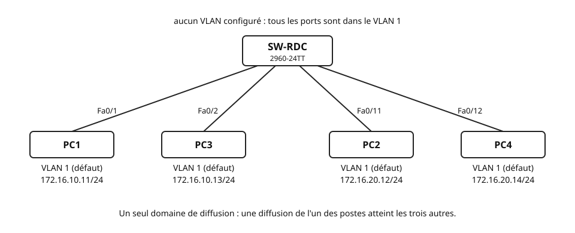
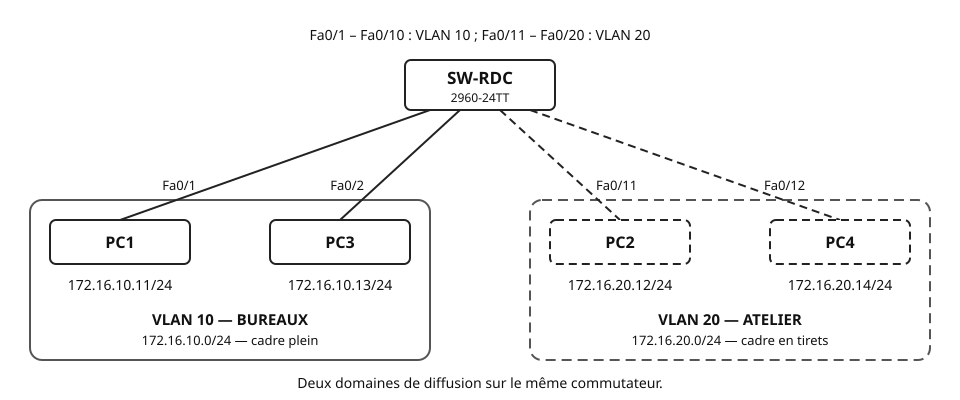
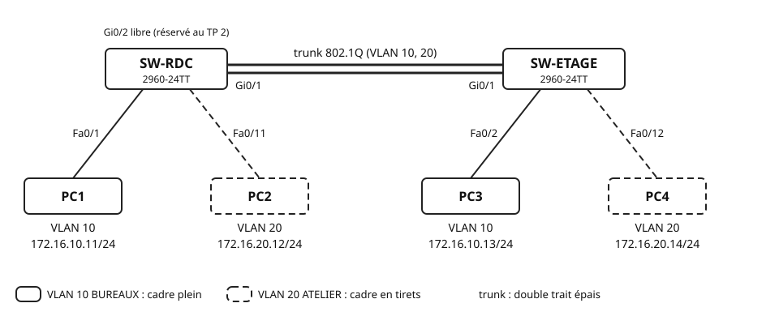

## Objectifs et prérequis

Vous allez découper le réseau de l'entreprise Celtis en deux VLAN. Vous
partirez d'un réseau sans VLAN, pour voir le problème à résoudre. Vous
créerez ensuite les VLAN sur un commutateur, puis sur deux commutateurs
reliés par un trunk. Une question revient à chaque étape : jusqu'où va une
diffusion ?

C'est votre première configuration de VLAN. Les commandes nouvelles sont
donc fournies, puis de moins en moins d'une partie à l'autre. Le cours
[« Les VLAN »](../cours-vlan/index.qmd) doit être connu. Vous devez savoir
calculer le réseau d'une adresse avec son masque. Vous devez aussi savoir
passer d'un mode IOS à l'autre. La
[fiche « VLAN et routage inter-VLAN »](../fiche-vlan-inter-vlan/index.qmd)
est autorisée.

## Situation de départ

Celtis est un bureau d'études installé sur deux niveaux. Les bureaux
(dessinateurs, comptabilité) et l'atelier (machines, bancs de test)
partagent aujourd'hui le même réseau. Tous les postes reçoivent donc les
messages diffusés par tous les autres.

Votre mission : séparer les bureaux et l'atelier, sans tirer un réseau
séparé pour chaque service. Chaque service aura son propre VLAN. Les deux
VLAN doivent exister aux deux niveaux du bâtiment.

Le résultat attendu : à la fin du TP, les postes d'un même service
communiquent, même d'un niveau à l'autre. Les postes de services
différents ne communiquent plus du tout.

Le TP se fait dans **un unique fichier Packet Tracer**, que vous faites
évoluer d'une partie à l'autre.

| Partie | Ce que vous faites | Durée indicative |
|:-:|:---|:-:|
| 1 | Constater le problème : un réseau sans VLAN | 20 min |
| 2 | Créer deux VLAN sur un commutateur | 30 min |
| 3 | Étendre les VLAN à un second commutateur par un trunk | 40 min |
| Bonus | Changer le VLAN natif du trunk | 20 min |

Chaque partie suit les quatre mêmes étapes.

| Étape | Ce que vous faites |
|:---|:---|
| 1. Configuration | réaliser la configuration demandée |
| 2. Vérification | relever l'état : commandes `show`, mode Simulation |
| 3. Tests | comparer chaque résultat au résultat attendu |
| 4. Réflexion | expliquer le résultat clé de la partie |

## Matériel et environnement

**Plateforme : Cisco Packet Tracer 9.0.1.** Matériel final : deux
commutateurs **Cisco 2960-24TT** sous IOS 15.0 (SW-RDC, SW-ETAGE) et quatre
postes **PC-PT** (PC1 à PC4). Ce TP ne comporte aucun routeur. Les
commandes des commutateurs se tapent dans l'onglet *CLI*. Les commandes des
PC se tapent dans *Desktop*, puis *Command Prompt*.

**VLAN et ports d'accès.** Ils sont identiques sur les deux commutateurs :
sur SW-RDC à partir de la partie 2, sur SW-ETAGE en partie 3.

| VLAN | Nom | Réseau IP | Ports d'accès |
|:-:|:---|:---|:---|
| 10 | BUREAUX | `172.16.10.0/24` | Fa0/1 – Fa0/10 |
| 20 | ATELIER | `172.16.20.0/24` | Fa0/11 – Fa0/20 |
| 99 | NATIF | — | aucun (bonus uniquement) |

**Trunk 802.1Q.** SW-RDC Gi0/1 ↔ SW-ETAGE Gi0/1, à partir de la partie 3.
Laissez le port Gi0/2 de SW-RDC libre : il servira au TP 2.

**Équipements terminaux.** Les postes n'ont pas de passerelle.

| Poste | Parties 1 et 2 | Partie 3 | VLAN (parties 2 et 3) | Adresse IP / masque |
|:---|:---|:---|:-:|:---|
| PC1 | SW-RDC Fa0/1 | SW-RDC Fa0/1 | 10 | `172.16.10.11/24` |
| PC2 | SW-RDC Fa0/11 | SW-RDC Fa0/11 | 20 | `172.16.20.12/24` |
| PC3 | SW-RDC Fa0/2 | SW-ETAGE Fa0/2 | 10 | `172.16.10.13/24` |
| PC4 | SW-RDC Fa0/12 | SW-ETAGE Fa0/12 | 20 | `172.16.20.14/24` |

**Câblage.**

| Câble | De | Vers | Type |
|:-:|:---|:---|:---|
| 1 | PC | port du commutateur indiqué | droit |
| 2 | SW-RDC Gi0/1 (partie 3) | SW-ETAGE Gi0/1 | croisé |

::: {.callout-note}
## Règles du jeu

- La fiche « VLAN et routage inter-VLAN » est autorisée. Les commandes
  nouvelles sont fournies une fois. Ensuite, c'est à vous de les réutiliser.
- Sauvegardez à la fin de chaque partie : `TP1_P1_NOM.pkt`,
  `TP1_P2_NOM.pkt`, `TP1_P3_NOM.pkt`, et `TP1_BONUS_NOM.pkt` pour le bonus.
- Sous Packet Tracer, le premier `ping` perd souvent un ou deux paquets : le
  temps de la résolution ARP. Relancez-le avant de conclure.
- Après un branchement, les voyants du lien passent à l'orange, puis au
  vert. Attendez le vert avant de tester.
:::

## Travail à réaliser

### Partie 1 — Le constat : un réseau sans VLAN

Les quatre postes sont branchés sur le même commutateur, SW-RDC. Aucun VLAN
n'est encore configuré.

{fig-alt="Le commutateur SW-RDC, un 2960-24TT, est au centre en haut. Une mention précise qu'aucun VLAN n'est configuré : tous les ports sont dans le VLAN 1. Quatre postes sont reliés à SW-RDC par un trait plein : PC1 sur Fa0/1, adresse 172.16.10.11/24 ; PC3 sur Fa0/2, adresse 172.16.10.13/24 ; PC2 sur Fa0/11, adresse 172.16.20.12/24 ; PC4 sur Fa0/12, adresse 172.16.20.14/24. Chaque poste porte la mention VLAN 1 (défaut). En bas, une phrase indique qu'il n'y a qu'un seul domaine de diffusion : une diffusion de l'un des postes atteint les trois autres."}

**1.1 Configuration.**

1. Réalisez la topologie. Nommez les équipements : onglet *Config*,
   champ *Display Name*.
2. Configurez l'adressage statique des quatre postes, sans passerelle :
   *Desktop*, puis *IP Configuration*. Le masque est `255.255.255.0`.
3. Sur le commutateur, donnez le nom d'hôte, puis sauvegardez.

```text
! Packet Tracer, commutateur 2960-24TT (IOS 15.0)
Switch> enable
Switch# configure terminal
Switch(config)# hostname SW-RDC
SW-RDC(config)# end
SW-RDC# copy running-config startup-config
! validez le nom de fichier proposé [startup-config] par Entrée
```

**1.2 Vérification.** Sur SW-RDC, tapez `show vlan brief`. Cette commande
liste les VLAN du commutateur et les ports affectés à chacun. Ignorez les
lignes des VLAN 1002 à 1005 : ils existent par défaut et ne servent pas ici.

| Commande et information | Valeur relevée |
|:---|:---|
| `show vlan brief` : numéro et nom du seul VLAN utilisé | |
| `show vlan brief` : ports affectés à ce VLAN | |

**1.3 Tests.**

| ID | Test | Attendu | Vérifié |
|:-:|:---|:-:|:-:|
| S1 | PC1 → PC3 | OK | |
| S2 | PC2 → PC4 | OK | |
| S3 | PC1 → PC2 | ÉCHEC | |

Le test S3 échoue déjà, alors qu'aucun VLAN n'a encore été créé : les
quatre ports sont dans le VLAN 1. PC1 et PC2 ne sont pas dans le même
réseau IP : `172.16.10.0/24` et `172.16.20.0/24`. Sans
passerelle, PC1 ne sait pas joindre un autre réseau. C'est une séparation
**par l'adressage IP**. Elle ne dit rien de ce que reçoit chaque poste.

**1.4 Observation en mode Simulation.** Vous allez suivre une requête ARP.
Pour joindre PC3, PC1 doit d'abord connaître son adresse MAC. Il la demande
par une requête ARP, envoyée en **diffusion** : la trame est adressée à
tous les postes du réseau local.

1. Sur PC1, videz le cache ARP avec `arp -d`. Sinon, PC1 connaît déjà
   l'adresse MAC de PC3 et n'envoie aucune requête.
2. Passez en mode *Simulation* : onglet en bas à droite de la fenêtre.
3. Dans *Edit Filters*, ne gardez que le protocole **ARP**.
4. Sur PC1, lancez `ping 172.16.10.13`.
5. Avancez pas à pas. Cliquez sur une enveloppe pour lire son contenu.

Relevez le parcours de la requête ARP envoyée par PC1.

| Poste | Reçoit la requête ARP ? (oui / non) | Y répond ? (oui / non) |
|:---|:-:|:-:|
| PC2 | | |
| PC3 | | |
| PC4 | | |

Relevez aussi l'adresse MAC de destination de la requête : `____________`.

Revenez en mode *Realtime* avant la suite.

::: {.callout-note}
## Notion — domaine de diffusion

Vous venez de le voir : la requête de PC1 ne concerne que PC3. Le
commutateur la recopie pourtant sur tous ses autres ports. L'ensemble des postes
qu'une diffusion peut atteindre s'appelle un **domaine de diffusion**. Sans
VLAN, un commutateur forme un seul domaine de diffusion, ici le VLAN 1.
:::

**1.5 Réflexion.**

a) PC2 et PC4 sont dans un autre réseau IP que PC1. Reçoivent-ils pourtant
   sa requête ARP ? Que concluez-vous sur l'effet de l'adressage IP au
   niveau 2 ?
b) Citez deux inconvénients de ce domaine de diffusion unique. Pensez à la
   charge des postes et du réseau, puis à la confidentialité.
c) Une personne de l'atelier change l'adresse de PC2 en `172.16.10.12/24`.
   Pourra-t-elle joindre PC1 ? Testez-le, notez le résultat, puis remettez
   `172.16.20.12/24`.

::: {.callout-important}
## Appelez le professeur

À montrer : la topologie, les relevés de `show vlan brief`, le tableau du
mode Simulation, les tests, les réponses à la réflexion. Puis sauvegardez
sous `TP1_P1_NOM.pkt`.
:::

### Partie 2 — Créer deux VLAN sur un commutateur

On repart du fichier de la partie 1. Le câblage ne change pas : seule la
configuration de SW-RDC évolue.

::: {.callout-note}
## Notion — VLAN

Un **VLAN** (*Virtual LAN*) découpe un commutateur en plusieurs réseaux
locaux virtuels. Chaque VLAN est un domaine de diffusion séparé. Un port
d'accès appartient à un seul VLAN : le poste branché dessus ne voit que ce
VLAN. Le commutateur ne transmet jamais une trame d'un VLAN vers un autre.
:::

{fig-alt="Le commutateur SW-RDC, un 2960-24TT, est au centre en haut. Une mention indique : ports Fa0/1 à Fa0/10 dans le VLAN 10, ports Fa0/11 à Fa0/20 dans le VLAN 20. À gauche, un grand cadre plein regroupe le VLAN 10 BUREAUX, réseau 172.16.10.0/24 : PC1 sur Fa0/1, adresse 172.16.10.11/24, et PC3 sur Fa0/2, adresse 172.16.10.13/24, reliés par des traits pleins. À droite, un grand cadre en tirets regroupe le VLAN 20 ATELIER, réseau 172.16.20.0/24 : PC2 sur Fa0/11, adresse 172.16.20.12/24, et PC4 sur Fa0/12, adresse 172.16.20.14/24, reliés par des traits en tirets. En bas, une phrase indique qu'il y a deux domaines de diffusion sur le même commutateur."}

**2.1 Configuration.**

**a) Le VLAN 10.** Sur SW-RDC, saisissez la configuration ci-dessous.

```text
! Packet Tracer, SW-RDC (2960-24TT, IOS 15.0)
SW-RDC> enable
SW-RDC# configure terminal
SW-RDC(config)# vlan 10
! crée le VLAN 10 et passe en mode de configuration du VLAN
SW-RDC(config-vlan)# name BUREAUX
! donne un nom au VLAN : il apparaîtra dans show vlan brief
SW-RDC(config-vlan)# exit
SW-RDC(config)# interface range fa0/1 - 10
! sélectionne les ports Fa0/1 à Fa0/10 d'un seul coup
SW-RDC(config-if-range)# switchport mode access
! force les ports en mode accès : un seul VLAN, sans étiquette
SW-RDC(config-if-range)# switchport access vlan 10
! affecte ces ports au VLAN 10
SW-RDC(config-if-range)# end
SW-RDC# show vlan brief
```

::: {.callout-warning}
## L'espace autour du tiret

Dans `interface range fa0/1 - 10`, mettez un espace de chaque côté du
tiret, comme dans la documentation Cisco. Le nombre après le tiret est le
dernier port de la plage, pas une interface complète.
:::

**b) Le VLAN 20.** Configurez-le vous-même, sans aide : nom `ATELIER`,
ports Fa0/11 à Fa0/20, en mode accès.

**c) Sauvegarde.** Enregistrez la configuration de SW-RDC dans la
`startup-config`, la configuration chargée au démarrage du commutateur.

**2.2 Vérification.** Relevez sur SW-RDC :

| Commande et information | Valeur relevée |
|:---|:---|
| `show vlan brief` : nom et ports du VLAN 10 | |
| `show vlan brief` : nom et ports du VLAN 20 | |
| `show vlan brief` : ports restés dans le VLAN 1 | |

Refaites ensuite l'observation de la partie 1, en mode *Simulation* :
`arp -d` sur PC1, filtre ARP, puis `ping 172.16.10.13` depuis PC1.

| Poste | Reçoit la requête ARP ? (oui / non) | Y répond ? (oui / non) |
|:---|:-:|:-:|
| PC2 | | |
| PC3 | | |
| PC4 | | |

Revenez en mode *Realtime* avant les tests.

**2.3 Tests.**

| ID | Test | Attendu | Vérifié |
|:-:|:---|:-:|:-:|
| V1 | PC1 → PC3 (même VLAN) | OK | |
| V2 | PC2 → PC4 (même VLAN) | OK | |
| V3 | PC1 → PC2 (VLAN différents) | ÉCHEC | |
| V4 | PC1 → PC2, avec PC2 réglé **temporairement** en `172.16.10.12/24` | ÉCHEC | |

Après le test V4, remettez l'adresse `172.16.20.12/24` sur PC2.

**2.4 Réflexion.**

a) Comparez les deux tableaux du mode Simulation, partie 1 et partie 2.
   Quel équipement a empêché la requête ARP d'atteindre PC2 et PC4 ?
b) Comparez le test V4 à la question 1.5 c). L'adresse de PC2 était la
   même. Pourquoi le résultat a-t-il changé ?
c) Complétez la phrase : « Deux postes de VLAN différents ne
   communiquent pas, même si ________________. »

::: {.callout-important}
## Appelez le professeur

À montrer : `show vlan brief`, le tableau du mode Simulation, les tests,
les réponses à la réflexion. Puis sauvegardez sous `TP1_P2_NOM.pkt`.
:::

### Partie 3 — Deux commutateurs, un trunk 802.1Q

On repart du fichier de la partie 2. Une partie des bureaux et de l'atelier
s'installe à l'étage. PC3 et PC4 y déménagent, sur un commutateur déjà
disponible à l'étage.

::: {.callout-note}
## Notion — trunk 802.1Q

Un seul câble relie les deux commutateurs. Il doit pourtant transporter les
trames du VLAN 10 et celles du VLAN 20. Le commutateur qui envoie ajoute
donc à chaque trame une **étiquette 802.1Q** : elle contient le numéro du
VLAN. Seules les trames du VLAN natif (VLAN 1 par défaut, voir le bonus)
passent sans étiquette. Le commutateur qui reçoit lit l'étiquette, la retire, et livre la
trame dans le bon VLAN. Un lien qui transporte plusieurs VLAN de cette
façon s'appelle un **trunk**.
:::

{fig-alt="SW-RDC et SW-ETAGE, deux commutateurs 2960-24TT, sont reliés entre leurs ports Gi0/1 par un trunk 802.1Q, dessiné en double trait épais, qui transporte les VLAN 10 et 20. Une mention au-dessus de SW-RDC indique que son port Gi0/2 reste libre, réservé au TP 2. Sur SW-RDC : PC1 sur Fa0/1, VLAN 10, adresse 172.16.10.11/24 ; PC2 sur Fa0/11, VLAN 20, adresse 172.16.20.12/24. Sur SW-ETAGE : PC3 sur Fa0/2, VLAN 10, adresse 172.16.10.13/24 ; PC4 sur Fa0/12, VLAN 20, adresse 172.16.20.14/24. Les postes du VLAN 10 BUREAUX ont un cadre et un lien pleins, ceux du VLAN 20 ATELIER un cadre et un lien en tirets."}

**3.1 Configuration.**

**a) Le commutateur de l'étage.** Il est déjà disponible : placez-le dans
la topologie. C'est un **2960-24TT**, nommé SW-ETAGE. Débranchez PC3 et PC4 de SW-RDC. Rebranchez-les sur SW-ETAGE :
PC3 sur Fa0/2, PC4 sur Fa0/12. Reliez Gi0/1 de SW-RDC à Gi0/1 de SW-ETAGE
avec un câble croisé.

**b) Les VLAN de SW-ETAGE.** Configurez-les vous-même, sans aide : nom
d'hôte, VLAN 10 et 20 créés et nommés, ports affectés par plage et forcés
en mode accès. Les numéros, les noms et les plages sont ceux de SW-RDC.

**c) Le trunk.** Sur SW-RDC, saisissez la configuration ci-dessous.

```text
! Packet Tracer, SW-RDC (2960-24TT, IOS 15.0)
SW-RDC# configure terminal
SW-RDC(config)# interface gigabitEthernet 0/1
SW-RDC(config-if)# switchport mode trunk
! force le port en trunk 802.1Q : VLAN étiquetés, sauf le natif
SW-RDC(config-if)# end
SW-RDC# show interfaces trunk
```

Faites de même sur le port Gi0/1 de SW-ETAGE. Configurez le trunk des
**deux** côtés : vous savez ainsi exactement dans quel mode est chaque
port. Sauvegardez ensuite la configuration des deux commutateurs.

**3.2 Vérification.** Relevez sur SW-ETAGE :

| Commande et information | Valeur relevée |
|:---|:---|
| `show vlan brief` : ports du VLAN 20 | |
| `show vlan brief` : le port Gi0/1 apparaît-il dans la liste ? | |
| `show interfaces trunk` : mode et état (*Status*) de Gi0/1 | |
| `show interfaces trunk` : encapsulation et VLAN natif (*Native vlan*) | |
| `show interfaces trunk` : VLAN autorisés et actifs (*allowed and active*) | |

**3.3 Tests.**

| ID | Test | Attendu | Vérifié |
|:-:|:---|:-:|:-:|
| A1 | PC1 → PC3 (même VLAN) | OK | |
| A2 | PC2 → PC4 (même VLAN) | OK | |
| A3 | PC1 → PC2 (VLAN différents) | ÉCHEC | |
| A4 | PC3 → PC4 (VLAN différents) | ÉCHEC | |

**3.4 L'étiquette 802.1Q en mode Simulation.** Vous allez voir l'étiquette
sur le trunk.

1. Sur PC1, videz le cache ARP avec `arp -d`.
2. Passez en mode *Simulation*, avec le seul filtre ARP.
3. Sur PC1, lancez `ping 172.16.10.13`.
4. Avancez jusqu'à ce que la requête ARP traverse le trunk. Cliquez sur
   l'enveloppe qui arrive sur SW-ETAGE. Ouvrez le détail de la trame.
5. Avancez encore. Ouvrez la trame qui arrive sur PC3.

| Information | Valeur relevée |
|:---|:---|
| Trame sur le trunk : nom de l'en-tête ajouté entre les adresses MAC et les données | |
| Trame sur le trunk : numéro de VLAN indiqué dans cet en-tête | |
| Trame reçue par PC3 : cet en-tête est-il encore présent ? | |
| PC4 reçoit-il la requête ARP ? | |

Revenez en mode *Realtime*.

**3.5 Réflexion.** Le test A3 échoue.

a) PC1 (`172.16.10.11/24`) veut joindre PC2 (`172.16.20.12`). Faites le ET
   logique entre l'adresse de PC2 et le masque de PC1. Comparez le résultat
   au réseau de PC1. Que conclut PC1 sur la position de PC2 ?
b) Que faudrait-il ajouter, sur les postes et dans la topologie, pour que
   PC1 puisse joindre PC2 ?
c) Supposons que PC1 et PC2 utilisent le masque `/16`. PC1 croirait alors
   PC2 dans son réseau, et lui enverrait une requête ARP. Le ping
   réussirait-il ? Justifiez avec la notion de domaine de diffusion.
d) Pourquoi l'étiquette 802.1Q est-elle utile sur le trunk, mais inutile
   sur le câble qui mène à PC3 ?

::: {.callout-important}
## Appelez le professeur

À montrer : `show vlan brief` et `show interfaces trunk` sur les deux
commutateurs, les tests, le tableau du mode Simulation, les réponses à la
réflexion. Puis sauvegardez sous `TP1_P3_NOM.pkt`.
:::

### Bonus — Le VLAN natif

On repart d'une **copie** de `TP1_P3_NOM.pkt` : enregistrez-la d'abord sous
`TP1_BONUS_NOM.pkt`.

::: {.callout-note}
## Notion — VLAN natif

Sur un trunk, les trames d'un VLAN circulent **sans étiquette** : c'est le
**VLAN natif**. Par défaut, c'est le VLAN 1. Les deux extrémités du trunk
doivent avoir le même VLAN natif. Sinon, une trame non étiquetée change de
VLAN en traversant le lien.
:::

**B.1 Configuration.** Sur SW-RDC, créez le VLAN 99 nommé `NATIF`. Puis
changez le VLAN natif du trunk.

```text
! Packet Tracer, SW-RDC (2960-24TT, IOS 15.0)
SW-RDC# configure terminal
SW-RDC(config)# vlan 99
SW-RDC(config-vlan)# name NATIF
SW-RDC(config-vlan)# exit
SW-RDC(config)# interface gigabitEthernet 0/1
SW-RDC(config-if)# switchport trunk native vlan 99
! les trames non étiquetées de ce trunk appartiennent désormais au VLAN 99
SW-RDC(config-if)# end
```

Ne touchez pas encore à SW-ETAGE. Restez en mode *Realtime* et observez la
console *CLI* des deux commutateurs. Un message peut mettre jusqu'à une
minute à apparaître.

**B.2 Vérification.**

| Information | Valeur relevée |
|:---|:---|
| Commutateur(s) sur le(s)quel(s) un message apparaît | |
| Texte du message (recopiez-en le début) | |
| Protocole qui signale le problème (nom au début du message) | |
| `show interfaces trunk` sur chaque commutateur : VLAN natif de Gi0/1 | |

**B.3 Correction et tests.** Corrigez SW-ETAGE vous-même : créez le
VLAN 99 `NATIF` et réglez le même VLAN natif sur son port Gi0/1.
Sauvegardez les deux commutateurs.

| ID | Test | Attendu | Vérifié |
|:-:|:---|:-:|:-:|
| N1 | `show interfaces trunk` : VLAN natif 99 des deux côtés | OK | |
| N2 | Plus aucun nouveau message de non-concordance du VLAN natif | OK | |
| N3 | PC1 → PC3 | OK | |

**B.4 Réflexion.**

a) Que signifie le message relevé en B.2 ? Pourquoi est-il apparu alors
   qu'un seul côté était modifié ?
b) Les ports Fa0/21 à Fa0/24 sont restés dans le VLAN 1. Pourquoi est-il
   risqué de laisser le VLAN 1 comme VLAN natif ? Pensez à un poste
   malveillant branché sur l'un de ces ports.
c) Pourquoi choisir un VLAN natif sans aucun port d'accès, comme le
   VLAN 99 ?

::: {.callout-important}
## Appelez le professeur

À montrer : le message relevé, `show interfaces trunk` des deux côtés, les
réponses à la réflexion. Puis sauvegardez sous `TP1_BONUS_NOM.pkt`.
:::

## Vérification et compte rendu

### Critères de réussite

Le réseau est validé quand :

- les relevés du mode Simulation montrent une diffusion qui atteint tous
  les postes en partie 1, puis seulement ceux de son VLAN en parties 2 et 3 ;
- les tests S1 à S3, V1 à V4 et A1 à A4 donnent le résultat attendu ;
- `show vlan brief` affiche, sur les deux commutateurs, les VLAN 10
  `BUREAUX` et 20 `ATELIER` avec les bons ports ;
- `show interfaces trunk` affiche Gi0/1 en trunk, des deux côtés ;
- les configurations des deux commutateurs sont enregistrées dans leur
  `startup-config` ;
- le port Gi0/2 de SW-RDC est resté libre.

### Livrables

- Les tableaux et les réponses aux réflexions, sur votre feuille de TP.
- Les fichiers Packet Tracer `TP1_P1_NOM.pkt` à `TP1_P3_NOM.pkt`, et
  `TP1_BONUS_NOM.pkt` si vous avez traité le bonus.
- Les fichiers sont déposés sur l'ENT.

::: {.callout-important}
## Gardez `TP1_P3_NOM.pkt`

Le TP 2, « Faire communiquer les VLAN », repartira de ce fichier : mêmes
noms, mêmes ports, mêmes adresses. Vous y ajouterez un routeur sur le port
Gi0/2 de SW-RDC.
:::

## Synthèse

Pour chaque partie, notez en une phrase ce que vous avez vérifié. Citez le
test, la commande ou l'observation qui l'a montré.

Terminez par un court bilan sur deux séparations à ne pas confondre :

- la séparation **par l'adressage IP** : un poste refuse d'envoyer
  directement à une adresse hors de son réseau ;
- la séparation **de niveau 2** par les VLAN : le commutateur ne transmet
  pas une trame d'un VLAN à l'autre, quelle que soit l'adresse IP.

Montrez où chacune est intervenue dans le TP. Expliquez enfin pourquoi le
TP 2 aura besoin d'un équipement de niveau 3.

## Pour aller plus loin

- **Limiter les VLAN du trunk.** Par défaut, le trunk transporte tous les
  VLAN. Cherchez dans la fiche la commande qui restreint la liste des VLAN
  autorisés. Limitez le trunk aux VLAN 10, 20 et 99. Vérifiez le résultat
  avec `show interfaces trunk`.
- **Un troisième service.** Celtis crée un VLAN 30 pour la direction, sur
  les ports Fa0/21 à Fa0/24 des deux commutateurs. Configurez-le de bout en
  bout et choisissez son réseau IP.
- Sources :
  - [Groupe de travail IEEE 802.1](https://www.ieee802.org/1/), qui
    publie la norme 802.1Q : VLAN et étiquette 802.1Q ;
  - [RFC 826 — An Ethernet Address Resolution Protocol](https://www.rfc-editor.org/rfc/rfc826.html),
    qui décrit la requête ARP diffusée ;
  - la référence des commandes intégrée à Packet Tracer, menu *Help*, pour
    le commutateur 2960.
