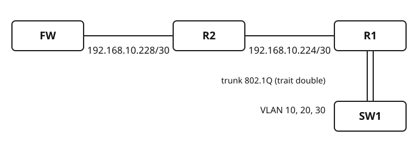
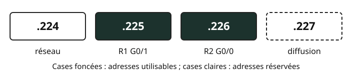

## Objectifs et prérequis

Cette séance ouvre le chapitre sur le découpage en sous-réseaux. À la fin, vous
saurez lire une adresse IPv4 en binaire, appliquer un masque avec un ET logique
et trouver rapidement le réseau et l'adresse de diffusion d'une adresse grâce à
la **taille de bloc**. Vous saurez surtout **démontrer** pourquoi les liaisons
entre routeurs du réseau étudié sont en `/30`.

On suppose connus les VLAN, le trunk 802.1Q et le routage inter-VLAN.

## Situation de départ

Toute la progression s'appuie sur le même réseau d'entreprise, appelé
**réseau fil rouge**. La plage `192.168.10.0/24` y est découpée en sous-réseaux
de tailles différentes.

{fig-alt="Le pare-feu FW est relié au routeur R2 par le réseau 192.168.10.228/30, R2 est relié au routeur R1 par le réseau 192.168.10.224/30. R1 est relié par un trunk au commutateur SW1, qui porte les VLAN 10, 20 et 30."}

| Service | Réseau | Passerelle |
|:---|:---|:---|
| Production | `192.168.10.0/25` | `.126` |
| Administration | `192.168.10.128/26` | `.190` |
| Wi-Fi invité | `192.168.10.192/27` | `.222` |
| Liaison R1–R2 | `192.168.10.224/30` | — |
| Liaison R2–FW | `192.168.10.228/30` | — |

::: {.callout-important}
## La question de la séance

Pourquoi les liaisons entre routeurs sont-elles en `/30`, et pas en `/24` ou en
`/27` ? En fin de séance, vous saurez le démontrer.
:::

## Comprendre le mécanisme

### Une adresse IPv4, c'est 32 bits

Une adresse IPv4 est formée de **4 octets de 8 bits**. Un octet vaut de 0
(`00000000`) à 255 (`11111111`). Chaque bit a un **poids** : 128, 64, 32, 16,
8, 4, 2, 1.

Exemple : l'adresse de R2 du côté de R1 est `192.168.10.226`. Son dernier octet
s'écrit ainsi :

| Poids | 128 | 64 | 32 | 16 | 8 | 4 | 2 | 1 |
|:---|:-:|:-:|:-:|:-:|:-:|:-:|:-:|:-:|
| **226** | 1 | 1 | 1 | 0 | 0 | 0 | 1 | 0 |

On vérifie : 226 = 128 + 64 + 32 + 2.

### Décimal vers binaire : on retire les poids

1. Partir du poids 128.
2. Si le poids tient dans le reste, le bit vaut 1 et on retire le poids du reste.
3. Sinon, le bit vaut 0.
4. Passer au poids suivant, jusqu'à 1.

**À vous.** Convertir en binaire : 190, 252, 224 et 128. Le corrigé est en fin
de page.

### Le masque : des 1, puis des 0

Le masque indique quelle partie de l'adresse désigne le **réseau** (bits à 1)
et quelle partie désigne l'**hôte** (bits à 0). La notation `/n` donne le
nombre de bits à 1.

Pour un `/30` : 30 bits à 1 pour la partie réseau, 2 bits à 0 pour la partie hôte.

| Octet | 1 | 2 | 3 | 4 |
|:---|:-:|:-:|:-:|:-:|
| Binaire | `11111111` | `11111111` | `11111111` | `11111100` |
| Décimal | 255 | 255 | 255 | 252 |

Ainsi, `/30` = `255.255.255.252`.

::: {.callout-warning}
## Attention

Les 1 sont toujours **à gauche** et **contigus**. Par exemple,
`255.255.255.250` n'est pas un masque : 250 s'écrit `11111010`.
:::

### Adresse ET masque = adresse du réseau

Le **ET logique** se fait bit à bit : le résultat vaut 1 seulement si les deux
bits valent 1.

| a | b | a ET b |
|:-:|:-:|:-:|
| 0 | 0 | 0 |
| 0 | 1 | 0 |
| 1 | 0 | 0 |
| 1 | 1 | 1 |

Un 0 dans le masque efface le bit correspondant de l'adresse : il ne reste que
la partie réseau. Appliquons-le au dernier octet de R2 :

| | Binaire | Décimal |
|:---|:-:|:-:|
| Adresse | `11100010` | 226 |
| Masque | `11111100` | 252 |
| **ET** | **`11100000`** | **224** |

Le réseau de R2 est donc `192.168.10.224/30`.

### Taille de bloc = 256 − octet du masque

Il existe un raccourci. Dans l'octet du masque qui n'est ni 255 ni 0, on calcule
**256 − octet du masque** : c'est la **taille de bloc**, c'est-à-dire le nombre
d'adresses de chaque sous-réseau.

Pour un `/30` : 256 − 252 = 4. Les réseaux avancent de 4 en 4 :
`.224`, `.228`, `.232`, `.236`, `.240`…

**Un réseau commence toujours sur un multiple de la taille de bloc.**

**À vous.** Calculer la taille de bloc d'un `/27` (masque `255.255.255.224`) et
d'un `/26` (masque `255.255.255.192`), puis lister les réseaux possibles dans
le dernier octet.

### Dans un /30 : 4 adresses, 2 utilisables

Dans chaque sous-réseau, la première adresse désigne le réseau et la dernière
est l'adresse de diffusion : elles ne sont pas attribuables à une interface.
Un `/30` contient donc 4 adresses, dont **2 utilisables**.

{fig-alt="L'adresse .224 est l'adresse du réseau, .225 est attribuée à R1 G0/1, .226 est attribuée à R2 G0/0 et .227 est l'adresse de diffusion. Seules .225 et .226 sont utilisables."}

::: {.callout-note}
## Réponse à la question de départ

Une liaison entre deux routeurs relie **exactement deux interfaces**. Le `/30`
en fournit exactement deux et n'en gaspille aucune. Avec un `/24` pour la même
liaison, on disposerait de 254 adresses utilisables pour 2 interfaces :
**252 adresses perdues**.
:::

## Observer et appliquer

Méthode pour trouver le réseau et la diffusion d'une adresse :

1. Repérer l'octet du masque qui n'est ni 255 ni 0 et calculer la taille de bloc.
2. Le réseau est le plus grand multiple de la taille de bloc inférieur ou égal
   à l'octet de l'adresse.
3. La diffusion est l'adresse du réseau suivant moins 1.

Exemple : `192.168.10.226/30`. La taille de bloc vaut 4 ; le plus grand
multiple de 4 inférieur ou égal à 226 est 224. Le réseau est
`192.168.10.224` ; le réseau suivant commence à `.228`, donc la diffusion est
`192.168.10.227`.

## Exercices de vérification

1. **Conversions.** Écrire en binaire : 190, 252, 224, 128.
2. **Tailles de bloc.** Donner la taille de bloc d'un `/27` et d'un `/26`, et les
   réseaux possibles dans le dernier octet.
3. **Réseau et diffusion** (5 minutes). Compléter le tableau.

| Adresse | Bloc | Réseau | Diffusion |
|:---|:-:|:---|:---|
| `192.168.10.229/30` | | | |
| `192.168.10.200/27` | | | |
| `192.168.10.150/26` | | | |

4. **Le gaspillage.** Combien d'adresses utilisables seraient perdues si la
   liaison R1–R2 utilisait un `/24` ?

### Corrigé

1. 190 = `10111110` (128 + 32 + 16 + 8 + 4 + 2) ; 252 = `11111100`
   (128 + 64 + 32 + 16 + 8 + 4) ; 224 = `11100000` (128 + 64 + 32) ;
   128 = `10000000`.
2. `/27` : 256 − 224 = **32** ; réseaux `.0`, `.32`, `.64`, … `.192`, `.224`.
   `/26` : 256 − 192 = **64** ; réseaux `.0`, `.64`, `.128`, `.192`.
3. Tableau complété :

| Adresse | Bloc | Réseau | Diffusion |
|:---|:-:|:---|:---|
| `192.168.10.229/30` | 4 | `192.168.10.228` | `192.168.10.231` |
| `192.168.10.200/27` | 32 | `192.168.10.192` | `192.168.10.223` |
| `192.168.10.150/26` | 64 | `192.168.10.128` | `192.168.10.191` |

4. Un `/24` offre 254 adresses utilisables ; la liaison en utilise 2 :
   **252 adresses perdues**.

## Synthèse

- **8 bits par octet** : poids 128, 64, 32, 16, 8, 4, 2, 1 ; un octet va de 0 à 255.
- **Adresse ET masque** : le ET bit à bit donne l'adresse du réseau.
- **256 − octet du masque** : c'est la taille de bloc ; les réseaux en sont des
  multiples. Un `/30` contient 4 adresses, dont 2 utilisables.

Prochaine séance : découper `192.168.10.0/24` en sous-réseaux égaux.

## Pour aller plus loin

- [RFC 4632 — CIDR](https://www.rfc-editor.org/rfc/rfc4632.html), qui définit la
  notation `/n` et l'agrégation des préfixes.
- [RFC 3021](https://www.rfc-editor.org/rfc/rfc3021.html) : certains équipements
  acceptent un `/31` sur une liaison point à point, sans adresse de réseau ni de
  diffusion. Ce cas n'est pas utilisé dans ce cours.
