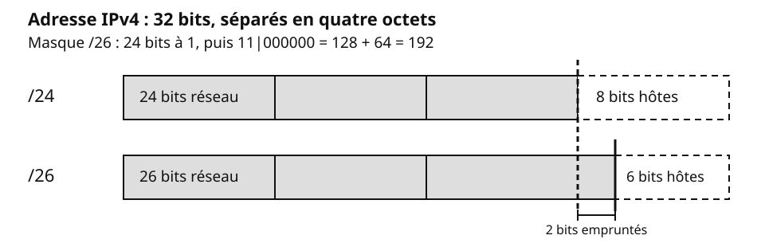
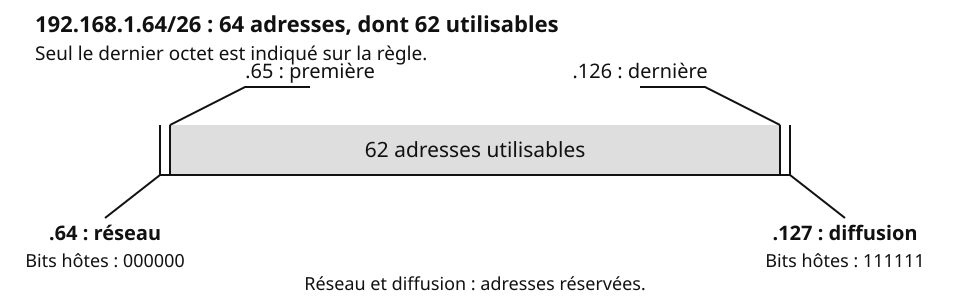
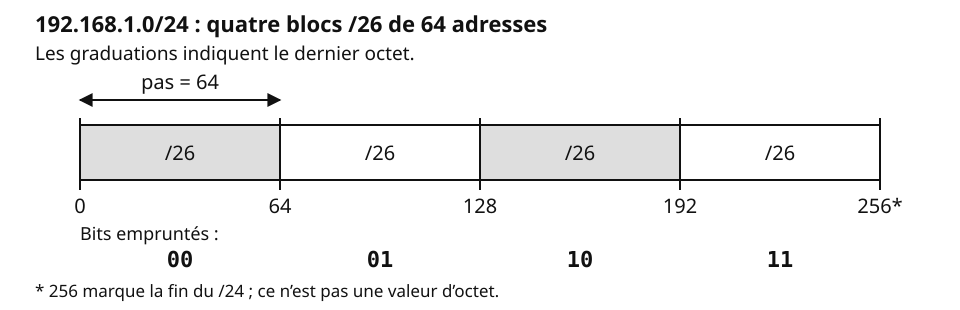

## Objectifs et prérequis

Vous allez découper un réseau IPv4 en sous-réseaux de même taille. Pour chaque
sous-réseau, vous saurez trouver le réseau, les adresses utilisables et la
diffusion.

Vous devez connaître la notation IPv4 et savoir convertir un octet en binaire.
Les bits d’un octet valent, de gauche à droite, 128, 64, 32, 16, 8, 4, 2 et 1.

## Situation de départ

Une agence possède le réseau `192.168.1.0/24` pour quatre services :

| Service | Postes |
|:---|:-:|
| Accueil | 20 |
| Comptabilité | 35 |
| Production | 50 |
| Wi-Fi invité | 40 |

Une adresse de **diffusion** désigne toutes les machines du réseau. Dans ce
réseau unique, les messages de diffusion atteignent tous les services.
Sans filtrage, un poste invité peut aussi atteindre la comptabilité.

Chaque service aura son sous-réseau et son VLAN : les diffusions restent
dans le service. Le routeur sera configuré pour filtrer ce qui passe entre services.

## Comprendre le mécanisme

### Réseau, hôtes et masque

Une adresse IPv4 contient une partie **réseau** et une partie **hôte**. Le
préfixe `/n` indique le nombre de bits réseau. Le masque écrit ces bits à 1,
puis les bits hôtes à 0.

Dans `192.168.1.0/24`, il y a 24 bits réseau et 8 bits hôtes. Si l’on emprunte
deux bits hôtes, le préfixe devient `/26` : la frontière avance de deux bits.

{fig-alt="En haut, /24 sépare 24 bits réseau de 8 bits hôtes. En bas, /26 sépare 26 bits réseau de 6 bits hôtes ; deux bits auparavant hôtes sont devenus des bits réseau. Le dernier octet du masque /26 vaut 11000000, soit 192."}

Les masques correspondants sont `255.255.255.0` pour `/24` et
`255.255.255.192` pour `/26` : après les 24 premiers bits à 1, le dernier
octet vaut `11000000` = 128 + 64 = **192**. Inversement, comptez les 1 :
`255.255.255.192` en contient 8 + 8 + 8 + 2 = **26**, donc `/26`.

### Les quatre adresses d’un sous-réseau

Prenons `192.168.1.64/26`. Il reste h = 32 − 26 = **6 bits hôtes**.

{fig-alt="Règle du bloc 192.168.1.64/26 : .64 est l’adresse réseau, ses six bits hôtes valent 000000 ; .65 est la première adresse utilisable, .126 la dernière ; .127 est la diffusion, ses bits hôtes valent 111111. Les 62 adresses utilisables se trouvent entre les deux bornes réservées."}

Un bloc de 6 bits hôtes contient 2^6^ = 64 adresses. Le réseau et la
diffusion sont réservés : il reste **2^h^ − 2 adresses utilisables**, ici 62.

### Emprunter des bits

Les bits empruntés servent à numéroter les sous-réseaux. Avec 2 bits, les
numéros `00`, `01`, `10`, `11` donnent les réseaux ci-dessous :

{fig-alt="Règle de 192.168.1.0/24, graduée de 0 à 256 : les quatre blocs /26 commencent à 0, 64, 128 et 192. Leurs deux bits empruntés sont respectivement 00, 01, 10 et 11. Une flèche entre 0 et 64 indique le pas de 64 dans le dernier octet. La borne 256 est la fin du /24, pas une valeur d’octet."}

Emprunter 1 bit donne 2 sous-réseaux ; en emprunter 2 en donne 4. En général,
**b bits empruntés donnent 2^b^ sous-réseaux**. À partir de `/24`, emprunter
2 bits donne quatre `/26`, avec 6 bits hôtes dans chacun.

### La taille de bloc et le pas d’avancement

Sur la règle ci-dessus, les réseaux commencent à 0, 64, 128 et 192 : ils
avancent de **64 en 64**. Chaque bloc contient **64 adresses**.

Ce nombre d’adresses est la **taille de bloc**. L’écart entre deux débuts
de blocs est le **pas d’avancement**, ici dans le dernier octet.

La **taille de bloc = 2^h^ adresses**, où h est le nombre de bits hôtes :
pour `/26`, 2^6^ = **64 adresses**.

Le **pas d’avancement = 256 − valeur de l’octet significatif du masque**.
L’octet significatif est le premier octet du masque qui n’est pas 255. Pour
`/26`, il vaut 192 : le pas est 256 − 192 = **64**.

### A. Trouver le masque

Suivez les quatre étapes. Selon le besoin, l’ordre des calculs change.

**Besoin en sous-réseaux :**

1. **Besoin** : notez le nombre de sous-réseaux demandés.
2. **Bits empruntés** : trouvez le plus petit b tel que 2^b^ ≥ besoin.
3. **Bits hôtes** : soustrayez b aux bits hôtes de départ.
4. **Nouveau masque** : ajoutez b au préfixe de départ, puis écrivez le masque.

**Besoin en hôtes :**

1. **Besoin** : comptez les adresses nécessaires, passerelle comprise.
2. **Bits hôtes** : trouvez le plus petit h tel que 2^h^ − 2 ≥ besoin.
3. **Bits empruntés** : soustrayez h aux bits hôtes de départ.
4. **Nouveau masque** : ajoutez les bits empruntés au préfixe de départ.

### B. Trouver les bornes

Pour chaque sous-réseau, mettez les bits hôtes à 0 pour l’adresse réseau, puis
à 1 pour l’adresse de diffusion. Les adresses utilisables sont entre ces deux
bornes.

Pour avancer sans binaire, repérez le pas et comptez de pas en pas dans
l’octet significatif. La diffusion est l’adresse juste avant le réseau suivant.

### Retrouver le réseau avec le ET logique

Un poste `192.168.1.150/26` veut connaître son réseau. Le dernier octet de
l’adresse est 150 (`10|010110`) ; celui du masque est 192 (`11|000000`).
Le trait marque la frontière réseau / hôtes. Le ET conserve un 1 seulement
quand les deux bits valent 1 :

```text
Adresse  150 = 10|010110
Masque   192 = 11|000000
ET             10|000000 = 128
```

Le réseau est donc `192.168.1.128/26`. Le ET met à 0 les bits hôtes et garde
les bits réseau.

## Observer et appliquer

### Exemple guidé : quatre sous-réseaux

L’agence veut quatre sous-réseaux égaux dans `192.168.1.0/24`.

**A. Trouver le masque — besoin en sous-réseaux.**

1. **Besoin** : 4 sous-réseaux.
2. **Bits empruntés** : 2^2^ = 4, donc b = 2.
3. **Bits hôtes** : 8 − 2 = 6. Chaque bloc offre 2^6^ − 2 = **62 adresses utilisables**.
4. **Nouveau masque** : `/24` + 2 = `/26`, soit `255.255.255.192`.

**B. Trouver les bornes.** Sur la règle du /24, les réseaux avancent de 64
en 64. Pour chaque diffusion, prenez l’adresse juste avant le réseau suivant.

| Service | Réseau | Première utilisable | Dernière utilisable | Diffusion |
|:---|:---|:---|:---|:---|
| Accueil | `192.168.1.0/26` | `.1` | `.62` | `.63` |
| Comptabilité | `192.168.1.64/26` | `.65` | `.126` | `.127` |
| Production | `192.168.1.128/26` | `.129` | `.190` | `.191` |
| Wi-Fi invité | `192.168.1.192/26` | `.193` | `.254` | `.255` |

Production : **50 postes + 1 passerelle = 51 adresses ; 51 ≤ 62 : le bloc suffit.**

### Exemple guidé : besoin en hôtes

Dans `192.168.20.0/24`, prévoyez des sous-réseaux de 25 postes plus la passerelle.

1. **Besoin** : 25 postes + 1 passerelle = **26 adresses**.
2. **Bits hôtes** : 2^4^ − 2 = 14 < 26 ; 2^5^ − 2 = 30 ≥ 26, donc **h = 5**.
3. **Bits empruntés** : 8 − 5 = **3**, soit 2^3^ = 8 sous-réseaux.
4. **Nouveau masque** : 24 + 3 = **/27**, soit `255.255.255.224`.

::: {.callout-warning}
## Piège : la passerelle compte

La passerelle utilise une adresse du sous-réseau. « 30 postes, passerelle
comprise » demande 30 adresses. « 30 postes plus la passerelle » en demande
31.
:::

### Mémo /24 à /30

Bits empruntés et sous-réseaux sont comptés **à partir d’un /24**.

| Préfixe | Masque | Bits empruntés | Sous-réseaux | Taille de bloc | Adresses utilisables |
|:-:|:---|:-:|:-:|:-:|:-:|
| /24 | `255.255.255.0` | 0 | 1 | 256 | 254 |
| /25 | `255.255.255.128` | 1 | 2 | 128 | 126 |
| /26 | `255.255.255.192` | 2 | 4 | 64 | 62 |
| /27 | `255.255.255.224` | 3 | 8 | 32 | 30 |
| /28 | `255.255.255.240` | 4 | 16 | 16 | 14 |
| /29 | `255.255.255.248` | 5 | 32 | 8 | 6 |
| /30 | `255.255.255.252` | 6 | 64 | 4 | 2 |

`/20` → `255.255.240.0` : pas de 16 dans le 3^e^ octet ; taille de bloc = 16 × 256 = **4 096 adresses**.

## Exercices de vérification

### Vérifier sa compréhension

1. Combien d’adresses utilisables offre un `/27` ?
2. Dans `192.168.1.0/24` découpé en `/26`, quel est le réseau de
   `192.168.1.100` ?
3. Peut-on attribuer `192.168.1.127` à un poste de ce plan ?

**Réponses :** 1. 30. 2. `192.168.1.64/26`, car 100 est entre 64 et 127.
3. Non, c’est l’adresse de diffusion du réseau `192.168.1.64/26`.

### S’entraîner

On découpe `192.168.50.0/24` en six sous-réseaux égaux.

1. Trouvez le masque, la taille de bloc et le nombre d’adresses utilisables.
2. Donnez les quatre adresses du premier et du sixième sous-réseau.
3. Trouvez le réseau de `192.168.50.100`.

**Corrigé.**

1. **A. Trouver le masque.** Besoin : 6. Il faut 3 bits empruntés, car
   2^2^ = 4 est trop petit et 2^3^ = 8 suffit. Il reste 5 bits hôtes.
   Le masque est `/27`, `255.255.255.224`. La taille de bloc vaut 32 adresses et
   il y en a 30 utilisables.
2. **B. Trouver les bornes.** Le pas vaut 256 − 224 = 32.

   | Sous-réseau | Réseau | Première | Dernière | Diffusion |
   |:---|:---|:---|:---|:---|
   | Premier | `192.168.50.0/27` | `.1` | `.30` | `.31` |
   | Sixième | `192.168.50.160/27` | `.161` | `.190` | `.191` |

3. Les réseaux commencent à 0, 32, 64, 96… L’adresse `.100` est dans
   `192.168.50.96/27`.

## Synthèse

- Le préfixe sépare les bits réseau des bits hôtes.
- **A. Trouver le masque** : besoin → bits empruntés → bits hôtes → nouveau masque.
- Pour un besoin en hôtes : besoin → bits hôtes → bits empruntés → nouveau masque.
- **B. Trouver les bornes** : bits hôtes à 0 pour le réseau, à 1 pour la diffusion.
- Avec h bits hôtes, la taille de bloc est 2^h^ ; les adresses utilisables sont 2^h^ − 2.
- Le pas d’avancement vaut 256 − valeur de l’octet significatif du masque.
- La passerelle compte parmi les adresses utilisables.

Le découpage égal donne à l’accueil 62 adresses utilisables pour 20 postes ;
le prochain cours présentera le VLSM, qui adapte la taille des blocs aux besoins.

## Pour aller plus loin

- [RFC 950 — Internet Standard Subnetting Procedure](https://www.rfc-editor.org/rfc/rfc950.html), sur le découpage en sous-réseaux.
- [RFC 4632 — Classless Inter-domain Routing](https://www.rfc-editor.org/rfc/rfc4632.html), sur la notation des préfixes.
