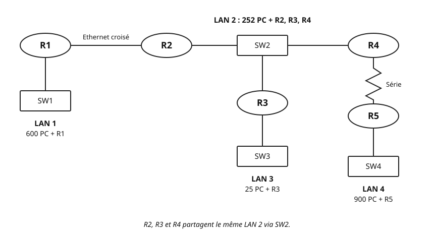

## Objectifs et prérequis

À l’issue du cours, vous saurez découper un réseau IPv4 en **sous-réseaux de
tailles différentes**. Chaque segment recevra le plus petit bloc qui lui
convient. Vous saurez ensuite vérifier votre plan, point par point.

Vous réutiliserez la démarche du cours
[« Découper un réseau en sous-réseaux »](../cours-subnetting-vlsm/index.qmd) :
bits hôtes, bits empruntés, taille de bloc, pas d’avancement, bornes. Relisez-le
si l’un de ces mots vous semble flou. Ce cours ne les réexplique pas.

Vous devez aussi savoir convertir un octet en binaire. Enfin, rappelez-vous
qu’un routeur possède une adresse IP sur **chaque** réseau qu’il relie.

## Situation de départ

Une entreprise reçoit la plage `192.168.10.0/24`. Elle a trois sites, chacun
derrière son routeur :

- le LAN A, derrière R1, compte **100 PC** ;
- le LAN B, derrière R2, compte **50 PC** ;
- le LAN C, derrière R3, compte **25 PC**.

Les routeurs sont reliés en chaîne par deux liaisons : **R1–R2** et **R2–R3**.
Chaque liaison est une **liaison point à point** : un réseau qui ne relie que
deux équipements, ici deux routeurs. Il faut donc **5 segments** en tout.

Essayez d’abord le découpage égal du cours précédent. Le LAN A a besoin de
100 + 1 = 101 adresses, interface de R1 comprise. Il faut h = 7 bits hôtes,
car 2^7^ − 2 = 126. Tous les sous-réseaux seraient donc des **/25**. Or un /24
ne contient que **2 blocs /25**. Il en faut 5 : le découpage égal est
impossible.

Le gaspillage est aussi flagrant. Une liaison point à point n’utilise
que 2 adresses. Lui réserver 126 adresses n’a pas de sens.

La solution consiste à donner à chaque segment **son propre masque**, ajusté à
son besoin. C’est ce que ce cours vous apprend.

## Comprendre le mécanisme

### Des masques de longueur variable

Dans la situation de départ, le LAN A recevra un /25, le LAN B un /26, le
LAN C un /27 et chaque liaison un /30. Les préfixes, donc les masques, n’ont
plus tous la même longueur.

Cette technique s’appelle le **VLSM**, pour *Variable Length Subnet Mask* :
masque de sous-réseau de longueur variable. Elle sert à découper un réseau
parent en blocs de tailles différentes, sans chevauchement et avec peu
d’adresses perdues.

Chaque bloc reste un sous-réseau ordinaire. Sa taille de bloc vaut toujours
2^h^ adresses, dont 2^h^ − 2 utilisables. Seule nouveauté : h change d’un bloc
à l’autre.

### La méthode, étape par étape

Pour chaque segment, vous suivez la chaîne déjà connue :
**besoin en adresses → bits hôtes → bits empruntés → nouveau masque**.
Vous y ajoutez une étape de placement.

**Étape 1 — Besoin en adresses.** Comptez les PC **et** les interfaces de
routeur présentes sur le segment. Un LAN de 50 PC avec un routeur demande
51 adresses. Une liaison point à point demande 2 adresses.

**Étape 2 — Bits hôtes.** Cherchez le plus petit h tel que
**2^h^ − 2 ≥ besoin**.

**Étape 3 — Bits empruntés et nouveau masque.** Partez des bits hôtes du réseau
parent. Les bits empruntés valent : bits hôtes du parent − h. Le nouveau
préfixe vaut : préfixe du parent + bits empruntés, soit 32 − h.

**Étape 4 — Placement.** Le bloc commence à la **première adresse libre** :
la diffusion du bloc précédent + 1. Vérifiez ensuite l’**alignement** : un
réseau doit commencer sur un multiple de sa taille de bloc. Dans l’octet
significatif, cela revient à un multiple du pas d’avancement, et les octets
suivants valent 0. Ainsi, `10.6.4.1` n’est pas l’adresse réseau d’un /22 :
son 3^e^ octet est un multiple de 4, mais le 4^e^ ne vaut pas 0. Si l’adresse
n’est pas alignée, sautez au multiple suivant.

**Étape 5 — Bornes.** Mettez les bits hôtes à 0 : vous obtenez l’adresse
réseau. Mettez-les à 1 : vous obtenez la diffusion. Les adresses utilisables
vont du réseau + 1 à la diffusion − 1.

### Pourquoi trier par ordre décroissant

Avant de placer quoi que ce soit, **triez les segments par besoin
décroissant**. Les grands blocs ont les contraintes d’alignement les plus
fortes. Un /25 ne peut commencer qu’en .0 ou en .128 dans le dernier octet. Un
/30 peut commencer sur n’importe quel multiple de 4.

Placez donc les grands blocs d’abord, au début de la plage. Les petits blocs
se logent ensuite dans l’espace restant.

L’ordre décroissant a un avantage précieux, à deux conditions. On part de
l’adresse réseau du parent. On place les blocs à la suite, sans laisser de
trou. Chaque bloc a une taille en puissance de 2, au moins égale à celle du
bloc suivant. La première adresse libre tombe alors toujours sur un multiple
de la taille suivante. Elle est donc toujours alignée. Gardez malgré tout le réflexe de vérifier : un plan
existant qu’on complète ne respecte pas toujours cet ordre.

### Exemple guidé : `192.168.10.0/24`

Reprenons l’entreprise. Le réseau parent est un /24 : il offre 8 bits hôtes.
Seul le dernier octet change, nous travaillons donc sur lui.

**Étape 1 — Besoins, triés par ordre décroissant.** Chaque LAN compte une
interface de routeur. Chaque liaison compte deux interfaces.

| Segment | Détail | Adresses requises |
|:---|:-:|:-:|
| LAN A | 100 + 1 | 101 |
| LAN B | 50 + 1 | 51 |
| LAN C | 25 + 1 | 26 |
| R1–R2 | 1 + 1 | 2 |
| R2–R3 | 1 + 1 | 2 |

**Étapes 2 et 3 — Bits hôtes et masque de chaque segment.**

- LAN A : 2^6^ − 2 = 62, insuffisant ; 2^7^ − 2 = 126, suffisant. h = 7,
  8 − 7 = 1 bit emprunté, **/25**.
- LAN B : 2^5^ − 2 = 30, insuffisant ; 2^6^ − 2 = 62, suffisant. h = 6,
  2 bits empruntés, **/26**.
- LAN C : 2^4^ − 2 = 14, insuffisant ; 2^5^ − 2 = 30, suffisant. h = 5,
  3 bits empruntés, **/27**.
- Liaisons : 2^1^ − 2 = 0, insuffisant ; 2^2^ − 2 = 2, suffisant. h = 2,
  6 bits empruntés, **/30**.

**Étapes 4 et 5 — Placement et bornes, bloc par bloc.**

*LAN A, /25.* Le réseau parent commence en `192.168.10.0`. Le pas vaut
256 − 128 = 128 : réseaux possibles en 0 et 128. L’adresse .0 est alignée.

```text
            empruntés | hôtes
Réseau      0         | 0000000  =   0   ->  192.168.10.0
Diffusion   0         | 1111111  = 127   ->  192.168.10.127
```

*LAN B, /26.* Première adresse libre : 127 + 1 = 128. Le pas vaut
256 − 192 = 64 : réseaux possibles en 0, 64, 128, 192. L’adresse .128 est
alignée.

```text
Réseau      10 | 000000  = 128   ->  192.168.10.128
Diffusion   10 | 111111  = 191   ->  192.168.10.191
```

*LAN C, /27.* Première adresse libre : 191 + 1 = 192. Le pas vaut
256 − 224 = 32 : 192 = 6 × 32, l’adresse est alignée.

```text
Réseau      110 | 00000  = 192   ->  192.168.10.192
Diffusion   110 | 11111  = 223   ->  192.168.10.223
```

*Liaison R1–R2, /30.* Première adresse libre : 223 + 1 = 224. Le pas vaut
256 − 252 = 4 : 224 = 56 × 4, l’adresse est alignée.

```text
Réseau      111000 | 00  = 224   ->  192.168.10.224
Diffusion   111000 | 11  = 227   ->  192.168.10.227
```

*Liaison R2–R3, /30.* Première adresse libre : 227 + 1 = 228. 228 = 57 × 4 :
l’adresse est alignée. Le bloc va de .228 à .231.

Le plan complet tient dans un tableau :

| Segment | Besoin | h | Préfixe | Masque | Réseau | Utilisables | Diffusion |
|:---|:---|:-:|:-:|:---|:---|:---|:---|
| LAN A | 100 + 1 = 101 | 7 | /25 | `255.255.255.128` | `192.168.10.0` | `.1` – `.126` | `.127` |
| LAN B | 50 + 1 = 51 | 6 | /26 | `255.255.255.192` | `192.168.10.128` | `.129` – `.190` | `.191` |
| LAN C | 25 + 1 = 26 | 5 | /27 | `255.255.255.224` | `192.168.10.192` | `.193` – `.222` | `.223` |
| R1–R2 | 2 | 2 | /30 | `255.255.255.252` | `192.168.10.224` | `.225` – `.226` | `.227` |
| R2–R3 | 2 | 2 | /30 | `255.255.255.252` | `192.168.10.228` | `.229` – `.230` | `.231` |

**L’espace libre.** Les adresses de `192.168.10.232` à `192.168.10.255`
restent libres, soit 24 adresses. Elles serviront plus tard, par exemple :

- `192.168.10.232/29` : 232 = 29 × 8, aligné ; 6 hôtes, de .233 à .238 ;
- `192.168.10.240/28` : 240 = 15 × 16, aligné ; 14 hôtes, de .241 à .254.

Un /28 ne pourrait pas commencer en .232 : 232 n’est pas un multiple de 16.

Pour finir, attribuez les adresses des interfaces. Ici, chaque routeur prend
la première adresse utilisable de son LAN. Sur une liaison, le routeur au plus
petit numéro prend la première adresse.

{fig-alt="Trois routeurs en ligne. R1 est relié à R2 par la liaison 192.168.10.224/30 : R1 en .225, R2 en .226. R2 est relié à R3 par la liaison 192.168.10.228/30 : R2 en .229, R3 en .230. Sous R1, le commutateur SW-A dessert le LAN A, 100 PC, réseau 192.168.10.0/25, passerelle .1. Sous R2, SW-B dessert le LAN B, 50 PC, réseau 192.168.10.128/26, passerelle .129. Sous R3, SW-C dessert le LAN C, 25 PC, réseau 192.168.10.192/27, passerelle .193."}

::: {.callout-note}
## À retenir

- Besoin en adresses → bits hôtes → bits empruntés → nouveau masque.
- Première adresse libre = diffusion précédente + 1. Vérifiez ensuite
  l’alignement du nouveau bloc.
- Bits hôtes à 0 : réseau. Bits hôtes à 1 : diffusion. Les adresses
  utilisables vont du réseau + 1 à la diffusion − 1.
:::

## Observer et appliquer

### Vérifier un plan : la grille en cinq points

Relisez toujours un plan VLSM avant de le configurer. Une erreur d’adressage
coûte cher à corriger une fois les équipements en service. Voici la grille,
appliquée à l’exemple guidé.

1. **Chaque masque offre-t-il assez d’adresses utilisables ?** LAN A :
   126 ≥ 101. LAN B : 62 ≥ 51. LAN C : 30 ≥ 26. Liaisons : 2 ≥ 2. Oui.
2. **Chaque bloc est-il aligné ?** .0 est un multiple de 128 ; .128 de 64 ;
   .192 de 32 ; .224 et .228 de 4. Oui.
3. **Les blocs sont-ils disjoints et contenus dans le parent ?** Chaque bloc
   commence après la diffusion du précédent. Le dernier finit en .231, avant
   .255. Tous restent dans `192.168.10.0/24`. Oui.
4. **Chaque interface a-t-elle une adresse unique ?** R2 possède trois
   interfaces : .129, .226 et .229. Ces adresses sont toutes différentes et
   chacune appartient au bon réseau. Oui.
5. **Les passerelles et les routes permettront-elles les communications
   voulues ?** Les PC du LAN A ont pour passerelle `192.168.10.1`. R1 doit
   aussi savoir joindre les réseaux qu’il ne touche pas.

Pour le point 5, regardez R1. Il connaît directement le LAN A et la liaison
R1–R2. Il lui faut une route vers les trois autres réseaux, par R2
(`192.168.10.226`). Sur un routeur Cisco, la commande `ip route` crée une
route statique. Exemple pour le LAN B :

**Plateforme : Cisco IOS, par exemple un routeur 2911 dans Packet Tracer.**

```text
R1(config)# ip route 192.168.10.128 255.255.255.192 192.168.10.226
```

Le même raisonnement vaut pour `192.168.10.192/27` et `192.168.10.228/30`. Le
routage statique fait l’objet de son propre chapitre : retenez ici que chaque
réseau du plan doit être joignable.

### Piège : la première adresse libre n’est pas toujours alignée

Imaginez un réseau qui finit en `192.168.1.31`. La première adresse libre est
`192.168.1.32`. Le bloc suivant doit être un /26, soit 64 adresses.

Le pas d’un /26 vaut 256 − 192 = 64. Ses réseaux commencent donc en 0, 64,
128 ou 192 dans le dernier octet. L’adresse .32 n’en fait pas partie.

Que se passerait-il si vous l’utilisiez quand même ? Calculez le réseau de
`192.168.1.32` avec le masque /26 : 32 ET 192 = 0. Vous obtenez
`192.168.1.0/26`, qui chevauche le bloc déjà placé.

Il faut donc laisser les adresses .32 à .63 libres. Le /26 commence en
`192.168.1.64` et finit en `192.168.1.127`. L’espace .32 à .63 pourra
accueillir un /27 ou des blocs plus petits.

::: {.callout-warning}
## Piège : diffusion + 1 ne suffit pas

La règle « diffusion précédente + 1 » donne un candidat, pas une réponse.
Vérifiez toujours que ce candidat est un multiple de la taille de bloc. Ce
piège peut apparaître dès que les blocs ne sont pas placés par ordre décroissant.
:::

### Contrôler l’appartenance par le ET logique

Le ET logique, vu au cours précédent, reste votre meilleur outil de contrôle.
Adresse ET masque donne l’adresse réseau.

Un poste a reçu `192.168.10.200/27`. Est-il bien dans le LAN C ?

```text
200  = 110|01000
224  = 111|00000
ET   = 110|00000  = 192   ->  192.168.10.192, le LAN C
```

L’interface de R3, `192.168.10.230/30`, est-elle bien sur la liaison R2–R3 ?

```text
230  = 111001|10
252  = 111111|00
ET   = 111001|00  = 228   ->  192.168.10.228, la liaison R2–R3
```

Dans les deux cas, le réseau trouvé est celui du plan. Cette condition est
nécessaire, mais elle ne suffit pas. L’adresse doit aussi être utilisable :
ni l’adresse réseau, ni la diffusion. Elle ne doit pas non plus être déjà
attribuée.

- `.200` est utilisable : elle se situe entre `.193` et `.222`. Seule `.193`
  est déjà prise, par R3. Le poste peut la garder si aucun autre équipement
  ne l’utilise.
- `.230` est utilisable : la plage de la liaison va de `.229` à `.230`. C’est
  bien l’adresse prévue pour R3. Aucun autre équipement ne peut la recevoir.

### Vérifier sa compréhension

::: {.content-visible when-format="html"}
<details>
<summary>Dans l’exemple guidé, pourquoi le LAN B ne peut-il pas recevoir un /27 ?</summary>
<p>Un /27 offre 2⁵ − 2 = 30 adresses utilisables. Le LAN B en demande 51 : 50 PC et l’interface de R2.</p>
</details>

<details>
<summary>Peut-on donner l’adresse 192.168.10.191 à un PC du LAN B ?</summary>
<p>Non. Dans 192.168.10.191, les 6 bits hôtes valent 111111 : c’est la diffusion du réseau 192.168.10.128/26.</p>
</details>

<details>
<summary>Un nouveau LAN de 10 PC, avec son routeur, peut-il tenir dans l’espace libre ?</summary>
<p>Oui. Il demande 11 adresses, donc h = 4 et un /28 de 14 hôtes. Le bloc 192.168.10.240/28 est libre et aligné : utilisables de .241 à .254.</p>
</details>
:::

::: {.content-visible unless-format="html"}
**Question 1.** Dans l’exemple guidé, pourquoi le LAN B ne peut-il pas
recevoir un /27 ?

**Réponse.** Un /27 offre 2^5^ − 2 = 30 adresses utilisables. Le LAN B en
demande 51 : 50 PC et l’interface de R2.

**Question 2.** Peut-on donner l’adresse `192.168.10.191` à un PC du LAN B ?

**Réponse.** Non. Dans `192.168.10.191`, les 6 bits hôtes valent `111111` :
c’est la diffusion du réseau `192.168.10.128/26`.

**Question 3.** Un nouveau LAN de 10 PC, avec son routeur, peut-il tenir dans
l’espace libre ?

**Réponse.** Oui. Il demande 11 adresses, donc h = 4 et un /28 de 14 hôtes.
Le bloc `192.168.10.240/28` est libre et aligné : utilisables de `.241` à
`.254`.
:::

## Exercices de vérification

Le réseau parent `10.6.0.0/15` doit accueillir quatre LAN et deux liaisons
point à point. La topologie compte cinq routeurs :

- le LAN 1 compte **600 PC** et l’interface de R1, via SW1 ;
- le LAN 2 compte **252 PC** et les interfaces de R2, R3 et R4, via SW2 ;
- le LAN 3 compte **25 PC** et l’interface de R3, via SW3 ;
- le LAN 4 compte **900 PC** et l’interface de R5, via SW4 ;
- R1 et R2 sont reliés par un câble **Ethernet croisé** ;
- R4 et R5 sont reliés par une **liaison série**.

{fig-alt="En haut, de gauche à droite : R1, relié à R2 par un câble Ethernet croisé ; R2 relié au commutateur SW2 ; SW2 relié à R4. SW2 forme le LAN 2 : 252 PC plus R2, R3 et R4. Sous R1, le commutateur SW1 forme le LAN 1 : 600 PC plus R1. Sous SW2, le routeur R3, puis le commutateur SW3 qui forme le LAN 3 : 25 PC plus R3. Sous R4, une liaison série, dessinée en zigzag, mène à R5 ; sous R5, le commutateur SW4 forme le LAN 4 : 900 PC plus R5. Les routeurs sont des ellipses, les commutateurs des rectangles."}

Convention : une liaison point à point reçoit un /30 classique, soit
4 adresses dont 2 utilisables.

1. **Besoins.** Pour chacun des six segments, donnez le nombre d’adresses
   requises, interfaces de routeur comprises. Classez-les par ordre
   décroissant.
2. **Masques.** Le parent /15 offre 17 bits hôtes. Pour chaque segment, donnez
   h, le nombre de bits empruntés, le préfixe et le masque.
3. **Plan VLSM.** Placez les blocs à partir de `10.6.0.0`, par ordre
   décroissant. Pour chacun, justifiez l’alignement. Donnez le réseau, la
   plage utilisable et la diffusion.
4. **Interfaces.** Donnez l’adresse et le préfixe de chaque interface des
   cinq routeurs. Sur chaque LAN, les routeurs prennent les premières adresses
   utilisables. Sur le LAN 2, attribuez-les dans l’ordre R2, R3, R4. Sur chaque
   liaison, le routeur au plus petit numéro prend la première adresse.
5. **Q1.** Pourquoi le LAN 2 ne peut-il pas utiliser un /24 ?
6. **Q2.** Quelle est la première adresse libre après `10.6.9.255` ? Est-elle
   alignée pour le LAN 3 ?
7. **Q3.** Peut-on commencer un /26 à `192.168.1.32` ?

### Corrigé

1. Besoins, par ordre décroissant :

   | Segment | Détail | Adresses requises |
   |:---|:-:|:-:|
   | LAN 4 | 900 + 1 | 901 |
   | LAN 1 | 600 + 1 | 601 |
   | LAN 2 | 252 + 3 | 255 |
   | LAN 3 | 25 + 1 | 26 |
   | R1–R2 | 1 + 1 | 2 |
   | R4–R5 | 1 + 1 | 2 |

2. Masques :

   - LAN 4 : 2^9^ − 2 = 510, insuffisant ; 2^10^ − 2 = 1 022, suffisant.
     h = 10, 17 − 10 = **7 bits empruntés**, 15 + 7 = **/22**,
     masque `255.255.252.0`.
   - LAN 1 : 601 adresses, h = 10 aussi : **/22**, `255.255.252.0`.
   - LAN 2 : 2^8^ − 2 = 254, insuffisant ; 2^9^ − 2 = 510, suffisant. h = 9,
     **8 bits empruntés**, **/23**, masque `255.255.254.0`.
   - LAN 3 : 2^4^ − 2 = 14, insuffisant ; 2^5^ − 2 = 30, suffisant. h = 5,
     **12 bits empruntés**, **/27**, masque `255.255.255.224`.
   - Liaisons : h = 2, **15 bits empruntés**, **/30**,
     masque `255.255.255.252`.

3. Plan VLSM.

   *LAN 4, /22.* Le parent commence en `10.6.0.0`. Le pas vaut
   256 − 252 = 4 dans le 3^e^ octet : 0 est aligné. Les 10 bits hôtes
   occupent 2 bits du 3^e^ octet et les 8 bits du 4^e^.

   ```text
   3e octet . 4e octet
   000000|00.00000000  ->  10.6.0.0     réseau
   000000|11.11111111  ->  10.6.3.255   diffusion
   ```

   *LAN 1, /22.* Première adresse libre : 10.6.3.255 + 1 = `10.6.4.0`.
   4 est un multiple de 4 : aligné. 3^e^ octet `000001|00` = 4 pour le
   réseau, `000001|11` = 7 pour la diffusion.

   *LAN 2, /23.* Première adresse libre : `10.6.8.0`. Le pas vaut
   256 − 254 = 2 : 8 est pair, aligné. 3^e^ octet `0000100|0` = 8, puis
   `0000100|1` = 9 pour la diffusion.

   *LAN 3, /27.* Première adresse libre : `10.6.10.0`. Les 5 bits hôtes sont
   dans le 4^e^ octet ; le pas vaut 32 : 0 est aligné. Diffusion :
   `000|11111` = 31.

   *R1–R2, /30.* Première adresse libre : `10.6.10.32`. 32 est un multiple
   de 4 : aligné.

   *R4–R5, /30.* Première adresse libre : `10.6.10.36`. 36 est un multiple
   de 4 : aligné.

   | Segment | Préfixe | Réseau | Utilisables | Diffusion |
   |:---|:-:|:---|:---|:---|
   | LAN 4 | /22 | `10.6.0.0` | `10.6.0.1` – `10.6.3.254` | `10.6.3.255` |
   | LAN 1 | /22 | `10.6.4.0` | `10.6.4.1` – `10.6.7.254` | `10.6.7.255` |
   | LAN 2 | /23 | `10.6.8.0` | `10.6.8.1` – `10.6.9.254` | `10.6.9.255` |
   | LAN 3 | /27 | `10.6.10.0` | `10.6.10.1` – `10.6.10.30` | `10.6.10.31` |
   | R1–R2 | /30 | `10.6.10.32` | `10.6.10.33` – `10.6.10.34` | `10.6.10.35` |
   | R4–R5 | /30 | `10.6.10.36` | `10.6.10.37` – `10.6.10.38` | `10.6.10.39` |

   Chaque diffusion + 1 est une frontière valide pour le masque suivant. Les
   blocs sont disjoints et contenus dans `10.6.0.0/15`, qui va jusqu’à
   `10.7.255.255`. Tout l’espace de `10.6.10.40` à `10.7.255.255` reste
   libre.

4. Interfaces des routeurs :

   | Routeur | Vers | Adresse | Routeur | Vers | Adresse |
   |:-:|:-:|:---|:-:|:-:|:---|
   | R1 | LAN 1 | `10.6.4.1/22` | R1 | R2 | `10.6.10.33/30` |
   | R2 | R1 | `10.6.10.34/30` | R2 | LAN 2 | `10.6.8.1/23` |
   | R3 | LAN 2 | `10.6.8.2/23` | R3 | LAN 3 | `10.6.10.1/27` |
   | R4 | LAN 2 | `10.6.8.3/23` | R4 | R5 | `10.6.10.37/30` |
   | R5 | R4 | `10.6.10.38/30` | R5 | LAN 4 | `10.6.0.1/22` |

   Sur le LAN 2, R2, R3 et R4 ont trois adresses différentes dans le même
   /23. Avec une autre règle d’attribution, d’autres adresses seraient
   valides.

5. **Q1.** 252 PC + 3 routeurs = 255 adresses. Un /24 n’offre que
   2^8^ − 2 = 254 adresses utilisables : il en manque une.
6. **Q2.** `10.6.9.255` + 1 = `10.6.10.0`. Pour un /27, les réseaux sont des
   multiples de 32 dans le 4^e^ octet : 0 convient, l’adresse est alignée.
7. **Q3.** Non. Pour un /26, les réseaux sont des multiples de 64 dans le
   dernier octet : 0, 64, 128, 192. Il faut commencer le /26 en
   `192.168.1.64`.

## Synthèse

- Le VLSM donne à chaque segment son propre masque, ajusté à son besoin. Il
  évite le gaspillage du découpage égal.
- Le besoin d’un segment compte les PC **et** les interfaces de routeur. Une
  liaison point à point demande 2 adresses : un /30 classique.
- Pour chaque segment : besoin → bits hôtes (plus petit h tel que
  2^h^ − 2 ≥ besoin) → bits empruntés → nouveau masque.
- Triez les besoins par ordre décroissant : les grands blocs ont les
  contraintes d’alignement les plus fortes.
- Première adresse libre = diffusion précédente + 1. Un réseau commence
  toujours sur un multiple de sa taille de bloc : vérifiez l’alignement.
- Bits hôtes à 0 : réseau. Bits hôtes à 1 : diffusion.
- Relisez chaque plan avec la grille en cinq points : adresses suffisantes,
  alignement, blocs disjoints et contenus dans le parent, interfaces uniques,
  passerelles et routes.
- Limite : un bloc a toujours une taille en puissance de 2. Un LAN de
  255 adresses occupe un /23 de 510 hôtes utilisables.

## Pour aller plus loin

- [RFC 1878 — Variable Length Subnet Table For IPv4](https://www.rfc-editor.org/rfc/rfc1878.html),
  RFC historique, utile comme table de référence des préfixes et de leurs
  tailles.
- [RFC 4632 — CIDR](https://www.rfc-editor.org/rfc/rfc4632.html), qui définit
  la notation /n et l’agrégation de préfixes.
- [RFC 1918 — adresses privées](https://www.rfc-editor.org/rfc/rfc1918.html),
  dont font partie `10.0.0.0/8` et `192.168.0.0/16`, utilisées dans ce cours.
- [RFC 3021 — préfixes /31 sur les liaisons point à point](https://www.rfc-editor.org/rfc/rfc3021.html).
  Un /31 n’a ni adresse réseau ni diffusion : ses 2 adresses servent aux deux
  routeurs. Ce cours garde la convention du /30 classique.

Vous appliquerez cette méthode au réseau fil rouge dans le
[TP 3 — Mettre en œuvre le plan VLSM](../tp-application-vlsm/index.qmd).
