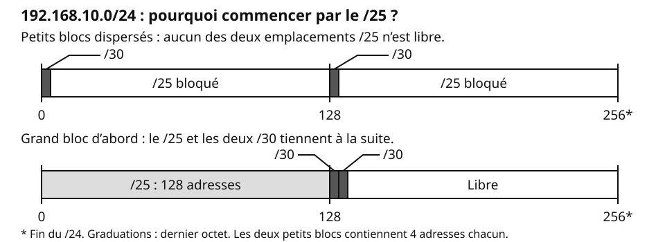
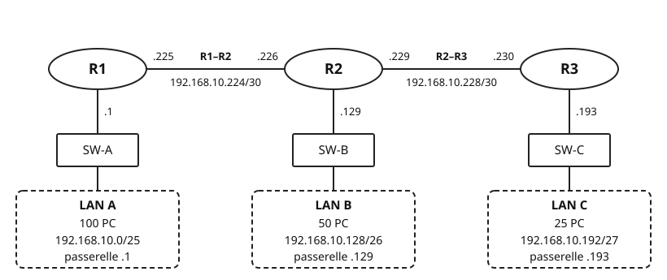
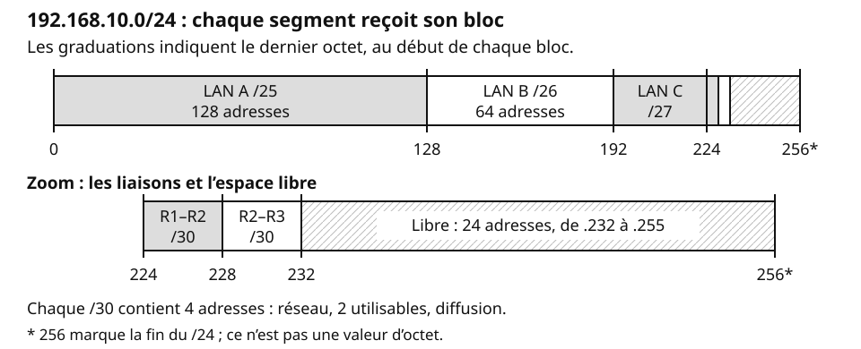

## Objectifs et prérequis

Vous allez donner à chaque segment un sous-réseau adapté à son besoin.
Vous saurez ensuite placer les blocs et vérifier votre plan.

Relisez [« Découper un réseau en sous-réseaux »](../cours-subnetting-vlsm/index.qmd)
si les mots masque, bits hôtes ou bornes vous semblent flous.
Vous devez aussi savoir convertir un octet en binaire et connaître le rôle du routeur.

## Situation de départ

Dans le cours précédent, l’accueil reçoit 62 adresses utilisables pour
20 postes et une passerelle. Beaucoup restent inutilisées. Une liaison entre
deux routeurs est une liaison **point à point** : elle ne relie que deux équipements.
Elle n’a besoin que de **2 adresses**, une par interface.

Pourquoi donner la même taille à tous les blocs ? Un LAN de 50 postes et
son routeur reçoit un **/26** : 62 adresses utilisables. Une liaison reçoit
un **/30 classique** : 4 adresses, dont 2 utilisables.

Le **VLSM** (*Variable Length Subnet Mask*) donne à chaque segment son propre
masque. Les sous-réseaux ont des tailles différentes.

## Comprendre le mécanisme

### A. Dimensionner

Pour 50 PC et un routeur, le besoin vaut **51 adresses**. Avec 5 bits hôtes,
on obtient 30 adresses utilisables : trop peu. Avec 6, on en obtient 62 : cela suffit.

Suivez la chaîne **besoin → bits hôtes → bits empruntés → nouveau masque**.
Faites-le pour **tous les segments avant d’en placer un seul**.

1. **Besoin** : comptez les PC et les interfaces de routeur du segment.
2. **Bits hôtes** : cherchez le plus petit h tel que **2^h^ − 2 ≥ besoin**.
3. **Masque** : soustrayez h aux bits hôtes du parent pour obtenir les bits empruntés.
   Ajoutez les bits empruntés au préfixe du parent,
   puis écrivez le masque pointé.

Dans un parent `/24`, il reste 8 bits hôtes. Pour les 51 adresses :
h = 6, donc 8 − 6 = **2 bits empruntés** ; 24 + 2 = **/26**,
soit `255.255.255.192`. La **taille de bloc = 2^h^**, ici 64 adresses.

### B. Placer

Un bloc ne commence pas à n’importe quelle adresse. Un `/26` contient
64 adresses : dans le dernier octet, ses débuts possibles sont 0, 64, 128 et 192.
Ainsi, `192.168.10.128/26` est **aligné** : 128 = 2 × 64.

Un bloc est **aligné** quand son adresse de départ est un multiple de sa taille.
Dans l’octet significatif, le départ est un **multiple du pas** ; les octets
suivants sont **à 0**. Le **pas d’avancement** (le pas) vaut
**256 − octet significatif du masque**, le premier octet qui n’est pas 255.
Pour `/26`, il vaut 256 − 192 = 64 dans le dernier octet.

Placez les blocs **du plus grand au plus petit**. Comme dans la fiche, poursuivez avec les étapes 4 et 5 :

4. **Placement** : partez du réseau parent ; ensuite,
   prenez la diffusion du bloc précédent + 1 comme candidat.
   Contrôlez l’**alignement** : multiple du pas et octets suivants à 0.
   Si nécessaire, avancez au prochain départ aligné et libre.
5. **Bornes** : bits hôtes à 0 pour le réseau, à 1 pour la diffusion.
   Les adresses utilisables vont de réseau + 1 à diffusion − 1.

Pour `192.168.10.128/26` : réseau `.128`, diffusion `.191`, utilisables
`.129` à `.190`. Le candidat suivant est `.192`.

### Pourquoi les grands blocs d’abord ?

Deux petits blocs dispersés peuvent empêcher de placer un grand bloc, même s’il reste
assez d’adresses au total. Un `/25` ne commence qu’en `.0` ou `.128`.
Si vous partez du réseau parent et placez les blocs à la suite, du plus grand au plus petit,
chaque candidat « diffusion + 1 » tombe aligné.
Vérifiez quand même : un plan qu’on complète ne respecte pas toujours cet ordre.

{fig-alt="Deux règles de 192.168.10.0/24, de 0 à 256. En haut, deux /30 occupent .0 à .3 et .128 à .131. Chacun bloque un des deux emplacements possibles d’un /25 : aucun /25 ne tient, malgré 248 adresses libres. En bas, un /25 occupe .0 à .127, puis les /30 occupent .128 à .131 et .132 à .135. Tous tiennent. La borne 256 marque la fin du /24, pas une valeur d’octet."}

::: {.callout-warning}
## Piège : la première adresse libre n’est pas toujours alignée

Après un bloc finissant en `.31`, `.32` est libre. Pour un `/26`, le pas
vaut 64 : `.32` n’est pas aligné. Commencez en `.64` si ce bloc est libre.
Les adresses `.32` à `.63` restent disponibles pour de plus petits blocs.
:::

## Observer et appliquer

### Exemple guidé : `192.168.10.0/24`

Trois LAN comptent **100, 50 et 25 PC**, chacun derrière son routeur.
Deux liaisons point à point relient R1 à R2, puis R2 à R3 : il faut **5 segments**.
Avec des blocs égaux, il faudrait cinq `/25`. Un `/24` n’en contient que deux.

{fig-alt="R1, R2 et R3 sont reliés en chaîne. R1–R2 : réseau 192.168.10.224/30, R1 en .225 et R2 en .226. R2–R3 : réseau 192.168.10.228/30, R2 en .229 et R3 en .230. Chaque routeur dessert un LAN via un commutateur. LAN A : 100 PC, 192.168.10.0/25, passerelle .1. LAN B : 50 PC, 192.168.10.128/26, passerelle .129. LAN C : 25 PC, 192.168.10.192/27, passerelle .193."}

**A. Dimensionner.** Le parent `/24` offre 8 bits hôtes.
Chaque LAN ajoute une interface de routeur ; chaque liaison en compte deux.

| Segment | Besoin | h | Bits empruntés | Préfixe | Masque |
|:---|:-:|:-:|:-:|:-:|:---|
| LAN A | 100 + 1 = 101 | 7 | 8 − 7 = 1 | /25 | `255.255.255.128` |
| LAN B | 50 + 1 = 51 | 6 | 8 − 6 = 2 | /26 | `255.255.255.192` |
| LAN C | 25 + 1 = 26 | 5 | 8 − 5 = 3 | /27 | `255.255.255.224` |
| R1–R2 | 2 | 2 | 8 − 2 = 6 | /30 | `255.255.255.252` |
| R2–R3 | 2 | 2 | 8 − 2 = 6 | /30 | `255.255.255.252` |

Pour le LAN A, 2^6^ − 2 = 62 ne suffit pas ; 2^7^ − 2 = **126** suffit.
Pour le LAN C, 2^4^ − 2 = 14 ne suffit pas ; 2^5^ − 2 = **30** suffit.
Pour les liaisons, 2^2^ − 2 = **2** : on garde le `/30` classique.

**B. Placer.** Les tailles sont 128, 64, 32, 4 et 4 adresses.
Placez-les à la suite, depuis `.0`, du plus grand au plus petit.

{fig-alt="Règle de 192.168.10.0/24 : LAN A de .0 à .127 en /25 ; LAN B de .128 à .191 en /26 ; LAN C de .192 à .223 en /27. Un agrandissement montre R1–R2 de .224 à .227 en /30, puis R2–R3 de .228 à .231 en /30. L’espace libre va de .232 à .255, soit 24 adresses. Les graduations donnent les débuts des blocs ; 256 marque la fin du /24, pas une valeur d’octet."}

L’alignement est vérifié : 0 = 0 × 128 ; 128 = 2 × 64 ; 192 = 6 × 32 ;
224 = 56 × 4 ; 228 = 57 × 4.

Dans le tableau, `.x` abrège `192.168.10.x`.

| Segment | Réseau | Utilisables | Diffusion |
|:---|:---|:---|:---|
| LAN A | `192.168.10.0/25` | `.1` à `.126` | `.127` |
| LAN B | `192.168.10.128/26` | `.129` à `.190` | `.191` |
| LAN C | `192.168.10.192/27` | `.193` à `.222` | `.223` |
| R1–R2 | `192.168.10.224/30` | `.225` à `.226` | `.227` |
| R2–R3 | `192.168.10.228/30` | `.229` à `.230` | `.231` |

Il reste **24 adresses libres**, de `192.168.10.232` à `192.168.10.255`.
Chaque routeur prend la **première adresse utilisable de son LAN**.
Sur chaque liaison, le routeur au plus petit numéro prend la première adresse.
La topologie indique toutes ces adresses.

::: {.callout-warning}
## Piège : « diffusion + 1 » ne suffit pas

Dans un autre plan, un bloc finit en `192.168.20.79` : le candidat est `.80`.
Pour ajouter un `/27`, il faut un multiple de 32 : 80 ne convient pas.
Le premier départ aligné est `.96` ; vérifiez que ce bloc est libre.
Contrôlez l’alignement avant d’écrire l’adresse réseau.
:::

### Vérifier son plan : la grille en cinq points

| Point | Contrôle sur l’exemple |
|:---|:---|
| 1. Assez d’adresses | 126 ≥ 101 ; 62 ≥ 51 ; 30 ≥ 26 ; 2 ≥ 2 pour chaque liaison. |
| 2. Blocs alignés | Chaque départ est un multiple de son pas ; les octets suivants valent 0. |
| 3. Blocs disjoints et contenus dans le parent | Aucun chevauchement ; tous les blocs restent entre `192.168.10.0` et `.255`. |
| 4. Interfaces uniques | Chaque interface reçoit une adresse différente, utilisable et dans le bon réseau. R2 : `.129`, `.226`, `.229`. |
| 5. Passerelles et routes | Les PC utilisent `.1`, `.129` ou `.193`. Chaque routeur doit avoir des routes vers les réseaux distants, pour l’aller et le retour. |

### Retrouver le segment d’une adresse

Un poste reçoit `192.168.10.200/27`. Pour vérifier son segment, utilisez
son masque : le pas vaut 256 − 224 = **32**.

1. Repérez le multiple du pas juste inférieur ou égal : **192 ≤ 200 < 224**.
2. Le réseau est `192.168.10.192/27` : c’est le **LAN C**.
3. Vérifiez l’adresse : `.200` est entre `.193` et `.222` ; elle convient
   si aucun autre équipement ne l’utilise.

Le **ET logique** donne le même réseau : dans le dernier octet, 200 ET 224 = 192.

## Exercices de vérification

### Vérifier sa compréhension

1. Pourquoi le LAN B ne peut-il pas recevoir un `/27` ?
2. Peut-on donner `192.168.10.191` à un PC du LAN B ?
3. Combien d’interfaces faut-il adresser sur une liaison entre deux routeurs ?

**Réponses :** 1. Il demande 51 adresses ; un `/27` n’en offre que 30 utilisables.
2. Non, `.191` est sa diffusion. 3. Deux interfaces, donc deux adresses : un `/30` classique.

### À vous : vérifier une extension

On ajoute au réseau de l’exemple un LAN de **10 PC**, directement relié à R3.
Un collègue propose `192.168.10.232/28`.

1. Le masque est-il assez grand ? Justifiez par besoin → h → bits empruntés → masque.
2. Le départ est-il aligné ? Corrigez-le si nécessaire, sans déplacer les blocs existants.
3. Donnez les bornes et la passerelle. Que faut-il prévoir pour joindre les autres LAN ?

**Corrigé.**

1. **A. Dimensionner.** Besoin : 10 + 1 = **11**. Avec h = 3, on obtient
   6 adresses utilisables ; avec h = 4, **14**. On emprunte 8 − 4 = **4 bits** :
   24 + 4 = **/28**, masque `255.255.255.240`.
2. **B. Placer.** Le pas est 16. `.232` n’est pas aligné ; le prochain
   multiple est **240 = 15 × 16**. Le bloc `192.168.10.240/28` est libre
   et tient dans le parent. `.232` à `.239` restent libres.
3. Réseau `.240`, utilisables `.241` à `.254`, diffusion `.255`.
   R3 prend `.241` sur ce LAN ; les PC l’utilisent comme passerelle.
   R1 et R2 doivent connaître une route vers `192.168.10.240/28`, par R3 :
   R2 via `192.168.10.230`, R1 via `192.168.10.226`.
   Vérifiez aussi les routes de retour depuis R3 vers les autres LAN.

## Synthèse

- **A. Dimensionner** : besoin → bits hôtes → bits empruntés → nouveau masque.
- Comptez les interfaces de routeur : une par LAN ici, deux par liaison.
- **B. Placer** : du plus grand au plus petit, première adresse libre,
  contrôle de l’alignement, puis bornes.
- **Taille de bloc = 2^h^** ; **pas = 256 − octet significatif du masque**.
- Vérifiez votre plan avec la **grille en cinq points**.

## Pour aller plus loin

- [Fiche méthode VLSM](../fiche-vlsm-methode/index.qmd) : gardez-la pendant les exercices.
- [TP 4 — Mettre en œuvre le plan VLSM](../tp-application-vlsm/index.qmd) : appliquez le même plan.
- Pour un `/22`, le pas vaut 4 dans le 3^e^ octet ; le 4^e^ doit valoir 0 au départ.
- [RFC 1878 — Variable Length Subnet Table For IPv4](https://www.rfc-editor.org/rfc/rfc1878.html) : table des masques et tailles de blocs.
- [RFC 4632 — CIDR](https://www.rfc-editor.org/rfc/rfc4632.html) : notation des préfixes et agrégation.
