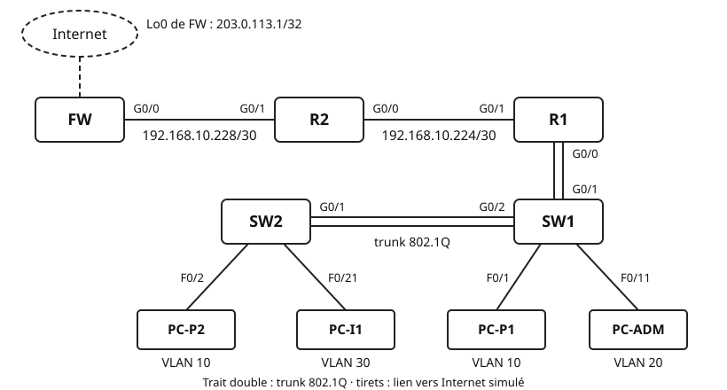

## Objectifs et prérequis

Vous allez construire dans Packet Tracer le réseau de l'entreprise **fil rouge** :
VLAN, routage inter-VLAN, DHCP et routage statique jusqu'au pare-feu, avec le
plan VLSM étudié au chapitre 2. La fiche de commandes Cisco est autorisée.

## Situation de départ

L'entreprise dispose de la plage `192.168.10.0/24`, découpée en VLSM entre la
production, l'administration, le Wi-Fi invité et deux liaisons entre routeurs.
Le réseau doit permettre à chaque poste de joindre les autres services et un
serveur situé sur Internet.

{fig-alt="Internet, simulé par la Loopback0 203.0.113.1/32 de FW, est derrière le pare-feu FW. FW G0/0 est relié à R2 G0/1 par 192.168.10.228/30 ; R2 G0/0 est relié à R1 G0/1 par 192.168.10.224/30. R1 G0/0 est relié en trunk à SW1 G0/1 ; SW1 G0/2 est relié en trunk 802.1Q à SW2 G0/1. Sur SW2 : PC-P2 sur F0/2 en VLAN 10 et PC-I1 sur F0/21 en VLAN 30. Sur SW1 : PC-P1 sur F0/1 en VLAN 10 et PC-ADM sur F0/11 en VLAN 20."}

FW est simulé par un routeur 2911 ; sa Loopback0 joue le rôle d'un serveur sur
Internet.

## Matériel et environnement

**Plateforme : Cisco Packet Tracer.** Routeurs **2911** (R1, R2, FW),
commutateurs **2960-24TT** (SW1, SW2), quatre PC.

**Plan des équipements.** Les cases `________` sont à compléter.

| Équipement | Interface | Adresse / préfixe | Passerelle |
|:---|:---|:---|:---|
| R1 | G0/0.10 | `________` /25 | — |
| | G0/0.20 | `________` /26 | — |
| | G0/0.30 | `________` /27 | — |
| | G0/1 | `192.168.10.225/30` | — |
| R2 | G0/0 | `192.168.10.226/30` | — |
| | G0/1 | `________` /30 | — |
| FW | G0/0 | `________` /30 | — |
| | Lo0 | `203.0.113.1/32` | — |
| SW1 | VLAN 20 | `192.168.10.188/26` | `________` |
| SW2 | VLAN 20 | `192.168.10.189/26` | `________` |
| PC-ADM | F0 | `192.168.10.129/26` | `________` |
| PC-P1, PC-P2, PC-I1 | F0 | DHCP | DHCP |

**Câblage.**

| Câble | De | Vers | Type |
|:-:|:---|:---|:---|
| 1 | R1 G0/0 | SW1 G0/1 | droit |
| 2 | SW1 G0/2 | SW2 G0/1 | croisé |
| 3 | R1 G0/1 | R2 G0/0 | croisé |
| 4 | R2 G0/1 | FW G0/0 | croisé |
| 5 | PC | SW (port du schéma) | droit |

**Conventions.**

- Passerelle = dernière adresse utilisable du réseau.
- Sur une liaison `/30`, l'équipement le plus proche des LAN prend la
  première adresse.
- Ports d'accès : F0/1–10 en VLAN 10, F0/11–20 en VLAN 20, F0/21–24 en VLAN 30.

Chaque partie suit la même démarche : **configuration → vérification → test →
une question de réflexion**.

## Travail à réaliser

### Partie 1 — Préparer le plan d'adressage et câbler

**Configuration.** Compléter le tableau ci-dessous, puis les cases `________` du plan
des équipements.

| Service | VLAN | Réseau | Masque | Plage utilisable | Diffusion | Nb |
|:---|:-:|:---|:---|:---|:---|:-:|
| Production | 10 | `192.168.10.0/25` | | | | |
| Administration | 20 | `192.168.10.128/26` | | | | |
| Wi-Fi invité | 30 | `192.168.10.192/27` | | | | |
| Liaison R1–R2 | — | `192.168.10.224/30` | | | | |
| Liaison R2–FW | — | `192.168.10.228/30` | | | | |

Dans Packet Tracer : placer les équipements, câbler selon le tableau des câbles,
puis sur **chaque** routeur et commutateur : `hostname`, `no ip domain-lookup`.
Renommer les PC (onglet *Config*).

**Vérification.** Les voyants des liaisons entre commutateurs et vers les PC
passent au vert. Ceux des routeurs restent rouges tant que les interfaces sont
éteintes.

**Question (2 points).** Quelles adresses de `192.168.10.0/24` restent libres ?
Les écrire sous forme de réseaux (adresse/préfixe).

### Partie 2 — VLAN, trunks et administration des commutateurs

**Configuration.** Sur SW1 **et** SW2 :

- créer les VLAN 10 `PRODUCTION`, 20 `ADMINISTRATION`, 30 `INVITES` ;
- affecter les plages de ports en mode *access* (`interface range`,
  `switchport access vlan`) ;
- passer en trunk les ports entre équipements (SW1 : G0/1 et G0/2 ; SW2 : G0/1),
  en limitant les VLAN : `switchport trunk allowed vlan 10,20,30` ;
- configurer l'interface `vlan 20` avec l'adresse du plan, `no shutdown`, puis
  `ip default-gateway`.

Configurer PC-ADM en adressage statique.

**Vérification.** `show vlan brief` : ports dans le bon VLAN.
`show interfaces trunk` : VLAN 10, 20, 30 autorisés et actifs.

**Test.** `ping 192.168.10.189` depuis SW1 ; `ping 192.168.10.188` depuis PC-ADM.

**Question (2 points).** PC-P1 (sur SW1) envoie une trame à PC-P2 (sur SW2), tous
deux en VLAN 10. Sur quels liens la trame porte-t-elle une étiquette 802.1Q ?

### Partie 3 — Routage inter-VLAN et DHCP sur R1

**Configuration.** Sur R1 :

- `no shutdown` sur G0/0, sans adresse ;
- une sous-interface par VLAN, G0/0.10, G0/0.20 et G0/0.30 :
  `encapsulation dot1Q` suivi du numéro de VLAN, puis l'adresse de passerelle ;
- DHCP pour les VLAN 10 et 30 : exclure `192.168.10.101` à `192.168.10.126`
  (réservées aux équipements fixes) et `192.168.10.222` ; créer les pools
  `PRODUCTION` et `INVITES` (`network`, `default-router`).

Passer PC-P1, PC-P2 et PC-I1 en DHCP.

**Vérification.** `show ip interface brief` : sous-interfaces *up/up*.
`show ip dhcp binding` : un bail par PC en DHCP.

**Test.** De PC-P1 vers PC-I1 et de PC-P2 vers PC-ADM : `ping`, puis `tracert`
(un seul saut attendu : la passerelle).

**Question (2 points).** Quelle est la plus grande adresse que le serveur DHCP
peut attribuer dans le VLAN 30 ? Justifier.

### Partie 4 — Liaisons entre routeurs et routage statique

**Configuration.** Adresser R1 G0/1, R2 G0/0, R2 G0/1, FW G0/0 et la Loopback0
de FW, puis `no shutdown`. Configurer les routes statiques :

| Routeur | Destination | Prochain saut |
|:---|:---|:---|
| R1 | route par défaut `0.0.0.0/0` | `________` |
| R2 | les trois réseaux des VLAN 10, 20, 30 (une route chacun) | `________` |
| R2 | route par défaut `0.0.0.0/0` | `________` |
| FW | `192.168.10.0/24` (une seule route pour tout le site) | `________` |

**Vérification.** `show ip route` sur chaque routeur : repérer les codes `C`,
`L`, `S` et `S*`.

**Test.** Depuis PC-P1 : `ping 203.0.113.1`, puis `tracert 203.0.113.1`.
Noter les sauts obtenus : `________`, `________`, `________`.

**Question (3 points).** Sur R2, peut-on remplacer les trois routes vers les VLAN
par la seule route `192.168.10.0/24` via R1 sans couper la liaison R2–FW ?
Justifier.

### Partie 5 — Recette et sauvegarde

**Test.** Compléter la matrice (**OK** ou **X**) avec des `ping` depuis la
source vers la destination.

| Source \\ Destination | PC-P2 | PC-ADM | PC-I1 | SW2 (.189) | R2 (.226) | 203.0.113.1 |
|:---|:-:|:-:|:-:|:-:|:-:|:-:|
| PC-P1 | | | | | | |
| PC-I1 | | | — | | | |

**Configuration.** Sur chaque équipement : `copy running-config startup-config`.

## Vérification et compte rendu

Le réseau est validé quand toutes les cases de la matrice de recette sont
remplies et justifiées. Livrables :

- le projet Packet Tracer, enregistré sous `TP3_NOM1_NOM2.pkt` et déposé sur l'ENT ;
- les tableaux complétés et les réponses aux quatre questions.

## Synthèse

Pour chaque partie, noter en une phrase ce qui a été vérifié, la commande qui l'a
montré et, le cas échéant, la panne rencontrée et sa cause.

## Pour aller plus loin

Le réseau invité peut joindre tout le site : aucun filtrage n'est encore en
place. Quelles communications faudrait-il interdire depuis le VLAN 30, et sur
quel équipement placer ce filtrage ? Les listes de contrôle d'accès (ACL)
seront étudiées plus tard.
