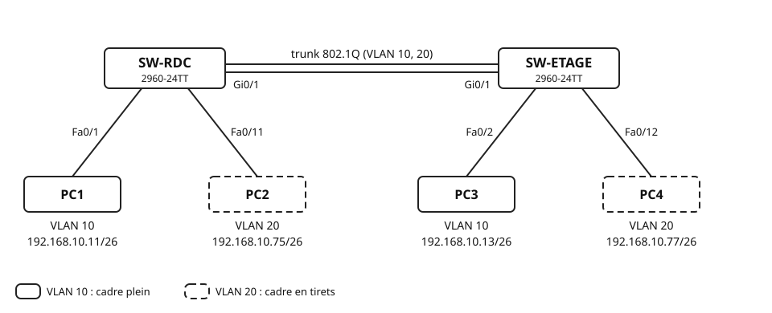
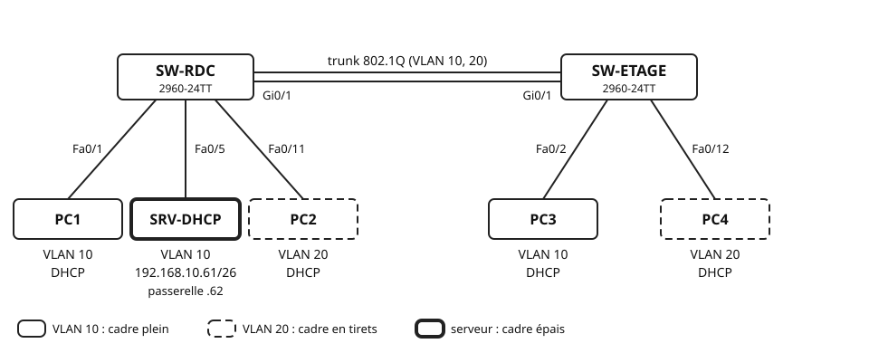
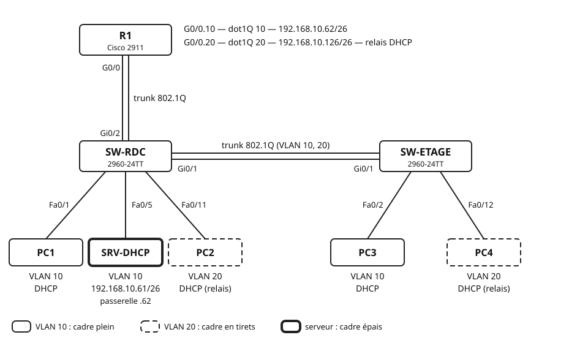
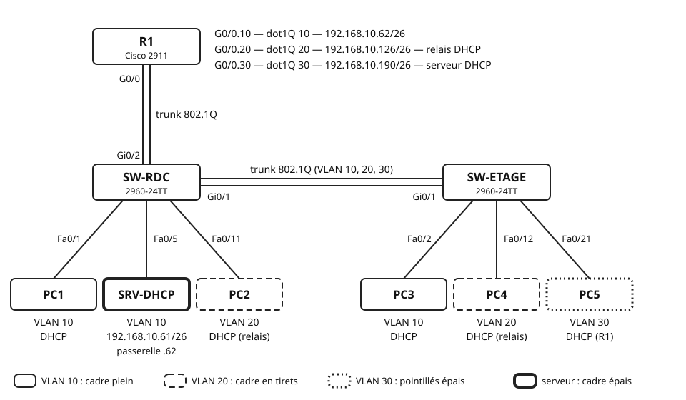

## Objectifs et prérequis

Vous allez découper la plage `192.168.10.0/24` de Lumitech en sous-réseaux,
un par VLAN. Vous distribuerez ensuite les adresses par DHCP, de trois
façons : un serveur dans le VLAN, ce même serveur à travers un relais, puis
le routeur lui-même. Une question revient à chaque étape : l'adresse
distribuée appartient-elle au bon sous-réseau ?

Le cours [« Découper un réseau en sous-réseaux »](../cours-subnetting-vlsm/index.qmd)
doit être connu. Les séries [d'entraînement](../exercices-subnetting-entrainement/index.qmd)
et [d'approfondissement](../exercices-subnetting-approfondissement/index.qmd)
doivent être faites. Vous devez savoir créer des VLAN et un trunk 802.1Q.
La fiche de commandes Cisco et la
[fiche méthode du subnetting](../fiche-subnetting-methode/index.qmd) sont
autorisées.

## Situation de départ

L'entreprise Lumitech a segmenté son réseau en VLAN : la comptabilité, le
service technique, et bientôt la direction. Elle ne veut utiliser qu'une
seule plage privée pour tout le site : `192.168.10.0/24`. Aucun service ne
dépassera 50 postes.

Votre mission : découper cette plage en sous-réseaux de même taille, un par
VLAN, avec au moins un sous-réseau en réserve. Les postes doivent ensuite
recevoir leur adresse automatiquement, dans le sous-réseau de leur VLAN.

Le résultat attendu : à la fin du TP, les trois VLAN communiquent. Chaque
poste a reçu par DHCP une adresse de son sous-réseau, avec le bon masque et
la bonne passerelle.

Le TP se fait dans **un unique fichier Packet Tracer**, que vous faites
évoluer d'une partie à l'autre.

| Partie | Ce que vous faites | Support |
|:-:|:---|:---|
| 0 | Calculer le plan d'adressage et les plages DHCP | papier |
| 1 | VLAN, trunk, adressage statique (révision) | Packet Tracer |
| 2 | Serveur DHCP dans le VLAN 10 | Packet Tracer |
| 3 | Routage inter-VLAN et relais DHCP | Packet Tracer |
| 4 | Nouveau VLAN 30, DHCP assuré par le routeur | Packet Tracer |
| Bonus | Diagnostiquer trois configurations erronées | papier |

Chaque partie sur Packet Tracer suit les quatre mêmes étapes.

| Étape | Ce que vous faites |
|:---|:---|
| 1. Configuration | réaliser la configuration demandée |
| 2. Vérification | relever l'état : commandes `show`, adresses obtenues |
| 3. Tests | comparer chaque résultat au résultat attendu |
| 4. Réflexion | expliquer le résultat clé de la partie |

## Matériel et environnement

**Plateforme : Cisco Packet Tracer 9.0.1.** Matériel final : deux
commutateurs **Cisco 2960-24TT** (SW-RDC, SW-ETAGE), un routeur **Cisco
2911** sous IOS 15.1 (R1), cinq postes **PC-PT** (PC1 à PC5), un serveur
**Server-PT** (SRV-DHCP). Les commandes des équipements Cisco se tapent dans
l'onglet *CLI*. Les commandes des PC se tapent dans *Desktop*, puis
*Command Prompt*.

**VLAN et ports d'accès.** Ils sont identiques sur les deux commutateurs.
La colonne « Sous-réseau » se remplit en partie 0.

| VLAN | Nom | Ports d'accès | Sous-réseau | À partir de |
|:-:|:---|:---|:---|:-:|
| 10 | COMPTA | Fa0/1 – Fa0/10 | partie 0 | partie 1 |
| 20 | TECHNIQUE | Fa0/11 – Fa0/20 | partie 0 | partie 1 |
| 30 | DIRECTION | Fa0/21 – Fa0/24 | partie 0 | partie 4 |

**Trunks 802.1Q.** SW-RDC Gi0/1 ↔ SW-ETAGE Gi0/1, dès la partie 1.
SW-RDC Gi0/2 ↔ R1 G0/0, à partir de la partie 3.

**Équipements terminaux.**

| Équipement | Branché sur | VLAN | Partie 1 | Parties 2 à 4 |
|:---|:---|:-:|:---|:---|
| PC1 | SW-RDC Fa0/1 | 10 | `192.168.10.11/26` | DHCP |
| PC2 | SW-RDC Fa0/11 | 20 | `192.168.10.75/26` | DHCP |
| PC3 | SW-ETAGE Fa0/2 | 10 | `192.168.10.13/26` | DHCP |
| PC4 | SW-ETAGE Fa0/12 | 20 | `192.168.10.77/26` | DHCP |
| SRV-DHCP | SW-RDC Fa0/5 | 10 | — | adresse fixe, ajouté en partie 2 |
| PC5 | SW-ETAGE Fa0/21 | 30 | — | DHCP, ajouté en partie 4 |

**Câblage.**

| Câble | De | Vers | Type |
|:-:|:---|:---|:---|
| 1 | SW-RDC Gi0/1 | SW-ETAGE Gi0/1 | croisé |
| 2 | PC ou serveur | port du commutateur indiqué | droit |
| 3 | R1 G0/0 (partie 3) | SW-RDC Gi0/2 | droit |

**Conventions d'adressage.** Vous les appliquerez en partie 0.

- Les sous-réseaux sont attribués dans l'ordre des VLAN : 10, 20, 30, puis
  la réserve.
- La passerelle d'un VLAN est la **dernière** adresse utilisable de son
  sous-réseau. Elle sera portée par R1.
- SRV-DHCP prend l'**avant-dernière** adresse utilisable du VLAN 10.

::: {.callout-note}
## Règles du jeu

- La fiche de commandes Cisco est autorisée. Les commandes déjà vues (VLAN,
  trunk) ne sont pas redonnées. Les commandes nouvelles sont fournies.
- Sauvegardez à la fin de chaque partie : `TP3_P1_NOM.pkt`,
  `TP3_P2_NOM.pkt`, `TP3_P3_NOM.pkt`, `TP3_P4_NOM.pkt`.
- Sous Packet Tracer, le premier `ping` perd souvent un ou deux paquets : le
  temps de la résolution ARP. Relancez-le avant de conclure.
:::

## Travail à réaliser

### Partie 0 — Calculer le plan d'adressage

Cette partie se fait sur papier, avant d'ouvrir Packet Tracer. Une erreur
ici se retrouverait partout : dans les masques, les passerelles et les pools
DHCP.

**0.1 Le découpage.** Lumitech veut trois VLAN et au moins un sous-réseau en
réserve, tous de même taille. Remplissez le tableau. Le cours, section
« La taille de bloc et le pas d'avancement », vous guide.

| Grandeur | Valeur |
|:---|:---|
| Nombre minimal de sous-réseaux | |
| Bits empruntés à la partie hôte | |
| Bits hôtes restants | |
| Préfixe (notation /n) | |
| Masque en décimal pointé | |
| Octet significatif | |
| Taille de bloc (2^h^ adresses, h = nombre de bits hôtes) | |
| Pas d'avancement (256 − octet significatif) | |
| Hôtes utilisables par sous-réseau | |

Vérifiez ensuite le besoin : un sous-réseau suffit-il pour 50 postes et sa
passerelle ?

**0.2 Le plan d'adressage.** Appliquez les conventions d'adressage.

| VLAN | Nom | Réseau / préfixe | Première utilisable | Dernière utilisable | Passerelle (R1) | Diffusion |
|:-:|:---|:---|:---|:---|:---|:---|
| 10 | COMPTA | | | | | |
| 20 | TECHNIQUE | | | | | |
| 30 | DIRECTION | | | | | |
| — | réserve | | | | — | |

Adresse de SRV-DHCP : `____________`, masque `____________`.

**0.3 Les plages DHCP.** Un serveur DHCP distribue des adresses prises dans
une plage, le **pool**. Prenons un exemple : un pool qui commence à `.200`,
avec 10 utilisateurs au plus, distribue les adresses `.200` à `.209`. La
dernière adresse vaut donc : début + nombre − 1.

Un pool sert à un seul sous-réseau. Il ne doit contenir ni la passerelle, ni
l'adresse du serveur, ni l'adresse de diffusion. Il ne doit jamais déborder
sur le sous-réseau suivant.

Voici les paramètres retenus. Calculez les adresses distribuées, puis
vérifiez chaque pool.

| Pool | Servi par | Paramètres | Première adresse distribuée | Dernière adresse distribuée | Pool correct ? (oui / non) |
|:---|:---|:---|:---|:---|:-:|
| `serverPool` (VLAN 10) | SRV-DHCP | début `.20`, 30 utilisateurs | | | |
| `VLAN20` | SRV-DHCP | début `.84`, 30 utilisateurs | | | |
| `VLAN30` | R1 | tout le sous-réseau du VLAN 30, sauf `.129` à `.149` et `.190` | | | |

Pour le pool `VLAN30`, donnez aussi le nombre d'adresses distribuables.

::: {.callout-important}
## Appelez le professeur

À montrer : les tableaux 0.1, 0.2 et 0.3. Ne passez pas à la partie 1
avant sa validation : tout le TP repose sur ce plan.
:::

### Partie 1 — VLAN et trunk, adressage statique

Révision : aucune commande n'est fournie.

{fig-alt="SW-RDC et SW-ETAGE, deux commutateurs 2960-24TT, sont reliés par un trunk 802.1Q qui transporte les VLAN 10 et 20, entre leurs ports Gi0/1. Sur SW-RDC : PC1 sur Fa0/1, VLAN 10, adresse 192.168.10.11/26 ; PC2 sur Fa0/11, VLAN 20, adresse 192.168.10.75/26. Sur SW-ETAGE : PC3 sur Fa0/2, VLAN 10, adresse 192.168.10.13/26 ; PC4 sur Fa0/12, VLAN 20, adresse 192.168.10.77/26. Les postes du VLAN 10 ont un cadre plein, ceux du VLAN 20 un cadre en tirets."}

**1.1 Configuration.**

1. Réalisez la topologie. Affichez les noms des équipements : *Config*,
   puis *Display Name*.
2. Configurez l'adressage statique des quatre postes, sans passerelle. Le
   masque est `255.255.255.192`.
3. Sur chaque commutateur : nom d'hôte ; VLAN 10 et 20 créés et nommés ;
   ports affectés par plage et forcés en mode accès ; Gi0/1 en trunk des
   deux côtés ; sauvegarde de la configuration.

**1.2 Vérification.** Relevez sur SW-ETAGE :

| Commande et information | Valeur relevée |
|:---|:---|
| `show vlan brief` : ports du VLAN 20 | |
| `show interfaces trunk` : mode et état de Gi0/1 | |
| `show interfaces trunk` : VLAN autorisés et actifs (*allowed and active*) | |

**1.3 Tests.**

| ID | Test | Attendu | Vérifié |
|:-:|:---|:-:|:-:|
| A1 | PC1 → PC3 (même VLAN) | OK | |
| A2 | PC2 → PC4 (même VLAN) | OK | |
| A3 | PC1 → PC2 (VLAN différents) | ÉCHEC | |
| A4 | PC3 → PC4 (VLAN différents) | ÉCHEC | |

**1.4 Réflexion.** Le test A3 échoue.

a) PC1 (`192.168.10.11/26`) veut joindre PC2 (`192.168.10.75`). Faites le
   ET logique entre l'adresse de PC2 et le masque de PC1. Comparez le
   résultat au réseau de PC1. Que conclut PC1 sur la position de PC2 ?
b) Que faudrait-il ajouter, sur les postes et dans la topologie, pour que
   PC1 puisse joindre PC2 ?
c) Supposons que PC1 et PC2 utilisent le masque `/24`. PC1 croirait alors
   PC2 dans son réseau, et lui enverrait une requête ARP. Le ping
   réussirait-il ? Justifiez avec la notion de domaine de diffusion.

::: {.callout-important}
## Appelez le professeur

À montrer : `show vlan brief` et `show interfaces trunk` sur les deux
commutateurs, les résultats des tests, les réponses à la réflexion. Puis
sauvegardez sous `TP3_P1_NOM.pkt`.
:::

### Partie 2 — Un serveur DHCP dans le VLAN 10

On repart du fichier de la partie 1. Les commutateurs ne sont pas modifiés.

::: {.callout-note}
## Notion — DHCP

Un poste qui démarre sans adresse ne connaît personne sur le réseau. Il
diffuse donc une demande à tout son réseau : c'est le message **Discover**.
Un serveur DHCP lui répond. Il lui attribue une adresse prise dans son
pool, avec le masque et la passerelle.

Sans réponse, le poste se donne une adresse **APIPA**, en `169.254.x.x`.
Cette adresse ne permet pas de joindre le reste du réseau.
:::

{fig-alt="Même topologie que la partie 1 : SW-RDC et SW-ETAGE reliés par un trunk 802.1Q, VLAN 10 et 20, entre leurs ports Gi0/1. Sur SW-RDC : PC1 sur Fa0/1, VLAN 10, en DHCP ; le serveur SRV-DHCP, en cadre épais, sur Fa0/5, VLAN 10, adresse 192.168.10.61/26, passerelle point 62 ; PC2 sur Fa0/11, VLAN 20, en DHCP. Sur SW-ETAGE : PC3 sur Fa0/2, VLAN 10, en DHCP ; PC4 sur Fa0/12, VLAN 20, en DHCP. Cadre plein pour le VLAN 10, cadre en tirets pour le VLAN 20."}

**2.1 Configuration.**

1. Ajoutez un **Server-PT** nommé `SRV-DHCP`. Branchez-le sur le port Fa0/5
   de SW-RDC, déjà affecté au VLAN 10.
2. Dans *Desktop*, puis *IP Configuration* : adressage statique,
   `192.168.10.61`, masque `255.255.255.192`, passerelle `192.168.10.62`.
   Le routeur n'existe pas encore : vous anticipez la partie 3.
3. Dans *Services*, puis *DHCP* : passez le service sur *On*. Modifiez le
   pool `serverPool` avec les valeurs ci-dessous, puis cliquez sur *Save*.
   Ce pool ne peut pas être supprimé.

| Default Gateway | DNS Server | Start IP Address | Subnet Mask | Maximum Number of Users |
|:-:|:-:|:-:|:-:|:-:|
| `192.168.10.62` | `0.0.0.0` | `192.168.10.20` | `255.255.255.192` | `30` |

Après *Save*, vérifiez les valeurs de `serverPool` dans le tableau du bas
de la fenêtre.

4. Passez les quatre postes en DHCP, dans *Desktop*, puis *IP
   Configuration*.

::: {.callout-warning}
## Le pool doit rester dans son sous-réseau

Ce pool distribue les adresses `.20` à `.49`. Elles appartiennent toutes à
`192.168.10.0/26`. Le pool s'arrête avant le serveur (`.61`) et la
passerelle (`.62`).

Un pool qui déborderait distribuerait des adresses inutilisables. La
diffusion `.63` ne peut pas être attribuée à un poste. L'adresse `.64` est
déjà dans le sous-réseau suivant. Avant chaque *Save*, calculez la dernière
adresse : début + nombre − 1.
:::

**2.2 Vérification.** Relevez la configuration obtenue par chaque poste.
La commande `ipconfig` dans le *Command Prompt* l'affiche aussi.

| Poste | VLAN | Adresse IP obtenue | Masque | Passerelle |
|:---|:-:|:---|:---|:---|
| PC1 | 10 | | | |
| PC2 | 20 | | | |
| PC3 | 10 | | | |
| PC4 | 20 | | | |

**2.3 Tests.**

| ID | Test | Attendu | Vérifié |
|:-:|:---|:-:|:-:|
| B1 | PC1 → PC3 | OK | |
| B2 | PC1 → `192.168.10.62` | ÉCHEC | |
| B3 | PC1 → SRV-DHCP | OK | |

**2.4 Réflexion.**

a) PC2 et PC4 n'obtiennent pas d'adresse. PC3, pourtant branché sur
   l'autre commutateur, en obtient une. Expliquez pourquoi.
b) Quelle adresse affichent PC2 et PC4 ? Comment l'appelle-t-on ?
   Pourquoi ne leur permet-elle pas de joindre SRV-DHCP ?
c) Le pool commence à `.20`. Combien d'utilisateurs pourrait-il servir au
   plus, sans jamais distribuer l'adresse du serveur ? Justifiez.

::: {.callout-important}
## Appelez le professeur

À montrer : les adresses des quatre postes, le pool de SRV-DHCP, les
résultats des tests, les réponses à la réflexion. Puis sauvegardez sous
`TP3_P2_NOM.pkt`.
:::

### Partie 3 — Routage inter-VLAN et relais DHCP

On repart du fichier de la partie 2. Le principe : un seul câble trunk entre
R1 et SW-RDC, et une sous-interface par VLAN. Chaque sous-interface est une
interface logique rattachée à l'interface physique ; elle porte la passerelle
d'un sous-réseau `/26`.

{fig-alt="Le routeur R1, un Cisco 2911, est au-dessus de SW-RDC. Son port G0/0 est relié en trunk 802.1Q au port Gi0/2 de SW-RDC. Sous-interfaces de R1 : G0/0.10, dot1Q 10, 192.168.10.62/26 ; G0/0.20, dot1Q 20, 192.168.10.126/26, relais DHCP. SW-RDC et SW-ETAGE sont reliés par un trunk 802.1Q, VLAN 10 et 20, entre leurs ports Gi0/1. Sur SW-RDC : PC1 sur Fa0/1, VLAN 10, en DHCP ; SRV-DHCP, en cadre épais, sur Fa0/5, VLAN 10, 192.168.10.61/26, passerelle point 62 ; PC2 sur Fa0/11, VLAN 20, en DHCP par le relais. Sur SW-ETAGE : PC3 sur Fa0/2, VLAN 10, en DHCP ; PC4 sur Fa0/12, VLAN 20, en DHCP par le relais."}

**3.1 Configuration.**

**a) Raccordement.** Ajoutez un routeur **Cisco 2911** nommé R1. Reliez son
port G0/0 au port Gi0/2 de SW-RDC. Sur SW-RDC, configurez Gi0/2 en trunk,
puis sauvegardez.

**b) Sous-interfaces.** Sur R1, saisissez la configuration ci-dessous.

```text
! Packet Tracer, R1 (2911, IOS 15.1)
Router> enable
Router# configure terminal
Router(config)# hostname R1
R1(config)# interface gigabitEthernet 0/0
R1(config-if)# no shutdown
! l'interface physique doit être active : ses sous-interfaces en dépendent
R1(config-if)# interface gigabitEthernet 0/0.10
R1(config-subif)# encapsulation dot1Q 10
! la sous-interface traite les trames étiquetées VLAN 10
R1(config-subif)# ip address 192.168.10.62 255.255.255.192
! passerelle du VLAN 10 : dernière adresse utilisable de 192.168.10.0/26
```

::: {.callout-warning}
## Deux pièges classiques

Tapez `encapsulation dot1Q` **avant** `ip address` : sinon, l'adresse est
refusée. Faites `no shutdown` sur l'interface physique G0/0, pas sur la
sous-interface.
:::

Créez ensuite vous-même la sous-interface **G0/0.20** : VLAN 20, passerelle
du VLAN 20 calculée en partie 0 (`192.168.10.126/26`).

**c) Relais DHCP.** Sur R1 :

```text
! Packet Tracer, R1 (2911, IOS 15.1)
R1(config)# interface gigabitEthernet 0/0.20
R1(config-subif)# ip helper-address 192.168.10.61
! les demandes DHCP reçues sur G0/0.20 sont transmises à SRV-DHCP
R1(config-subif)# end
R1# copy running-config startup-config
```

Le serveur est dans le VLAN 10 ; PC2 et PC4 sont dans le VLAN 20. Cette
commande se lit : « les demandes DHCP qui arrivent sur G0/0.20,
transmets-les à `192.168.10.61` ». G0/0.20 est l'interface où R1 écoute.
`192.168.10.61` est l'adresse du serveur, pas une adresse du VLAN 20.

**d) Pool du VLAN 20.** Sur SRV-DHCP, dans *Services*, puis *DHCP*, créez un
nouveau pool avec *Add*.

| Pool Name | Default Gateway | DNS Server | Start IP Address | Subnet Mask | Maximum Number of Users |
|:-:|:-:|:-:|:-:|:-:|:-:|
| `VLAN20` | `192.168.10.126` | `0.0.0.0` | `192.168.10.84` | `255.255.255.192` | `30` |

Ce pool distribue les adresses `.84` à `.113`. Elles sont toutes dans
`192.168.10.64/26`, sous la passerelle `.126`.

**e) Renouvellement.** Sur PC2 et PC4, dans le *Command Prompt* :
`ipconfig /renew`.

**3.2 Vérification.**

| Commande et information | Valeur relevée |
|:---|:---|
| R1 : `show ip interface brief` : état de G0/0, G0/0.10 et G0/0.20 | |
| R1 : `show ip route` : réseaux connectés (C) et leur préfixe | |
| R1 : `show ip route` : adresses locales (L) et leur préfixe | |
| SW-RDC : `show interfaces trunk` : ports en trunk | |
| PC2 et PC4 : adresses obtenues ; appartiennent-elles à `192.168.10.64/26` ? | |

**3.3 Tests.**

| ID | Test | Attendu | Vérifié |
|:-:|:---|:-:|:-:|
| C1 | PC1 → `192.168.10.62` | OK | |
| C2 | PC1 → PC2 | OK | |
| C3 | PC3 → PC4 | OK | |
| C4 | PC4 → SRV-DHCP | OK | |
| C5 | `tracert` de PC3 vers PC4 | 2 sauts | |

::: {.callout-note}
## Le champ `giaddr` : le lien avec le subnetting

Le relais ne se contente pas de faire suivre la demande. Il écrit dans le
champ `giaddr` du message DHCP l'adresse de l'interface qui l'a reçue. Il
envoie ensuite la demande au serveur, en unicast : le message vise un seul
destinataire.

Le serveur cherche alors le pool dont le réseau contient `giaddr`. Il
calcule ce réseau avec le masque du pool. Si `giaddr` n'appartient au réseau
d'aucun pool, par exemple avec une sous-interface adressée dans un autre
sous-réseau, aucun pool ne correspond : le serveur ne devrait pas répondre.
Un masque de pool faux peut au contraire laisser le pool correspondre : le
serveur distribue alors des adresses avec ce mauvais masque. Si `giaddr`
vaut `0.0.0.0`, la demande n'est pas passée par un relais. Le serveur
choisit alors le pool du réseau de sa propre interface.
:::

**3.4 Réflexion.**

a) Après l'étape b), le routeur reliait déjà les deux VLAN. Pourquoi PC2
   n'a-t-il obtenu une adresse qu'après l'ajout de `ip helper-address` ?
   Pensez à la nature du message Discover.
b) SRV-DHCP possède maintenant deux pools. Comment choisit-il le bon ?
   Appuyez-vous sur l'encadré ci-dessus, puis répondez :
   - quelle adresse R1 place-t-il dans le champ `giaddr` pour une demande
     de PC2 ?
   - faites le ET logique de cette adresse avec le masque `/26` : quel
     réseau obtenez-vous ? Quel pool couvre ce réseau ?
   - pour une demande de PC1, reçue directement, quel pool le serveur
     utilise-t-il ? Pourquoi ?
c) La réponse du serveur repart vers `192.168.10.126`, hors de son
   sous-réseau. Par quel équipement passe-t-elle ? Pourquoi la passerelle
   du serveur, réglée en partie 2, était-elle indispensable ?

::: {.callout-important}
## Appelez le professeur

À montrer : les relevés, les tests, la sous-interface G0/0.20 dans
`show running-config`, les réponses à la réflexion. Puis sauvegardez sous
`TP3_P3_NOM.pkt`.
:::

### Partie 4 — Le routeur distribue les adresses du VLAN 30

On repart du fichier de la partie 3. La direction emménage à l'étage. Cette
fois, ce n'est pas SRV-DHCP qui servira ses postes : c'est R1 lui-même.

{fig-alt="Topologie de la partie 3, complétée. R1, un Cisco 2911, est relié par son port G0/0 en trunk 802.1Q au port Gi0/2 de SW-RDC. Sous-interfaces de R1 : G0/0.10, dot1Q 10, 192.168.10.62/26 ; G0/0.20, dot1Q 20, 192.168.10.126/26, relais DHCP ; G0/0.30, dot1Q 30, 192.168.10.190/26, serveur DHCP. SW-RDC et SW-ETAGE sont reliés par un trunk 802.1Q, VLAN 10, 20 et 30, entre leurs ports Gi0/1. Sur SW-RDC : PC1 sur Fa0/1, VLAN 10, en DHCP ; SRV-DHCP, en cadre épais, sur Fa0/5, VLAN 10, 192.168.10.61/26, passerelle point 62 ; PC2 sur Fa0/11, VLAN 20, en DHCP par le relais. Sur SW-ETAGE : PC3 sur Fa0/2, VLAN 10, en DHCP ; PC4 sur Fa0/12, VLAN 20, en DHCP par le relais ; PC5 sur Fa0/21, VLAN 30, en DHCP servi par R1. Cadre plein pour le VLAN 10, en tirets pour le VLAN 20, en pointillés épais pour le VLAN 30."}

**4.1 Configuration.**

**a) VLAN 30 (révision).** Sur les **deux** commutateurs, créez le VLAN 30
nommé `DIRECTION`. Affectez-lui les ports Fa0/21 à Fa0/24, en mode accès.
Le VLAN doit aussi exister sur SW-RDC : ses trames y transitent vers R1.
Si vous avez limité les VLAN autorisés sur vos trunks, ajoutez-y le VLAN 30.

**b) PC5.** Ajoutez un PC-PT nommé PC5, branché sur le port Fa0/21 de
SW-ETAGE. Passez-le en DHCP.

**c) Sous-interface G0/0.30.** Créez-la vous-même sur R1 : VLAN 30,
adresse `192.168.10.190/26`, la passerelle calculée en partie 0.

**d) Service DHCP de R1.** Saisissez la configuration ci-dessous.

```text
! Packet Tracer, R1 (2911, IOS 15.1)
R1(config)# ip dhcp excluded-address 192.168.10.129 192.168.10.149
! adresses .129 à .149 réservées aux équipements fixes : jamais distribuées
R1(config)# ip dhcp excluded-address 192.168.10.190
! la passerelle du VLAN 30 n'est jamais distribuée
R1(config)# ip dhcp pool VLAN30
R1(dhcp-config)# network 192.168.10.128 255.255.255.192
! le pool couvre le sous-réseau du VLAN 30, moins les adresses exclues
R1(dhcp-config)# default-router 192.168.10.190
! passerelle annoncée aux clients
R1(dhcp-config)# exit
```

R1 sert le VLAN 30 sans relais. La demande de PC5 arrive sur G0/0.30, dont
l'adresse appartient à `192.168.10.128/26`. R1 utilise donc le pool dont le
réseau est `192.168.10.128/26`.

**e) Renouvellement.** Sur PC5 : `ipconfig /renew`.

**f) Sauvegarde.** Sur R1 :

```text
! Packet Tracer, R1 (2911, IOS 15.1)
R1(config)# end
R1# copy running-config startup-config
```

Sauvegardez aussi la configuration des **deux** commutateurs, modifiée à
l'étape a).

**4.2 Vérification.**

| Commande et information | Valeur relevée |
|:---|:---|
| SW-ETAGE : `show vlan brief` : ports du VLAN 30 | |
| R1 : `show ip interface brief` : état de G0/0.30 | |
| R1 : `show ip dhcp binding` : adresse attribuée à PC5 et adresse MAC associée | |
| R1 : `show ip dhcp pool` : *Total addresses*, *Excluded addresses*, *Leased addresses* | |
| PC5 : adresse, masque et passerelle obtenus | |

**4.3 Tests.**

| ID | Test | Attendu | Vérifié |
|:-:|:---|:-:|:-:|
| D1 | PC5 obtient une adresse entre `.150` et `.189` | OK | |
| D2 | PC5 → `192.168.10.190` | OK | |
| D3 | PC5 → PC1 | OK | |
| D4 | PC5 → PC2 | OK | |

**4.4 Réflexion.**

a) Vous avez distribué les adresses de trois façons. Comparez-les dans le
   tableau suivant.

| Méthode | VLAN servi | Où se trouve le serveur ? | Ce qu'il faut configurer sur R1 | Un avantage | Une limite |
|:---|:-:|:---|:---|:---|:---|
| Serveur dans le VLAN (partie 2) | | | | | |
| Serveur à travers un relais (partie 3) | | | | | |
| Service DHCP du routeur (partie 4) | | | | | |

b) Pourquoi faut-il saisir les `ip dhcp excluded-address` **avant** de créer
   le pool ? Que pourrait-il arriver dans l'ordre inverse, si un poste fait
   sa demande entre-temps ?
c) Quelle est la première adresse distribuée par R1 ? Avec les valeurs
   *Total* et *Excluded* relevées, calculez le nombre d'adresses
   distribuables. Comparez avec votre tableau 0.3.

::: {.callout-important}
## Appelez le professeur

À montrer : les relevés, les tests, le tableau comparatif, les réponses à la
réflexion. Puis sauvegardez sous `TP3_P4_NOM.pkt`.
:::

### Bonus — Diagnostiquer trois configurations erronées

Un collègue a configuré trois éléments du réseau. Chacun contient une
erreur d'adressage. Raisonnez d'abord sur papier. Vous pourrez ensuite
vérifier dans une **copie** de votre fichier, jamais dans `TP3_P4_NOM.pkt`.

**Cas 1 — Le pool `VLAN20` de SRV-DHCP.**

| Pool Name | Default Gateway | Start IP Address | Subnet Mask | Maximum Number of Users |
|:-:|:-:|:-:|:-:|:-:|
| `VLAN20` | `192.168.10.126` | `192.168.10.110` | `255.255.255.192` | `30` |

**Cas 2 — La sous-interface G0/0.20 de R1.** Le pool `VLAN20` de
SRV-DHCP est celui de la partie 3, sans erreur.

```text
! Packet Tracer, R1 (2911, IOS 15.1) : extrait de show running-config
interface GigabitEthernet0/0.20
 encapsulation dot1Q 20
 ip address 192.168.10.65 255.255.255.192
 ip helper-address 192.168.10.61
```

Indice : PC2 obtient-il encore une adresse ? Calculez le ET logique de
`giaddr` avec le masque du pool.

**Cas 3 — Le relais de R1.** Le pool `VLAN20` est correct.

```text
! Packet Tracer, R1 (2911, IOS 15.1) : extrait de show running-config
interface GigabitEthernet0/0.20
 encapsulation dot1Q 20
 ip address 192.168.10.126 255.255.255.192
 ip helper-address 192.168.10.62
```

Pour chaque cas, remplissez le tableau. Dans le cas 1, l'effet n'apparaît
pas tout de suite : cherchez à partir de quel client il se produit.

| Cas | Erreur | Effet (observé ou prévisible) | Correction |
|:-:|:---|:---|:---|
| 1 | | | |
| 2 | | | |
| 3 | | | |

## Vérification et compte rendu

### Critères de réussite

Le réseau est validé quand :

- le plan d'adressage de la partie 0 est validé par le professeur ;
- les tests A1 à A4, B1 à B3, C1 à C5 et D1 à D4 donnent le résultat
  attendu ;
- chaque poste a obtenu par DHCP une adresse de son sous-réseau, avec le
  masque `255.255.255.192` et la passerelle de son VLAN ;
- aucun pool ne contient une passerelle, l'adresse du serveur ou une
  adresse de diffusion ;
- les configurations de R1 et des deux commutateurs sont enregistrées dans
  leur `startup-config`.

### Livrables

- Les tableaux et les réponses aux réflexions, sur votre feuille de TP.
- Les fichiers Packet Tracer `TP3_P1_NOM.pkt` à `TP3_P4_NOM.pkt`.
- Le tableau du bonus, si vous l'avez traité.
- Les fichiers sont déposés sur l'ENT.

## Synthèse

Pour chaque partie, notez en une phrase ce que vous avez vérifié. Citez le
test ou la commande qui l'a montré.

Terminez par un court bilan sur le lien entre subnetting et DHCP. Le masque
fixe les limites d'un sous-réseau. Montrez où ces limites sont intervenues
dans le TP : la décision du poste d'utiliser sa passerelle, les bornes d'un
pool, le choix du pool par `giaddr`.

## Pour aller plus loin

- **Utiliser la réserve.** Lumitech ouvre un Wi-Fi invité dans un VLAN 40.
  Attribuez-lui le sous-réseau de réserve. Calculez sa passerelle et un pool
  servi par R1. Configurez-le de bout en bout.
- **Des besoins inégaux.** Le service technique passe à 80 postes. Un `/26`
  ne suffit plus. Les sous-réseaux de taille variable (VLSM) répondent à ce
  problème : c'est l'objet du TP « Mettre en œuvre le plan VLSM ».
- Sources :
  - [RFC 2131 — Dynamic Host Configuration Protocol](https://www.rfc-editor.org/rfc/rfc2131.html),
    qui décrit les échanges DHCP et le champ `giaddr` ;
  - [RFC 1542 — Clarifications and Extensions for the Bootstrap Protocol](https://www.rfc-editor.org/rfc/rfc1542.html),
    qui décrit le rôle de l'agent relais ;
  - [RFC 3927 — Dynamic Configuration of IPv4 Link-Local Addresses](https://www.rfc-editor.org/rfc/rfc3927.html),
    qui définit les adresses `169.254.0.0/16` ;
  - [RFC 950 — Internet Standard Subnetting Procedure](https://www.rfc-editor.org/rfc/rfc950.html),
    le texte fondateur du découpage en sous-réseaux ;
  - la référence des commandes intégrée à Packet Tracer, menu *Help*, pour
    le routeur 2911 et le commutateur 2960.
