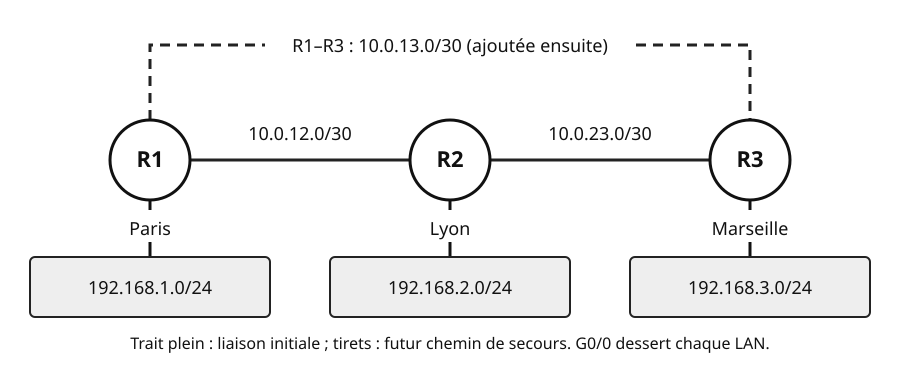
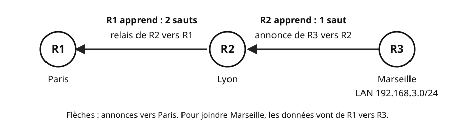
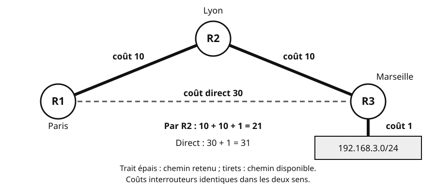
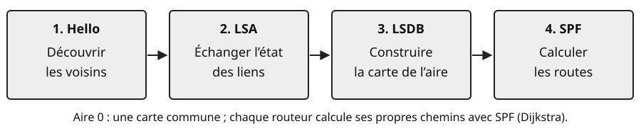

## Objectifs et prérequis

Vous allez faire apprendre les routes aux routeurs, puis leur faire choisir un chemin de secours.
Vous devez savoir lire une table de routage et reconnaître un sous-réseau.
**Plateforme de toutes les commandes : Cisco Packet Tracer (IOS), routeurs 2911.**

## Situation de départ

HexaTech relie Paris à Lyon, puis ouvre Marseille. Au départ, les routeurs forment une chaîne : **R1–R2–R3**.
Chaque routeur connaît ses réseaux directement connectés. Il lui manque les routes vers les LAN distants.

{fig-alt="R1 Paris, LAN 192.168.1.0/24 ; R2 Lyon, LAN 192.168.2.0/24 ; R3 Marseille, LAN 192.168.3.0/24. R1–R2 : 10.0.12.0/30 ; R2–R3 : 10.0.23.0/30. La future liaison R1–R3, 10.0.13.0/30, est en tirets. Les interfaces et adresses sont données dans le tableau suivant."}

| Routeur | G0/0 : LAN | G0/1 | G0/2 |
|:---|:---|:---|:---|
| R1 Paris | `192.168.1.1/24` | `10.0.12.1/30` vers R2 | `10.0.13.1/30` vers R3 |
| R2 Lyon | `192.168.2.1/24` | `10.0.12.2/30` vers R1 | `10.0.23.1/30` vers R3 |
| R3 Marseille | `192.168.3.1/24` | `10.0.23.2/30` vers R2 | `10.0.13.2/30` vers R1 |

Chaque PC reçoit l’adresse `.10/24` dans son LAN ; sa passerelle est l’adresse G0/0 du routeur local.
Les interfaces utilisées sont déjà adressées et activées avec `no shutdown`.

## Comprendre le mécanisme

### 1. Routage statique : prévoir l’aller et le retour

Pour joindre Lyon, R1 doit savoir à qui transmettre le paquet.
Sa **table de routage** associe un réseau destination à un prochain saut ou une interface de sortie.
Pour `192.168.2.10`, R1 peut envoyer à R2, `10.0.12.2`. R2 doit aussi savoir revenir vers Paris.

1. Repérez le réseau distant et son masque.
2. Choisissez un prochain saut directement joignable.
3. Configurez aussi le retour, puis testez avec `ping`.

```text
! R1, mode de configuration globale : vers Lyon
ip route 192.168.2.0 255.255.255.0 10.0.12.2
```

```text
! R2, mode de configuration globale : retour vers Paris
ip route 192.168.1.0 255.255.255.0 10.0.12.1
```

Avec **20 sites**, ces routes manuelles se multiplient. Un oubli de retour suffit à interrompre une communication.

### 2. Routage dynamique et RIPv2 : apprendre par les voisins

Pour éviter ces ajouts répétés, les routeurs échangent les réseaux qu’ils connaissent.
Comme Alice, Bob et Claire qui partagent leurs chemins vers Paris, Lyon et Marseille, chacun apprend des autres.
R3 connaît le LAN Marseille ; R2 l’apprend à **1 saut**, puis R1 à **2 sauts**.

{fig-alt="Chaîne R1 Paris, R2 Lyon, R3 Marseille. Le LAN 192.168.3.0/24 est connecté à R3. Une annonce de R3 vers R2 donne une route de métrique 1 sur R2 ; le relais de R2 vers R1 donne une route de métrique 2 sur R1. Les données circulent dans le sens inverse pour joindre Marseille."}

**RIPv2** (*Routing Information Protocol*, version 2) est un protocole à **vecteur de distance** : direction et distance reçues du voisin.
Sa métrique compte les sauts : le plus petit nombre gagne. **15 au maximum ; 16 signifie inaccessible.**
Les annonces périodiques partent environ toutes les **30 s**, en **UDP 520**, vers **224.0.0.9** en multicast.
RIPv2 transmet aussi les masques : il accepte le VLSM.

1. Retirez les anciennes routes statiques vers les LAN distants sur chaque routeur (`no ip route` avec leurs paramètres).
2. Activez RIPv2 sur les réseaux directement connectés.
3. Désactivez le résumé automatique et rendez le LAN passif ; vérifiez avec `show ip protocols`, puis `show ip route`.

Sur **R1**, depuis le mode privilégié :

```text
configure terminal
router rip
 version 2
 network 192.168.1.0
 network 10.0.0.0
 no auto-summary
 passive-interface GigabitEthernet0/0
end
```

En RIP Cisco, `network` utilise le **réseau majeur** : `10.0.0.0` sélectionne les interfaces du réseau `10.0.0.0/8`.
`no auto-summary` conserve les sous-réseaux précis au passage entre réseaux majeurs.
Le LAN passif reste annoncé aux autres routeurs ; aucune annonce RIP n’est envoyée vers ses PC.
Sur R2 et R3, remplacez seulement `192.168.1.0` par leur LAN : `192.168.2.0` ou `192.168.3.0`.

Avant l’ajout de R1–R3, voici une ligne simplifiée de `show ip route` sur R1 :

```text
R 192.168.3.0/24 [120/2] via 10.0.12.2
```

| Élément | Lecture |
|:---|:---|
| `R` et `192.168.3.0/24` | Route RIP vers le LAN Marseille |
| `120` | Distance administrative de RIP |
| `2` | Métrique : deux sauts |
| `via 10.0.12.2` | Prochain saut : R2 |

La **distance administrative** départage les sources proposant **le même réseau et le même préfixe**.
Par défaut sur Cisco : **connectée 0, statique 1, OSPF 110, RIP 120**. La plus petite gagne.
Ainsi, une statique vers Marseille masque la route RIP vers ce même `/24`.
La **métrique** compare les chemins d’un même protocole ; ne comparez pas des sauts RIP à un coût OSPF.
Pour acheminer un paquet, le routeur utilise ensuite la route au **préfixe le plus long** qui contient sa destination.

### 3. Redondance et convergence : prévoir un secours physique

Un protocole ne peut pas inventer un câble. En chaîne, une panne R1–R2 isole Paris.
Ajoutez **R1–R3**, `10.0.13.0/30` : RIP préfère alors Marseille à 1 saut plutôt qu’à 2.
Si R1–R3 tombe, le trajet R1–R2–R3 reste possible.

1. Ajoutez et adressez la liaison de secours suivant le tableau.
2. Coupez R1 G0/2 avec `shutdown` en configuration d’interface.
3. Attendez, puis testez : RIP réapprend Marseille par R2, à 2 sauts. Rétablissez avec `no shutdown`.

La **convergence** est l’adaptation des informations et des routes après un changement.
Elle prend du temps : des paquets peuvent être perdus pendant la bascule.

### 4. OSPF : choisir selon le coût

Une route courte encombrée peut être moins intéressante qu’une autoroute passant par davantage de villes.
RIP compte les sauts, sans considérer le débit. OSPF permet de comparer autrement les chemins.
Chez HexaTech, fixons les coûts : **R1–R2 = 10, R2–R3 = 10, R1–R3 = 30**.
Le LAN Marseille garde son coût automatique de **1**.

{fig-alt="Depuis R1, le chemin direct vers le LAN Marseille coûte 30 plus 1, soit 31. Le chemin par R2 coûte 10 plus 10 plus 1, soit 21 : c’est le chemin retenu par SPF. Le coût 1 final est celui de G0/0 de R3. Trait épais : chemin choisi ; tirets : chemin direct disponible."}

1. Listez les chemins possibles.
2. Additionnez les coûts des **interfaces de sortie**, jusqu’au réseau destination inclus.
3. Retenez la plus petite somme : ici **21 par R2**, contre 31 en direct.

**OSPF** (*Open Shortest Path First*) est un protocole à **état de liens** : les routeurs partagent une carte du réseau.
Les routeurs s’envoient des **annonces d’état de liens (LSA)**.
Une **aire**, ou zone, regroupe ces informations. Ici, tous les routeurs appartiennent à **l’aire 0**, l’aire dorsale.

{fig-alt="Quatre étapes : découvrir les voisins avec Hello ; échanger les annonces d’état de liens, LSA ; constituer la carte commune de l’aire, LSDB ; calculer les chemins de coût minimal avec SPF, algorithme de Dijkstra, et remplir la table de routage."}

Sur Ethernet, les **Hello** partent toutes les **10 s** ; après **40 s** sans Hello, le voisin est déclaré perdu (**Dead**).
Pour établir le voisinage, vérifiez : même sous-réseau et masque, même aire, mêmes minuteries et router-id distincts.
Après une panne détectée, les routeurs diffusent le changement puis recalculent leurs routes avec **SPF (Dijkstra)**.
Une interface qui tombe signale immédiatement la panne ; si elle reste active sans recevoir de Hello, Dead sert de délai.

::: {.callout-note}
## À retenir : coût automatique ou imposé

Avec une référence de **100 Mb/s**, FastEthernet coûte **100 ÷ 100 = 1**.
GigabitEthernet donne **100 ÷ 1 000 = 0,1**, ramené au minimum **1**.
Le coût automatique vaut référence ÷ bande passante déclarée, arrondi à l’entier inférieur, avec un minimum de 1.
`ip ospf cost` remplace ce calcul sur l’interface concernée, **dans le sens de sortie seulement**.
:::

Un réseau **multi-accès** permet de brancher plusieurs routeurs, comme un segment Ethernet.
Sur Ethernet, OSPF élit un **DR** (routeur désigné) et un **BDR** (remplaçant), pour organiser les échanges.
Le DR relaie les échanges, pour éviter que chacun parle à tous.
Même une liaison Ethernet `/30` est multi-accès par défaut : elle possède ces rôles.
À l’élection : plus haute priorité, puis plus haut router-id ; un DR en place garde son rôle.

## Observer et appliquer

### Configurer OSPF en aire 0

Pour retrouver le calcul de coût précédent, configurez les trois routeurs HexaTech.
Le **router-id** identifie le routeur : nous choisissons `1.1.1.1`, `2.2.2.2` et `3.3.3.3`.

1. Retirez RIP avec `no router rip` en configuration globale, sur chaque routeur.
2. Fixez le router-id **avant** les instructions `network`.
3. Activez les interfaces avec `network`, puis rendez le LAN passif.

Une **Loopback** est une interface virtuelle.
Le router-id se choisit dans cet ordre :
**commande `router-id` → plus haute IPv4 de Loopback active → plus haute IPv4 d’interface active**.
Sans Loopback ni réglage manuel, R1 choisirait ici `192.168.1.1`.
Un identifiant déjà choisi reste jusqu’au redémarrage du processus OSPF.

Pour sélectionner G0/1 de R1, `10.0.12.1/30`, utilisez `network 10.0.12.0 0.0.0.3 area 0`.
Le **masque générique** (*wildcard*) se calcule octet par octet : **255.255.255.255 − masque**.
Un bit à 0 impose la correspondance ; un bit à 1 ignore la valeur.

| Préfixe | Masque | Masque générique |
|:---|:---|:---|
| /24 | `255.255.255.0` | `0.0.0.255` |
| /30 | `255.255.255.252` | `0.0.0.3` |

Sur **R1**, depuis le mode privilégié, dans **Packet Tracer (IOS)** :

```text
configure terminal
router ospf 1
 router-id 1.1.1.1
 network 192.168.1.0 0.0.0.255 area 0
 network 10.0.12.0 0.0.0.3 area 0
 network 10.0.13.0 0.0.0.3 area 0
 passive-interface GigabitEthernet0/0
exit
interface GigabitEthernet0/1
 ip ospf cost 10
exit
interface GigabitEthernet0/2
 ip ospf cost 30
end
```

`1` dans `router ospf 1` est un numéro de processus **local** au routeur.
`network` sélectionne des interfaces ; OSPF annonce ensuite leurs sous-réseaux.
Le LAN passif **reste annoncé**, mais sans Hello ni voisin OSPF sur G0/0.

| Routeur à configurer de même | Router-id | Réseaux à sélectionner | Coûts G0/1 ; G0/2 |
|:---|:---|:---|:---|
| R2 | `2.2.2.2` | LAN Lyon, R1–R2, R2–R3 | 10 ; 10 |
| R3 | `3.3.3.3` | LAN Marseille, R2–R3, R1–R3 | 10 ; 30 |

Gardez G0/0 passive et son coût automatique de 1 sur chacun.

### Vérifier les voisins, les routes et le secours

1. Sur chaque routeur, contrôlez les quatre points du tableau, en **mode privilégié**.
2. Sur R1, retrouvez le coût 21 vers Marseille, prochain saut `10.0.12.2`.
3. Depuis le PC Paris : `tracert 192.168.3.10`. Coupez R1 G0/1 : après convergence, le chemin direct coûte 31.
4. Vérifiez à nouveau les routes et le `ping`, puis rétablissez G0/1 avec `no shutdown`.

| Commande | Point à contrôler |
|:---|:---|
| `show ip ospf neighbor` | Deux voisins par routeur, état `FULL` sur nos liaisons |
| `show ip route` | Routes `O` : `[110/coût]`, réseau et prochain saut |
| `show ip protocols` | Router-id, instructions `network`, interface passive |
| `show ip ospf interface` | Aire 0, coût, Hello 10 s, Dead 40 s |

### Annoncer une route par défaut

Pour une destination inconnue, il faut une sortie commune. Si HexaTech reçoit un accès Internet, son routeur de sortie l’annonce.
Dans le **TP 5**, ce rôle revient à **FW**, sur une autre topologie et un autre adressage.

1. Installez une route par défaut sur le routeur de sortie.
2. Après router-id, `network` et interfaces passives, ajoutez `default-information originate` sous `router ospf 1`.
3. Vérifiez sur les autres routeurs le code **`O*E2`** : OSPF, candidate par défaut (`*`), externe de type 2.

Sans route par défaut présente, cette commande seule n’en annonce aucune.
Le TP 5 détaille Null0, l’Internet simulé sur une Loopback et la métrique E2.

## Exercices de vérification

### À vous : choisir et vérifier

1. Sur R1 en chaîne, que signifient `120/2` et `10.0.12.2` dans la route RIP étudiée ?
2. Avec les coûts HexaTech, calculez le trajet OSPF vers Marseille. Que reste-t-il si R1–R2 tombe ?
3. Donnez le masque générique d’un `/26`. Une interface passive annonce-t-elle encore son LAN ?
4. Sans commande `router-id`, R3 possède une Loopback `172.16.0.1` active. Quel identifiant choisit-il ?

**Corrigé.**

1. Distance administrative **120**, métrique **2 sauts**, prochain saut **R2**.
2. Par R2 : **10 + 10 + 1 = 21**. Après la panne : direct **30 + 1 = 31**, après convergence.
3. `255.255.255.255 − 255.255.255.192 = 0.0.0.63`. **Oui**, le LAN reste annoncé ; aucun voisin OSPF dessus.
4. **172.16.0.1** : une Loopback est prioritaire sur les interfaces physiques, même si leur IPv4 est plus haute.

## Synthèse

| Point | RIPv2 | OSPF |
|:---|:---|:---|
| Informations échangées | Destinations et distances | État des liens : carte de l’aire |
| Métrique minimale recherchée | Sauts ; 16 = inaccessible | Somme des coûts de sortie |
| Repère Cisco | `R`, distance administrative 120 | `O`, distance administrative 110 |

Retenez : **apprendre → choisir → vérifier**. Un secours exige un autre chemin physique et un temps de convergence.
Configurez OSPF dans l’ordre : **router-id → network → interfaces passives → annonce éventuelle de la route par défaut**.

## Pour aller plus loin

- [TP 5 — Router le fil rouge avec OSPF](../tp-ospf/index.qmd) : transposez la méthode au plan VLSM du TP 4.
- Pour distinguer 100 Mb/s et 1 Gb/s : `auto-cost reference-bandwidth 1000` sous `router ospf 1`, sur **tous** les routeurs.
- [RFC 2453 — RIPv2](https://www.rfc-editor.org/rfc/rfc2453.html) : métrique, mises à jour et transport.
- [RFC 2328 — OSPFv2](https://www.rfc-editor.org/rfc/rfc2328.html) : Hello, carte et SPF.
