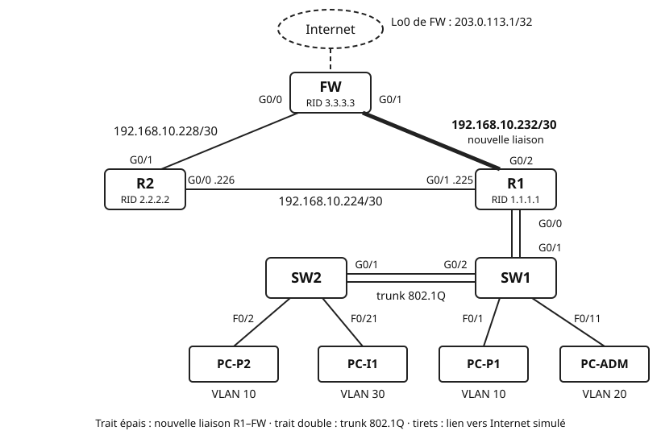

## Objectifs et prérequis

Vous allez faire évoluer le réseau **fil rouge** du TP 4. Une nouvelle
liaison va créer une boucle entre les trois routeurs. Vous remplacerez
ensuite les routes statiques par **OSPF**, en zone 0. Vous observerez enfin
comment OSPF réagit à une panne et au changement d'un coût.

Vous devez disposer de votre fichier Packet Tracer du TP 4, terminé. Le
cours « Le routage dynamique avec OSPF » doit être connu. Le cours et la
fiche de commandes Cisco sont autorisés.

## Situation de départ

Dans le TP 4, tout le trafic vers Internet passe par R2. Si la liaison R1–R2
tombe, le site entier est coupé. L'entreprise ajoute donc une liaison directe
entre R1 et le pare-feu FW.

Avec trois routeurs en triangle, les routes statiques deviennent difficiles à
tenir. Il faudrait prévoir un secours pour chaque destination. Vous confiez
donc ce travail à OSPF.

{fig-alt="Les routeurs R1, R2 et FW forment un triangle. FW, router-id 3.3.3.3, est en haut ; derrière lui, Internet est simulé par sa Loopback0 203.0.113.1/32. R2, router-id 2.2.2.2, est à gauche ; R1, router-id 1.1.1.1, est à droite. Liaison R1–R2 : 192.168.10.224/30, R2 G0/0 point 226, R1 G0/1 point 225. Liaison R2–FW : 192.168.10.228/30, R2 G0/1 et FW G0/0. Nouvelle liaison R1–FW, en trait épais : 192.168.10.232/30, R1 G0/2 et FW G0/1. R1 G0/0 est relié en trunk à SW1 G0/1 ; SW1 G0/2 est relié en trunk 802.1Q à SW2 G0/1. Sur SW2 : PC-P2 sur F0/2 en VLAN 10 et PC-I1 sur F0/21 en VLAN 30. Sur SW1 : PC-P1 sur F0/1 en VLAN 10 et PC-ADM sur F0/11 en VLAN 20."}

Le résultat attendu : les trois routeurs sont voisins OSPF. Tous les PC
joignent `203.0.113.1`. Le trafic bascule seul sur l'autre chemin quand une
liaison tombe.

## Matériel et environnement

**Plateforme : Cisco Packet Tracer.** Routeurs **2911** sous IOS 15.1 (R1,
R2, FW), commutateurs **2960-24TT** (SW1, SW2), quatre PC. Les commandes
des routeurs se tapent dans l'onglet *CLI*. Les commandes des PC se tapent
dans *Desktop*, puis *Command Prompt*.

**Fichier de départ.** Votre projet `TP4_NOM1_NOM2.pkt`, enregistré sous un
nouveau nom : `TP5_NOM1_NOM2.pkt`.

**Ce qui change par rapport au TP 4.**

| Équipement | Interface | Adresse / préfixe | Rôle |
|:---|:---|:---|:---|
| R1 | G0/2 | `192.168.10.233/30` | nouvelle liaison vers FW |
| FW | G0/1 | `192.168.10.234/30` | nouvelle liaison vers R1 |

Les autres adresses sont celles de votre plan du TP 4. Les commutateurs ne
changent pas.

**Câblage supplémentaire.**

| Câble | De | Vers | Type |
|:-:|:---|:---|:---|
| 6 | R1 G0/2 | FW G0/1 | croisé |

**Router-id.** Chaque routeur reçoit un identifiant OSPF facile à lire.

| Routeur | Router-id |
|:---|:---|
| R1 | `1.1.1.1` |
| R2 | `2.2.2.2` |
| FW | `3.3.3.3` |

**Captures d'écran.** Le compte rendu demande des captures numérotées, de
C1 à C16. Faites-les au fil du TP : une sortie de commande effacée ne se
retrouve pas toujours.

Chaque partie suit la même démarche : **configuration → vérification → test
→ observations à consigner**. Les questions Q1 à Q24 et les captures sont
listées dans la section « Vérification et compte rendu ».

## Travail à réaliser

### Partie 0 — Reprendre le réseau du TP 4

Cette partie fixe un point de comparaison. Vous saurez ainsi ce qu'OSPF
change.

**Configuration.** Ouvrez votre fichier du TP 4. Enregistrez-le aussitôt sous
`TP5_NOM1_NOM2.pkt`.

**Vérification.** Sur chaque routeur, tapez `show ip route`. Selon le
routeur, vous retrouvez des codes `C`, `L`, `S` ou `S*` du TP 4.

**Test.** Depuis PC-P1, lancez `ping 203.0.113.1`, puis
`tracert 203.0.113.1`. Le ping doit réussir.

::: {.callout-warning}
## Votre TP 4 n'est pas terminé ?

Terminez d'abord sa partie 4 : routes statiques et route par défaut. Sans
elle, vous ne pourrez pas comparer les deux modes de routage. Prévenez
l'enseignant si vous êtes bloqué.
:::

**Observations à consigner.** Q1 ; capture C1.

### Partie 1 — Créer la boucle avec une liaison R1–FW

Une boucle offre deux chemins vers chaque destination. C'est elle qui rend
le secours possible.

**Choix du sous-réseau.** La nouvelle liaison relie deux routeurs : un /30
suffit. Vous prenez le premier /30 libre du plan du TP 4 :
`192.168.10.232/30`. Il suit directement la liaison R2–FW. Les trois liaisons restent ainsi groupées dans
`192.168.10.224/27`.

Les conventions du TP 4 s'appliquent. R1 est le plus proche des LAN : il
prend la première adresse utilisable, `.233`. FW prend `.234`.

**Configuration.**

- Câblez R1 G0/2 à FW G0/1 avec un câble croisé.
- Sur R1, adressez G0/2 en `192.168.10.233/30`, puis `no shutdown`.
- Sur FW, adressez G0/1 en `192.168.10.234/30`, puis `no shutdown`.

**Vérification.** `show ip interface brief` sur R1 et sur FW : G0/2 et G0/1
sont *up/up*.

**Test.** Depuis R1 : `ping 192.168.10.234`. Depuis PC-P1 : relancez
`tracert 203.0.113.1` et comparez avec la partie 0.

**Observations à consigner.** Q2, Q3 ; capture C2.

### Partie 2 — Retirer les routes statiques internes

Une route statique a une distance administrative de 1, une route OSPF 110.
Pour un même réseau, avec la même longueur de préfixe, la route statique
l'emporte donc. Une route statique moins précise reste aussi dans la table.
Il faut donc retirer les routes statiques pour voir OSPF travailler seul.

**Configuration.** Sur R1, R2 puis FW :

1. listez les routes statiques avec `show ip route static` ;
2. supprimez chacune avec `no ip route`, suivi du réseau, du masque et du
   prochain saut affichés.

```text
! Packet Tracer, FW (2911, IOS 15.1)
! mode privilégié : lister les routes statiques
show ip route static
! mode de configuration globale : supprimer la route du TP 4
no ip route 192.168.10.0 255.255.255.0 ________
! le prochain saut est celui affiché par show ip route static
```

**Vérification.** `show ip route static` n'affiche plus rien sur les trois
routeurs. `show ip route` ne montre plus que des codes `C` et `L`.

**Test.** Depuis PC-P1 : `ping 203.0.113.1`, puis `ping` vers PC-I1. Notez
les deux résultats.

**Observations à consigner.** Q4, Q5 ; capture C3.

### Partie 3 — Configurer OSPF en zone 0

Vous activez OSPF sur les trois routeurs. Le réglage suit l'ordre vu en
cours : router-id d'abord, instructions `network` ensuite, interfaces
passives et route par défaut enfin.

**Préparation : les masques génériques.** Complétez le tableau. La dernière
colonne indique sur quels routeurs placer l'instruction `network`.

| Réseau | Masque | Masque générique | Routeurs concernés |
|:---|:---|:---|:---|
| `192.168.10.0/25` | | | |
| `192.168.10.128/26` | | | |
| `192.168.10.192/27` | | | |
| `192.168.10.224/30` | | | |
| `192.168.10.228/30` | | | |
| `192.168.10.232/30` | `255.255.255.252` | `0.0.0.3` | R1, FW |

**Configuration de R1.** R1 porte les trois VLAN et deux liaisons. Ses
sous-interfaces sont tournées vers des PC : elles sont passives.

```text
! Packet Tracer, R1 (2911, IOS 15.1), mode de configuration globale
router ospf 1
! processus OSPF numéro 1, local à R1
 router-id 1.1.1.1
! à fixer avant les instructions network
 network 192.168.10.0 ________ area 0
 network 192.168.10.128 ________ area 0
 network 192.168.10.192 ________ area 0
! les trois VLAN : complétez avec vos masques génériques
 network 192.168.10.224 ________ area 0
 network 192.168.10.232 0.0.0.3 area 0
! les deux liaisons de R1
 passive-interface GigabitEthernet0/0.10
 passive-interface GigabitEthernet0/0.20
 passive-interface GigabitEthernet0/0.30
! aucun Hello vers les VLAN, mais leurs réseaux restent annoncés
```

::: {.callout-tip}
## Variante : tout passif, sauf les liaisons

Sur un routeur qui a beaucoup d'interfaces tournées vers des PC, on inverse
la logique. `passive-interface default` rend toutes les interfaces passives.
Puis `no passive-interface GigabitEthernet0/1` réactive les Hello sur une
liaison. Sur R1, il faudrait le faire pour G0/1 et G0/2.
:::

**Configuration de R2.** Avec `router ospf 1` :

- fixez le router-id `2.2.2.2` ;
- activez OSPF sur ses deux liaisons, en zone 0, avec les masques
  génériques de votre tableau.

R2 n'a aucune interface vers des PC : il n'a pas d'interface passive.

**Configuration de FW.** FW doit annoncer la route par défaut aux deux autres
routeurs, avec `default-information originate`. Configurez d'abord sur FW
une route par défaut vers l'interface virtuelle `Null0`, puis OSPF.

```text
! Packet Tracer, FW (2911, IOS 15.1), mode de configuration globale
ip route 0.0.0.0 0.0.0.0 Null0
! route par défaut d'ancrage : tout paquet sans route plus précise est jeté
router ospf 1
 router-id 3.3.3.3
 network 192.168.10.228 ________ area 0
 network 192.168.10.232 0.0.0.3 area 0
! les deux liaisons de FW ; la Loopback0 n'est pas déclarée
 default-information originate
! annonce la route par défaut à R1 et R2
```

::: {.callout-note}
## Et dans une vraie entreprise ?

Le pare-feu aurait une route par défaut vers le routeur du fournisseur
d'accès. `default-information originate` l'annoncerait de la même façon.
Ici, `Null0` remplace ce fournisseur absent.
:::

**Vérification.** Des messages `%OSPF-5-ADJCHG` apparaissent dans la console
quand un voisinage se forme. Attendez qu'ils indiquent l'état `FULL`.

**Observations à consigner.** Q6, Q7, Q8, Q9 ; capture C4.

### Partie 4 — Vérifier le fonctionnement d'OSPF

Ces commandes se tapent en mode privilégié. Elles prouvent que chaque étape
d'OSPF a réussi : voisins, routes, puis acheminement.

**Vérification des voisins.** `show ip ospf neighbor` sur chaque routeur.
Chacun doit voir **deux** voisins à l'état `FULL`.

**Vérification de la configuration.** `show ip protocols` sur R1 : router-id,
instructions `network` et interfaces passives.

**Vérification d'une interface.** `show ip ospf interface GigabitEthernet0/2`
sur R1 : zone, coût, type de réseau, rôle DR ou BDR, minuteries.

**Vérification des routes.** `show ip route` sur R1 et sur R2. Repérez les
codes `O` et `O*E2`. `show ip route ospf` n'affiche que les routes OSPF.

**Test.** Depuis PC-P1 : `tracert 203.0.113.1`. Comparez avec la partie 0.
Puis complétez la matrice (**OK** ou **X**) avec des `ping`.

| Source \\ Destination | PC-P2 | PC-ADM | PC-I1 | SW2 (.189) | R2 (.226) | FW (.234) | 203.0.113.1 |
|:---|:-:|:-:|:-:|:-:|:-:|:-:|:-:|
| PC-P1 | | | | | | | |
| PC-I1 | | | — | | | | |

**Observations à consigner.** Q10 à Q13 ; captures C5 à C9.

### Partie 5 — Observer la convergence

Vous allez couper la liaison R1–FW et regarder OSPF trouver le chemin de
secours. La **convergence** est le processus par lequel les routeurs
retrouvent une vue cohérente du réseau et recalculent leurs routes. Le
**temps de convergence** est la durée de ce processus.

**Préparation.** Sur PC-P1, lancez `ping 203.0.113.1` : les quatre échos
doivent réussir. Laissez la fenêtre du PC ouverte, à côté de la CLI de R1.
Sur R1, entrez déjà dans `interface GigabitEthernet0/2`.

**Panne.** Sur R1, tapez `shutdown`.

**Test.** Aussitôt après, relancez `ping 203.0.113.1` sur PC-P1. Notez le
nombre d'échos sans réponse. Relancez la commande jusqu'à obtenir quatre
réponses sur quatre, en comptant les essais.

**Vérification.** Ensuite seulement, relevez sur R1 le message
`%OSPF-5-ADJCHG` affiché dans la console. Lancez `show ip ospf neighbor`,
puis `show ip route`. Regardez la route par défaut : son prochain saut a
changé. Lancez enfin `tracert 203.0.113.1` depuis PC-P1.

**Rétablissement.** Sur R1 : `no shutdown` sur G0/2. Notez le temps
nécessaire pour revoir le voisin FW à l'état `FULL`. Vérifiez que le
`tracert` reprend le chemin de la partie 4.

::: {.callout-note}
## Le temps dans Packet Tracer

Packet Tracer simule le temps : les durées mesurées sont indicatives. Ses
minuteries OSPF sont celles du cours : Hello 10 s, Dead 40 s. Le bouton
*Fast Forward Time* avance le temps de 30 s à chaque clic. Ne l'utilisez
pas pendant une mesure.
:::

**Observations à consigner.** Q14 à Q17 ; captures C10 à C12.

### Partie 6 — Influencer le chemin par le coût

OSPF choisit le chemin de plus petit coût. En changeant un coût, vous
choisissez donc le chemin. Le coût s'applique à l'interface de **sortie**,
dans un seul sens.

**Étape A — Imposer un coût.**

1. Sur R1, interface G0/2 : `ip ospf cost 10`.
2. Vérifiez avec `show ip ospf interface GigabitEthernet0/2` sur R1.
3. Relevez `show ip route` sur R1, puis `tracert 203.0.113.1` depuis PC-P1.
4. Sur FW, relevez la route vers `192.168.10.0/25` avec `show ip route`.
5. Sur FW, interface G0/1 : `ip ospf cost 10`. Relevez de nouveau la route
   vers `192.168.10.0/25`.
6. Retirez les deux réglages : `no ip ospf cost` sur R1 G0/2 et sur FW G0/1.

**Étape B — Changer la bande passante de référence.** Toutes les interfaces
des routeurs sont en GigabitEthernet. Vous allez simuler une liaison R1–FW à
100 Mb/s.

```text
! Packet Tracer, R1, R2 et FW (2911, IOS 15.1)
! mode de configuration du processus OSPF, sur les TROIS routeurs
router ospf 1
 auto-cost reference-bandwidth 1000
! référence en Mb/s
```

1. Sur les trois routeurs, réglez la référence à 1 000 Mb/s.
2. Relevez le coût de R1 G0/2 avec `show ip ospf interface`.
3. Sur R1 G0/2 **et** FW G0/1 : `bandwidth 100000`. La valeur est en kb/s.
4. Relevez de nouveau le coût de R1 G0/2 et le chemin suivi par
   `tracert 203.0.113.1`.
5. Retirez `bandwidth` sur les deux interfaces avec `no bandwidth`. Gardez
   la référence à 1 000 Mb/s sur les trois routeurs.

::: {.callout-warning}
## La commande bandwidth ne change pas le débit

`bandwidth` ne modifie que la valeur utilisée dans les calculs, comme celui
du coût OSPF. La liaison reste en GigabitEthernet.
:::

**Sauvegarde.** Sur chaque routeur : `copy running-config startup-config`.
Enregistrez le fichier `.pkt`.

**Observations à consigner.** Q18 à Q21 ; captures C13 et C14.

### Partie 7 (bonus) — Observer l'élection du DR et du BDR

Chaque liaison Ethernet est par défaut un réseau multi-accès : OSPF y élit
un DR et un BDR. Vous l'observez sur la liaison R1–R2, `192.168.10.224/30`.

1. Sur R1 : `show ip ospf neighbor`. Notez le rôle de R2 sur G0/1.
2. Sur R1, interface G0/1 : `ip ospf priority 200`. Relancez
   `show ip ospf neighbor` : le rôle a-t-il changé ?
3. Relancez la liaison des deux côtés : `shutdown` sur R1 G0/1 et sur
   R2 G0/0, puis `no shutdown` sur les deux. Attendez le retour à l'état
   `FULL`. L'élection peut prendre jusqu'à 40 s : c'est la minuterie Wait,
   délai d'attente avant l'élection quand l'interface démarre. Relevez les
   rôles.
4. Sur R1 G0/1 : `ip ospf priority 0`. Relancez la liaison de la même façon,
   puis relevez les rôles.
5. Sur R1 G0/1 **et** R2 G0/0 : `ip ospf network point-to-point`. Relevez
   `show ip ospf neighbor` et `show ip ospf interface GigabitEthernet0/1`
   sur R1.
6. Retirez ces réglages : `no ip ospf priority` et `no ip ospf network` sur
   les deux interfaces.

**Observations à consigner.** Q22 à Q24 ; captures C15 et C16.

## Vérification et compte rendu

### Questions

Répondez à chaque question en quelques phrases. Appuyez-vous sur vos
captures quand c'est utile.

**Partie 0**

- **Q1.** Notez les sauts du `tracert 203.0.113.1` depuis PC-P1. Pour
  chaque saut, nommez le routeur et l'interface qui répondent.

**Partie 1**

- **Q2.** Montrez que `192.168.10.232/30` est libre dans le plan du TP 4.
  Listez pour cela les plages occupées. Donnez ensuite son adresse de
  diffusion.
- **Q3.** Après le câblage, le `tracert` de PC-P1 emprunte-t-il la nouvelle
  liaison ? Expliquez pourquoi, en vous appuyant sur les routes statiques.

**Partie 2**

- **Q4.** Le ping vers `203.0.113.1` échoue, mais celui vers PC-I1 réussit.
  Expliquez ces deux résultats.
- **Q5.** Supposez que vous ayez gardé les routes statiques. Une fois OSPF
  configuré, quelle route R2 aurait-il gardée vers `192.168.10.0/25` ?
  Justifiez avec la distance administrative.

**Partie 3**

- **Q6.** Recopiez le tableau des masques génériques complété. Détaillez le
  calcul pour le /26.
- **Q7.** Pourquoi les sous-interfaces de R1 sont-elles passives ? Que se
  passerait-il si G0/1 était passive par erreur ?
- **Q8.** Prévoyez ce qui se passerait sur R1 et R2 sans la route
  `0.0.0.0/0` vers `Null0` sur FW. Prévoyez aussi la route nouvelle qui
  apparaîtrait sur R1 si une instruction `network` couvrait la Loopback0.
  Justifiez chaque prévision.
- **Q9.** Sans la commande `router-id`, quel router-id FW aurait-il choisi ?
  Justifiez avec la règle de choix vue en cours.

**Partie 4**

- **Q10.** Sur R2, choisissez deux routes `O`. Pour chacune, expliquez les
  deux nombres entre crochets et le prochain saut.
- **Q11.** Sur R2, un réseau a deux prochains sauts. Lequel ? Calculez le
  coût de chaque chemin et expliquez pourquoi OSPF garde les deux.
- **Q12.** Que signifie le code `O*E2` de la route par défaut sur R1 ? Quel
  routeur l'a annoncée, et par quelle commande ?
- **Q13.** Comparez le `tracert` de la partie 4 à celui de la partie 0.
  Expliquez la différence avec les coûts OSPF.

**Partie 5**

- **Q14.** Combien d'échos sont restés sans réponse au premier `ping` après
  la coupure ? Combien d'essais a-t-il fallu pour retrouver quatre réponses
  sur quatre ?
- **Q15.** Décrivez, dans l'ordre, ce qu'ont fait les routeurs après le
  `shutdown` : voisin, LSA, SPF, table de routage.
- **Q16.** Ici, la panne est détectée tout de suite. Dans quelle situation
  R1 ou FW aurait-il attendu l'intervalle Dead ? Combien de temps ?
- **Q17.** Combien de temps le voisinage a-t-il mis à revenir à `FULL` après
  le `no shutdown` ? Comparez avec le temps de la bascule.

**Partie 6**

- **Q18.** Avec `ip ospf cost 10` sur R1 G0/2 seul, calculez le coût de R1
  jusqu'à FW par chacun des deux chemins. Ce coût est la somme des coûts des
  interfaces de sortie. Le `[110/1]` de la route `O*E2` ne le montre pas.
  Quel chemin suit le `tracert` ?
- **Q19.** À la même étape, quel chemin suit FW pour revenir vers
  `192.168.10.0/25` ? Pourquoi dit-on que le routage est asymétrique ? Que
  change le coût sur FW G0/1 ?
- **Q20.** Avec la référence à 1 000 Mb/s, quel est le coût d'une interface
  GigabitEthernet ? Et après `bandwidth 100000` ? Détaillez les calculs.
- **Q21.** Pourquoi faut-il la même bande passante de référence sur tous les
  routeurs de la zone ?

**Partie 7 (bonus)**

- **Q22.** Au départ, quel routeur est DR sur la liaison R1–R2 ? Pourquoi la
  priorité 200 ne change-t-elle rien tant que la liaison n'est pas
  relancée ?
- **Q23.** Que devient l'élection quand R1 a la priorité 0 ? Combien de
  routeurs restent éligibles sur ce lien ?
- **Q24.** Après `ip ospf network point-to-point`, quel rôle affiche
  `show ip ospf neighbor` ? Quel intérêt présente ce type sur une liaison
  entre deux routeurs ?

### Captures d'écran

Chaque capture porte son numéro et une légende d'une ligne. Elle montre
l'invite de commande, pour qu'on sache sur quel équipement elle est prise.

| N° | Partie | Contenu |
|:-:|:-:|:---|
| C1 | 0 | `show ip route` sur R2, avant OSPF |
| C2 | 1 | `show ip interface brief` sur R1, G0/2 *up/up* |
| C3 | 2 | `show ip route` sur R2, routes statiques retirées |
| C4 | 3 | `show running-config` de FW : partie `router ospf 1` et route vers `Null0` |
| C5 | 4 | `show ip ospf neighbor` sur R2 |
| C6 | 4 | `show ip route` sur R2 |
| C7 | 4 | `show ip protocols` sur R1 |
| C8 | 4 | `show ip ospf interface GigabitEthernet0/2` sur R1 |
| C9 | 4 | `tracert 203.0.113.1` depuis PC-P1 |
| C10 | 5 | message `%OSPF-5-ADJCHG` et `show ip ospf neighbor` sur R1, après la coupure |
| C11 | 5 | `show ip route` sur R1, après la coupure |
| C12 | 5 | premier `ping 203.0.113.1` après la coupure, puis `tracert 203.0.113.1` |
| C13 | 6 | `show ip ospf interface GigabitEthernet0/2` sur R1, coût 10 |
| C14 | 6 | `show ip route` sur R1 et `tracert` depuis PC-P1, coût 10 |
| C15 | 7 | `show ip ospf neighbor` sur R1, aux étapes 1 à 4 (priorités) |
| C16 | 7 | `show ip ospf neighbor` et `show ip ospf interface GigabitEthernet0/1` sur R1, en point à point |

### Critères de réussite

Le réseau est validé quand :

- chaque routeur voit deux voisins à l'état `FULL` ;
- la seule route statique restante est `0.0.0.0/0` vers `Null0`, sur FW ;
- R1 et R2 reçoivent la route par défaut avec le code `O*E2` ;
- `show ip protocols` sur R1 cite les trois sous-interfaces comme passives ;
- toutes les cases de la matrice de recette sont à **OK** ;
- après la coupure de R1–FW, PC-P1 joint toujours `203.0.113.1` ;
- en fin de partie 6, les coûts sont revenus à leur calcul automatique.

### Livrables

- Le compte rendu au format PDF, nommé `TP5_NOM1_NOM2.pdf` : réponses aux
  questions Q1 à Q21, captures C1 à C14, et la matrice de recette. Ajoutez
  Q22 à Q24, C15 et C16 si vous avez fait le bonus.
- Le projet Packet Tracer, enregistré sous `TP5_NOM1_NOM2.pkt`, dans son
  état de fin de partie 6 ou 7.
- Les deux fichiers sont déposés sur l'ENT.

## Synthèse

Pour chaque partie, notez en une phrase ce que vous avez vérifié. Citez la
commande qui l'a montré. Le cas échéant, décrivez la panne rencontrée et sa
cause.

Terminez par un court bilan. Comparez le routage statique du TP 4 et OSPF :
nombre de lignes de configuration, réaction à une panne, ajout d'un réseau.

## Pour aller plus loin

- **Authentifier les voisins.** Un routeur pirate pourrait devenir voisin et
  injecter de fausses routes. OSPF peut exiger une authentification MD5 sur
  chaque liaison. Cherchez les commandes `ip ospf authentication
  message-digest` et `ip ospf message-digest-key` dans l'aide de Packet
  Tracer. Testez-les sur la liaison R1–R2, puis observez un voisinage refusé
  quand les clés diffèrent.
- **Filtrer le Wi-Fi invité.** Le VLAN 30 joint toujours tout le site. Les
  listes de contrôle d'accès (ACL), au chapitre suivant, régleront ce point.
- Sources :
  - [RFC 2328 — OSPF Version 2](https://www.rfc-editor.org/rfc/rfc2328.html),
    la spécification d'OSPF pour IPv4 ; l'élection du DR est décrite en
    section 9.4 ;
  - [RFC 5737 — plages IPv4 de documentation](https://www.rfc-editor.org/rfc/rfc5737.html),
    dont `203.0.113.0/24`, utilisée pour simuler Internet ;
  - la référence des commandes intégrée à Packet Tracer, menu *Help*, pour le
    routeur 2911.
