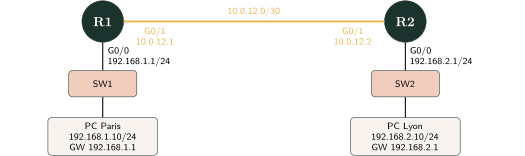
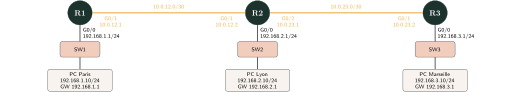
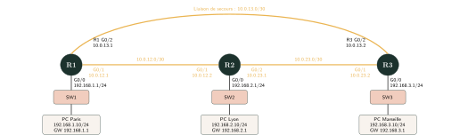

*Plateforme : Cisco Packet Tracer. Matériel : trois routeurs Cisco 2911, trois switches 2960, trois PC, câbles Ethernet. Chaque routeur utilise G0/0 pour le LAN ; les autres interfaces sont précisées sur les schémas.*

**[Télécharger le sujet (PDF)](fichiers/tp-routage-statique-dynamique.pdf)** · **[Télécharger la source LaTeX](fichiers/tp-routage-statique-dynamique.tex)**

**Question directrice :** comment permettre aux routeurs d'apprendre les chemins et de s'adapter aux changements du réseau ?

## Le réseau HexaTech : projet commun

HexaTech possède d'abord deux sites (Paris et Lyon), puis ouvre Marseille. Vous configurerez la même infrastructure tout au long des cinq séances.

| TP | Thème | Durée |
|---|---|---|
| TP 1 | Deux sites, routes statiques | 1 h 30 |
| TP 2 | Troisième site, limites du statique | 1 h 30 |
| TP 3 | Découverte et configuration de RIPv2 | 2 h |
| TP 4 | Redondance et convergence | 1 h 30 |
| TP 5 | Découverte et configuration d'OSPF | 2 h 30 |

**Règle de travail :** enregistrer une copie distincte à chaque séance. Les tests se font d'abord en mode Realtime, puis en mode Simulation lorsque demandé.

## TP 1 — Deux sites doivent communiquer (1 h 30)

::: {.callout-important title="Situation-problème"}
Le bureau de Paris doit échanger des données avec le bureau de Lyon. Chaque LAN fonctionne, mais les deux PC n'arrivent pas à communiquer. Pourquoi ?
:::

{fig-alt="Le routeur R1 (Paris) et le routeur R2 (Lyon) sont reliés par la liaison 10.0.12.0/30 : R1 G0/1 a l'adresse 10.0.12.1 et R2 G0/1 a l'adresse 10.0.12.2. R1 G0/0 (192.168.1.1/24) est relié au switch SW1, lui-même relié à PC Paris (192.168.1.10/24, passerelle 192.168.1.1). R2 G0/0 (192.168.2.1/24) est relié au switch SW2, lui-même relié à PC Lyon (192.168.2.10/24, passerelle 192.168.2.1)."}

**Objectifs :** configurer les interfaces, effectuer des tests de connectivité, consulter la table de routage, créer les routes statiques nécessaires.

### Étape 1 — Construire et adresser

1. Placez deux routeurs 2911, deux switches 2960 et deux PC. Reliez-les comme sur le schéma.
2. Configurez les PC avec leurs adresses, masques et passerelles indiqués sur le schéma.
3. Sur R1, configurez **G0/0** (LAN Paris) et **G0/1** (liaison vers R2). Sur R2, configurez **G0/0** (LAN Lyon) et **G0/1** (liaison vers R1). Activez les quatre interfaces avec `no shutdown`.

```text
enable
configure terminal
interface gigabitEthernet 0/0
 ip address ADRESSE MASQUE
 no shutdown
exit
```

::: {.callout-note title="Question"}
Pourquoi les interfaces G0/0 et G0/1 d'un même routeur n'ont-elles pas des adresses dans le même réseau ?
:::

### Étape 2 — Vérifier les interfaces

Sur les deux routeurs, lancez `show ip interface brief`.

::: {.callout-note title="Question"}
Quels états doivent apparaître dans les colonnes `Status` et `Protocol` pour une liaison opérationnelle ?
:::

### Étape 3 — Constater le problème

Depuis PC Paris, exécutez successivement `ping 192.168.1.1` puis `ping 192.168.2.10`.

::: {.callout-note title="Question"}
Quel test fonctionne ? Formulez une hypothèse expliquant l'échec éventuel de l'autre test.
:::

### Étape 4 — Vérifier l'hypothèse

Sur R1 puis R2, exécutez `show ip route`. Repérez les réseaux précédés de `C` (connecté) et de `L` (adresse locale d'interface).

::: {.callout-note title="Question"}
R1 possède-t-il une route vers `192.168.2.0/24` ? Et R2 vers `192.168.1.0/24` ?
:::

### Étape 5 — Corriger avec des routes statiques

Complétez la commande sur R1 et faites l'équivalent sur R2 : `ip route RESEAU_DESTINATION MASQUE IP_PROCHAIN_SAUT`

::: {.callout-note title="Question"}
Pourquoi faut-il prévoir une route dans chaque sens ?
:::

Refaites le ping entre les PC et consultez `show ip route`.

::: {.callout-note title="Question"}
Quelle lettre distingue maintenant les nouvelles routes dans la table ?
:::

::: {.callout-note title="Synthèse à compléter"}
Une route statique est ……………………………………

Un routeur connaît initialement ……………………………………

Le prochain saut désigne ……………………………………
:::

## TP 2 — L'entreprise ouvre Marseille (1 h 30)

::: {.callout-important title="Situation-problème"}
Un troisième site ouvre à Marseille. Le responsable annonce ensuite vingt nouvelles implantations. La méthode utilisée précédemment pourra-t-elle être conservée sans difficulté ?
:::

{fig-alt="Trois routeurs en chaîne : R1 (Paris), R2 (Lyon) et R3 (Marseille). R1 G0/1 (10.0.12.1) est relié à R2 G0/1 (10.0.12.2) par la liaison 10.0.12.0/30. R2 G0/2 (10.0.23.1) est relié à R3 G0/1 (10.0.23.2) par la liaison 10.0.23.0/30. Chaque routeur a son LAN sur G0/0 via un switch : PC Paris 192.168.1.10/24 derrière R1 (192.168.1.1), PC Lyon 192.168.2.10/24 derrière R2 (192.168.2.1), PC Marseille 192.168.3.10/24 derrière R3 (192.168.3.1)."}

### Étape 1 — Ajouter le troisième site

Reprenez une copie du TP 1. Ajoutez R3, SW3 et PC Marseille. Sur R2, configurez **G0/2** vers R3 ; sur R3, configurez **G0/1** vers R2 et **G0/0** vers son LAN. Attribuez toutes les IP figurant sur le schéma.

::: {.callout-note title="Question"}
Quels nouveaux réseaux apparaissent dans la table de R2 ?
:::

### Étape 2 — Tester avant de configurer les routes

Depuis PC Paris, lancez `ping 192.168.3.10`. Consultez ensuite les tables des trois routeurs.

::: {.callout-note title="Question"}
Quels routeurs ne connaissent pas encore de chemin adapté vers les LAN distants ?
:::

### Étape 3 — Compléter les routes statiques

Ajoutez les routes nécessaires sur R1, R2 et R3, en tenant compte des routes du TP 1. Testez Paris–Marseille, Lyon–Marseille et les trajets retour.

::: {.callout-note title="Question"}
Combien de nouvelles routes avez-vous créées ? Quelles erreurs de configuration seraient possibles ?
:::

### Étape 4 — Prendre du recul

L'entreprise prévoit désormais vingt sites supplémentaires.

::: {.callout-note title="Question"}
Quelles tâches l'administrateur devra-t-il répéter à chaque extension ?
:::

::: {.callout-note title="Question"}
Imaginez un moyen pour que les routeurs apprennent eux-mêmes les réseaux annoncés par leurs voisins.
:::

::: {.callout-note title="Synthèse à compléter"}
La principale limite du routage statique dans un grand réseau est ……………………………………

Nous aurions besoin que les routeurs ……………………………………
:::

## TP 3 — Découvrir et configurer RIPv2 (2 h)

::: {.callout-important title="Situation-problème"}
Le service informatique veut réduire la maintenance manuelle des routes. Comment R1 pourrait-il apprendre le réseau de Marseille grâce aux annonces de R2 ?
:::

*Topologie : identique à celle du TP 2.*

::: {.callout-tip title="Comprendre avant d'agir"}
**Principe :** un routeur peut annoncer à ses voisins les réseaux qu'il sait atteindre. Ceux-ci peuvent utiliser les annonces pour mettre à jour leurs tables de routage. C'est le **routage dynamique**.

**RIP** (Routing Information Protocol) est un protocole de type *vecteur de distance*. Avec RIPv2, les informations annoncées incluent les masques. La métrique RIP est le **nombre de sauts** : une route de métrique 16 est considérée comme inaccessible.
:::

### Étape 1 — Prédire la métrique

R3 possède directement le LAN Marseille. En RIP, R2 peut apprendre ce LAN avec une métrique 1, puis R1 avec une métrique 2.

::: {.callout-note title="Question"}
Pourquoi R1 doit-il envoyer les paquets à R2 pour atteindre Marseille dans cette topologie ?
:::

### Étape 2 — Préparer une expérience correcte

Dupliquez le TP 2. Sur chaque routeur, consultez `show ip route static` puis supprimez uniquement les routes statiques ajoutées lors des TP 1 et 2 : `no ip route RESEAU_DESTINATION MASQUE IP_PROCHAIN_SAUT`

::: {.callout-note title="Question"}
Pourquoi faut-il retirer ces routes avant d'étudier les routes apprises par RIP ?
:::

### Étape 3 — Configurer RIP sur R1, commande par commande

| Commande | Rôle |
|---|---|
| `router rip` | Active le processus RIP. |
| `version 2` | Utilise RIPv2 et ses annonces incluant les masques. |
| `network 192.168.1.0` | Active RIP sur les interfaces du réseau majeur correspondant au LAN Paris. |
| `network 10.0.0.0` | Active RIP sur les interfaces relevant du réseau majeur 10.0.0.0/8. |
| `no auto-summary` | Désactive le résumé automatique aux frontières des réseaux majeurs. |
| `passive-interface gigabitEthernet 0/0` | Empêche les annonces RIP de sortir vers les PC, tout en conservant l'annonce du LAN. |

Sur R1, saisissez :

```text
enable
configure terminal
router rip
 version 2
 network 192.168.1.0
 network 10.0.0.0
 no auto-summary
 passive-interface gigabitEthernet 0/0
```

::: {.callout-warning title="Attention"}
La commande `network` ne crée ni sous-réseau IP ni route statique. Elle désigne les interfaces sur lesquelles fonctionne RIP. Dans Cisco RIP, on utilise les réseaux majeurs, d'où `10.0.0.0` pour les liens en /30.
:::

::: {.callout-note title="Question"}
Pourquoi le LAN Paris est-il annoncé, alors que l'interface G0/0 est passive ?
:::

### Étape 4 — Reproduire en comprenant

Sur R2 puis R3, configurez RIP en adaptant le réseau LAN : `192.168.2.0` puis `192.168.3.0`. Gardez `network 10.0.0.0`, `version 2`, `no auto-summary` et l'interface LAN passive.

::: {.callout-note title="Question"}
Quelles commandes sont identiques sur les trois routeurs ? Lesquelles changent et pourquoi ?
:::

### Étape 5 — Vérifier l'apprentissage

Sur R1, exécutez `show ip protocols` puis `show ip route`. Une sortie attendue après convergence est : `R 192.168.3.0/24 [120/2] via 10.0.12.2`

::: {.callout-note title="Question"}
Interprétez la lettre R, les valeurs 120 et 2, puis l'adresse 10.0.12.2.
:::

Testez le ping de Paris vers Marseille, puis le trajet retour.

### Étape 6 — Voir RIP fonctionner

Dans Packet Tracer, passez en **Simulation**, filtrez les événements **RIP**, avancez jusqu'à voir une annonce (des mises à jour périodiques ont lieu normalement toutes les 30 secondes) et ouvrez le détail d'un PDU. RIPv2 utilise UDP 520 et le multicast 224.0.0.9.

::: {.callout-note title="Question"}
Quelles informations sont transmises ? À quoi servent-elles à un routeur voisin ?
:::

::: {.callout-note title="Synthèse à compléter"}
RIP est un protocole de ……………………………………

Sa métrique est ……………………………………

Une route RIP est signalée par la lettre ……………………………………
:::

## TP 4 — Une liaison tombe en panne (1 h 30)

::: {.callout-important title="Situation-problème"}
Une liaison directe Paris–Marseille est créée pour disposer de plusieurs chemins. Que se passe-t-il si elle tombe en panne ?
:::

{fig-alt="Les trois routeurs R1, R2 et R3 forment un triangle. Liaison R1–R2 : 10.0.12.0/30, R1 G0/1 (10.0.12.1) et R2 G0/1 (10.0.12.2). Liaison R2–R3 : 10.0.23.0/30, R2 G0/2 (10.0.23.1) et R3 G0/1 (10.0.23.2). Liaison de secours directe R1–R3 : 10.0.13.0/30, R1 G0/2 (10.0.13.1) et R3 G0/2 (10.0.13.2). Chaque routeur a son LAN sur G0/0 via un switch : PC Paris 192.168.1.10/24 derrière R1, PC Lyon 192.168.2.10/24 derrière R2, PC Marseille 192.168.3.10/24 derrière R3."}

### Étape 1 — Ajouter le chemin direct

Reprenez le TP 3. Reliez **R1 G0/2** à **R3 G0/2**, configurez leurs IP indiquées sur le schéma, puis lancez `no shutdown`. Les interfaces en 10.0.13.0/30 sont déjà sélectionnées par `network 10.0.0.0` dans RIP.

::: {.callout-note title="Question"}
Combien de chemins physiques permettent maintenant de relier Paris à Marseille ?
:::

### Étape 2 — Observer le trajet normal

Attendez la convergence et, depuis PC Paris, exécutez `tracert 192.168.3.10`.

::: {.callout-note title="Question"}
Quel chemin est utilisé ? Expliquez ce choix à partir de la métrique RIP.
:::

### Étape 3 — Provoquer et observer une panne

Sur R1, désactivez G0/2 : `configure terminal` → `interface gigabitEthernet 0/2` → `shutdown`.

Après convergence, consultez `show ip route` puis relancez le ping et le traceroute.

::: {.callout-note title="Question"}
Par quel routeur les paquets passent-ils maintenant ? La communication est-elle nécessairement ininterrompue pendant la convergence ?
:::

::: {.callout-tip title="Comprendre avant d'agir"}
La **convergence** est le processus par lequel les routeurs prennent connaissance d'un changement et mettent à jour leurs routes. Le routage dynamique ne crée pas de nouvelle liaison : pour contourner une panne, un chemin alternatif doit déjà exister.
:::

### Étape 4 — Rétablir la liaison

Sur R1 G0/2 : `no shutdown`. Attendez la convergence et observez le retour éventuel de la route directe.

::: {.callout-note title="Question"}
Pourquoi le chemin préféré peut-il changer à nouveau ?
:::

::: {.callout-note title="Synthèse à compléter"}
La redondance signifie ……………………………………

La convergence correspond à ……………………………………
:::

## TP 5 — Découvrir et configurer OSPF (2 h 30)

::: {.callout-important title="Situation-problème"}
Le chemin qui passe par le moins de routeurs n'est pas toujours le plus intéressant. Comment choisir selon le coût des liaisons plutôt que selon le seul nombre de sauts ?
:::

*Topologie : identique à celle du TP 4 (triangle R1–R2–R3).*

::: {.callout-tip title="Comprendre avant d'agir"}
**OSPF** signifie *Open Shortest Path First*. C'est un protocole à **état de liens**. Ses routeurs découvrent leurs voisins avec des messages Hello, échangent des informations sur la topologie de leur aire, puis calculent les chemins de coût minimal grâce à SPF (algorithme de Dijkstra). Nous utiliserons une seule aire, **area 0**.
:::

### Étape 1 — Faire une hypothèse avant de configurer

Nous attribuerons les coûts de liaison suivants : R1–R2 : 10 ; R2–R3 : 10 ; R1–R3 : 30.

::: {.callout-note title="Question"}
Comparez le coût du trajet direct R1–R3 et celui du trajet R1–R2–R3. Quel chemin OSPF devrait-il préférer vers Marseille ?
:::

::: {.callout-warning title="Attention"}
Le coût d'une route OSPF comprend également l'interface de sortie vers le LAN destination. Cette partie est identique pour les deux chemins étudiés ; elle ne change donc pas le chemin préféré.
:::

### Étape 2 — Préparer OSPF

Rétablissez toutes les interfaces. Sur chaque routeur, désactivez RIP : `configure terminal` puis `no router rip`.

::: {.callout-note title="Question"}
Pourquoi ne conserverons-nous pas RIP pendant l'expérience OSPF ?
:::

### Étape 3 — Comprendre les commandes OSPF

| Commande | Rôle |
|---|---|
| `router ospf 1` | Active un processus OSPF local identifié par 1 ; ce numéro n'a pas besoin d'être identique sur les voisins. |
| `network 192.168.1.0 0.0.0.255 area 0` | Sélectionne l'interface LAN de R1 et l'associe à l'aire 0. |
| `network 10.0.12.0 0.0.0.3 area 0` | Sélectionne l'interface de R1 vers R2. |
| `network 10.0.13.0 0.0.0.3 area 0` | Sélectionne l'interface de R1 vers R3. |
| `passive-interface gigabitEthernet 0/0` | N'établit pas de voisinage OSPF sur le LAN tout en annonçant celui-ci. |

**Pourquoi un wildcard mask ?** Dans une commande `network` OSPF, le masque générique sert à choisir les interfaces : les bits à 0 doivent correspondre, les bits à 1 sont ignorés. Pour /24 : `255.255.255.255 - 255.255.255.0 = 0.0.0.255` ; pour /30 : `255.255.255.255 - 255.255.255.252 = 0.0.0.3`.

::: {.callout-note title="Question"}
Pourquoi la commande OSPF pour un lien /30 utilise-t-elle 0.0.0.3 plutôt que 255.255.255.252 ?
:::

### Étape 4 — Configurer R1, puis adapter aux autres

```text
router ospf 1
 network 192.168.1.0 0.0.0.255 area 0
 network 10.0.12.0 0.0.0.3 area 0
 network 10.0.13.0 0.0.0.3 area 0
 passive-interface gigabitEthernet 0/0
```

Sur R2 et R3, adaptez les trois lignes `network` aux réseaux de leurs interfaces. Tous les routeurs restent dans l'aire 0, avec G0/0 passive.

::: {.callout-note title="Question"}
Quelles interfaces doivent établir des voisinages OSPF ? Pourquoi pas G0/0 ?
:::

### Étape 5 — Observer les voisins et les routes

Sur R1, lancez `show ip ospf neighbor` puis `show ip route`.

::: {.callout-note title="Question"}
Combien de voisins OSPF R1 découvre-t-il ? Quelle lettre désigne les routes apprises par OSPF ?
:::

**À noter :** Dans une entrée de type `O 192.168.3.0/24 [110/21] via 10.0.12.2`, **110** est la distance administrative Cisco d'OSPF et **21** est la métrique totale. Ce sont deux notions distinctes.

### Étape 6 — Appliquer les coûts

```text
! Sur R1
interface gigabitEthernet 0/1
 ip ospf cost 10
exit
interface gigabitEthernet 0/2
 ip ospf cost 30
```

Sur R2, appliquez 10 sur G0/1 et G0/2. Sur R3, appliquez 10 sur G0/1 et 30 sur G0/2. Laissez les interfaces LAN à leur coût par défaut et vérifiez les coûts avec `show ip ospf interface`.

Après convergence, depuis PC Paris : `tracert 192.168.3.10`.

::: {.callout-note title="Question"}
Quel chemin est choisi ? Le résultat confirme-t-il votre hypothèse de l'étape 1 ?
:::

### Étape 7 — Couper une liaison et analyser

Coupez R1 G0/1 (vers R2), attendez la convergence et répétez `show ip route` et le traceroute. Puis réactivez l'interface.

::: {.callout-note title="Question"}
Quel chemin de secours OSPF utilise-t-il ? Pourquoi ?
:::
