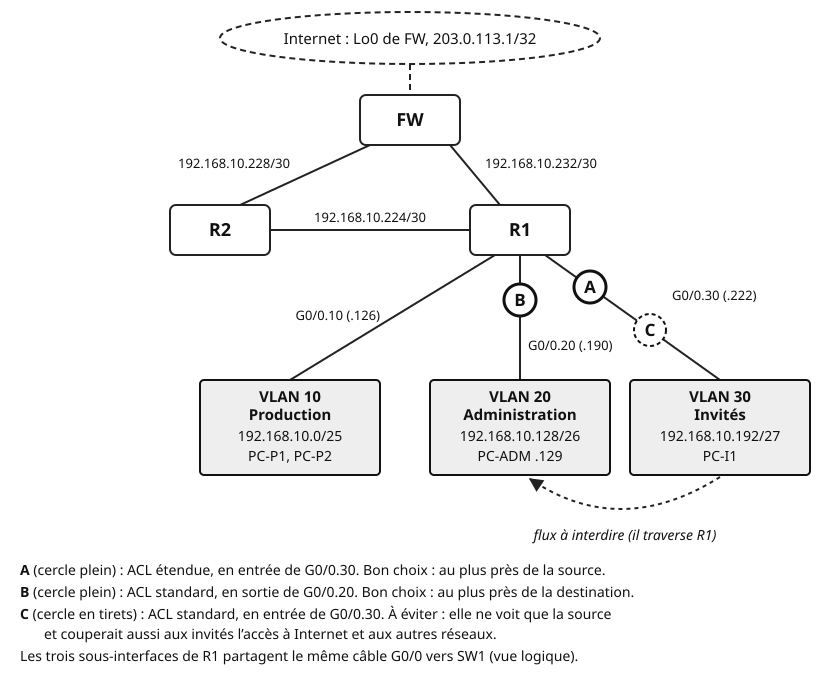
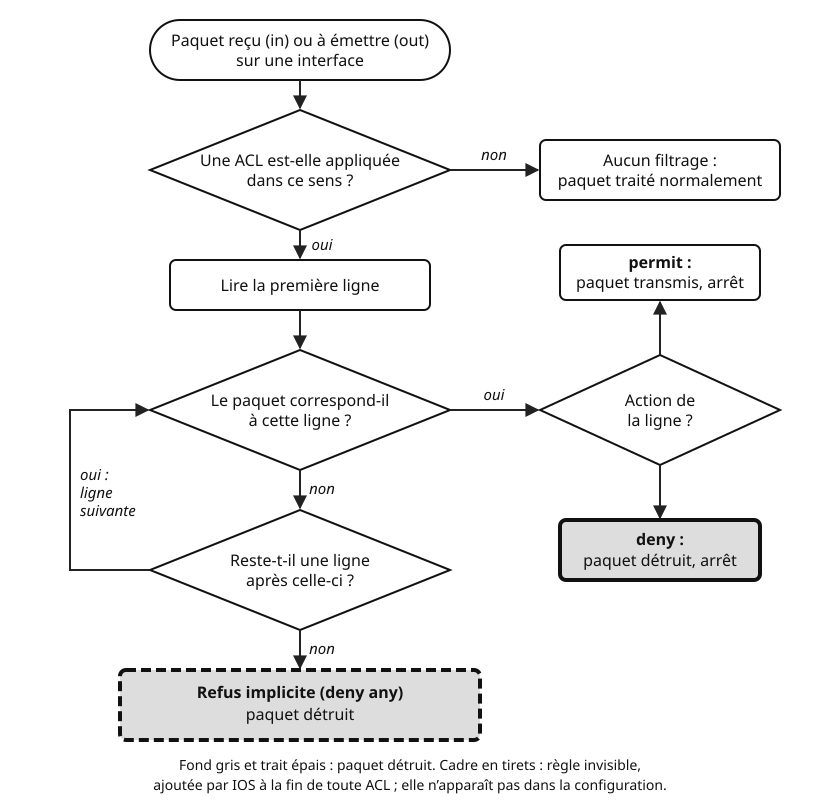
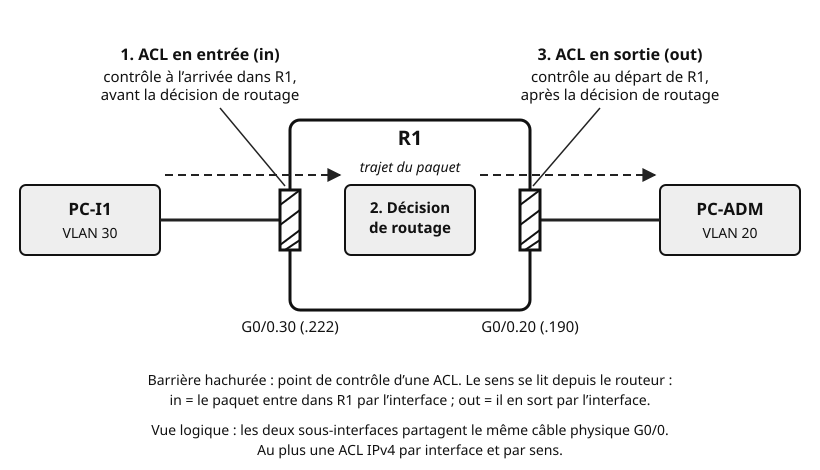

## Objectifs et prérequis

À l'issue du cours, vous saurez dire quels paquets un routeur doit laisser
passer ou détruire. Vous saurez écrire une **liste de contrôle d'accès**
(ACL), l'appliquer au bon endroit, puis vérifier qu'elle fait bien ce que
vous voulez. Vous saurez enfin réserver l'administration d'un routeur à SSH
depuis un seul réseau.

Ce cours relève de deux compétences du référentiel. C06, « Valider un
système informatique », comprend la « sécurisation des réseaux (ACL, mots de
passe, pare-feu) ». C09, « Installer un réseau informatique », comprend
« pare-feu, ACL ». Source : référentiel du BTS CIEL (arrêté du 25 janvier
2023), option A, compétence C06 p. 38 et C09 p. 40, lien dans « Pour aller
plus loin ».

Vous devez connaître le découpage VLSM, le routage inter-VLAN et OSPF. Le
masque générique, vu avec OSPF, revient ici en force. Rappelez-vous aussi le
rôle des ports TCP et UDP.

Les configurations utilisent **Cisco Packet Tracer 9.0.1**, avec des
routeurs **Cisco 2911** sous **IOS 15.1**. Les commandes sont celles d'IOS,
saisies dans l'onglet CLI (interface en ligne de commande) de chaque routeur.

## Situation de départ

Vous reprenez le réseau **fil rouge** des TP 3 et 4. Les routeurs R1, R2 et
le pare-feu FW forment un triangle et échangent leurs routes par OSPF. R1
dessert trois VLAN par des sous-interfaces. La Loopback0 de FW,
`203.0.113.1`, simule un serveur sur Internet.

{fig-alt="Les routeurs R1, R2 et FW forment un triangle. Liaisons : R2–FW 192.168.10.228/30, R1–FW 192.168.10.232/30, R1–R2 192.168.10.224/30. Internet est simulé par la Loopback0 de FW, 203.0.113.1/32. R1 dessert trois VLAN par des sous-interfaces : VLAN 10 Production, 192.168.10.0/25, PC-P1 et PC-P2, par G0/0.10 d'adresse .126 ; VLAN 20 Administration, 192.168.10.128/26, PC-ADM .129, par G0/0.20 d'adresse .190 ; VLAN 30 Invités, 192.168.10.192/27, PC-I1, par G0/0.30 d'adresse .222. Une flèche en tirets va du VLAN 30 au VLAN 20 : c'est le flux à interdire, qui traverse R1. Trois positions sont marquées. A, cercle plein, sur G0/0.30 : ACL étendue en entrée, bon choix, au plus près de la source. B, cercle plein, sur G0/0.20 : ACL standard en sortie, bon choix, au plus près de la destination. C, cercle en tirets, sur G0/0.30 : ACL standard en entrée, à éviter, car elle couperait aussi aux invités l'accès à Internet."}

Le plan d'adressage est celui du TP 3. La passerelle de chaque VLAN est la
dernière adresse utilisable de son réseau.

| Réseau | Sous-réseau | Adresses utiles |
|:---|:---|:---|
| VLAN 10 Production | `192.168.10.0/25` | R1 G0/0.10 : `.126` ; postes en DHCP |
| VLAN 20 Administration | `192.168.10.128/26` | R1 G0/0.20 : `.190` ; PC-ADM : `.129` |
| VLAN 30 Invités (Wi-Fi) | `192.168.10.192/27` | R1 G0/0.30 : `.222` ; postes en DHCP |
| R1–R2 | `192.168.10.224/30` | R1 G0/1 : `.225` ; R2 G0/0 : `.226` |
| R2–FW | `192.168.10.228/30` | R2 G0/1 : `.229` ; FW G0/0 : `.230` |
| R1–FW | `192.168.10.232/30` | R1 G0/2 : `.233` ; FW G0/1 : `.234` |
| Internet simulé | `203.0.113.1/32` | Loopback0 de FW |

Aujourd'hui, un invité branché sur le Wi-Fi peut pinguer PC-ADM. Il pourrait
aussi tenter une connexion à distance sur un routeur. Rien ne l'en empêche :
un routeur achemine tout ce qu'il sait router. Ce cours vous montre comment
lui apprendre à trier.

## Comprendre le mécanisme

### Filtrer des paquets : à quoi ça sert ?

Imaginez l'accueil d'une entreprise. L'agent consulte une liste : « Les
visiteurs vont en salle de réunion, jamais au service comptable. » Il
regarde le badge de chaque personne, puis la laisse passer ou non.

Un routeur peut jouer ce rôle. Pour chaque paquet, il lit l'en-tête : adresse
source, adresse destination, protocole, ports. Il compare ces champs à une
liste de règles, puis transmet ou détruit le paquet. C'est le **filtrage de
paquets**. La liste de règles s'appelle une **ACL** (*Access Control List*,
liste de contrôle d'accès).

Chaque ligne d'une ACL est une **entrée de contrôle d'accès** (ACE). Elle
contient une action, `permit` (autoriser) ou `deny` (refuser), et des
critères de correspondance.

Une ACL de routeur fait un **filtrage sans état** (*stateless*). Elle examine
chaque paquet seul, sans mémoire des paquets précédents. Elle ne sait pas
qu'une réponse fait suite à une demande autorisée.

| Critère | Filtrage sans état (ACL) | Pare-feu à états |
|:---|:---|:---|
| Ce qui est examiné | chaque paquet, isolément | chaque paquet, replacé dans sa connexion |
| Mémoire | aucune | table des connexions en cours |
| Réponses à une demande | à autoriser par une règle explicite | autorisées automatiquement |
| Exemple d'équipement | routeur Cisco 2911 | pare-feu Cisco ASA |

Le pare-feu à états sera étudié au chapitre 06, avec la DMZ (zone
démilitarisée : réseau intermédiaire qui héberge les serveurs joignables
depuis Internet). Il s'appuiera sur un pare-feu dédié, le Cisco ASA de
Packet Tracer. Les ACL restent utiles en complément : elles filtrent au plus près des
utilisateurs, sur chaque routeur.

::: {.callout-note}
## Les ACL servent aussi à sélectionner du trafic

Une ACL ne sert pas qu'à filtrer. Elle peut aussi **désigner** un ensemble
d'adresses pour une autre fonction. Au chapitre 05, une ACL indiquera par
exemple quelles adresses internes la traduction d'adresses (NAT) doit
traduire. Dans ce cas, `deny` signifie « ne pas sélectionner », et non
« détruire ».
:::

### Comment le routeur lit une ACL

Prenez cette liste, appliquée aux paquets qui arrivent du VLAN 30 :

```text
! Packet Tracer, R1 (2911, IOS 15.1) : exemple de liste, lecture seule
10 deny   192.168.10.200
20 permit 192.168.10.192 0.0.0.31
```

Un paquet part de `192.168.10.200`. La ligne 10 correspond : il est
détruit. La ligne 20 n'est jamais lue pour lui. Un paquet part de
`192.168.10.201` : la ligne 10 ne correspond pas, la ligne 20 oui. Il passe.

Le routeur applique donc trois règles :

1. il lit la liste **de haut en bas**, dans l'ordre des numéros ;
2. il s'arrête à la **première ligne qui correspond** et applique son
   action ;
3. si aucune ligne ne correspond, le paquet est détruit : c'est le **refus
   implicite** (*implicit deny*).

Le refus implicite est une ligne invisible, placée par IOS à la fin de
toute ACL. Elle vaut `deny any` dans une ACL standard et `deny ip any any`
dans une ACL étendue. Elle n'apparaît ni dans la configuration ni dans
`show access-lists`.

{fig-alt="Organigramme. Un paquet est reçu en entrée ou va être émis en sortie sur une interface. Question : une ACL est-elle appliquée dans ce sens ? Non : aucun filtrage, le paquet est traité normalement. Oui : le routeur lit la première ligne. Question : le paquet correspond-il à cette ligne ? Oui : question sur l'action de la ligne ; permit, le paquet est transmis et la lecture s'arrête ; deny, le paquet est détruit et la lecture s'arrête. Non : question, reste-t-il une ligne après celle-ci ? Oui : le routeur passe à la ligne suivante et repose la question de correspondance. Non : refus implicite, deny any, le paquet est détruit. Les cases où le paquet est détruit ont un fond gris et un trait épais ; le refus implicite a un cadre en tirets, car c'est une règle invisible."}

Deux conséquences découlent de ces règles.

- **Une ACL sans aucun `permit` bloque tout.** Prenez une liste réduite à
  `deny host 192.168.10.200`. Le refus implicite détruit aussi tous les
  autres paquets.
- **L'ordre des lignes compte.** Placez les règles **de la plus précise à la
  plus générale**. Une règle générale placée trop haut masque les règles
  précises situées dessous.

Dans l'exemple, inversez les deux lignes. Le `permit` du /27 passe en
premier : il correspond aussi à `192.168.10.200`, qui n'est plus jamais
refusé.

::: {.callout-note}
## À retenir

- Lecture **de haut en bas**, arrêt à la **première correspondance**.
- À la fin, un **refus implicite** invisible détruit tout le reste.
- Toute ACL de filtrage contient donc au moins un `permit`.
- Règles **précises en haut**, règles générales en bas.
:::

### Le masque générique

Pour dire « tout le VLAN 30 » dans une règle, il faut désigner une plage
d'adresses. Les ACL utilisent pour cela le **masque générique**
(*wildcard*), déjà rencontré avec l'instruction `network` d'OSPF.

Un bit à 0 impose l'égalité avec l'adresse donnée. Un bit à 1 accepte
n'importe quelle valeur. Pour un sous-réseau, le calcul reste le même :

**masque générique = 255.255.255.255 − masque**

Détaillez le VLAN 30, en `/27`. Le masque vaut `255.255.255.224`. Le masque
générique vaut donc `0.0.0.31`. En binaire, le dernier octet s'écrit
`00011111` : les 3 premiers bits sont figés, les 5 derniers sont libres.
L'entrée `192.168.10.192 0.0.0.31` couvre de `.192` à `.192 + 31 = .223`.

| Réseau du fil rouge | Masque | Masque générique | Adresses couvertes |
|:---|:---|:---|:---|
| VLAN 10, `192.168.10.0/25` | `255.255.255.128` | `0.0.0.127` | `.0` à `.127` |
| VLAN 20, `192.168.10.128/26` | `255.255.255.192` | `0.0.0.63` | `.128` à `.191` |
| VLAN 30, `192.168.10.192/27` | `255.255.255.224` | `0.0.0.31` | `.192` à `.223` |
| R1–R2, `192.168.10.224/30` | `255.255.255.252` | `0.0.0.3` | `.224` à `.227` |
| tout le site, `192.168.10.0/24` | `255.255.255.0` | `0.0.0.255` | `.0` à `.255` |

Deux mots-clés abrègent les cas extrêmes :

| Mot-clé | Équivaut à | Désigne |
|:---|:---|:---|
| `host 192.168.10.129` | `192.168.10.129 0.0.0.0` | une seule adresse |
| `any` | `0.0.0.0 255.255.255.255` | toutes les adresses |

::: {.callout-warning}
## Masque générique, pas masque de sous-réseau

Écrire `192.168.10.192 255.255.255.224` dans une ACL est une erreur
fréquente. IOS lit `255.255.255.224` comme un masque générique : presque
tous les bits deviennent libres. La règle couvre alors bien plus d'adresses
que prévu.
:::

### ACL standard et ACL étendues

Vous voulez empêcher les invités de joindre l'administration, mais les
laisser aller sur Internet. Le critère « source = VLAN 30 » ne suffit pas :
il faut aussi regarder la destination. Les deux familles d'ACL se
distinguent justement par les champs qu'elles examinent.

| | ACL standard | ACL étendue |
|:---|:---|:---|
| Numéros (Packet Tracer) | 1 à 99 | 100 à 199 |
| Champs examinés | adresse **source** seulement | protocole, source, destination, ports |
| Précision | faible | fine : un service vers un hôte |
| Placement conseillé | près de la destination | près de la source |

**ACL standard.** Elle ne regarde que l'adresse source du paquet. Voici sa
syntaxe en mode de configuration globale :

```text
! Packet Tracer, IOS 15.1 : syntaxe d'une ACL standard numérotée
access-list 20 remark Invites interdits vers Administration
! remark : commentaire, sans effet sur le filtrage
access-list 20 deny 192.168.10.192 0.0.0.31
! refuse toute source du VLAN 30
access-list 20 permit any
! autorise toutes les autres sources
```

Chaque commande `access-list 20` ajoute une ligne **à la fin** de la
liste 20.

**ACL étendue.** Elle examine aussi le protocole, la destination et, pour
TCP ou UDP, les ports. Sa syntaxe générale est la suivante :

```text
! Packet Tracer, IOS 15.1 : forme générale d'une ligne d'ACL étendue
access-list 1xx {permit|deny} protocole source [port] destination [port]
! protocole : ip, icmp, tcp, udp, ospf…
! source et destination : adresse + masque générique, host A.B.C.D ou any
! port (tcp et udp seulement) : eq, neq, gt, lt ou range,
! suivi d'un numéro (deux numéros pour range)
```

Le mot-clé `ip` désigne tous les paquets IPv4, quel que soit le protocole
transporté. Pour TCP et UDP, l'opérateur suit l'adresse qu'il qualifie.
Après la source, il porte sur le port source. Après la destination, il
porte sur le port destination.

| Opérateur | Sens | Exemple |
|:---|:---|:---|
| `eq` | égal à | `eq 443` |
| `neq` | différent de | `neq 23` |
| `gt` / `lt` | plus grand / plus petit que | `gt 1023` |
| `range` | dans l'intervalle | `range 20 21` |

Dans Packet Tracer, écrivez les ports **en chiffres**. Voici ceux dont vous
aurez besoin :

| Service | Protocole | Port |
|:---|:-:|:-:|
| HTTP | TCP | 80 |
| HTTPS | TCP | 443 |
| SSH | TCP | 22 |
| Telnet | TCP | 23 |
| DNS | UDP (et TCP) | 53 |
| DHCP, côté serveur / côté client | UDP | 67 / 68 |

Pour ICMP, vous pouvez préciser le type de message : `echo` pour la requête
du ping, `echo-reply` pour sa réponse.

```text
! Packet Tracer, IOS 15.1 : exemples de lignes d'ACL étendue
access-list 110 permit tcp 192.168.10.192 0.0.0.31 any eq 443
! les invités peuvent ouvrir des connexions HTTPS vers toute destination
access-list 110 deny icmp any host 192.168.10.129 echo
! personne ne peut envoyer de requête ping à PC-ADM
access-list 110 permit ospf any any
! laisse passer les paquets OSPF (protocole IP 89)
```

### ACL nommées et numéros de séquence

Une liste numérotée `110` ne dit rien de son rôle. Six mois plus tard, qui
se souvient de son but ? Une **ACL nommée** porte un nom choisi par vous,
par exemple `INVITES-IN`. Elle se configure dans un mode dédié.

```text
! Packet Tracer, R1 (2911, IOS 15.1), mode de configuration globale
ip access-list extended INVITES-IN
! crée la liste étendue INVITES-IN et entre dans son mode
 remark Invites : pas d'acces aux VLAN 10 et 20
 deny ip 192.168.10.192 0.0.0.31 192.168.10.128 0.0.0.63
 deny ip 192.168.10.192 0.0.0.31 192.168.10.0 0.0.0.127
 permit ip 192.168.10.192 0.0.0.31 any
```

Le même mode existe pour une liste standard : `ip access-list standard NOM`.
Il accepte aussi un numéro à la place du nom, par exemple
`ip access-list standard 20`.

IOS numérote chaque ligne : 10, 20, 30, et ainsi de suite. Ces **numéros de
séquence** servent à modifier la liste sans tout retaper. Dans le mode de la
liste, vous pouvez :

- **insérer** une ligne entre deux autres, en tapant son numéro devant ;
- **supprimer** une seule ligne avec `no` suivi de son numéro.

```text
! Packet Tracer, R1, mode de configuration globale
ip access-list extended INVITES-IN
 5 permit udp host 0.0.0.0 eq 68 host 255.255.255.255 eq 67
! insère une ligne avant la ligne 10 (rôle expliqué plus bas)
 no 20
! supprime la ligne 20 : les invités pourraient alors joindre le VLAN 10
```

L'écart de 10 entre deux numéros laisse de la place pour ces insertions.

::: {.callout-warning}
## `no access-list` efface toute la liste

En mode de configuration globale, `no access-list 20` supprime **toute** la
liste 20, pas une seule ligne. Pour retirer une ligne, passez par
`ip access-list standard 20`, puis `no` suivi du numéro de séquence.
:::

### Appliquer une ACL à une interface

Écrire une ACL ne suffit pas : tant qu'elle n'est attachée à aucune
interface, elle ne filtre rien. La commande `ip access-group` l'attache, en
précisant un **sens**.

```text
! Packet Tracer, R1, mode de configuration globale
interface GigabitEthernet0/0.30
 ip access-group INVITES-IN in
! contrôle les paquets qui ENTRENT dans R1 par G0/0.30
```

Le sens se lit **depuis le routeur** :

- `in` : le paquet entre dans le routeur par cette interface ; il est
  contrôlé **avant** la décision de routage ;
- `out` : le paquet sort du routeur par cette interface ; il est contrôlé
  **après** la décision de routage.

{fig-alt="Un paquet va de PC-I1, dans le VLAN 30, à PC-ADM, dans le VLAN 20. Il entre dans le routeur R1 par la sous-interface G0/0.30, d'adresse .222. Premier point de contrôle, une barrière hachurée : ACL en entrée, in, contrôlée à l'arrivée dans R1, avant la décision de routage. Deuxième étape, au centre du routeur : la décision de routage. Troisième étape, une autre barrière hachurée sur G0/0.20, d'adresse .190 : ACL en sortie, out, contrôlée au départ de R1, après la décision de routage. Le paquet rejoint alors PC-ADM. Note : vue logique, les deux sous-interfaces partagent le même câble physique G0/0. Au plus une ACL IPv4 par interface et par sens."}

Une interface accepte **une ACL par sens et par protocole** : une ACL IPv4
en entrée et une ACL IPv4 en sortie, au plus. Une nouvelle commande
`ip access-group` dans le même sens remplace la précédente.

Une ACL en entrée filtre aussi les paquets destinés au routeur lui-même,
comme les Hello OSPF ou une connexion SSH. En revanche, sur IOS, une ACL en
sortie ne filtre pas les paquets que le routeur émet lui-même.

### Où placer une ACL ?

Revenez au flux à interdire : du VLAN 30 vers le VLAN 20. Trois positions
sont dessinées sur le schéma du début.

**ACL étendue : au plus près de la source.** Position A, en entrée de
G0/0.30. L'ACL étendue connaît la source **et** la destination. Elle peut
donc détruire les paquets des invités vers l'administration, et seulement
ceux-là. En la plaçant près de la source, vous détruisez ces paquets dès
leur arrivée. Ils ne consomment ni la décision de routage ni la bande
passante des autres liens.

**ACL standard : au plus près de la destination.** Position B, en sortie de
G0/0.20. L'ACL standard ne voit que la source. Placée en sortie vers le
VLAN 20, elle ne touche que le trafic destiné à l'administration. Les
invités gardent l'accès à Internet et au VLAN 10.

**Position C, à éviter.** Une ACL standard en entrée de G0/0.30 refuserait
la source « VLAN 30 » pour **toutes** les destinations. Les invités
perdraient Internet, ce qui n'était pas demandé.

```text
! Packet Tracer, R1 : solution B, ACL standard près de la destination
access-list 20 remark Invites interdits vers Administration
access-list 20 deny 192.168.10.192 0.0.0.31
access-list 20 permit any
interface GigabitEthernet0/0.20
 ip access-group 20 out
```

Les solutions A et B atteignent le même but. Choisissez l'une **ou**
l'autre. La suite du cours retient A, plus précise et plus économe.

::: {.callout-tip}
## Écrivez l'ACL avant de l'appliquer

Appliquez une ACL une fois complète. Si vous l'appliquez vide, puis tapez
ses lignes une à une, le refus implicite agit dès la première ligne. Sur
une interface d'administration, vous pouvez ainsi couper votre propre
accès.
:::

### Filtrage sans état : attention aux réponses

Une fois l'ACL `INVITES-IN` appliquée, PC-ADM pingue PC-I1. La requête
`echo` part de `.129` vers le VLAN 30 : elle n'entre pas par G0/0.30 et
passe. La réponse `echo-reply` revient de PC-I1 vers `.129`. Elle entre
dans R1 par G0/0.30 et correspond à la première ligne `deny`. Elle est
détruite, et le ping échoue.

L'ACL ne sait pas que cette réponse suit une requête autorisée. **Bloquer
le sens retour casse donc aussi la communication dans l'autre sens.** Pour
chaque flux autorisé, pensez au paquet aller **et** au paquet retour.

IOS réel propose le mot-clé `established`. Il teste seulement la présence
des bits ACK ou RST dans l'en-tête TCP, sans rien mémoriser : un segment
fabriqué avec ces bits passe. Il n'est pas documenté dans Packet Tracer, et
ce cours ne l'utilise pas. Le pare-feu à états du chapitre 06, lui,
mémorise les connexions.

### Protéger l'accès d'administration

Un administrateur se connecte à distance aux routeurs, depuis son poste.
Il ouvre une session sur une **ligne virtuelle** (VTY) du routeur. Deux
protocoles existent :

| Protocole | Port | Contenu de la session | À utiliser ? |
|:---|:-:|:---|:---|
| Telnet | TCP 23 | en clair, mot de passe compris | non : toute capture le révèle |
| SSH version 2 | TCP 22 | chiffré | oui |

Sur le réseau fil rouge, un invité qui capture le trafic lirait un mot de
passe Telnet en clair. SSH chiffre toute la session, authentification
comprise.

Deux protections se complètent :

- `transport input ssh` n'accepte que SSH sur les lignes VTY ;
- `access-class` applique une ACL standard aux **lignes VTY**, et non à une
  interface : seules les sources autorisées peuvent ouvrir une session.

`access-class` agit quelle que soit l'interface d'arrivée. Une seule
commande protège donc toutes les adresses du routeur.

## Observer et appliquer

### Filtrer les invités sur R1

**Plateforme : Cisco Packet Tracer 9.0.1, routeur 2911, IOS 15.1.** Vous
partez du réseau du
[TP 4 — Router le fil rouge avec OSPF](../../03-routage-dynamique/tp-ospf/index.qmd).
OSPF fonctionne et tous les pings de la matrice de recette de ce TP
réussissent.

Les blocs de la partie « Comprendre le mécanisme »
étaient des exemples : partez d'un R1 sans aucune ACL.

Objectif : le VLAN 30 ne joint ni le VLAN 20 ni le VLAN 10. Il garde
l'accès à Internet et continue de recevoir son adresse par DHCP.

Le DHCP mérite une ligne à part. Un poste qui démarre n'a pas encore
d'adresse. Sa demande DHCP part de `0.0.0.0`, port UDP 68, vers
`255.255.255.255`, port UDP 67. Cette source n'est pas dans le VLAN 30 : sans
règle dédiée, le refus implicite la détruirait.

La ligne DHCP vise exactement ce cas : de `host 0.0.0.0` vers
`host 255.255.255.255`. Elle suffit. Une fois l'adresse obtenue, le poste
renouvelle son bail depuis sa propre adresse du VLAN 30. Ce renouvellement
est couvert par la dernière ligne de la liste.

```text
! Packet Tracer, R1 (2911, IOS 15.1), mode de configuration globale
ip access-list extended INVITES-IN
 remark DHCP : demandes des postes sans adresse
 permit udp host 0.0.0.0 eq 68 host 255.255.255.255 eq 67
 remark Invites : pas d'acces aux VLAN internes
 deny ip 192.168.10.192 0.0.0.31 192.168.10.128 0.0.0.63
 deny ip 192.168.10.192 0.0.0.31 192.168.10.0 0.0.0.127
 remark Invites : tout le reste est autorise
 permit ip 192.168.10.192 0.0.0.31 any
interface GigabitEthernet0/0.30
 ip access-group INVITES-IN in
```

La dernière ligne n'autorise que les sources du VLAN 30. Un paquet dont la
source est usurpée est détruit par le refus implicite. Seule exception,
une demande DHCP de `0.0.0.0` vers la diffusion : le routeur ne la transmet
à aucun autre réseau.

G0/0.30 est une interface passive OSPF : aucun Hello n'y circule. Cette ACL
n'a donc pas besoin de règle pour OSPF.

**Tests**, depuis le *Command Prompt* des PC :

| Source | Commande | Résultat attendu | Ligne de l'ACL en cause |
|:---|:---|:---|:---|
| PC-I1 | `ping 192.168.10.129` (PC-ADM) | échec | `deny` vers le VLAN 20 |
| PC-I1 | `ping 192.168.10.126` (passerelle du VLAN 10) | échec | `deny` vers le VLAN 10 |
| PC-I1 | `ping 203.0.113.1` | succès | `permit ip … any` |
| PC-ADM | `ping` vers PC-I1 | échec | la réponse est refusée au retour |
| PC-P1 | `ping 192.168.10.129` | succès | trafic hors de G0/0.30 : non filtré |

Pour tester la ligne DHCP, passez PC-I1 en adressage statique, puis de
nouveau en DHCP, dans *Desktop*, *IP Configuration*. Il doit retrouver une
adresse du VLAN 30.

### Lire les compteurs

Les commandes suivantes se tapent en mode privilégié (`R1#`). La sortie est
une **sortie type**. Sa mise en forme exacte peut varier selon la version
de Packet Tracer. Les compteurs dépendent de vos tests.

```text
R1# show access-lists
Extended IP access list INVITES-IN
    10 permit udp host 0.0.0.0 eq 68 host 255.255.255.255 eq 67 (2 match(es))
    20 deny ip 192.168.10.192 0.0.0.31 192.168.10.128 0.0.0.63 (4 match(es))
    30 deny ip 192.168.10.192 0.0.0.31 192.168.10.0 0.0.0.127 (4 match(es))
    40 permit ip 192.168.10.192 0.0.0.31 any (8 match(es))
```

Les ports sont ici écrits en chiffres. Votre écran peut afficher leur nom à
la place, par exemple `bootpc` pour 68 et `bootps` pour 67. Cet affichage ne change pas
le filtrage.

- Chaque ligne affiche son **numéro de séquence**, attribué de 10 en 10.
- Les `remark` n'y figurent pas : ils ne sont visibles que dans
  `show running-config`.
- Le nombre entre parenthèses compte les paquets qui ont **correspondu** à
  la ligne. Un compteur à 0 ne prouve une erreur que si le test a produit un paquet
  visé par la ligne. Un test HTTP, par exemple, ne sollicite pas une règle
  DNS. Si le test était adapté, la ligne est mal écrite, mal placée ou
  masquée par une ligne plus haute.
- Le refus implicite n'apparaît pas, et ses paquets ne sont pas comptés ici.

Pour repartir de zéro avant un test, remettez les compteurs à 0 :

```text
R1# clear access-list counters INVITES-IN
! sans nom ni numéro : remet à zéro les compteurs de toutes les ACL
```

### Vérifier où l'ACL est appliquée

`show access-lists` montre le contenu d'une liste, pas son emplacement.
Deux commandes répondent à la question « où est-elle appliquée ? ».

`show running-config` affiche la ligne `ip access-group INVITES-IN in` sous
`interface GigabitEthernet0/0.30`. `show ip interface` détaille une
interface. Voici un **extrait type**, à confirmer dans votre Packet Tracer :

```text
R1# show ip interface GigabitEthernet0/0.30
GigabitEthernet0/0.30 is up, line protocol is up
  Internet address is 192.168.10.222/27
  Outgoing access list is not set
  Inbound  access list is INVITES-IN
```

Repérez les deux lignes `access list` : une par sens. `not set` signifie
qu'aucune ACL n'est appliquée dans ce sens.

| Commande (mode privilégié) | Ce qu'elle permet de vérifier |
|:---|:---|
| `show access-lists` | contenu de toutes les ACL, numéros de séquence, compteurs |
| `show ip access-lists` | même chose, limitée aux ACL IPv4 |
| `show access-lists INVITES-IN` | une seule liste, par son nom ou son numéro |
| `show ip interface G0/0.30` | ACL appliquée en entrée et en sortie |
| `show running-config` | lignes `remark`, `ip access-group`, `access-class` |
| `clear access-list counters` | remise à zéro des compteurs avant un test |

### Réserver l'administration de R1 à SSH depuis le VLAN 20

**Plateforme : Cisco Packet Tracer 9.0.1, routeur 2911, IOS 15.1.**

SSH a besoin d'une paire de clés RSA. RSA est un algorithme de
chiffrement asymétrique : il fournit au routeur sa paire de clés, publique
et privée. Le routeur la nomme d'après son nom
d'hôte et son nom de domaine : ces deux réglages viennent donc d'abord.

```text
! Packet Tracer, R1 (2911, IOS 15.1), mode de configuration globale
hostname R1
ip domain-name fil-rouge.example
! nom de domaine fictif, nécessaire à la génération des clés
crypto key generate rsa general-keys modulus 2048
! paire de clés RSA ; 1024 bits au moins recommandé, 2048 conseillé
ip ssh version 2
! refuse l'ancienne version 1 du protocole
username admin secret Ch4ngez-Moi
! compte local ; secret enregistre le mot de passe sous forme hachée
enable secret Ch4ngez-Moi-Aussi
! protège le mode privilégié
access-list 10 remark Administration a distance depuis le VLAN 20
access-list 10 permit 192.168.10.128 0.0.0.63
! refus implicite pour toutes les autres sources
line vty 0 4
 transport input ssh
! Telnet refusé, SSH seul accepté
 login local
! authentification par les comptes définis avec username
 access-class 10 in
! seules les sources autorisées par l'ACL 10 ouvrent une session
```

Choisissez évidemment vos propres mots de passe. Si `show running-config`
affiche aussi `line vty 5 15`, protégez ces lignes de la même façon.

`show ip ssh` indique si SSH est activé et quelle version est utilisée.

**Tests**, depuis le *Command Prompt* :

1. Sur PC-ADM : `ssh -l admin 192.168.10.190`. Le mot de passe est demandé,
   puis l'invite `R1>` apparaît.
2. Sur PC-P1 : `ssh -l admin 192.168.10.126`. La connexion est refusée.
   L'adresse de PC-P1, dans `192.168.10.0/25`, n'est pas couverte par
   `192.168.10.128 0.0.0.63`.
3. Sur PC-ADM : `telnet 192.168.10.190`. La connexion est refusée :
   `transport input ssh` n'accepte plus Telnet.

Le test 1 vise l'adresse de R1 dans le VLAN 20. Avec `access-class`, viser
une autre adresse de R1 donnerait le même résultat.

### Une ACL qui coupe OSPF

**Plateforme : Cisco Packet Tracer 9.0.1, routeur 2911, IOS 15.1.**

Vous voulez empêcher Internet de pinguer les postes du site. Sur R1, vous
écrivez cette liste pour l'entrée de G0/2, la liaison vers FW :

```text
! Packet Tracer, R1 : version FAUTIVE, à ne pas garder
ip access-list extended DEPUIS-FW
 deny icmp host 203.0.113.1 192.168.10.0 0.0.0.255 echo
 permit tcp any any
 permit udp any any
 permit icmp any any
interface GigabitEthernet0/2
 ip access-group DEPUIS-FW in
```

Pendant quelques secondes, au plus 40, rien ne change. Puis un message
`%OSPF-5-ADJCHG` signale que le voisin FW est perdu.

Que s'est-il passé ? Les Hello de FW arrivent sur R1 G0/2. Ce sont des
paquets IP de protocole 89 : ni TCP, ni UDP, ni ICMP. Aucune ligne ne
correspond : le refus implicite les détruit. Au bout de l'intervalle Dead,
40 s, R1 déclare FW perdu. Le trafic passe alors par R2, sans erreur
visible pour les utilisateurs.

La correction : insérer une ligne qui autorise OSPF, avant toute autre.

```text
! Packet Tracer, R1, mode de configuration globale
ip access-list extended DEPUIS-FW
 5 permit ospf host 192.168.10.234 any
! Hello et mises à jour OSPF envoyés par FW G0/1
```

`show ip ospf neighbor` doit de nouveau montrer FW à l'état `FULL`.

Cette liste reste d'ailleurs incomplète. Les paquets venus d'Internet
peuvent aussi arriver par R2, sur R1 G0/1. Le bon endroit pour filtrer
Internet est le pare-feu, au chapitre 06.

::: {.callout-warning}
## Toute ACL en entrée sur une liaison OSPF doit autoriser OSPF

Une ACL en entrée filtre aussi les paquets destinés au routeur. Sur une
liaison entre routeurs, prévoyez toujours une ligne qui laisse passer
OSPF : `permit ospf`, ou un `permit ip` qui le couvre. Sur le
fil rouge, cela concerne G0/1 et G0/2 de R1, les deux interfaces de R2 et
G0/0 et G0/1 de FW.
:::

### Les erreurs classiques

| Symptôme | Cause probable | Commande qui la révèle |
|:---|:---|:---|
| Le filtrage n'a aucun effet | ACL appliquée dans le mauvais sens ou sur la mauvaise interface | `show ip interface`, `show running-config` |
| Tout est bloqué | aucun `permit` : seul le refus implicite agit | `show access-lists` |
| Une règle `deny` ne bloque rien | une ligne plus générale, placée au-dessus, correspond d'abord | `show access-lists` : compteur à 0 |
| Le filtrage n'a aucun effet, l'ACL semble appliquée | `ip access-group` cite un nom ou un numéro qui n'existe pas | `show ip interface` puis `show access-lists` |
| Un voisin OSPF disparaît après 40 s | ACL en entrée sans `permit ospf` | `show ip ospf neighbor` |
| Un flux autorisé échoue | le paquet retour est refusé : filtrage sans état | `show access-lists` côté retour |
| Les nouveaux postes n'ont plus d'adresse | ACL en entrée sans règle pour DHCP | `show access-lists`, `show ip dhcp binding` |

Le cas de l'ACL inexistante est piégeux. IOS accepte la commande
`ip access-group` sans vérifier que la liste existe. Une ACL inexistante ne
filtre rien : vous croyez être protégé, et tout passe. Dès que vous créez la
liste, elle s'applique avec son refus implicite.

### Vérifier sa compréhension

::: {.content-visible when-format="html"}
<details>
<summary>Une ACL appliquée en entrée ne contient que la ligne deny host 192.168.10.200. Que devient un paquet venu de 192.168.10.201 ?</summary>
<p>Il est détruit. La ligne deny ne lui correspond pas ; il atteint donc la fin de la liste, où le refus implicite le détruit. Sans aucun permit, cette ACL bloque tout.</p>
</details>

<details>
<summary>Avec INVITES-IN en entrée de G0/0.30, pourquoi PC-ADM ne peut-il plus pinguer PC-I1, alors que l'ACL ne filtre pas les paquets vers le VLAN 30 ?</summary>
<p>La requête echo passe. Mais la réponse echo-reply part de PC-I1 vers 192.168.10.129 : elle entre dans R1 par G0/0.30 et correspond à la ligne deny vers le VLAN 20. L'ACL est sans état : elle ne sait pas que ce paquet répond à une requête autorisée.</p>
</details>
:::

::: {.content-visible unless-format="html"}
**Question 1.** Une ACL appliquée en entrée ne contient que la ligne
`deny host 192.168.10.200`. Que devient un paquet venu de
`192.168.10.201` ?

**Réponse.** Il est détruit. La ligne `deny` ne lui correspond pas ; il
atteint donc la fin de la liste, où le refus implicite le détruit. Sans
aucun `permit`, cette ACL bloque tout.

**Question 2.** Avec `INVITES-IN` en entrée de G0/0.30, pourquoi PC-ADM ne
peut-il plus pinguer PC-I1, alors que l'ACL ne filtre pas les paquets vers
le VLAN 30 ?

**Réponse.** La requête `echo` passe. Mais la réponse `echo-reply` part de
PC-I1 vers `192.168.10.129` : elle entre dans R1 par G0/0.30 et correspond à
la ligne `deny` vers le VLAN 20. L'ACL est sans état : elle ne sait pas que
ce paquet répond à une requête autorisée.
:::

## Exercices de vérification

1. **Masque générique.** Donnez le masque générique, puis la première et la
   dernière adresse couvertes :

   a. `192.168.10.228/30` ;
   b. `10.1.0.0/16` ;
   c. `172.16.4.0/22`.

   Puis répondez :

   d. Écrivez de deux façons une entrée qui désigne seulement PC-ADM.
   e. L'adresse `192.168.10.200` correspond-elle à
      `192.168.10.192 0.0.0.31` ? Et `192.168.10.224` ? Justifiez.
2. **Ordre des lignes.** Un collègue applique cette liste en entrée de R1
   G0/0.30 :

   ```text
   ip access-list extended TEST
    10 permit ip 192.168.10.192 0.0.0.31 any
    20 deny ip 192.168.10.192 0.0.0.31 192.168.10.128 0.0.0.63
   ```

   a. PC-I1 peut-il joindre PC-ADM ? Justifiez avec le traitement de la
      liste.
   b. Que montrera le compteur de la ligne 20 après vos tests ?
   c. Corrigez la liste sans la retaper entièrement : donnez les commandes.
   d. Un paquet de source usurpée `192.168.10.5` entre par G0/0.30. Que
      devient-il ?
3. **Écrire une ACL étendue.** La direction durcit la règle. Les invités
   n'auront plus que le web (HTTP et HTTPS) et le DNS par UDP. Ces
   services ne seront permis que vers Internet. Ils doivent toujours obtenir leur adresse par
   DHCP.

   a. Écrivez l'ACL nommée `INVITES-WEB` et la commande qui l'applique.
   b. Un invité lance `ping 203.0.113.1`. Que se passe-t-il, et quelle ligne
      en décide ?
   c. Pourquoi faut-il refuser les destinations internes **avant** les
      lignes `permit` ?
4. **Placement.** Vous repartez d'un R1 sans aucune ACL. Le serveur web
   interne `192.168.10.101`, dans le VLAN 10, ne doit pas être joint en HTTP
   par les invités. Tout le reste reste
   autorisé.

   a. Écrivez l'ACL étendue et son application, au meilleur endroit.
   b. Un collègue propose de l'appliquer en sortie de G0/0.10. Est-ce que
      cela fonctionne ? Est-ce le meilleur choix ?
   c. Un autre propose l'entrée de R1 G0/1. Qu'en pensez-vous ?
   d. Pourquoi une ACL standard ne convient-elle pas ici ?
5. **Diagnostic.** Dans chaque cas, trouvez la cause et la commande qui la
   révèle.

   a. Sur R1 : `access-list 30 deny 192.168.10.192 0.0.0.31`, seule ligne de
      la liste, puis `ip access-group 30 out` sur G0/0.20. Plus personne ne
      joint PC-ADM.
   b. `INVITES-IN` est appliquée en **sortie** de G0/0.30, et non en entrée.
      Les invités ne joignent plus aucun hôte hors de leur VLAN.
   c. Sur R1 G0/0.30 : `ip access-group INVITE-IN in`. Les invités joignent
      toujours PC-ADM.
   d. Sur R1, les lignes VTY portent `transport input ssh` et `login local`.
      Le routeur refuse toute connexion SSH. `show running-config` ne montre
      aucune ligne `username`.

### Corrigé

1. Masque générique = 255.255.255.255 − masque :

   a. /30 : `255.255.255.252`, donc `0.0.0.3`. De `192.168.10.228` à
      `192.168.10.231`.
   b. /16 : `255.255.0.0`, donc `0.0.255.255`. De `10.1.0.0` à
      `10.1.255.255`.
   c. /22 : `255.255.252.0`, donc `0.0.3.255`. De `172.16.4.0` à
      `172.16.7.255`, car 4 + 3 = 7 sur le troisième octet.
   d. `host 192.168.10.129` ou `192.168.10.129 0.0.0.0`.
   e. `192.168.10.200` : oui, elle est entre `.192` et `.192 + 31 = .223`.
      `192.168.10.224` : non, elle dépasse `.223`. En binaire, 224 s'écrit
      `11100000` ; le troisième bit figé vaut 1 au lieu de 0.
2. Ordre des lignes :

   a. Oui. Un paquet de PC-I1 vers PC-ADM correspond dès la ligne 10, qui
      l'autorise. La lecture s'arrête : la ligne 20 n'est jamais lue.
   b. Il restera à 0 : aucun paquet n'atteint cette ligne.
   c. Dans le mode de la liste, insérez le refus avant la ligne 10, puis
      supprimez l'ancienne ligne 20 :

      ```text
      ! Packet Tracer, R1, mode de configuration globale
      ip access-list extended TEST
       5 deny ip 192.168.10.192 0.0.0.31 192.168.10.128 0.0.0.63
       no 20
      ```

   d. Il ne correspond à aucune des deux lignes : sa source n'est pas dans le
      VLAN 30. Le refus implicite le détruit.
3. ACL `INVITES-WEB` :

   a. Une solution :

      ```text
      ! Packet Tracer, R1 (2911, IOS 15.1), mode de configuration globale
      ip access-list extended INVITES-WEB
       permit udp host 0.0.0.0 eq 68 host 255.255.255.255 eq 67
       permit udp 192.168.10.192 0.0.0.31 eq 68 host 192.168.10.222 eq 67
       permit udp 192.168.10.192 0.0.0.31 eq 68 host 255.255.255.255 eq 67
       deny ip 192.168.10.192 0.0.0.31 192.168.10.0 0.0.0.255
       permit udp 192.168.10.192 0.0.0.31 any eq 53
       permit tcp 192.168.10.192 0.0.0.31 any eq 80
       permit tcp 192.168.10.192 0.0.0.31 any eq 443
      interface GigabitEthernet0/0.30
       ip access-group INVITES-WEB in
      ```

      Les deuxième et troisième lignes laissent passer le renouvellement du
      bail. Il part de l'adresse du poste vers la passerelle `.222`, une
      destination interne : sans la deuxième ligne, le `deny` du /24 le
      détruirait. Si ce renouvellement échoue, le poste diffuse sa demande
      depuis son adresse : c'est la troisième ligne (RFC 2131, § 4.4.5). Une seule commande
      `ip access-group` est possible par sens : elle remplace `INVITES-IN`. Le trafic entre deux postes du VLAN 30 ne
      passe pas par R1 : la ligne `deny` du /24 ne le gêne pas.
   b. Le ping échoue. La requête est en ICMP : aucune ligne ne correspond,
      et le refus implicite la détruit.
   c. Les lignes `permit` ont pour destination `any`, qui inclut les réseaux
      internes. Placées en premier, elles laisseraient passer le web et le
      DNS vers le VLAN 10 ou 20. La lecture s'arrête à la première
      correspondance.
4. Placement :

   a. Au plus près de la source, en entrée de G0/0.30 :

      ```text
      ! Packet Tracer, R1, mode de configuration globale
      ip access-list extended INVITES-SANS-WEB-INTERNE
       deny tcp 192.168.10.192 0.0.0.31 host 192.168.10.101 eq 80
       permit ip any any
      interface GigabitEthernet0/0.30
       ip access-group INVITES-SANS-WEB-INTERNE in
      ```

      `permit ip any any` couvre aussi les demandes DHCP de source
      `0.0.0.0`.
   b. Cela fonctionne : la ligne `deny` voit la même source et la même
      destination. Mais les paquets traversent la décision de routage avant
      d'être détruits. Et cette ACL occupe le seul emplacement `out` de
      G0/0.10. Le placement en entrée de G0/0.30 reste préférable.
   c. C'est inutile : le trafic des invités vers le VLAN 10 n'entre jamais
      par G0/1. Il entre par G0/0.30 et sort par G0/0.10. Cette ACL finit par
      `permit ip any any` : elle laisse passer OSPF. Mais une ACL sans ligne
      qui laisse passer OSPF couperait, en entrée de G0/1, le voisinage avec
      R2.
   d. Une ACL standard ne voit que la source. Elle refuserait aux invités
      tout le trafic, et pas seulement HTTP vers ce serveur.
5. Diagnostic :

   a. **Aucun `permit`** : la ligne `deny` refuse les invités, et le refus
      implicite refuse tous les autres. `show access-lists 30` montre une
      seule ligne. Ajoutez `access-list 30 permit any`.
   b. **Mauvais sens.** En sortie de G0/0.30, les paquets vont **vers** le
      VLAN 30 : leur source n'est presque jamais dans le VLAN 30. Aucune
      ligne ne correspond, le refus implicite détruit les réponses
      destinées aux invités. Seul le trafic émis par R1 lui-même n'est pas
      filtré en sortie : l'offre DHCP et les réponses de R1 à un ping vers
      `.222` passent encore. `show ip interface GigabitEthernet0/0.30`
      affiche l'ACL sur la ligne `Outgoing`.
   c. **ACL inexistante** : `INVITE-IN` au lieu de `INVITES-IN`. Une ACL
      inexistante ne filtre rien. `show ip interface GigabitEthernet0/0.30`
      affiche `INVITE-IN` ; `show access-lists` ne connaît que
      `INVITES-IN`.
   d. **Aucun compte local** : `login local` cherche les comptes créés par
      `username`, et il n'en existe aucun. Créez-en un avec
      `username … secret …`. Vérifiez aussi avec `show ip ssh` que SSH est
      activé, donc que les clés RSA existent.

## Synthèse

- Une ACL est une liste ordonnée de règles `permit` et `deny`. Elle filtre
  sans état : chaque paquet est jugé seul, réponses comprises.
- Lecture de haut en bas, arrêt à la première correspondance, refus
  implicite à la fin. Une ACL de filtrage contient toujours au moins un
  `permit`. Règles précises en haut.
- Masque générique = 255.255.255.255 − masque. `host` désigne une adresse,
  `any` toutes les adresses.
- ACL standard, 1 à 99 : source seulement, près de la destination. ACL
  étendue, 100 à 199 : protocole, source, destination, ports, près de la
  source.
- ACL nommée : `ip access-list standard|extended NOM`. Numéros de séquence
  pour insérer une ligne ou en supprimer une avec `no`.
- Application : `ip access-group … in|out`, sens vu depuis le routeur. Une
  ACL par interface, par sens et par protocole.
- Administration : SSH version 2, `login local`, `transport input ssh`,
  `access-class` sur les lignes VTY. Telnet circule en clair : à proscrire.
- Vérification : `show access-lists` et ses compteurs, `show ip interface`,
  `show running-config`, `clear access-list counters`.
- Pièges : mauvais sens, mauvaise interface, ordre des lignes, ACL
  inexistante, oubli de `permit ospf` ou de DHCP, paquets retour refusés.
- Limites de ce cours : ACL IPv6, mot-clé `established` et journalisation
  des correspondances ne sont pas traités. Le pare-feu à états viendra au
  chapitre 06.

## Pour aller plus loin

- [Cisco — Configure and Filter IP Access Lists](https://www.cisco.com/c/en/us/support/docs/security/ios-firewall/23602-confaccesslists.html),
  la documentation de Cisco sur les ACL d'IOS, en anglais.
- [RFC 4253 — The Secure Shell (SSH) Transport Layer Protocol](https://www.rfc-editor.org/rfc/rfc4253.html),
  qui décrit le chiffrement de la session SSH.
- [Registre IANA des numéros de port](https://www.iana.org/assignments/service-names-port-numbers/service-names-port-numbers.xhtml),
  pour vérifier le port d'un service.
- [RFC 2131 — DHCP](https://www.rfc-editor.org/rfc/rfc2131.html), qui fixe
  les ports UDP 67 et 68.
- [RFC 2328 — OSPF Version 2](https://www.rfc-editor.org/rfc/rfc2328.html) :
  OSPF utilise le protocole IP 89 et l'adresse `224.0.0.5`.
- [Référentiel du BTS CIEL](https://referentiels-professionnels.eduscol.education.fr/referentiels_BTS/BTS_Cybersecurite_Informatique_reseaux_electronique.pdf)
  (arrêté du 25 janvier 2023) : compétences C06, p. 38, et C09, p. 40,
  de l'option A.
- La référence des commandes intégrée à Packet Tracer, menu *Help*, pour le
  routeur 2911.
- Prolongement dans Packet Tracer : protégez de la même façon les lignes VTY
  de R2 et de FW. Écrivez une ACL standard nommée plutôt que numérotée.
