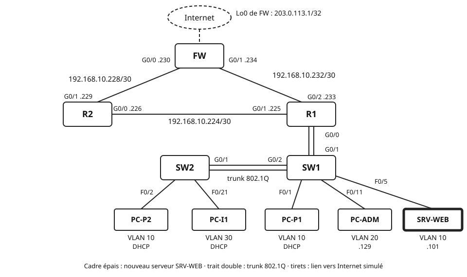

## Objectifs et prérequis

Vous allez sécuriser le réseau **fil rouge** du TP 5. L'entreprise vous
remet une politique de sécurité en trois règles. Vous la traduirez d'abord
en tests, puis en configuration : SSH sur les routeurs, une ACL standard,
une ACL étendue. Vous provoquerez enfin une panne classique : une ACL qui
coupe OSPF.

Vous devez disposer de votre fichier Packet Tracer du TP 5, terminé. Le
cours [« Les listes de contrôle d'accès (ACL) »](../cours-acl/index.qmd)
doit être connu. Le cours et la fiche de commandes Cisco sont autorisés.

## Situation de départ

Aujourd'hui, un invité branché sur le Wi-Fi joint tout le site. Il pingue
PC-ADM. Il pourrait tenter une connexion sur un routeur. L'entreprise
installe aussi un serveur web interne, SRV-WEB, dans le VLAN 10. Les invités
doivent pouvoir consulter ses pages, et rien d'autre sur le site.

{fig-alt="Les routeurs R1, R2 et FW forment un triangle. FW est en haut ; derrière lui, Internet est simulé par sa Loopback0 203.0.113.1/32. R2 est à gauche, R1 à droite. Liaison R1–R2 : 192.168.10.224/30, R2 G0/0 point 226, R1 G0/1 point 225. Liaison R2–FW : 192.168.10.228/30, R2 G0/1 point 229, FW G0/0 point 230. Liaison R1–FW : 192.168.10.232/30, R1 G0/2 point 233, FW G0/1 point 234. R1 G0/0 est relié en trunk à SW1 G0/1 ; SW1 G0/2 est relié en trunk 802.1Q à SW2 G0/1. Sur SW2 : PC-P2 sur F0/2 en VLAN 10 et PC-I1 sur F0/21 en VLAN 30, tous deux en DHCP. Sur SW1 : PC-P1 sur F0/1 en VLAN 10, en DHCP ; PC-ADM sur F0/11 en VLAN 20, adresse 192.168.10.129 ; le nouveau serveur SRV-WEB, en cadre épais, sur F0/5 en VLAN 10, adresse 192.168.10.101."}

**La politique de sécurité.** Elle s'applique au réseau entier. « Le site »
désigne toutes les adresses de `192.168.10.0/24` : VLAN, passerelles et
liaisons entre routeurs. « Internet » désigne toute adresse hors du site ;
`203.0.113.1` la représente.

| Règle | Flux autorisés | Flux refusés |
|:-:|:---|:---|
| **P1** — Invités (VLAN 30) | obtenir et renouveler leur adresse par DHCP ; joindre Internet ; consulter SRV-WEB en HTTP (TCP 80) | tout autre trafic vers le site : VLAN 10, VLAN 20, passerelles, liaisons |
| **P2** — Administration des routeurs | PC-ADM (`192.168.10.129`) en SSH vers R1, R2 et FW | Telnet, pour tous ; SSH depuis tout autre poste |
| **P3** — Routage | OSPF continue de fonctionner entre les trois routeurs | — |

La politique ne cite pas les autres flux. Par exemple, PC-P1 doit toujours
joindre PC-ADM et Internet.

Le résultat attendu : chaque règle est vérifiée dans une **matrice de
recette**, un tableau qui rassemble les tests, leurs résultats attendus et
leurs résultats obtenus. Chaque ACL est justifiée : type, interface, sens, ordre des lignes.

## Matériel et environnement

**Plateforme : Cisco Packet Tracer 9.0.1.** Routeurs **2911** sous IOS 15.1
(R1, R2, FW), commutateurs **2960-24TT** (SW1, SW2), quatre PC et un
serveur **Server-PT**. Les commandes des routeurs se tapent dans l'onglet
*CLI*. Les commandes des PC se tapent dans *Desktop*, puis *Command
Prompt*. Les pages web s'ouvrent dans *Desktop*, puis *Web Browser*.

**Fichier de départ.** Votre projet `TP5_NOM1_NOM2.pkt`, enregistré sous un
nouveau nom : `TP6_NOM1_NOM2.pkt`.

**Ce qui change par rapport au TP 5.**

| Équipement | Interface | Adresse / préfixe | Passerelle | Rôle |
|:---|:---|:---|:---|:---|
| SRV-WEB | F0 | `192.168.10.101/25` | `192.168.10.126` | serveur web interne, VLAN 10 |

L'adresse `192.168.10.101` est exclue du DHCP depuis le TP 4. Les adresses
de `.101` à `.126` sont en effet réservées aux équipements fixes. Les autres
adresses sont celles du plan du TP 5.

**Câblage supplémentaire.**

| Câble | De | Vers | Type |
|:-:|:---|:---|:---|
| 7 | SRV-WEB F0 | SW1 F0/5 | droit |

Le port F0/5 de SW1 est déjà en mode *access*, dans le VLAN 10 : les ports
F0/1 à F0/10 y sont affectés depuis le TP 4.

**Conventions du TP.**

| Élément | Valeur |
|:---|:---|
| Nom de domaine des routeurs | `fil-rouge.example` |
| Compte local d'administration | `admin`, avec un mot de passe de votre choix |
| ACL de la règle P2 | standard nommée `ADMIN-SSH` |
| ACL de la règle P1 | étendue nommée `INVITES-IN` |

Choisissez un mot de passe différent du nom du compte. Notez-le : il vous
servira à chaque connexion SSH.

**Captures d'écran.** Le compte rendu demande des captures numérotées, de
C1 à C18. Faites-les au fil du TP : une sortie de commande effacée ne se
retrouve pas toujours.

Chaque partie suit la même démarche : **configuration → vérification → test
→ observations à consigner**. Les questions Q1 à Q26 et les captures sont
listées dans la section « Vérification et compte rendu ».

## Travail à réaliser

### Partie 0 — Reprendre le réseau et installer SRV-WEB

Cette partie vérifie que le réseau fonctionne **avant** tout filtrage. Une
ACL ne répare jamais un routage défaillant : partez d'un réseau sain.

**Configuration.** Ouvrez votre fichier du TP 5. Enregistrez-le aussitôt sous
`TP6_NOM1_NOM2.pkt`.

**Vérification.** Sur chaque routeur, `show ip ospf neighbor` : chacun voit
deux voisins à l'état `FULL`. Sur R1, `show access-lists` ne doit rien
afficher.

**Test.** Refaites la matrice de recette du TP 5, avec des `ping`.

| Source \\ Destination | PC-P2 | PC-ADM | PC-I1 | SW2 (.189) | R2 (.226) | FW (.234) | 203.0.113.1 |
|:---|:-:|:-:|:-:|:-:|:-:|:-:|:-:|
| PC-P1 | | | | | | | |
| PC-I1 | | | — | | | | |

::: {.callout-warning}
## Une case est à X ?

Corrigez d'abord le TP 5. Avec une panne de routage, vous ne sauriez pas si
un échec vient de votre ACL ou du réseau. Prévenez l'enseignant si vous
êtes bloqué.
:::

**Installation de SRV-WEB.**

1. Ajoutez un serveur **Server-PT**. Nommez-le `SRV-WEB` dans l'onglet
   *Config*.
2. Câblez son port FastEthernet0 au port F0/5 de SW1, avec un câble droit.
3. Dans *Desktop*, puis *IP Configuration* : adressage statique,
   `192.168.10.101`, masque `255.255.255.128`, passerelle `192.168.10.126`.
4. Dans *Services*, puis *HTTP* : vérifiez que **HTTP** et **HTTPS** sont
   sur *On*.
5. Dans *Services*, puis *DHCP* : vérifiez que le service est sur *Off*.
   Le serveur DHCP du site reste R1.

**Test du serveur.** Depuis PC-P1, puis depuis PC-I1 :

- `ping 192.168.10.101` dans le *Command Prompt* ;
- `http://192.168.10.101`, puis `https://192.168.10.101`, dans le *Web
  Browser*.

Les trois essais doivent réussir depuis chacun des deux PC. La page affichée est
la page d'accueil par défaut du serveur.

**La matrice de recette.** Elle traduit la politique en tests. Recopiez-la
dans votre compte rendu. Remplissez **dès maintenant** la colonne
« Attendu » : **OK** si le flux doit passer, **X** s'il doit être refusé. Les
colonnes « Obtenu » se remplissent aux parties 3 et 6.

| N° | Source | Test | Règle | Attendu | Obtenu (partie 3) | Obtenu (partie 6) |
|:-:|:---|:---|:-:|:-:|:-:|:-:|
| T1 | PC-I1 | obtenir une adresse par DHCP, puis `ipconfig /renew` | P1 | | | |
| T2 | PC-I1 | `ping 203.0.113.1` | P1 | | | |
| T3 | PC-I1 | navigateur : `http://192.168.10.101` | P1 | | | |
| T4 | PC-I1 | navigateur : `https://192.168.10.101` | P1 | | | |
| T5 | PC-I1 | `ping 192.168.10.101` | P1 | | | |
| T6 | PC-I1 | `ping` vers PC-P1 | P1 | | | |
| T7 | PC-I1 | `ping 192.168.10.129` (PC-ADM) | P1 | | | |
| T8 | PC-I1 | `ping 192.168.10.222` (sa passerelle) | P1 | | | |
| T9 | PC-I1 | `ping 192.168.10.226` (R2) | P1 | | | |
| T10 | PC-I1 | `ssh -l admin 203.0.113.1` (FW) | P2 | | | |
| T11 | PC-ADM | `ssh -l admin 192.168.10.190` (R1) | P2 | | | |
| T12 | PC-ADM | `ssh -l admin 192.168.10.226` (R2) | P2 | | | |
| T13 | PC-ADM | `ssh -l admin 192.168.10.234` (FW) | P2 | | | |
| T14 | PC-ADM | `telnet 192.168.10.190` (R1) | P2 | | | |
| T15 | PC-P1 | `ssh -l admin 192.168.10.126` (R1) | P2 | | | |
| T16 | PC-P1 | navigateur : `http://192.168.10.101` | — | | | |
| T17 | PC-P1 | `ping 203.0.113.1` | — | | | |
| T18 | R1, R2, FW | `show ip ospf neighbor` : deux voisins `FULL` | P3 | | | |

Pour T6, relevez d'abord l'adresse de PC-P1 avec `ipconfig`. Pour T1,
passez PC-I1 en adressage statique, puis de nouveau en DHCP, dans
*Desktop*, puis *IP Configuration*. Relevez l'adresse obtenue. Tapez
ensuite `ipconfig /renew` dans le *Command Prompt* de PC-I1, puis relevez
de nouveau l'adresse. T1 est à **OK** si les deux étapes donnent une adresse
du VLAN 30.

**Observations à consigner.** Q1, Q2, Q3 ; captures C1 et C2.

### Partie 1 — Remplacer Telnet par SSH sur les trois routeurs

SSH chiffre toute la session, mot de passe compris. C'est le premier
verrou de la règle P2. Le filtrage par adresse viendra à la partie 2.

**Test de départ.** Depuis PC-ADM : `telnet 192.168.10.190`. Notez le
message obtenu.

**Configuration de R1.** Suivez l'ordre du cours, section « Réserver
l'administration de R1 à SSH depuis le VLAN 20 ». Les valeurs à reporter
sont dans le tableau des conventions.

```text
! Packet Tracer, R1 (2911, IOS 15.1), mode de configuration globale
ip domain-name ________
! le nom d'hôte R1 existe depuis le TP 4 : les clés en ont besoin
crypto key generate rsa general-keys modulus 2048
! paire de clés RSA ; la génération peut prendre quelques secondes
ip ssh version 2
username ________ secret ________
enable secret ________
! protège le mode privilégié, que la session SSH demandera
line vty 0 4
 login local
! authentification par le compte créé avec username
```

**Test intermédiaire.** Depuis PC-ADM, relancez `telnet 192.168.10.190`.
Notez le résultat. Si une invite apparaît, quittez la session avec `exit`.

**Configuration (suite).** Sur R1, dans `line vty 0 4` : `transport input
ssh`. Si `show running-config` affiche aussi `line vty 5 15`, appliquez-lui
`login local` et `transport input ssh`.

**Configuration de R2 et de FW.** Reprenez la même procédure sur R2, puis
sur FW, avec le même compte et le même nom de domaine.

**Vérification.** Sur chaque routeur, `show ip ssh` : SSH est activé, en
version 2.

**Test.** Depuis PC-ADM :

1. `ssh -l admin 192.168.10.190` : le mot de passe est demandé, puis
   l'invite `R1>` apparaît. Tapez `enable`, puis `exit` pour quitter.
2. `telnet 192.168.10.190` : relevez le résultat et comparez-le à votre
   colonne « Attendu » (T14).
3. `ssh -l admin 192.168.10.226`, puis `ssh -l admin 192.168.10.234` : vous
   obtenez les invites `R2>` et `FW>`.

::: {.callout-note}
## Une session ouverte sur le routeur

Dans la fenêtre du PC, l'invite devient celle du routeur. Les commandes
tapées s'exécutent alors sur le routeur. Pensez à `exit` avant de lancer le
test suivant depuis le PC.
:::

**Observations à consigner.** Q4, Q5, Q6 ; captures C3 à C5.

### Partie 2 — Réserver l'administration à PC-ADM (règle P2)

Pour l'instant, tout poste qui connaît le mot de passe peut ouvrir une
session SSH. La règle P2 réserve ce droit à PC-ADM. Un critère suffit : la
**source** du paquet. Une ACL standard convient donc.

**Préparation.** Avant de configurer, répondez par écrit : à quoi
s'applique l'ACL, dans quel sens, et pourquoi ? Le cours, section
« Protéger l'accès d'administration », vous guide.

**Configuration de R1.** Complétez le squelette.

```text
! Packet Tracer, R1 (2911, IOS 15.1), mode de configuration globale
ip access-list standard ADMIN-SSH
 remark P2 : administration depuis PC-ADM seulement
 ________
! une seule ligne suffit : le refus implicite écarte toutes les autres sources
line vty 0 4
 access-class ADMIN-SSH ____
! à reporter aussi sur line vty 5 15 si elle existe
```

**Configuration de R2 et de FW.** Créez la même ACL `ADMIN-SSH` sur R2 et
sur FW. Appliquez-la de la même façon à leurs lignes VTY.

**Vérification.** Sur chaque routeur, `show access-lists` affiche
`ADMIN-SSH`. `show running-config` montre `access-class` sous les lignes
VTY.

**Test.**

1. Sur R1, en mode privilégié : `clear access-list counters`.
2. Depuis PC-ADM : `ssh -l admin` vers R1 (`.190`), R2 (`.226`) et FW
   (`.234`).
3. Depuis PC-P1 : `ssh -l admin 192.168.10.126`.
4. Relevez les résultats et comparez-les à votre colonne « Attendu » (T11 à
   T13, T15).
5. Sur R1 : `show access-lists ADMIN-SSH`. Relevez le compteur et notez
   combien de connexions ont visé R1 à chaque étape.

**Observations à consigner.** Q7 à Q10 ; captures C6 et C7.

### Partie 3 — Filtrer les invités (règle P1)

La règle P1 croise trois critères : la source, la destination et le
service. Seule une ACL **étendue** sait les combiner.

**Préparation : écrire l'ACL sur papier.** Avant de toucher au routeur,
remplissez ce tableau dans votre compte rendu. Une ligne du tableau
correspond à une ligne de l'ACL. Vous n'utiliserez pas forcément toutes les
lignes.

| Ordre | Action | Protocole | Source | Destination | Port destination | Rôle (règle P1) |
|:-:|:---|:---|:---|:---|:---|:---|
| 1 | | | | | | |
| 2 | | | | | | |
| 3 | | | | | | |
| 4 | | | | | | |
| 5 | | | | | | |
| 6 | | | | | | |

Vos lignes doivent couvrir tous les flux de P1. Pensez aux trois points
suivants :

- **la demande DHCP initiale** : le poste n'a pas encore d'adresse ; reprenez
  la ligne DHCP du cours ;
- **le renouvellement du bail** : il part de l'adresse du poste vers son
  serveur DHCP ; retrouvez les ports et l'adresse du serveur ;
- **l'ordre des lignes** : une ligne générale placée trop haut masque les
  lignes précises situées dessous.

Les opérateurs de port et les mots-clés `host` et `any` sont décrits dans
le cours, section « ACL standard et ACL étendues ».

**Choix de l'emplacement.** Choisissez l'interface et le sens
d'application. Justifiez par écrit avec la règle de placement d'une ACL
étendue.

**Configuration.** Sur R1 :

1. créez l'ACL étendue nommée `INVITES-IN`, avec une ligne `remark` par
   groupe de règles ;
2. vérifiez-la avec `show access-lists INVITES-IN` ;
3. seulement ensuite, appliquez-la avec `ip access-group`, sur l'interface
   et dans le sens choisis.

::: {.callout-tip}
## Écrivez l'ACL avant de l'appliquer

Une ACL appliquée vide, puis complétée ligne à ligne, agit dès sa première
ligne. Son refus implicite bloque alors tout le reste, le temps de la
saisie.
:::

**Vérification.** `show ip interface` sur l'interface choisie : la ligne
`Inbound access list` ou `Outgoing access list` cite `INVITES-IN`.
`show running-config` montre vos lignes `remark`.

**Test.**

1. Sur R1 : `clear access-list counters INVITES-IN`.
2. Réalisez les tests T1 à T18 de la matrice. Remplissez la colonne
   « Obtenu (partie 3) ».
3. Sur R1 : `show access-lists INVITES-IN`. Pour chaque ligne, reliez son
   compteur aux tests qui l'ont sollicitée.
4. Depuis PC-ADM : `ping` vers PC-I1. Notez le résultat.

Relevez chaque résultat et comparez-le à votre colonne « Attendu ». Si un
résultat obtenu diffère de l'attendu, cherchez la cause avec
le tableau « Les erreurs classiques » du cours. Corrigez, puis refaites les
tests.

**Sauvegarde.** Sur R1 : `copy running-config startup-config`. Enregistrez
le fichier `.pkt`.

**Observations à consigner.** Q11 à Q17 ; captures C8 à C10.

### Partie 4 — Modifier une ACL sans la retaper

La politique évolue. Une ACL nommée se modifie ligne par ligne, grâce à ses
numéros de séquence. Vous n'avez jamais besoin de la supprimer pour la
réécrire.

**Relevé initial.** Sur R1 : `show access-lists INVITES-IN`. Notez les
numéros de séquence de chaque ligne.

**Évolution 1 — HTTPS vers SRV-WEB.** La direction autorise désormais les
invités à consulter SRV-WEB en HTTPS, port TCP 443.

1. Choisissez un numéro de séquence qui place la nouvelle ligne juste après
   celle du HTTP.
2. Dans le mode de configuration de `INVITES-IN`, tapez ce numéro, suivi de
   la nouvelle ligne.
3. Relevez `show access-lists INVITES-IN`, puis refaites T3 et T4.

**Évolution 2 — ping de diagnostic, temporaire.** Le support informatique
veut que les invités puissent pinguer leur passerelle pendant une semaine.
Seule la requête `echo` vers `192.168.10.222` est concernée.

1. Insérez la ligne au bon endroit, avec un numéro de séquence choisi par
   vous.
2. Relevez `show access-lists INVITES-IN` : vos deux insertions y
   figurent. Refaites T8, puis T9. Relevez les résultats : ensemble, ils
   montrent si votre ligne n'ouvre que la passerelle.
3. La semaine est passée : supprimez cette seule ligne avec `no`, suivi de
   son numéro.
4. Relevez de nouveau `show access-lists INVITES-IN`, puis refaites T8.

Vous disposez ainsi de quatre relevés : initial, après l'évolution 1, après
l'insertion de l'évolution 2, après le `no`.

**Mise à jour de la matrice.** L'évolution 1 change la politique. Dans la
colonne « Attendu », barrez la valeur de T4 sans l'effacer. Écrivez la
nouvelle valeur à côté, avec la mention « évolution 1 ». L'obtenu de la
partie 3 se compare à l'attendu initial ; l'obtenu de la partie 6, à
l'attendu mis à jour. L'évolution 2 a été retirée : T8 ne change pas.

La réponse `echo-reply` de la passerelle part de R1 lui-même. Elle n'entre
pas par l'interface filtrée : votre nouvelle ligne n'a pas à la prévoir.

::: {.callout-warning}
## `no access-list` ou `no ip access-list` efface toute la liste

En mode de configuration globale, ces commandes suppriment la liste
entière, pas une ligne. Pour retirer une ligne, entrez dans le mode de la
liste, puis tapez `no` suivi de son numéro de séquence.
:::

**Observations à consigner.** Q18 et Q19 ; captures C11 et C12.

### Partie 5 — Diagnostiquer une ACL qui coupe OSPF

Un collègue a voulu filtrer ce qui arrive de R1 sur le pare-feu. Il a
appliqué la liste suivante en entrée de FW G0/1, la liaison vers R1. Elle
est **volontairement fautive** : vous allez observer ses effets, puis la
corriger.

**Préparation.** Sur FW, puis sur R1 : `show ip ospf neighbor`. Notez les
voisins et leur état. Depuis PC-P1 : `tracert 203.0.113.1`. Notez le chemin
suivi.

**Panne.** Sur FW, tapez exactement la liste suivante.

```text
! Packet Tracer, FW (2911, IOS 15.1), mode de configuration globale
! liste FAUTIVE, fournie pour l'exercice : ne la gardez pas
ip access-list extended PANNE-FW
 remark Liste fautive du collegue
 permit icmp any any
 permit tcp any any
interface GigabitEthernet0/1
 ip access-group PANNE-FW in
```

::: {.callout-note}
## Le temps dans Packet Tracer

Packet Tracer simule le temps : les durées sont indicatives. Ses minuteries
OSPF sont celles du cours : Hello 10 s, Dead 40 s. Le bouton *Fast Forward
Time* avance le temps de 30 s à chaque clic.
:::

**Observation.**

1. Relancez aussitôt `show ip ospf neighbor` sur FW. Notez l'état du voisin
   R1.
2. Cliquez une fois sur *Fast Forward Time*, puis relancez la commande.
   Recommencez jusqu'à la disparition du voisin R1. Comptez les clics.
3. Relevez les messages `%OSPF-5-ADJCHG` affichés dans les consoles de FW
   et de R1.
4. Sur R1 : `show ip ospf neighbor`, puis `show ip route`. Regardez la
   route par défaut.
5. Depuis PC-P1 : `ping 203.0.113.1`, puis `tracert 203.0.113.1`.
6. Sur FW : `show access-lists PANNE-FW`. Relevez les compteurs.

**Diagnostic.** Trouvez la cause de la panne. Aidez-vous du tableau « Les
erreurs classiques » du cours.

**Correction.** Écrivez **une seule** ligne, placée par son numéro de
séquence. Puis attendez le retour des deux voisins à l'état `FULL`.

**Retrait.** Cette liste ne fait pas partie de la politique. Retirez-la :

```text
! Packet Tracer, FW (2911, IOS 15.1), mode de configuration globale
interface GigabitEthernet0/1
 no ip access-group PANNE-FW in
! l'interface n'est plus filtrée
exit
no ip access-list extended PANNE-FW
! supprime la liste entière, désormais inutile
```

**Vérification.** `show ip ospf neighbor` sur FW et sur R1 : deux voisins
`FULL` chacun. `show ip interface GigabitEthernet0/1` sur FW : aucune ACL
appliquée.

**Observations à consigner.** Q20 à Q23 ; captures C13 à C15.

### Partie 6 — Recette finale

La recette prouve que la configuration finale respecte la politique. Elle se
fait sur le réseau complet, toutes ACL en place.

1. Sur R1 : `clear access-list counters`.
2. Réalisez les tests T1 à T18. Remplissez la colonne « Obtenu
   (partie 6) ». Comparez-la à la colonne « Attendu », mise à jour en
   partie 4.
3. Sur R1 : `show access-lists`.
4. Sur R2 et FW : `show ip ospf neighbor`.
5. Sur chaque routeur : `copy running-config startup-config`. Enregistrez le
   fichier `.pkt`.

Toute case où l'obtenu diffère de l'attendu doit être expliquée, puis
corrigée.

**Observations à consigner.** Q24 ; captures C16 et C17.

### Partie 7 (bonus) — Observer le filtrage sans état

Une ACL juge chaque paquet seul. Elle ne sait pas qu'un paquet répond à une
demande autorisée. Vous l'observez de deux façons.

**Étape A — ACL standard au plus près de la destination.**

1. Sur R1, retirez `INVITES-IN` de son interface avec `no ip
   access-group`, suivi du nom et du sens. La liste reste en mémoire.
2. Écrivez une ACL standard nommée `VERS-ADM`. Elle refuse les sources du
   VLAN 30 et autorise toutes les autres.
3. Appliquez-la en sortie de G0/0.20.
4. Testez : PC-I1 vers PC-ADM, PC-I1 vers `203.0.113.1`, PC-I1 vers
   `192.168.10.101`, puis PC-ADM vers PC-I1.
5. Retirez `VERS-ADM` de G0/0.20. Réappliquez `INVITES-IN` comme à la
   partie 3. Vérifiez T7 et T2.

**Étape B — Laisser l'administrateur pinguer les invités.** À la partie 3,
vous avez relevé le résultat du ping de PC-ADM vers PC-I1. L'administrateur
a besoin de ce ping pour dépanner les invités.

1. Insérez dans `INVITES-IN` une seule ligne, qui laisse passer les
   **réponses** au ping, du VLAN 30 vers PC-ADM seulement.
2. Testez : PC-ADM vers PC-I1, puis PC-I1 vers PC-ADM.
3. Relevez `show access-lists INVITES-IN`.

**Retour à la politique.** Le fichier rendu doit appliquer la politique P1
à P3 modifiée par l'évolution 1 : l'accès HTTPS à SRV-WEB est conservé. Les
ajouts du bonus doivent disparaître. Retirez la ligne de l'étape B avec `no`, suivi de son numéro, dans le
mode de `INVITES-IN`. Supprimez aussi la liste de l'étape A :

```text
! Packet Tracer, R1 (2911, IOS 15.1), mode de configuration globale
no ip access-list standard VERS-ADM
! VERS-ADM n'est plus appliquée nulle part depuis l'étape A
```

Refaites T7 et T2, puis enregistrez la configuration et le fichier `.pkt`.

**Observations à consigner.** Q25 et Q26 ; capture C18.

## Vérification et compte rendu

### Questions

Répondez à chaque question en quelques phrases. Appuyez-vous sur vos
captures quand c'est utile.

**Partie 0**

- **Q1.** Recopiez la matrice du TP 5 obtenue en partie 0. Depuis PC-I1,
  quels essais vers SRV-WEB ont réussi ? En quoi est-ce contraire à la
  politique ?
- **Q2.** Pourquoi un serveur reçoit-il une adresse fixe, et non une adresse
  par DHCP ? Que se passerait-il si `192.168.10.101` n'était pas exclue du
  DHCP ?
- **Q3.** Recopiez la matrice de recette avec sa colonne « Attendu ».
  Justifiez les résultats attendus de T6, T8 et T10, en citant la règle
  concernée.

**Partie 1**

- **Q4.** Notez les messages de `telnet 192.168.10.190` au test de départ et
  au test intermédiaire. Expliquez la différence. Que montre le test
  intermédiaire sur le rôle de `transport input ssh` ?
- **Q5.** Un invité capture le trafic d'une session Telnet, puis d'une
  session SSH. Que lit-il dans chaque cas ? Appuyez-vous sur le tableau
  Telnet / SSH du cours.
- **Q6.** Pourquoi faut-il régler `hostname` et `ip domain-name` avant de
  générer les clés RSA ? Quel est le rôle de `login local` ?

**Partie 2**

- **Q7.** Recopiez votre ACL `ADMIN-SSH`. Pourquoi une ACL standard
  suffit-elle ? Quel sens avez-vous choisi pour `access-class` ?
  Justifiez.
- **Q8.** PC-ADM se connecte à FW par `192.168.10.234`. Le paquet traverse
  R1. Quelle adresse source FW voit-il ? Justifiez : R1 modifie-t-il
  l'adresse source en routant ?
- **Q9.** Pourquoi `access-class` sur les lignes VTY est-il préférable à une
  ACL appliquée sur chaque interface du routeur ? Comptez les adresses IP de
  R1 pour répondre.
- **Q10.** Comparez le nombre de connexions tentées vers R1, autorisées et
  refusées, au compteur relevé dans `show access-lists ADMIN-SSH`.
  Concordent-ils ? Proposez une interprétation. Rappelez ce que le cours dit
  du refus implicite et de ses compteurs.

**Partie 3**

- **Q11.** Recopiez votre tableau de préparation et l'ACL `INVITES-IN`
  telle que l'affiche `show access-lists`. Pour chaque ligne, citez la partie
  de la règle P1 qu'elle traduit.
- **Q12.** Sur quelle interface et dans quel sens avez-vous appliqué
  `INVITES-IN` ? Justifiez. Pourquoi une ACL standard ne pouvait-elle pas
  traduire P1 ?
- **Q13.** Expliquez le rôle de chacune de vos lignes DHCP. Pour la demande
  initiale, donnez l'adresse source, l'adresse destination et les deux ports.
  Avec votre ACL, quel paquet `ipconfig /renew` a-t-il pu envoyer ?
  Observez-le en mode Simulation, avec le filtre DHCP.
- **Q14.** Prenez votre ligne qui autorise HTTP vers SRV-WEB. Que se
  passerait-il si elle était placée après votre ligne `deny` ? Et votre
  dernière ligne `permit`, si elle était placée en tête ? Justifiez avec le
  traitement d'une ACL.
- **Q15.** Reliez chaque compteur de `show access-lists INVITES-IN` aux
  tests qui l'ont sollicité. Une ligne a-t-elle un compteur à 0 ? Est-ce une
  erreur ?
- **Q16.** `INVITES-IN` ne contient aucune ligne pour OSPF. Pourquoi R1
  n'en a-t-il pas besoin sur cette interface ? Appuyez-vous sur la
  configuration OSPF de R1 au TP 5.
- **Q17.** Le ping de PC-ADM vers PC-I1 échoue, alors que P1 ne parle pas
  de ce flux. Expliquez, paquet par paquet. Pour T10, quel équipement a
  décidé du résultat : R1 ou FW ? Pourquoi ?

**Partie 4**

- **Q18.** Donnez les numéros de séquence choisis pour les deux évolutions.
  Comparez le relevé initial à celui de l'étape 2 de l'évolution 2 (C11),
  puis ce dernier au relevé final (C12). Où la ligne ICMP devait-elle se
  placer, et pourquoi ?
- **Q19.** Un collègue propose de supprimer toute la liste, puis de la
  retaper avec la ligne en plus. Quel risque court-il pendant la saisie, si
  `ip access-group` reste en place ? Aidez-vous du cours, section
  « Les erreurs classiques ».

**Partie 5**

- **Q20.** Combien de clics sur *Fast Forward Time* ont été nécessaires
  avant la disparition du voisin R1 sur FW ? Reliez ce délai à une
  minuterie d'OSPF. Pourquoi la panne n'est-elle pas immédiate ?
- **Q21.** Expliquez la cause de la panne. Pourquoi les paquets OSPF ne
  correspondent-ils à aucune ligne de `PANNE-FW` ? Que deviennent-ils ?
  Les Hello de FW vers R1 ne sont pas filtrés : pourquoi R1 perd-il quand
  même son voisin FW ?
- **Q22.** Pendant la panne, quel chemin suivait le `tracert` de PC-P1 ?
  Pourquoi les utilisateurs ne voyaient-ils presque rien ? Pourquoi cette
  panne est-elle dangereuse malgré tout ?
- **Q23.** Recopiez votre ligne de correction et son numéro de séquence.
  Justifiez la source choisie. Où faut-il penser à OSPF dans une ACL en
  entrée, sur le fil rouge ?

**Partie 6**

- **Q24.** Recopiez la matrice de recette complète. Comparez l'obtenu de
  la partie 3 à l'attendu initial, et l'obtenu de la partie 6 à l'attendu
  mis à jour en partie 4. Pour toute case qui diffère, donnez la cause et la
  correction apportée.

**Partie 7 (bonus)**

- **Q25.** Avec `VERS-ADM`, quels tests ont réussi ? Pourquoi le ping de
  PC-ADM vers PC-I1 échoue-t-il ? Quelles parties de P1 cette ACL ne
  traduit-elle plus ?
- **Q26.** Recopiez la ligne ajoutée à l'étape B. Pourquoi PC-ADM pingue-t-il
  désormais PC-I1, alors que PC-I1 ne pingue toujours pas PC-ADM ? Quelle
  faiblesse du filtrage sans état cette ligne illustre-t-elle ?

### Captures d'écran

Chaque capture porte son numéro et une légende d'une ligne. Elle montre
l'invite de commande, pour qu'on sache sur quel équipement elle est prise.

| N° | Partie | Contenu |
|:-:|:-:|:---|
| C1 | 0 | `show ip ospf neighbor` sur R1, avant tout filtrage |
| C2 | 0 | navigateur de PC-I1 sur `http://192.168.10.101`, avant filtrage |
| C3 | 1 | `show ip ssh` sur R1 |
| C4 | 1 | session SSH ouverte depuis PC-ADM vers R1 : invite `R1>` |
| C5 | 1 | `telnet 192.168.10.190` depuis PC-ADM, après `transport input ssh` |
| C6 | 2 | `show running-config` de R1 : ACL `ADMIN-SSH` et lignes VTY |
| C7 | 2 | `ssh -l admin 192.168.10.126` depuis PC-P1 |
| C8 | 3 | `show access-lists INVITES-IN` sur R1, compteurs après les tests |
| C9 | 3 | `show ip interface` de l'interface où `INVITES-IN` est appliquée |
| C10 | 3 | navigateur et `ping` de PC-I1 vers SRV-WEB |
| C11 | 4 | `show access-lists INVITES-IN` à l'étape 2 de l'évolution 2 : deux lignes insérées |
| C12 | 4 | `show access-lists INVITES-IN` après le `no` de la ligne ICMP |
| C13 | 5 | messages `%OSPF-5-ADJCHG` et `show ip ospf neighbor` sur FW et sur R1, pendant la panne |
| C14 | 5 | `show ip route` sur R1 et `tracert 203.0.113.1` depuis PC-P1, pendant la panne |
| C15 | 5 | `show ip ospf neighbor` sur FW, après la correction |
| C16 | 6 | `show access-lists` sur R1, après la recette finale |
| C17 | 6 | `show ip ospf neighbor` sur R2 et sur FW, après la recette finale |
| C18 | 7 | `show access-lists INVITES-IN` et pings de l'étape B |

### Critères de réussite

Le réseau est validé quand :

- toutes les cases « Obtenu (partie 6) » sont égales aux cases « Attendu »,
  mises à jour en partie 4 ;
- chaque routeur voit deux voisins à l'état `FULL` ;
- les trois routeurs n'acceptent que SSH version 2, et seulement depuis
  `192.168.10.129` ;
- `INVITES-IN` est appliquée sur une seule interface, dans le sens justifié,
  et chacune de ses lignes est justifiée ;
- la ligne ICMP temporaire, la liste `PANNE-FW` et les ajouts du bonus ont
  disparu de la configuration ;
- les configurations sont enregistrées dans la `startup-config` des trois
  routeurs.

### Livrables

- Le compte rendu au format PDF, nommé `TP6_NOM1_NOM2.pdf` : réponses aux
  questions Q1 à Q24, captures C1 à C17, et la matrice de recette remplie.
  Ajoutez Q25, Q26 et C18 si vous avez fait le bonus.
- Le projet Packet Tracer, enregistré sous `TP6_NOM1_NOM2.pkt`, dans son
  état de fin de partie 6, ou de fin de partie 7 après le retour à la
  politique.
- Les deux fichiers sont déposés sur l'ENT.

## Synthèse

Pour chaque partie, notez en une phrase ce que vous avez vérifié. Citez la
commande ou le test qui l'a montré. Le cas échéant, décrivez la panne
rencontrée et sa cause.

Terminez par un court bilan. Comparez les deux ACL du TP : type, critères
examinés, emplacement et sens. Dites ce qu'une ACL sans état ne sait pas
faire, et ce qu'un pare-feu à états apportera au chapitre 06.

## Pour aller plus loin

- **Protéger les commutateurs.** SW1 et SW2 ont une adresse dans le
  VLAN 20 : `.188` et `.189`. Leurs lignes VTY sont encore ouvertes.
  Appliquez-leur la même démarche : SSH, compte local et `access-class`.
  Vérifiez d'abord dans l'aide de Packet Tracer que le 2960 accepte ces
  commandes.
- **Durcir l'accès des invités.** L'exercice 3 du cours limite les invités au
  web et au DNS vers Internet. Comparez cette politique à P1 : quels tests
  de la matrice changeraient ?
- Sources :
  - [Cisco — Configure and Filter IP Access Lists](https://www.cisco.com/c/en/us/support/docs/security/ios-firewall/23602-confaccesslists.html),
    la documentation de Cisco sur les ACL d'IOS, en anglais ;
  - [RFC 4253 — The Secure Shell (SSH) Transport Layer Protocol](https://www.rfc-editor.org/rfc/rfc4253.html),
    qui décrit le chiffrement de la session SSH ;
  - [RFC 2131 — DHCP](https://www.rfc-editor.org/rfc/rfc2131.html), qui
    fixe les ports UDP 67 et 68 et décrit le renouvellement du bail ;
  - [RFC 2328 — OSPF Version 2](https://www.rfc-editor.org/rfc/rfc2328.html) :
    OSPF utilise le protocole IP 89 ;
  - [Registre IANA des numéros de port](https://www.iana.org/assignments/service-names-port-numbers/service-names-port-numbers.xhtml),
    pour vérifier les ports 22, 23, 80 et 443 ;
  - la référence des commandes intégrée à Packet Tracer, menu *Help*, pour le
    routeur 2911.
