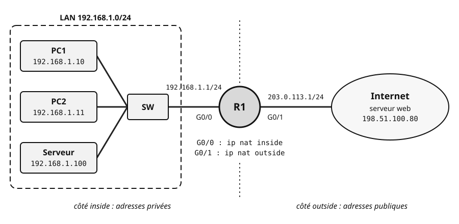
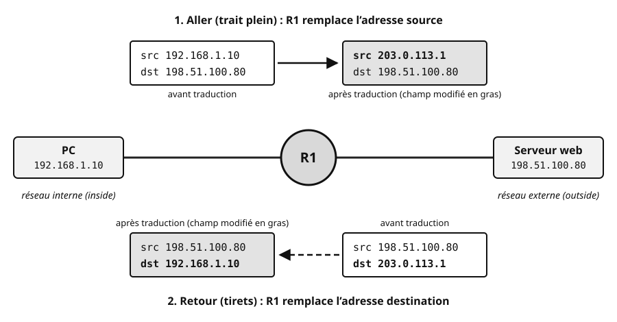
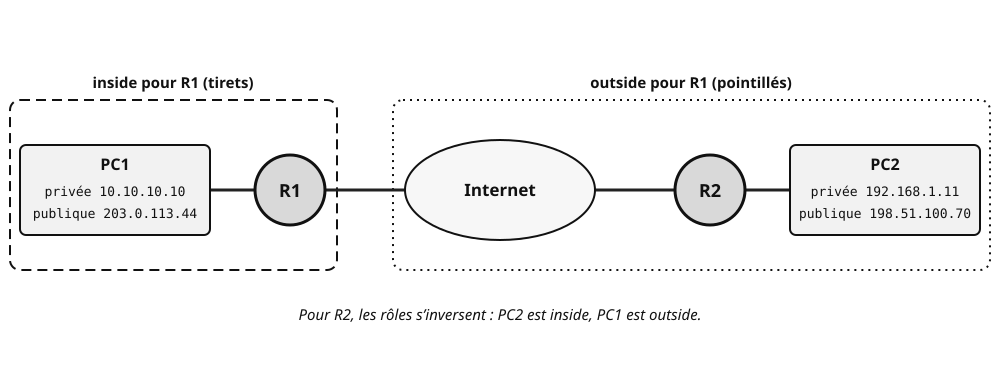
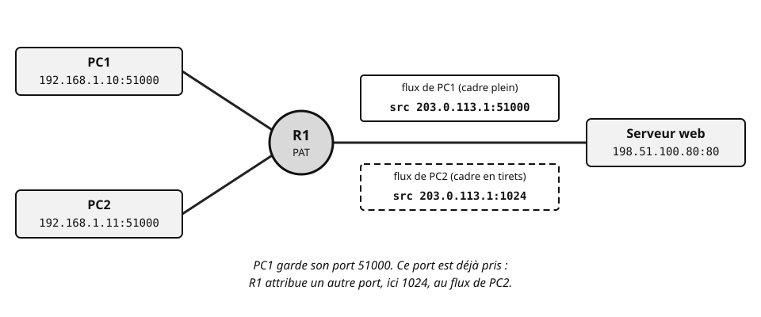

## Objectifs et prérequis

À l'issue du cours, vous saurez expliquer comment des centaines de postes
en adresses privées accèdent à Internet avec une seule adresse publique.
Vous saurez lire une **table NAT** et configurer les trois modes de
traduction d'un routeur Cisco. Vous saurez enfin vérifier et dépanner une
traduction qui ne fonctionne pas.

Ce cours se rattache à la compétence C09 du référentiel, « Installer un réseau
informatique ». La traduction d'adresses se configure en effet sur le
routeur de périphérie, quand on installe l'accès à Internet. Source : référentiel
du BTS CIEL (arrêté du 25 janvier 2023), option A, compétence C09 p. 40,
lien dans « Pour aller plus loin ».

Vous devez maîtriser l'adressage IPv4 et les masques. Le cours ACL du
chapitre 04 vous sert directement : NAT dynamique et PAT désignent le
trafic à traduire par une ACL, avec un masque générique. Rappelez-vous
aussi le rôle d'une route par défaut et des numéros de port TCP et UDP.

Les configurations utilisent **Cisco Packet Tracer 9.0.1**, avec un routeur
**Cisco 2911** sous **IOS 15.1**. Ses interfaces GigabitEthernet0/0 et
GigabitEthernet0/1 servent d'interfaces interne et externe. Les commandes
se saisissent dans l'onglet CLI du routeur.

## Situation de départ

Une petite entreprise utilise le réseau `192.168.1.0/24`. Son routeur de
périphérie R1 est relié au fournisseur d'accès (FAI) par son interface
G0/1. Le FAI lui a attribué une seule adresse publique : `203.0.113.1`.

{fig-alt="Le LAN 192.168.1.0/24, entouré d'un cadre en tirets, contient trois hôtes reliés au commutateur SW : PC1 d'adresse 192.168.1.10, PC2 d'adresse 192.168.1.11 et un serveur d'adresse 192.168.1.100. SW est relié à l'interface G0/0 du routeur R1, d'adresse 192.168.1.1/24. L'interface G0/1 de R1, d'adresse 203.0.113.1/24, mène au nuage Internet, où se trouve un serveur web d'adresse 198.51.100.80. Sous R1 : G0/0 est déclarée ip nat inside, G0/1 est déclarée ip nat outside. Une ligne pointillée verticale passe par R1 : à gauche, le côté inside, aux adresses privées ; à droite, le côté outside, aux adresses publiques."}

PC1 veut consulter le serveur web `198.51.100.80`. Son paquet part avec
l'adresse source `192.168.1.10`. Or les routeurs d'Internet rejettent cette
adresse privée. Et même si le paquet arrivait, la réponse n'aurait aucun
moyen de revenir vers `192.168.1.10`.

Le serveur `192.168.1.100` pose le problème inverse. L'entreprise veut le
rendre joignable depuis Internet, alors qu'il n'a qu'une adresse privée.

Ce cours vous montre comment R1 résout ces deux problèmes en **traduisant
les adresses**. Le TP du chapitre appliquera ensuite le PAT et le NAT
statique au réseau fil rouge.

::: {.callout-note}
## Adresses de documentation

Les « adresses publiques » de ce cours appartiennent aux plages réservées à
la documentation par la RFC 5737 : `192.0.2.0/24`, `198.51.100.0/24` et
`203.0.113.0/24`. C'est une bonne pratique : un exemple ou un TP n'utilise
jamais les adresses réelles d'un organisme existant.
:::

## Comprendre le mécanisme

### Pourquoi traduire : la pénurie d'adresses IPv4

Une adresse IPv4 est codée sur **32 bits**. Cela donne 2^32^, soit environ
4,3 milliards d'adresses. Ce nombre semblait énorme dans les années 1980.
Avec les ordinateurs, les smartphones et les objets connectés, il est
devenu très insuffisant.

Trois mécanismes ont retardé l'épuisement :

- le **CIDR** (*Classless Inter-Domain Routing*, RFC 1518 et 1519, 1993)
  abandonne les classes A, B et C au profit de masques de longueur
  variable ; on ne gaspille plus des blocs entiers ;
- les **adresses privées** (RFC 1918, 1996) sont réutilisables dans chaque
  réseau local ;
- la **traduction d'adresses**, ou NAT (RFC 1631, puis RFC 3022), permet à
  ces adresses privées d'accéder à Internet.

Cela n'a pas suffi. L'IANA, l'organisme qui distribue les blocs
d'adresses, a attribué ses derniers blocs /8 en **février 2011**. L'APNIC
(Asie-Pacifique) a entamé son dernier bloc /8 en avril 2011. Le **RIPE NCC
(Europe)** l'a fait en **septembre 2012**. Tous deux ont alors rationné
leurs attributions. Le RIPE NCC a épuisé son stock en novembre 2019.
L'ARIN (Amérique du Nord) a épuisé son stock libre en septembre 2015.

La solution de fond s'appelle **IPv6**, avec des adresses sur 128 bits.
Nous vivons une longue période de **cohabitation** entre IPv4 et IPv6. Dans
les réseaux IPv4, le NAT reste omniprésent.

::: {.callout-note}
## À retenir

Le NAT est né d'un problème de **quantité** d'adresses. Il permet à de
nombreux équipements en adresses privées de partager une ou quelques
adresses publiques.
:::

### Adresses privées et adresses publiques

Votre poste a en pratique deux « identités ». Son **identité locale** est
son adresse privée, valable dans son réseau. Son **identité globale** est
l'adresse publique sous laquelle il apparaît sur Internet.

::: {.callout-tip}
## Analogie

Votre **adresse de domicile** est connue de votre entourage : c'est
l'adresse privée. Une **boîte postale** est une adresse officielle,
joignable de partout, mais ce n'est pas votre domicile : c'est l'adresse
publique. Le bureau de poste fait le lien entre les deux : c'est le routeur
NAT.
:::

#### Adresse privée

Chez vous, votre ordinateur a sans doute une adresse en `192.168.1.x`.
Votre voisin aussi, et des millions d'autres foyers. Cela ne pose aucun
conflit, car ces adresses ne sortent jamais telles quelles sur Internet.

::: {.callout-note}
## Définition : adresse privée

Une adresse privée est réservée par la **RFC 1918** aux réseaux privés.
Elle est **non routable sur Internet** : les routeurs des opérateurs
rejettent les paquets qui la portent.
:::

Une adresse privée a quatre caractéristiques :

- sa portée est **locale** : réseau domestique, réseau d'entreprise,
  campus ;
- elle est **gratuite** : nul besoin de la demander à un FAI ;
- elle n'est **pas unique** : la même adresse sert dans des millions de
  réseaux à la fois ;
- elle est en général attribuée par **DHCP**, soit par le routeur de
  périphérie (cas de la box), soit par un serveur DHCP dédié.

Vous la lisez avec `ipconfig` sous Windows ou `ip addr` sous Linux.

| Bloc | Plage | Préfixe | Nombre d'adresses |
|:---|:---|:---|:---|
| « classe A » | `10.0.0.0` – `10.255.255.255` | `10.0.0.0/8` | 2^24^, environ 16,7 millions |
| « classe B » | `172.16.0.0` – `172.31.255.255` | `172.16.0.0/12` | 2^20^, environ 1 million |
| « classe C » | `192.168.0.0` – `192.168.255.255` | `192.168.0.0/16` | 2^16^ = 65 536 |

::: {.callout-warning}
## La plage « classe B » est un /12, pas un /16

La plage privée de « classe B » est `172.16.0.0/12`. Elle va de `172.16` à
`172.31`. Ainsi, `172.25.0.1` est privée, mais `172.32.0.1` est publique.
:::

Choisissez la plage selon la taille du réseau. Un réseau domestique se
contente d'un `192.168.x.0/24`. Un grand réseau d'entreprise ou un campus
puise dans `172.16.0.0/12` ou `10.0.0.0/8`. Plus le préfixe est court,
plus le nombre d'hôtes possibles est grand.

#### Adresse publique

Ouvrez un site du type « quelle est mon IP ». Il n'affiche pas votre
`192.168.1.x`, mais une tout autre adresse : celle que votre FAI a donnée à
votre box.

::: {.callout-note}
## Définition : adresse publique

Une adresse publique est **routable sur Internet**. Un registre régional
l'attribue, directement ou non, à un opérateur, qui l'affecte à ses
clients.
:::

Une adresse publique a trois caractéristiques :

- sa portée est **mondiale** ;
- elle est **unique à un instant donné** sur tout Internet ;
- elle est **fournie par le FAI** avec l'abonnement ; chez un particulier,
  elle peut être fixe ou changer de temps en temps.

Vous la trouvez aussi dans l'interface d'administration de la box, onglet
WAN ou Internet.

Toutes les adresses IPv4 sont publiques, **sauf** les plages privées et
les plages spéciales. Parmi ces dernières :

- le multicast `224.0.0.0/4` (ancienne classe D) et la plage réservée
  `240.0.0.0/4` (ancienne classe E) ;
- le bouclage `127.0.0.0/8` ;
- le lien local `169.254.0.0/16`, où un poste sans réponse DHCP
  s'attribue lui-même une adresse : c'est l'APIPA (*Automatic Private IP
  Addressing*) ;
- l'espace partagé des opérateurs `100.64.0.0/10` (RFC 6598) ;
- les plages de documentation de la RFC 5737.

| | Adresse privée | Adresse publique |
|:---|:---|:---|
| Portée | réseau local | Internet, mondiale |
| Routable sur Internet | non | oui |
| Unicité | non, réutilisée partout | oui, à un instant donné |
| Coût | gratuite | liée à l'abonnement FAI |
| Attribution | DHCP local ou manuelle | FAI, via un registre régional |

### Le principe de la traduction d'adresses

Reprenez PC1 et le serveur web. R1 se trouve entre les deux. Quand le
paquet de PC1 le traverse, R1 remplace l'adresse source `192.168.1.10` par
sa propre adresse publique, `203.0.113.1`. Le serveur répond donc à
`203.0.113.1`. Quand la réponse revient, R1 remet `192.168.1.10` en
destination, puis la transmet à PC1.

{fig-alt="PC, d'adresse 192.168.1.10, côté réseau interne (inside), communique avec le serveur web 198.51.100.80, côté réseau externe (outside), à travers le routeur R1. En haut, l'aller, flèche en trait plein : avant R1, le paquet porte src 192.168.1.10 et dst 198.51.100.80 ; après R1, il porte src 203.0.113.1, en gras car modifiée, et dst 198.51.100.80. En bas, le retour, flèche en tirets : avant R1, la réponse porte src 198.51.100.80 et dst 203.0.113.1 ; après R1, elle porte src 198.51.100.80 et dst 192.168.1.10, en gras car modifiée. Les paquets après traduction ont un fond gris."}

::: {.callout-note}
## Définition : NAT

Le **NAT** (*Network Address Translation*, traduction d'adresses réseau)
**modifie les adresses IP dans l'en-tête des paquets** qui traversent un
équipement. Dans le cas usuel, l'adresse **source privée** d'un paquet
sortant devient une adresse **publique**. Au retour, l'adresse
**destination publique** redevient l'adresse privée d'origine.
:::

Le NAT exige un équipement capable de lire et de réécrire l'en-tête IP,
donc de **couche 3 ou plus**. C'est le cas d'un routeur, d'un pare-feu, d'un
serveur Linux à deux interfaces (`iptables` ou `nftables`) ou d'une box. Un
**commutateur de niveau 2** ne le peut pas : il ne traite que les adresses
MAC.

On active le NAT sur le **routeur de périphérie**, à la frontière entre le
réseau privé et Internet. Une box se configure souvent par une interface
graphique. Un routeur Cisco se configure en ligne de commande : c'est ce
que vous allez faire.

Le NAT apporte quatre bénéfices :

- **économie d'adresses publiques** : tout un réseau peut sortir avec une
  seule adresse publique, grâce au PAT ;
- **accès à Internet** pour des hôtes en adresses privées ;
- **indépendance de l'adressage interne** : vous changez de FAI sans
  renuméroter le réseau local ;
- **masquage de la topologie interne** : de l'extérieur, on ne voit que
  l'adresse publique, pas le plan d'adressage privé.

::: {.callout-warning}
## Le NAT n'est pas un mécanisme de sécurité

Le NAT masque l'adressage interne. En PAT, il bloque de fait les
connexions entrantes non sollicitées. Mais il ne filtre rien : le contrôle
d'accès est le rôle du **pare-feu** et des **ACL**.
:::

### La table NAT et le vocabulaire Cisco

Pour renvoyer chaque réponse au bon poste, R1 doit se souvenir des
traductions qu'il a faites. Il les note dans une **table de traduction**,
ou **table NAT**. La commande `show ip nat translations` l'affiche, en mode
privilégié. Voici une **sortie type** :

```text
R1# show ip nat translations
Pro  Inside global      Inside local       Outside local      Outside global
icmp 203.0.113.1:3      192.168.1.10:3     198.51.100.80:3    198.51.100.80:3
tcp  203.0.113.1:51200  192.168.1.11:51200 198.51.100.80:80   198.51.100.80:80
```

La première ligne correspond à un ping de PC1 vers le serveur. Pour ICMP,
le nombre après les deux-points est l'identifiant de la requête, pas un
port. La seconde ligne correspond à une connexion web de PC2.

La colonne `Pro` donne le protocole. Les quatre autres colonnes croisent
deux paires de termes, **toujours du point de vue du routeur qui fait le
NAT** :

- **inside / outside** répond à la question « où se trouve l'hôte ? ».
  *Inside* : dans le réseau interne du routeur. *Outside* : de l'autre côté,
  sur Internet ou sur un autre site ;
- **local / global** répond à la question « comment l'adresse est-elle
  vue ? ». *Local* : telle qu'elle apparaît dans le réseau interne.
  *Global* : telle qu'elle apparaît sur le réseau externe.

| Terme Cisco | Signification | Exemple ci-dessus |
|:---|:---|:---|
| Inside local | adresse **réelle** de l'hôte interne, en général privée | `192.168.1.10` |
| Inside global | adresse sous laquelle l'hôte interne **apparaît sur Internet** | `203.0.113.1` |
| Outside local | adresse de l'hôte externe **vue depuis le réseau interne** | `198.51.100.80` |
| Outside global | adresse **réelle** de l'hôte externe sur Internet | `198.51.100.80` |

::: {.callout-note}
## À retenir

- La traduction du NAT « classique » va de l'**inside local** vers
  l'**inside global**, c'est-à-dire du privé vers le public.
- Presque toujours, **outside local = outside global**. Le routeur ne
  connaît pas l'adresse privée d'un hôte distant, caché derrière un autre
  routeur NAT : il ne le connaît que par son adresse publique.
- Ces deux colonnes ne diffèrent que si l'on traduit aussi les adresses
  externes, avec `ip nat outside source`. Ce cas est rare et n'est pas
  traité ici.
:::

#### Exemple : deux sites, deux routeurs NAT

PC1 est derrière R1, PC2 derrière R2. Les deux routeurs font du NAT. PC1
envoie un `ping` vers l'adresse publique de PC2, `198.51.100.70`. Pour que
ce ping atteigne PC2, R2 doit associer en permanence `192.168.1.11` à
`198.51.100.70` : c'est un NAT statique, détaillé plus loin.

{fig-alt="De gauche à droite : PC1, d'adresse privée 10.10.10.10 et publique 203.0.113.44 ; le routeur R1 ; le nuage Internet ; le routeur R2 ; PC2, d'adresse privée 192.168.1.11 et publique 198.51.100.70. Un cadre en tirets entoure PC1 et R1 : inside pour R1. Un cadre en pointillés entoure Internet, R2 et PC2 : outside pour R1. Note : pour R2, les rôles s'inversent, PC2 est inside et PC1 est outside."}

Voici la ligne créée dans la **table NAT de R1** pour ce ping. PC1 est
*inside*, PC2 est *outside*. Les identifiants ICMP sont omis.

| Pro | Inside global | Inside local | Outside local | Outside global |
|:---|:---|:---|:---|:---|
| icmp | `203.0.113.44` | `10.10.10.10` | `198.51.100.70` | `198.51.100.70` |

R1 connaît les deux identités de PC1. Il **ignore l'adresse privée de
PC2**, `192.168.1.11` : il inscrit son adresse publique dans les deux
colonnes *outside*.

Dans la **table NAT de R2**, le point de vue s'inverse. PC2 est *inside*,
PC1 est *outside*.

| Pro | Inside global | Inside local | Outside local | Outside global |
|:---|:---|:---|:---|:---|
| icmp | `198.51.100.70` | `192.168.1.11` | `203.0.113.44` | `203.0.113.44` |

::: {.callout-warning}
## Inside et outside dépendent du routeur considéré

Avant de remplir une table NAT, posez-vous toujours deux questions : « De
quel routeur suis-je la table ? » et « De quel côté de ce routeur se trouve
chaque hôte ? ».
:::

#### Vie d'une entrée dans la table

- Une entrée **statique** existe en permanence, dès la configuration.
- Les entrées **dynamiques** n'existent pas tant qu'aucun trafic n'a
  traversé le routeur. La table se remplit **au fil des communications**,
  un peu comme le cache ARP.
- Une entrée décrit une **correspondance** (NAT dynamique) ou un **flux**
  (PAT), et non chaque paquet. Les paquets suivants du même flux
  réutilisent l'entrée existante.
- Les entrées dynamiques **expirent** après une période d'inactivité.

La documentation de Cisco IOS donne les délais d'inactivité par défaut
suivants. Packet Tracer peut s'en écarter : retenez surtout leur ordre de
grandeur.

| Type d'entrée | Délai par défaut (IOS) |
|:---|:---|
| NAT dynamique, sans ports | 24 h |
| PAT, session TCP | 24 h |
| PAT, flux UDP | 5 min |
| PAT, requête DNS | 1 min |
| PAT, flux ICMP | 1 min |

### Trois façons de traduire

#### NAT statique

Supposez que le FAI attribue en plus l'adresse `203.0.113.10` au serveur.
Le serveur `192.168.1.100` doit être joignable depuis Internet, toujours à
la même adresse. Vous associez donc une fois pour toutes `192.168.1.100` à
l'adresse publique `203.0.113.10`.

::: {.callout-note}
## Définition : NAT statique

Le NAT statique établit une correspondance **permanente, un pour un**,
entre une adresse privée et une adresse publique. L'administrateur la saisit
à la main.
:::

Une variante ne publie qu'un service : c'est la **redirection de port**
(*port forwarding*). Les connexions vers un port de l'adresse publique sont
redirigées vers un port d'un serveur interne. Votre box le propose dans
son menu « NAT / PAT ».

#### NAT dynamique

L'entreprise dispose maintenant de trois adresses publiques, de
`203.0.113.11` à `203.0.113.13`. PC1 sort le premier : il reçoit
`203.0.113.11`. PC2 sort ensuite : il reçoit `203.0.113.12`. Ces
associations disparaissent après une période d'inactivité.

::: {.callout-note}
## Définition : NAT dynamique

Le NAT dynamique associe les adresses internes à un **pool** d'adresses
publiques. Quand un hôte interne émet vers l'extérieur, le routeur lui
attribue la première adresse libre du pool. La correspondance est un pour
un, et temporaire.
:::

Le NAT dynamique demande autant d'adresses publiques que d'hôtes
**simultanément** connectés. Quand le pool est épuisé, les hôtes suivants ne
peuvent plus sortir.

#### PAT, ou NAT avec surcharge

Revenez à la situation de départ : une seule adresse publique pour tout le
réseau. PC1 et PC2 consultent en même temps le même serveur web. Par
hasard, ils ont choisi le même port source, 51000.

{fig-alt="PC1, d'adresse 192.168.1.10 et de port source 51000, et PC2, d'adresse 192.168.1.11 et de port source 51000, sont reliés au routeur R1, marqué PAT. R1 est relié au serveur web 198.51.100.80, port 80. Après R1, le flux de PC1, dans un cadre plein, porte la source 203.0.113.1:51000. Le flux de PC2, dans un cadre en tirets, porte la source 203.0.113.1:1024. Note : PC1 garde son port 51000 ; ce port étant déjà pris, R1 attribue un autre port, ici 1024, au flux de PC2."}

R1 traduit l'adresse source des deux postes en `203.0.113.1`. Pour les
distinguer, il traduit aussi le port source. IOS essaie de garder le port
d'origine : PC1 conserve 51000. Ce port est déjà pris pour le flux de PC2 :
R1 lui en attribue un autre, ici 1024. Les valeurs exactes dépendent du
routeur et du moment.

Quand le serveur répond à `203.0.113.1:1024`, R1 consulte sa table. Il
retrouve `192.168.1.11:51000` et renvoie la réponse à PC2.

::: {.callout-note}
## Définition : PAT

Le **PAT** (*Port Address Translation*) est aussi appelé **NAT overload**
ou NAPT. Il traduit **plusieurs adresses privées vers une seule adresse
publique**. Il distingue les flux par le **numéro de port** TCP ou UDP, ou
par l'identifiant ICMP. Le routeur réécrit l'adresse **et** le port source,
puis mémorise le couple.
:::

C'est la forme de NAT **la plus utilisée** : votre box fait exactement cela.

Combien de postes une adresse publique peut-elle servir ? Le port est codé
sur 16 bits : il existe 65 536 valeurs par adresse et par protocole. En
pratique, la limite est plus basse. Elle dépend des ressources du routeur
et de son implémentation. Pour un réseau domestique ou une PME, une seule
adresse publique suffit largement.

### Limites du NAT et perspective IPv6

Le NAT rend de grands services, mais il a un coût.

- **Charge du routeur.** Chaque paquet est modifié : adresse, port, sommes
  de contrôle IP et TCP ou UDP recalculées. Cela consomme des ressources et
  ajoute un peu de latence.
- **Rupture du modèle de bout en bout.** Un hôte externe ne peut pas ouvrir
  de connexion vers un hôte interne sans redirection de port. Certaines
  applications transportent des adresses IP dans leurs données : pair à
  pair, VoIP (SIP), certains jeux, FTP actif. Elles exigent des
  contournements, comme les ALG (passerelles applicatives) ou STUN et TURN :
  des serveurs qui aident deux hôtes situés derrière un NAT à se joindre.
- **Perte de traçabilité.** De l'extérieur, tous les hôtes partagent la
  même adresse. Retrouver l'auteur d'une connexion exige les journaux du
  routeur NAT. C'est un avantage pour la confidentialité, mais un
  inconvénient pour une enquête ou les obligations légales.
- **Difficultés avec IPsec.** Le protocole **AH** protège l'intégrité de
  l'en-tête IP : toute traduction d'adresse le casse. **ESP** n'a pas de
  numéro de port exploitable par le PAT. La solution standard est le
  **NAT-Traversal** (NAT-T, RFC 3947 et 3948) : il encapsule ESP dans UDP,
  sur le port 4500.

**Et IPv6 ?** Il offre 2^128^ adresses. Chaque équipement peut donc
disposer d'une adresse globale unique. Le NAT n'est plus nécessaire pour
économiser des adresses, et le modèle de bout en bout est restauré. La
sécurité repose alors explicitement sur le pare-feu.

Pendant la cohabitation, des mécanismes de transition font communiquer les
deux mondes : double pile, tunnels, NAT64. Le NAT IPv4 reste incontournable,
y compris le *Carrier-Grade NAT* (CGN) des opérateurs, qui utilise l'espace
partagé `100.64.0.0/10`.

## Observer et appliquer

Tous les blocs de cette partie utilisent la topologie de référence. On
suppose que R1 possède déjà ses adresses IP et une route par défaut vers le
FAI.

### Déclarer les interfaces inside et outside

**Plateforme : Cisco Packet Tracer 9.0.1, routeur 2911, IOS 15.1.**

Quel que soit le mode de NAT, R1 doit savoir de quel côté se trouve chaque
interface. Deux commandes, en mode de configuration d'interface, le lui
disent :

- `ip nat inside` sur l'interface reliée au **réseau interne**, privé ;
- `ip nat outside` sur l'interface reliée au **réseau externe**, Internet.

```text
! Packet Tracer, R1 (2911, IOS 15.1), mode de configuration globale
interface GigabitEthernet0/0
 ip nat inside
! G0/0 : côté LAN 192.168.1.0/24
interface GigabitEthernet0/1
 ip nat outside
! G0/1 : côté FAI, 203.0.113.1/24
```

Un paquet qui **entre par l'inside et sort par l'outside** voit son adresse
source traduite, du privé vers le public. Un paquet qui **entre par
l'outside** voit son adresse destination traduite en sens inverse.

Ces deux déclarations sont communes aux trois modes. Les blocs suivants ne
les répètent pas : ajoutez-les si elles manquent.

### Configurer un NAT statique

**Plateforme : Cisco Packet Tracer 9.0.1, routeur 2911, IOS 15.1.**

Supposez que le FAI attribue en plus l'adresse `203.0.113.10` au serveur.
Objectif : rendre le serveur `192.168.1.100` joignable depuis Internet à
cette adresse publique. La syntaxe est
`ip nat inside source static` *adresse-privée* *adresse-publique*. Le premier
argument est **toujours** l'adresse interne (inside local). Le second est
l'adresse publique (inside global).

```text
! Packet Tracer, R1 (2911, IOS 15.1), mode de configuration globale
ip nat inside source static 192.168.1.100 203.0.113.10
! le serveur interne apparaît sur Internet sous 203.0.113.10
```

Testez depuis un hôte externe avec `ping 203.0.113.10`. R1 traduit la
destination en `192.168.1.100`. Depuis l'extérieur, utilisez **toujours
l'adresse publique** : dans un vrai réseau, l'adresse privée du serveur
n'est ni connue ni joignable.

::: {.callout-warning}
## Un simulateur peut être trop permissif

Si le routage est mal fait, Packet Tracer laisse parfois passer un ping
vers l'adresse privée du serveur. Ce résultat n'est pas représentatif d'un
vrai réseau : sur Internet, les opérateurs rejettent les adresses privées.
:::

L'entrée statique apparaît dans la table dès la configuration, sans aucun
trafic. Les colonnes *outside* restent vides, notées `---`. **Sortie
type**, dont la mise en forme peut varier selon la version de Packet
Tracer :

```text
R1# show ip nat translations
Pro  Inside global      Inside local       Outside local      Outside global
---  203.0.113.10       192.168.1.100      ---                ---
```

**Variante : redirection de port.** Pour ne publier que le service web du
serveur, sur l'adresse de l'interface G0/1 :

```text
! Packet Tracer, R1 (2911, IOS 15.1), mode de configuration globale
ip nat inside source static tcp 192.168.1.100 80 203.0.113.1 80
! TCP vers 203.0.113.1, port 80 -> serveur 192.168.1.100, port 80
```

Les connexions vers le port 80 de `203.0.113.1` sont redirigées vers le
serveur web interne. Les autres ports de `203.0.113.1` ne sont pas touchés :
cette adresse reste disponible pour le PAT des postes.

| Avantages | Inconvénients |
|:---|:---|
| Simple à comprendre et à configurer. | Une commande par équipement : ingérable pour un grand réseau. |
| Idéal pour un serveur qui doit être joignable à une adresse fixe. | Une adresse publique par hôte : aucune économie d'adresses. |

### Configurer un NAT dynamique

**Plateforme : Cisco Packet Tracer 9.0.1, routeur 2911, IOS 15.1.**

Objectif : traduire le LAN `192.168.1.0/24` vers un pool de trois adresses
publiques, de `203.0.113.11` à `203.0.113.13`. La configuration suit trois
étapes, en plus des interfaces.

1. **Créer le pool** d'adresses publiques :
   `ip nat pool` *NOM* *première-adresse* *dernière-adresse* `netmask`
   *masque*.
2. **Désigner les adresses privées à traduire** avec une ACL.
3. **Lier l'ACL au pool** : `ip nat inside source list` *ACL* `pool` *NOM*.

```text
! Packet Tracer, R1 (2911, IOS 15.1), mode de configuration globale
ip nat pool PUBLIC 203.0.113.11 203.0.113.13 netmask 255.255.255.0
! 1. pool de trois adresses publiques
ip access-list extended PRIVE
 permit ip 192.168.1.0 0.0.0.255 any
! 2. ACL qui désigne le LAN à traduire (masque générique)
exit
ip nat inside source list PRIVE pool PUBLIC
! 3. liaison entre l'ACL PRIVE et le pool PUBLIC
```

::: {.callout-important}
## Ici, l'ACL ne filtre pas : elle désigne

Au chapitre 04, une ACL appliquée par `ip access-group` filtrait les
paquets. Ici, elle n'est appliquée à aucune interface. La commande
`ip nat inside source list` l'utilise seulement pour **sélectionner** le
trafic à traduire.

- `permit` signifie « à traduire ».
- `deny`, ou le refus implicite, signifie « à ne pas traduire ». Le paquet
  n'est pas détruit : il est routé sans traduction, avec son adresse
  privée.
- Le réseau s'écrit avec un **masque générique** : `0.0.0.255` pour un /24,
  `0.0.255.255` pour un /16.

Revoyez si besoin le
[cours ACL du chapitre 04](../../04-acl/cours-acl/index.qmd), partie « Le
masque générique ».
:::

Une ACL standard suffit aussi, et elle est très courante. Ces deux lignes
remplacent l'ACL `PRIVE` :

```text
! Packet Tracer, R1 (2911, IOS 15.1), mode de configuration globale
access-list 1 permit 192.168.1.0 0.0.0.255
ip nat inside source list 1 pool PUBLIC
```

::: {.callout-warning}
## Des noms identiques partout

Les noms `PRIVE` et `PUBLIC` sont libres. Mais ils doivent être écrits
**exactement de la même façon**, majuscules comprises, à la création et
dans la commande de liaison.
:::

| Avantages | Inconvénients |
|:---|:---|
| Quelques commandes suffisent pour des centaines d'hôtes. | Autant d'adresses publiques que d'hôtes **simultanément** connectés. |
| Aucune gestion manuelle des correspondances. | Pool épuisé : les hôtes suivants ne peuvent plus sortir. |

### Configurer un PAT

**Plateforme : Cisco Packet Tracer 9.0.1, routeur 2911, IOS 15.1.**

Objectif : faire sortir tout le LAN avec l'unique adresse de G0/1,
`203.0.113.1`. Plus besoin de pool : la commande cite l'interface externe.

```text
! Packet Tracer, R1 (2911, IOS 15.1), mode de configuration globale
access-list 1 permit 192.168.1.0 0.0.0.255
! désigne le LAN à traduire
ip nat inside source list 1 interface GigabitEthernet0/1 overload
! adresse de G0/1 ; overload active la traduction de port
```

Le mot-clé `overload` active la traduction de port. Tous les hôtes sortent
avec l'**adresse de l'interface externe**. Cela fonctionne même si le FAI
attribue cette adresse par DHCP.

Lorsqu'une seule adresse publique ne suffit plus, le PAT peut aussi
s'appuyer sur un pool : `ip nat inside source list 1 pool PUBLIC overload`.

Après la consultation du serveur web par PC1 et PC2, la table contient deux
entrées. **Sortie type** :

```text
R1# show ip nat translations
Pro  Inside global      Inside local       Outside local      Outside global
tcp  203.0.113.1:51000  192.168.1.10:51000 198.51.100.80:80   198.51.100.80:80
tcp  203.0.113.1:1024   192.168.1.11:51000 198.51.100.80:80   198.51.100.80:80
```

Les deux lignes partagent la même adresse *inside global*. Seul le port
permet à R1 de les distinguer.

### Synthèse des trois modes

| | Statique | Dynamique | PAT (overload) |
|:---|:---|:---|:---|
| Correspondance | 1 privée ↔ 1 publique, fixe | 1 privée ↔ 1 publique du pool, temporaire | N privées ↔ 1 publique, avec les ports |
| Adresses publiques | 1 par hôte | 1 par hôte actif | 1 pour tout le réseau |
| Commande clé | `ip nat inside source static` | `ip nat pool` + `ip nat inside source list … pool …` | `ip nat inside source list … interface … overload` |
| Accès entrant | oui | seulement tant que la correspondance existe | non, sauf redirection de port |
| Usage type | serveurs publiés | rare aujourd'hui | accès Internet des postes |

### Vérifier et dépanner

**Plateforme : Cisco Packet Tracer 9.0.1, routeur 2911, IOS 15.1.** Les
commandes suivantes se tapent en mode privilégié (`R1#`).

| Commande | Rôle |
|:---|:---|
| `show ip nat translations` | affiche la table NAT, c'est-à-dire les traductions actives |
| `show ip nat translations verbose` | même chose, avec la durée de vie et le temps d'inactivité de chaque entrée ; IOS réel, à vérifier sous Packet Tracer |
| `show ip nat statistics` | nombre de traductions, interfaces inside et outside, utilisation du pool, compteurs *hits* et *misses* |
| `debug ip nat` | affiche en temps réel chaque traduction ; à utiliser avec prudence en production ; IOS réel, à vérifier sous Packet Tracer |
| `undebug all` | arrête tous les débogages |
| `clear ip nat translation *` | vide les entrées **dynamiques** de la table |

Pour relire rapidement les lignes de configuration NAT, filtrez la
configuration. Ce filtre `include` est à vérifier sous Packet Tracer :

```text
R1# show running-config | include nat
```

::: {.callout-tip}
## Check-list de dépannage

1. Les interfaces sont-elles bien déclarées `ip nat inside` et
   `ip nat outside`, sans inversion ?
2. L'ACL désigne-t-elle le bon réseau, avec un **masque générique**
   correct ?
3. Les noms d'ACL et de pool sont-ils identiques dans toutes les commandes ?
4. Le pool contient-il assez d'adresses, en NAT dynamique ? Vérifiez avec
   `show ip nat statistics`.
5. Le routeur a-t-il une **route par défaut** vers Internet,
   `ip route 0.0.0.0 0.0.0.0 …` ? Le NAT ne remplace pas le routage.
6. Une traduction apparaît-elle quand vous générez du trafic ? Vérifiez
   avec `show ip nat translations` ou `debug ip nat`.
:::

### Vérifier sa compréhension

::: {.content-visible when-format="html"}
<details>
<summary>R1 est configuré en PAT. Avant tout trafic, show ip nat translations n'affiche aucune entrée. Est-ce une panne ?</summary>
<p>Non. Les entrées du PAT sont dynamiques : elles sont créées au passage du premier paquet de chaque flux. Générez du trafic, par exemple un ping de PC1 vers 198.51.100.80, puis relancez la commande.</p>
</details>

<details>
<summary>L'ACL utilisée par le PAT contient d'abord access-list 1 deny host 192.168.1.50, puis access-list 1 permit 192.168.1.0 0.0.0.255. Que devient un paquet de 192.168.1.50 vers Internet ?</summary>
<p>Il n'est pas traduit, mais il n'est pas détruit par l'ACL : ici, deny signifie « ne pas sélectionner ». R1 le route avec son adresse source privée. Sur Internet, il serait rejeté, et aucune réponse ne pourrait revenir.</p>
</details>
:::

::: {.content-visible unless-format="html"}
**Question 1.** R1 est configuré en PAT. Avant tout trafic,
`show ip nat translations` n'affiche aucune entrée. Est-ce une panne ?

**Réponse.** Non. Les entrées du PAT sont dynamiques : elles sont créées au
passage du premier paquet de chaque flux. Générez du trafic, par exemple un
ping de PC1 vers `198.51.100.80`, puis relancez la commande.

**Question 2.** L'ACL utilisée par le PAT contient d'abord
`access-list 1 deny host 192.168.1.50`, puis
`access-list 1 permit 192.168.1.0 0.0.0.255`. Que devient un paquet de
`192.168.1.50` vers Internet ?

**Réponse.** Il n'est pas traduit, mais il n'est pas détruit par l'ACL :
ici, `deny` signifie « ne pas sélectionner ». R1 le route avec son adresse
source privée. Sur Internet, il serait rejeté, et aucune réponse ne pourrait
revenir.
:::

## Exercices de vérification

1. **Privée ou publique ?** Pour chaque adresse, indiquez si elle est
   privée (RFC 1918), publique ou spéciale.

   a. `10.200.3.4` ;
   b. `172.15.0.1` ;
   c. `172.20.10.5` ;
   d. `172.32.1.1` ;
   e. `192.168.0.254` ;
   f. `192.169.1.1` ;
   g. `127.0.0.1` ;
   h. `169.254.10.20`.
2. **Lecture de table NAT.** Sur R1, `show ip nat translations` affiche :

   ```text
   Pro  Inside global      Inside local       Outside local      Outside global
   tcp  203.0.113.1:1030   192.168.1.25:49812 198.51.100.80:443  198.51.100.80:443
   ```

   a. Quelle est l'adresse réelle du poste interne ? Sous quelle adresse
      est-il vu sur Internet ?
   b. Quel service le poste consulte-t-il ?
   c. Quel type de NAT est utilisé ? Justifiez.
   d. Pourquoi les colonnes *outside local* et *outside global* sont-elles
      identiques ?
3. **Configuration.** Une PME utilise le réseau `172.16.0.0/16`. Son
   routeur de périphérie, un 2911 sous Packet Tracer, a l'interface G0/0
   côté LAN. Son interface G0/1 est côté FAI, d'adresse
   `198.51.100.2/30`.

   a. Écrivez la configuration PAT qui permet à tous les postes d'accéder
      à Internet.
   b. Le serveur web interne `172.16.0.80` doit être joignable sur le port
      443 de l'adresse publique du routeur. Écrivez la commande.
   c. Quelle commande permet de vérifier que les traductions fonctionnent ?

### Corrigé

1. Privée ou publique :

   a. `10.200.3.4` : privée, dans `10.0.0.0/8`.
   b. `172.15.0.1` : publique, car `172.15` est avant `172.16`.
   c. `172.20.10.5` : privée, dans `172.16.0.0/12`.
   d. `172.32.1.1` : publique, car `172.32` est après `172.31`.
   e. `192.168.0.254` : privée, dans `192.168.0.0/16`.
   f. `192.169.1.1` : publique, car `192.169` sort de `192.168.0.0/16`.
   g. `127.0.0.1` : spéciale, adresse de bouclage.
   h. `169.254.10.20` : spéciale, lien local (APIPA).
2. Lecture de table NAT :

   a. L'adresse réelle est `192.168.1.25`, colonne *inside local*. Sur
      Internet, le poste est vu sous `203.0.113.1`, colonne *inside global*.
   b. HTTPS : le port de destination est TCP 443.
   c. Du PAT. Le port source a été traduit, de 49812 en 1030. De plus,
      `203.0.113.1` est l'adresse de l'interface externe, partagée par tout
      le réseau.
   d. Le routeur ne connaît le serveur que par son adresse publique. Aucune
      traduction des adresses externes n'est configurée.
3. Configuration :

   a. Une solution :

      ```text
      ! Packet Tracer, routeur PME (2911), config. globale
      access-list 1 permit 172.16.0.0 0.0.255.255
      ! désigne le LAN /16 : masque générique 0.0.255.255
      ip nat inside source list 1 interface GigabitEthernet0/1 overload
      ! PAT sur l'adresse de G0/1
      interface GigabitEthernet0/0
       ip nat inside
      interface GigabitEthernet0/1
       ip nat outside
      ```

      N'oubliez pas la route par défaut vers le FAI. Sur ce /30, le FAI ne
      peut avoir que l'adresse `198.51.100.1` :
      `ip route 0.0.0.0 0.0.0.0 198.51.100.1`.
   b. Une redirection de port, en mode de configuration globale :

      ```text
      ! Packet Tracer, routeur PME (2911), config. globale
      ip nat inside source static tcp 172.16.0.80 443 198.51.100.2 443
      ! 198.51.100.2:443 -> serveur 172.16.0.80:443
      ```

      Sur un IOS réel, une autre forme cite l'interface à la place de
      l'adresse :

      ```text
      ! IOS réel ; à vérifier sous Packet Tracer
      ip nat inside source static tcp 172.16.0.80 443 interface g0/1 443
      ! g0/1 : abréviation acceptée de GigabitEthernet0/1
      ```

      Elle reste valable si l'adresse publique change. Vérifiez qu'elle est
      acceptée par votre version de Packet Tracer.
   c. `show ip nat translations`, en mode privilégié, après avoir généré du
      trafic depuis un poste. `show ip nat statistics` complète la
      vérification.

## Synthèse

- Une adresse IPv4 privée (RFC 1918 : `10.0.0.0/8`, `172.16.0.0/12`,
  `192.168.0.0/16`) n'est pas routable sur Internet. Une adresse publique
  est unique et routable.
- Le NAT réécrit les adresses dans l'en-tête IP, sur le routeur de
  périphérie. À l'aller, il traduit la source ; au retour, la destination.
- Le routeur note chaque traduction dans sa table NAT. Inside local :
  adresse réelle de l'hôte interne. Inside global : son adresse vue
  d'Internet. Outside local et outside global sont presque toujours égales.
- Trois modes : **statique**, un pour un et permanent, pour publier un
  serveur ; **dynamique**, un pour un sur un pool ; **PAT**, plusieurs vers
  une adresse grâce aux ports, pour l'accès Internet des postes.
- Configuration Cisco : `ip nat inside` et `ip nat outside` sur les
  interfaces, puis `ip nat inside source static`, `… list … pool …` ou
  `… list … interface … overload`.
- En NAT dynamique et en PAT, l'ACL ne filtre pas : elle désigne le trafic
  à traduire, avec un masque générique.
- Vérification : `show ip nat translations`, `show ip nat statistics`,
  `debug ip nat`. Le NAT ne remplace ni le routage ni le pare-feu.
- Limites : charge du routeur, rupture du bout en bout, traçabilité,
  difficultés avec IPsec. IPv6 rend le NAT inutile pour économiser des
  adresses.
- Non traités ici : la traduction des adresses externes
  (`ip nat outside source`), le NAT64 et la configuration du NAT sous
  Linux.

## Pour aller plus loin

- [RFC 1918 — Address Allocation for Private Internets](https://www.rfc-editor.org/rfc/rfc1918.html),
  qui définit les trois plages privées.
- [RFC 2663 — IP Network Address Translator (NAT) Terminology and Considerations](https://www.rfc-editor.org/rfc/rfc2663.html),
  le vocabulaire du NAT.
- [RFC 3022 — Traditional IP Network Address Translator](https://www.rfc-editor.org/rfc/rfc3022.html),
  qui décrit le NAT de base et le NAPT.
- [RFC 5737 — IPv4 Address Blocks Reserved for Documentation](https://www.rfc-editor.org/rfc/rfc5737.html),
  pour les adresses des exemples.
- [RFC 6598 — IANA-Reserved IPv4 Prefix for Shared Address Space](https://www.rfc-editor.org/rfc/rfc6598.html),
  l'espace `100.64.0.0/10` du NAT des opérateurs.
- [RFC 3948 — UDP Encapsulation of IPsec ESP Packets](https://www.rfc-editor.org/rfc/rfc3948.html),
  le NAT-Traversal.
- [Registre IANA des adresses IPv4 à usage spécial](https://www.iana.org/assignments/iana-ipv4-special-registry/iana-ipv4-special-registry.xhtml),
  pour vérifier si une adresse est spéciale.
- [Référentiel du BTS CIEL](https://referentiels-professionnels.eduscol.education.fr/referentiels_BTS/BTS_Cybersecurite_Informatique_reseaux_electronique.pdf)
  (arrêté du 25 janvier 2023) : compétence C09, p. 40, de l'option A.
- Cisco Networking Academy, *CCNA — Enterprise Networking, Security, and
  Automation*, modules sur les concepts et la configuration du NAT pour
  IPv4.
- J. Kurose et K. Ross, *Réseaux informatiques : une approche descendante*,
  Pearson, chapitre sur la couche réseau, section consacrée au NAT.
- La référence des commandes intégrée à Packet Tracer, menu *Help*, pour le
  routeur 2911.
