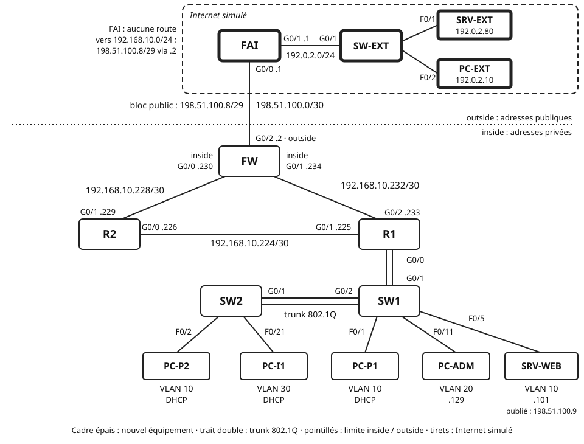

## Objectifs et prérequis

Vous allez raccorder le réseau **fil rouge** à un vrai fournisseur d'accès,
simulé dans Packet Tracer. Vous constaterez d'abord que les postes ne
joignent plus Internet. Vous configurerez ensuite sur FW les trois modes de
traduction du cours : NAT statique, NAT dynamique, puis PAT. Vous finirez
par un dépannage et un défi : la redirection de port.

Vous devez disposer de votre fichier Packet Tracer du
[TP 6](../../04-acl/tp-acl/index.qmd), terminé. Le cours
[« La traduction d'adresses : NAT et PAT »](../cours-nat-pat/index.qmd)
doit être connu. Le cours et la fiche de commandes Cisco sont autorisés.

## Situation de départ

Jusqu'ici, « Internet » n'existait pas vraiment. Depuis le TP 4, une
simple boucle locale de FW le représentait : sa Loopback0, `203.0.113.1/32`.
Aucun paquet ne quittait donc le site.

L'entreprise signe maintenant un contrat avec un fournisseur d'accès à
Internet (FAI). Le FAI lui attribue deux choses : une liaison en `/30`, et
un petit bloc de huit adresses publiques, `198.51.100.8/29`. Il route ce
bloc vers FW. En revanche, il ignore tout du réseau privé
`192.168.10.0/24`, comme tout opérateur réel.

La direction fixe trois besoins :

- **B1** — tous les postes des trois VLAN consultent les sites d'Internet ;
- **B2** — SRV-WEB, le serveur web interne du TP 6, devient joignable
  depuis Internet, à une adresse publique fixe ;
- **B3** — la politique de sécurité du TP 6 reste en vigueur.

{fig-alt="En haut, dans un cadre en tirets « Internet simulé » : le routeur FAI, dont G0/1 point 1 est relié au commutateur SW-EXT, réseau 192.0.2.0/24 ; sur SW-EXT, SRV-EXT 192.0.2.80 sur F0/1 et PC-EXT 192.0.2.10 sur F0/2. Le FAI n'a aucune route vers 192.168.10.0/24 ; il route le bloc public 198.51.100.8/29 vers FW. Liaison FAI–FW : 198.51.100.0/30, FAI G0/0 point 1, FW G0/2 point 2, interface outside. Une ligne pointillée horizontale sépare le côté outside, aux adresses publiques, du côté inside, aux adresses privées. Les routeurs R1, R2 et FW forment un triangle. Liaison R1–R2 : 192.168.10.224/30, R2 G0/0 point 226, R1 G0/1 point 225. Liaison R2–FW : 192.168.10.228/30, R2 G0/1 point 229, FW G0/0 point 230, inside. Liaison R1–FW : 192.168.10.232/30, R1 G0/2 point 233, FW G0/1 point 234, inside. R1 G0/0 est relié en trunk à SW1 G0/1 ; SW1 G0/2 est relié en trunk 802.1Q à SW2 G0/1. Sur SW2 : PC-P2 sur F0/2 en VLAN 10 et PC-I1 sur F0/21 en VLAN 30, en DHCP. Sur SW1 : PC-P1 sur F0/1 en VLAN 10, en DHCP ; PC-ADM sur F0/11 en VLAN 20, adresse 192.168.10.129 ; SRV-WEB sur F0/5 en VLAN 10, adresse 192.168.10.101, publiée sous 198.51.100.9. Les nouveaux équipements FAI, SW-EXT, SRV-EXT et PC-EXT ont un cadre épais."}

Le résultat attendu : chaque besoin est vérifié dans une **matrice de
recette**, comme au TP 6. La table NAT de FW prouve chaque traduction.

## Matériel et environnement

**Plateforme : Cisco Packet Tracer 9.0.1.** Routeurs **2911** sous IOS 15.1
(R1, R2, FW et le nouveau routeur FAI), commutateurs **2960-24TT** (SW1,
SW2 et le nouveau SW-EXT), cinq PC et deux serveurs **Server-PT**. Les
commandes des routeurs se tapent dans l'onglet *CLI*. Celles des PC et des
serveurs se tapent dans *Desktop*, puis *Command Prompt*. Les pages web
s'ouvrent dans *Desktop*, puis *Web Browser*.

**Fichier de départ.** Votre projet `TP6_NOM1_NOM2.pkt`, enregistré sous un
nouveau nom : `TP7_NOM1_NOM2.pkt`.

**Plan d'adressage public.** Toutes ces adresses appartiennent aux plages
de documentation de la RFC 5737. Elles jouent ici le rôle d'adresses
publiques.

| Réseau | Usage | Adresses utilisables |
|:---|:---|:---|
| `198.51.100.0/30` | liaison FAI–FW | `.1` (FAI), `.2` (FW) |
| `198.51.100.8/29` | bloc public de l'entreprise, routé vers FW | `.9` à `.14` |
| `192.0.2.0/24` | réseau « Internet » derrière le FAI | `.1` à `.254` |

**Ce qui change par rapport au TP 6.**

| Équipement | Interface | Adresse / préfixe | Passerelle | Rôle |
|:---|:---|:---|:---|:---|
| FW | G0/2 | `198.51.100.2/30` | — | nouvelle liaison vers le FAI, côté outside |
| FW | Loopback0 | supprimée | — | ne simule plus Internet |
| FAI | G0/0 | `198.51.100.1/30` | — | liaison vers FW |
| FAI | G0/1 | `192.0.2.1/24` | — | passerelle du réseau « Internet » |
| SRV-EXT | F0 | `192.0.2.80/24` | `192.0.2.1` | serveur web public, visité par les salariés |
| PC-EXT | F0 | `192.0.2.10/24` | `192.0.2.1` | internaute, client de SRV-WEB |

**Adresses publiques de l'entreprise.** Ce sont les adresses du bloc
`198.51.100.8/29`, attribué par le FAI. S'y ajoute `198.51.100.2`,
l'adresse de FW sur la liaison `198.51.100.0/30`.

| Adresse publique | Usage | Partie |
|:---|:---|:-:|
| `198.51.100.9` | SRV-WEB, en NAT statique | 2 |
| `198.51.100.10` à `198.51.100.11` | pool du NAT dynamique, volontairement réduit | 3 |
| `198.51.100.2` | adresse de FW G0/2 : PAT des postes, puis redirection de port | 4 et 7 |

Les autres adresses sont celles du plan du TP 6. Aucune adresse privée ne
change.

**Câblage supplémentaire.**

| Câble | De | Vers | Type |
|:-:|:---|:---|:---|
| 8 | FW G0/2 | FAI G0/0 | croisé |
| 9 | FAI G0/1 | SW-EXT G0/1 | droit |
| 10 | SRV-EXT F0 | SW-EXT F0/1 | droit |
| 11 | PC-EXT F0 | SW-EXT F0/2 | droit |

SW-EXT garde sa configuration d'usine : tous ses ports sont dans le
VLAN 1. Il ne demande aucune commande.

**Conventions du TP.**

| Élément | Valeur |
|:---|:---|
| ACL qui désigne les VLAN à traduire | standard nommée `NAT-LAN` |
| Pool du NAT dynamique | `PUBLIC` |
| Interfaces inside de FW | G0/0 (vers R2) et G0/1 (vers R1) |
| Interface outside de FW | G0/2 (vers le FAI) |

**Captures d'écran.** Le compte rendu demande des captures numérotées, de
C1 à C18. Faites-les au fil du TP : une sortie de commande effacée ne se
retrouve pas toujours.

Chaque partie suit la même démarche : **configuration → vérification → test
→ observations à consigner**. Les questions Q1 à Q27 et les captures sont
listées dans la section « Vérification et compte rendu ».

## Travail à réaliser

### Partie 0 — Reprendre le réseau et raccorder le FAI

Cette partie remplace l'Internet simulé du TP 6 par un vrai voisin. Avant de
toucher au réseau, vérifiez qu'il fonctionne : un NAT ne répare jamais un
routage défaillant.

**Point de départ.** Ouvrez votre fichier du TP 6. Enregistrez-le aussitôt
sous `TP7_NOM1_NOM2.pkt`.

**Vérification.** Sur chaque routeur, `show ip ospf neighbor` : chacun voit
deux voisins à l'état `FULL`. Sur R1, `show access-lists` affiche
`INVITES-IN` et `ADMIN-SSH`. Depuis PC-P1, `ping 203.0.113.1` réussit
encore.

::: {.callout-warning}
## Le ping vers 203.0.113.1 échoue déjà ?

Corrigez d'abord le TP 6. Avec une panne de routage, vous ne sauriez pas si
un échec vient du NAT ou du réseau. Prévenez l'enseignant si vous êtes
bloqué.
:::

**Installation de l'Internet simulé.**

1. Ajoutez un routeur **2911**, nommé `FAI`, et un commutateur
   **2960-24TT**, nommé `SW-EXT`.
2. Ajoutez un **Server-PT**, nommé `SRV-EXT`, et un PC, nommé `PC-EXT`.
3. Câblez selon le tableau, câbles 8 à 11.
4. Sur SRV-EXT et PC-EXT, dans *Desktop*, puis *IP Configuration* :
   adressage statique, selon le tableau des changements. Le masque est
   `255.255.255.0`.
5. Sur SRV-EXT, dans *Services*, puis *HTTP* : vérifiez que **HTTP** est
   sur *On*.

**Configuration du FAI.** Le FAI n'est pas votre équipement : sa
configuration vous est fournie en entier. Tapez-la telle quelle.

```text
! Packet Tracer, FAI (2911, IOS 15.1), mode de configuration globale
hostname FAI
interface GigabitEthernet0/0
 description Vers le client fil-rouge
 ip address 198.51.100.1 255.255.255.252
 no shutdown
interface GigabitEthernet0/1
 description Reseau Internet simule
 ip address 192.0.2.1 255.255.255.0
 no shutdown
exit
ip route 198.51.100.8 255.255.255.248 198.51.100.2
! le bloc public du client est routé vers FW
! aucune route vers 192.168.10.0/24 : c'est volontaire
```

**Configuration de FW.** Trois changements, dans cet ordre : adresser G0/2,
remplacer la route par défaut, supprimer la Loopback0. Complétez le
squelette avec le plan d'adressage.

```text
! Packet Tracer, FW (2911, IOS 15.1), mode de configuration globale
interface GigabitEthernet0/2
 description Vers FAI
 ip address ________ ________
 no shutdown
exit
ip route 0.0.0.0 0.0.0.0 ________
! nouvelle route par défaut : le prochain saut est le FAI
no ip route 0.0.0.0 0.0.0.0 Null0
! la route d'ancrage du TP 5 doit disparaître
no interface Loopback0
! Internet n'est plus simulé par FW lui-même
ip route 198.51.100.8 255.255.255.248 Null0
! adresses du bloc public non traduites : jetées, pas de boucle
```

Recopiez la dernière route telle quelle. L'encadré suivant explique son
rôle.

Ne touchez pas à `router ospf 1`. La commande `default-information
originate` du TP 5 reste en place. Ne déclarez pas `198.51.100.0/30` dans
OSPF : le FAI n'est pas un voisin OSPF.

::: {.callout-note}
## Ce que deviennent les choix du TP 5 et du TP 6

- La Loopback0 n'était pas déclarée dans OSPF. Le router-id `3.3.3.3` est
  fixé par `router-id` : sa suppression ne change donc rien à OSPF.
- La route par défaut vers `Null0` jouait le rôle du FAI absent. Le vrai
  FAI la remplace, comme l'annonçait l'encadré « Et dans une vraie
  entreprise ? » du TP 5.
- Une nouvelle route vers `Null0` couvre le bloc public `198.51.100.8/29`.
  C'est la même logique d'ancrage qu'au TP 5. Sans elle, un paquet vers
  une adresse du bloc non traduite repartirait vers le FAI par la route
  par défaut. Le FAI le renverrait à FW, et ainsi de suite jusqu'à
  l'expiration du TTL.
- Sous IOS, la traduction outside vers inside a lieu avant le routage. Les
  adresses traduites, comme `.9`, `.10` ou `.11`, ne sont donc pas jetées.
  Ce comportement est à confirmer sous Packet Tracer.
- Cette route statique n'est pas redistribuée dans OSPF : R1 et R2 ne la
  voient pas.
- Les tests du TP 6 vers `203.0.113.1` visent désormais SRV-EXT,
  `192.0.2.80`. Le test T10 du TP 6, SSH de PC-I1 vers `203.0.113.1`,
  visait une adresse qui n'existe plus. Le test T8 vérifie la même règle
  depuis Internet, et le test T9 depuis PC-I1.
:::

**Vérification.** Sur FW : `show ip interface brief`, G0/2 est *up/up* et
la Loopback0 a disparu. `show ip route static` affiche deux routes : la
route par défaut vers `198.51.100.1` et le bloc public vers `Null0`. Sur R1 : `show ip route`, la route
`O*E2` est toujours présente.

**Test.**

1. Depuis FW : `ping 192.0.2.80`. Le ping doit réussir.
2. Depuis PC-EXT : `ping 198.51.100.2`. Le ping doit réussir.
3. Sur FAI : `show ip route`. Relevez les réseaux connus du FAI.

**La matrice de recette.** Elle traduit les besoins B1 à B3 en tests.
Recopiez-la dans votre compte rendu. Remplissez **dès maintenant** la
colonne « Attendu ». Elle vaut pour la configuration finale de la
partie 6 : **OK** si le flux doit passer, **X** s'il doit échouer.

| N° | Source | Test | Besoin | Attendu | Obtenu (partie 1) | Obtenu (partie 6) |
|:-:|:---|:---|:-:|:-:|:-:|:-:|
| T1 | PC-P1 | `ping 192.0.2.80` | B1 | | | |
| T2 | PC-P1 | navigateur : `http://192.0.2.80` | B1 | | | |
| T3 | PC-I1 | navigateur : `http://192.0.2.80` | B1 | | | |
| T4 | PC-ADM | `ping 192.0.2.80` | B1 | | | |
| T5 | PC-EXT | navigateur : `http://198.51.100.9` | B2 | | — | |
| T6 | PC-EXT | `ping 198.51.100.9` | B2 | | — | |
| T7 | PC-EXT | `ping 192.168.10.101` (adresse privée de SRV-WEB) | B2 | | | |
| T8 | PC-EXT | `ssh -l admin 198.51.100.2` (FW) | B3 | | | |
| T9 | PC-I1 | `ssh -l admin 198.51.100.2` (FW) | B3 | | | |
| T10 | PC-I1 | `ping 192.168.10.129` (PC-ADM) | B3 | | | |
| T11 | PC-ADM | `ssh -l admin 192.168.10.234` (FW) | B3 | | | |
| T12 | R1, R2, FW | `show ip ospf neighbor` : deux voisins `FULL` | B3 | | | |
| T13 | R1 | `ping 192.0.2.80`, depuis la CLI du routeur | — | | | |

Pour T6, le cours, section « NAT statique », vous aide : une
correspondance statique publie-t-elle un seul service ou tout le serveur ?
T5 et T6 ne se testent pas en partie 1 : leur case porte un tiret.

**Observations à consigner.** Q1, Q2, Q3 ; captures C1 et C2.

### Partie 1 — Constater l'échec sans NAT

Avant de traduire, vous allez voir **où** le trafic se perd. Ce constat
justifie tout le reste du TP.

**Test.** Réalisez les tests T1 à T4 et T7 à T13. Remplissez la colonne
« Obtenu (partie 1) ».

**Observation en mode Simulation.**

1. Passez en mode *Simulation*. Dans *Edit Filters*, ne gardez que
   **ICMP**.
2. Dans le *Command Prompt* de PC-P1, lancez `ping 192.0.2.80`.
3. Avancez avec *Capture/Forward*. Cliquez sur l'enveloppe à chaque étape.
   L'onglet *Inbound PDU Details* montre l'en-tête IP reçu.
4. Notez l'équipement où la requête arrive, puis celui où la réponse
   disparaît. Relevez les adresses source et destination de la réponse.
5. Repassez en mode *Realtime*.

::: {.callout-tip}
## Lancez le ping depuis le Command Prompt

L'outil *Add Simple PDU* choisit lui-même l'adresse visée. Le *Command
Prompt* vous laisse taper l'adresse exacte. C'est indispensable dès
qu'un même serveur a une adresse privée et une adresse publique.
:::

**Observations à consigner.** Q4, Q5, Q6 ; capture C3.

### Partie 2 — Publier SRV-WEB par un NAT statique (besoin B2)

Un internaute doit joindre SRV-WEB, toujours à la même adresse. Le NAT
statique associe pour cela, une fois pour toutes, `192.168.10.101` à
`198.51.100.9`.

**Préparation.** Avant de configurer, répondez par écrit : quelles
interfaces de FW sont inside ? Laquelle est outside ? Pourquoi FW a-t-il
**deux** interfaces inside ? Pensez aux chemins possibles depuis le VLAN 10.

**Configuration de FW.** Complétez le squelette. Les commandes sont celles
du cours, sections « Déclarer les interfaces inside et outside » et
« Configurer un NAT statique ».

```text
! Packet Tracer, FW (2911, IOS 15.1), mode de configuration globale
interface GigabitEthernet0/0
 ip nat ________
! liaison vers R2
interface GigabitEthernet0/1
 ip nat ________
! liaison vers R1
interface GigabitEthernet0/2
 ip nat ________
! liaison vers le FAI
exit
ip nat inside source static ________ ________
! d'abord l'adresse privée de SRV-WEB, puis son adresse publique
```

**Vérification.** Sur FW, en mode privilégié, **avant tout trafic** :
`show ip nat translations`. Relevez la ligne affichée.

**Test.**

1. Depuis PC-EXT : `http://198.51.100.9` dans le *Web Browser*. La page
   d'accueil de SRV-WEB s'affiche.
2. Depuis PC-EXT : `ping 198.51.100.9`, puis `ping 192.168.10.101`.
3. Sur FW : `show ip nat translations`. Comparez avec le relevé précédent.
4. Depuis SRV-WEB : `ping 192.0.2.80`. Puis, depuis PC-P1 :
   `ping 192.0.2.80`. Notez les deux résultats.
5. En mode *Simulation*, filtre ICMP, suivez un `ping 198.51.100.9` lancé
   depuis PC-EXT. Remplissez le tableau suivant dans votre compte rendu.

| Segment | IP source | IP destination |
|:---|:---|:---|
| PC-EXT → FAI | | |
| FAI → FW, entrée par G0/2 | | |
| FW → SRV-WEB, sortie par G0/0 ou G0/1 | | |
| SRV-WEB → FW, réponse | | |
| FW → FAI, sortie par G0/2 | | |

::: {.callout-warning}
## Le NAT statique publie tout le serveur

La correspondance statique ne regarde pas les ports. Tout le trafic vers
`198.51.100.9` atteint SRV-WEB : ping, web, et tout autre service ouvert.
Aucune ACL de FW ne filtre G0/2 : le TP 6 n'en a laissé aucune sur FW,
hors des lignes VTY. Le défi de la partie 7 ne publiera que le web.
:::

**Observations à consigner.** Q7 à Q10 ; captures C4 à C6.

### Partie 3 — NAT dynamique : un pool trop petit

Le NAT dynamique prête une adresse publique à chaque poste qui sort. Le
pool est ici limité à deux adresses : vous allez observer ce qui arrive au
troisième poste.

**Préparation : l'ACL qui désigne les VLAN.** Complétez ce tableau dans
votre compte rendu. Les préfixes sont ceux du plan du TP 4.

| VLAN | Réseau | Masque générique |
|:-:|:---|:---|
| 10 | `192.168.10.0/25` | |
| 20 | `192.168.10.128/26` | |
| 30 | `192.168.10.192/27` | |

Le pool est pris dans le bloc `198.51.100.8/29`. Calculez le masque de ce
bloc, en notation décimale pointée : c'est le `netmask` du pool.

**Configuration de FW.** Les interfaces inside et outside restent celles de
la partie 2. Complétez le squelette.

```text
! Packet Tracer, FW (2911, IOS 15.1), mode de configuration globale
ip nat pool PUBLIC 198.51.100.10 198.51.100.11 netmask ________
! pool réduit à deux adresses, pour observer l'épuisement
ip access-list standard NAT-LAN
 remark Designe les trois VLAN a traduire
 permit 192.168.10.0 ________
 permit 192.168.10.128 ________
 permit 192.168.10.192 ________
exit
ip nat inside source list ________ pool ________
! liaison entre l'ACL et le pool
```

::: {.callout-important}
## L'ACL désigne, elle ne filtre pas

`NAT-LAN` n'est appliquée à aucune interface : aucun `ip access-group` ne
la cite. `permit` signifie « à traduire ». Le refus implicite signifie « à
ne pas traduire » : le paquet est routé tel quel, avec son adresse privée.
Revoyez l'encadré « Ici, l'ACL ne filtre pas : elle désigne » du cours.
:::

**Vérification.** Sur FW : `show access-lists NAT-LAN`, puis
`show ip nat statistics`. Relevez les interfaces inside et outside, et la
description du pool.

**Test : épuiser le pool.**

1. Sur FW, en mode privilégié : `clear ip nat translation *`.
2. Depuis PC-P1, puis PC-ADM, puis PC-I1, **dans cet ordre** :
   `ping 192.0.2.80`.
3. Sur FW : `show ip nat translations`, puis `show ip nat statistics`.
   Relevez l'adresse publique prêtée à chaque poste. Relevez les
   compteurs globaux *hits* et *misses*. Relevez aussi les lignes
   propres au pool `PUBLIC` : adresses allouées et, si elles sont
   affichées, allocations refusées. Leur libellé exact est à vérifier
   sous Packet Tracer.
4. Depuis PC-P1, relancez `ping 192.0.2.80`. Relevez son adresse publique.
5. Pendant que la traduction de PC-P1 existe, prévoyez par écrit le
   résultat d'un `ping` de PC-EXT vers l'adresse publique de PC-P1.
   Testez ensuite.
6. Sur FW : `clear ip nat translation *`. Depuis PC-I1, relancez
   `ping 192.0.2.80`.

**Nettoyage avant la partie 4.** Gardez `NAT-LAN`, la correspondance
statique et les interfaces inside et outside. Retirez seulement le NAT
dynamique.

```text
! Packet Tracer, FW (2911, IOS 15.1)
! mode privilégié : vider les traductions dynamiques
clear ip nat translation *
! mode de configuration globale : retirer la liaison, puis le pool
no ip nat inside source list NAT-LAN pool PUBLIC
no ip nat pool PUBLIC
```

::: {.callout-tip}
## La suppression est refusée ?

Le routeur peut refuser de retirer une liaison encore utilisée par des
traductions. Revenez en mode privilégié, videz de nouveau la table, puis
recommencez aussitôt. Un poste qui pingue entre-temps recrée une entrée.
:::

**Vérification.** `show ip nat translations` n'affiche plus que la ligne
statique de SRV-WEB. `show running-config` ne contient plus `ip nat pool`.

**Observations à consigner.** Q11 à Q15 ; captures C7 à C9.

### Partie 4 — PAT : une adresse pour les trois VLAN (besoin B1)

Le PAT fait sortir tous les postes avec l'unique adresse de FW G0/2,
`198.51.100.2`. Les ports distinguent les flux. C'est la configuration
d'une box, et celle que vous garderez.

**Configuration de FW.** Écrivez seul la commande du PAT. Elle réutilise
l'ACL `NAT-LAN` et cite l'interface outside. La syntaxe est dans le cours,
section « Configurer un PAT ». N'oubliez pas le mot-clé `overload`.

**Vérification.** `show running-config` sur FW : relevez toutes les lignes
qui commencent par `ip nat`. Le cours propose un filtre `include`, à
vérifier sous Packet Tracer.

**Test.**

1. Sur FW : `clear ip nat translation *`.
2. Depuis PC-P1, PC-P2, PC-ADM et PC-I1 : `ping 192.0.2.80`, puis
   `http://192.0.2.80` dans le *Web Browser*. Enchaînez vite, en moins
   d'une minute.
3. Sur FW : `show ip nat translations`. Repérez au moins une ligne
   par poste.
4. Depuis SRV-WEB : `ping 192.0.2.80`. Relevez l'adresse *inside global*
   utilisée pour SRV-WEB dans la table.
5. Depuis R1 : `ping 192.0.2.80`. Notez le résultat.
6. Sur FW : `show ip nat statistics`. Relevez le nombre de traductions
   actives.
7. Cliquez plusieurs fois sur *Fast Forward Time*, puis relancez
   `show ip nat translations`. Notez les lignes qui ont disparu.

::: {.callout-note}
## Et l'ACL INVITES-IN du TP 6 ?

Elle filtre l'entrée de R1 G0/0.30, bien avant FW. Le NAT n'a pas encore
eu lieu : elle voit la source privée du poste. Elle voit aussi une
destination publique, par exemple `192.0.2.80`. Ses règles distinguent
les destinations du site, filtrées, de toute destination hors du site,
autorisée. Une destination publique tombe dans ce second cas : le PAT ne
demande aucune modification de `INVITES-IN`.
:::

**Sauvegarde.** Sur FW et sur FAI : `copy running-config startup-config`.
Enregistrez le fichier `.pkt`.

**Observations à consigner.** Q16 à Q20 ; captures C10 à C12.

### Partie 5 — Vérifier et dépanner la traduction

Un NAT en panne ne donne aucun message d'erreur : les paquets partent sans
traduction et ne reviennent pas. La table et les compteurs sont vos seuls
témoins. Vous allez provoquer deux situations, puis les expliquer.

**Panne A — une interface inside oubliée.** Un collègue « nettoie » la
configuration de FW et retire `ip nat inside` de G0/1.

1. Sur FW, interface G0/1 : `no ip nat inside`.
2. Sur FW : `clear ip nat translation *`.
3. Depuis PC-P1 : `ping 192.0.2.80`. Depuis PC-EXT : `http://198.51.100.9`.
4. Sur FW : `show ip nat translations` et `show ip nat statistics`.
   Comparez la liste des interfaces inside avec celle de la partie 3.
5. Depuis PC-P1 : `tracert 192.0.2.80`. Notez le chemin suivi.
6. En mode *Simulation*, avec le filtre **HTTP** ou **TCP**, relancez
   `http://198.51.100.9` depuis PC-EXT. Suivez la requête jusqu'à
   SRV-WEB, puis la réponse jusqu'à sa disparition ou à PC-EXT. À chaque
   passage dans FW, relevez l'interface et les adresses de l'en-tête IP.
   Repassez ensuite en mode *Realtime*.
7. Diagnostiquez la panne avec la check-list du cours, section « Vérifier
   et dépanner ». Corrigez-la, puis refaites l'étape 3.

**Situation B — une liaison coupée.** Le NAT est de nouveau correct. Vous
coupez la liaison R1–FW.

1. Sur R1, interface G0/2 : `shutdown`.
2. Attendez qu'OSPF ait basculé. Depuis PC-P1 : `tracert 192.0.2.80`, puis
   `http://192.0.2.80`.
3. Sur FW : `show ip nat translations`.
4. Sur R1, interface G0/2 : `no shutdown`. Attendez le retour du voisin FW
   à l'état `FULL`.

**Vider la table.** Sur FW, en mode privilégié, lancez
`clear ip nat translation *`, puis `show ip nat translations`. Notez la
ligne qui reste.

Le cours cite aussi `show ip nat translations verbose` et `debug ip nat`,
pour un IOS réel. Essayez-les : notez si votre version de Packet Tracer
les accepte. Arrêtez tout débogage avec `undebug all`.

**Observations à consigner.** Q21 à Q24 ; captures C13 à C15.

### Partie 6 — Recette finale

La recette prouve que la configuration finale répond aux besoins B1 à B3.
Elle se fait sur le réseau complet : NAT statique, PAT et ACL du TP 6 en
place.

1. Sur FW : `clear ip nat translation *`.
2. Réalisez les tests T1 à T13. Remplissez la colonne « Obtenu
   (partie 6) ».
3. Sur FW : `show ip nat translations`.
4. Sur chaque routeur : `copy running-config startup-config`. Enregistrez
   le fichier `.pkt`.

Expliquez, puis corrigez tout écart entre le résultat obtenu et le résultat
attendu.

**Observations à consigner.** Q25 ; captures C16 et C17.

### Partie 7 (défi) — Ne publier que le service web

Le NAT statique de la partie 2 expose tout SRV-WEB. La direction veut
désormais ne publier que le web. Elle veut aussi libérer `198.51.100.9`.
SRV-WEB sera joint sur le port TCP 80 de l'adresse de FW, `198.51.100.2`.

1. Prévoyez par écrit l'effet de cette redirection sur le PAT des postes,
   qui utilise la même adresse.
2. Retirez la correspondance statique de la partie 2 avec `no`.
3. Écrivez la redirection de port. Le cours, section « Variante :
   redirection de port », donne la syntaxe.
4. Testez depuis PC-EXT : `http://198.51.100.2`, puis
   `https://198.51.100.2`, puis `ping 198.51.100.2`, puis
   `http://198.51.100.9`.
5. En mode *Simulation*, filtre ICMP : suivez le `ping 198.51.100.2`.
   Notez l'équipement qui répond.
6. Vérifiez que T1 à T4 réussissent toujours.
7. Sur FW : `show ip nat translations`.

Après la libération de `198.51.100.9`, un paquet vers cette adresse
devrait être jeté par FW, grâce à la route du bloc vers `Null0`. Ce
comportement est à confirmer sous Packet Tracer.

Le fichier rendu peut garder cette redirection. Dans ce cas, signalez dans
le compte rendu que T5 et T6 visent `198.51.100.9`, désormais libérée.

**Observations à consigner.** Q26 et Q27 ; capture C18.

## Vérification et compte rendu

### Questions

Répondez à chaque question en quelques phrases. Appuyez-vous sur vos
captures quand c'est utile.

**Partie 0**

- **Q1.** Recopiez votre configuration de FW G0/2 et la nouvelle route par
  défaut. Pourquoi faut-il supprimer la route par défaut vers `Null0` ? Que se
  passerait-il avec deux routes par défaut statiques, de même distance
  administrative ?
- **Q2.** Après le changement, la route `O*E2` de R1 a-t-elle changé ?
  Expliquez le rôle de `default-information originate`. Pourquoi ne
  faut-il pas déclarer `198.51.100.0/30` dans OSPF ?
- **Q3.** Recopiez la matrice de recette avec sa colonne « Attendu ».
  Justifiez les résultats attendus de T6, T7, T8, T9 et T13.

**Partie 1**

- **Q4.** Listez les réseaux connus du FAI, d'après son `show ip route`.
  Expliquez alors le résultat de T1. La requête atteint-elle SRV-EXT ?
- **Q5.** D'après le mode Simulation, sur quel équipement la réponse
  disparaît-elle ? Donnez ses adresses source et destination. Pourquoi un
  vrai opérateur n'aurait-il, lui non plus, aucune route vers
  `192.168.10.0/24` ? Citez la RFC 1918.
- **Q6.** Depuis FW, le ping vers `192.0.2.80` réussit pourtant. Quelle
  adresse source FW utilise-t-il ? Pourquoi la réponse revient-elle ?

**Partie 2**

- **Q7.** Recopiez votre configuration NAT de FW. Justifiez le rôle de
  chaque interface. Que se passerait-il si G0/0 n'était pas déclarée
  inside et que la liaison R1–FW tombait ?
- **Q8.** Que contient la table avant tout trafic ? Pourquoi une ligne
  existe-t-elle déjà ? Nommez chaque colonne remplie avec le vocabulaire
  Cisco.
- **Q9.** Recopiez le tableau du mode Simulation. Sur quelle adresse porte
  la traduction à l'aller, puis au retour ? Reliez votre réponse aux rôles
  inside et outside.
- **Q10.** SRV-WEB joint SRV-EXT, mais PC-P1 ne le joint toujours pas.
  Expliquez ces deux résultats. Expliquez aussi celui de T7, et dites
  pourquoi ce test ne doit jamais servir à valider un NAT.

**Partie 3**

- **Q11.** Recopiez le tableau des masques génériques et l'ACL `NAT-LAN`.
  Détaillez le calcul du masque générique du VLAN 20 et du `netmask` du
  pool.
- **Q12.** Recopiez les adresses publiques prêtées aux trois postes. Que
  devient le troisième ? Dans `show ip nat statistics`, distinguez les
  compteurs globaux *hits* et *misses* des lignes du pool `PUBLIC`.
  Lesquelles révèlent vraiment l'épuisement du pool ? Justifiez.
- **Q13.** Au nouveau ping de PC-P1, son adresse publique a-t-elle changé ?
  Pourquoi ? Combien de temps, selon le cours, une entrée de NAT dynamique
  reste-t-elle sur un IOS réel ?
- **Q14.** Comparez votre prévision et le résultat du ping de PC-EXT vers
  l'adresse publique de PC-P1. Reliez-le à la ligne « Accès entrant » du
  tableau de synthèse du cours. Le NAT est-il un mécanisme de sécurité ?
- **Q15.** Après `clear ip nat translation *`, pourquoi PC-I1 sort-il ?
  Combien d'adresses publiques faudrait-il pour que les quatre PC sortent
  en même temps, en NAT dynamique ? SRV-WEB garde son adresse statique.

**Partie 4**

- **Q16.** Recopiez votre commande PAT. Que se passerait-il sans le
  mot-clé `overload` ?
- **Q17.** Recopiez au moins une ligne de la table par poste. Que
  remarquez-vous dans la colonne *inside global* ? Comment FW sait-il à
  quel poste renvoyer chaque réponse ?
- **Q18.** Quelle adresse *inside global* SRV-WEB utilise-t-il pour sortir ?
  Proposez une explication, sachant que les deux règles le concernent.
- **Q19.** Le ping depuis R1 échoue. Quelle adresse source R1 utilise-t-il ?
  Pourquoi n'est-elle pas traduite ? Faut-il l'ajouter à `NAT-LAN` ?
  Justifiez.
- **Q20.** Quelles lignes ont disparu après les clics sur *Fast Forward
  Time* ? Comparez avec le tableau des délais du cours. Rappelez que
  Packet Tracer peut s'écarter de l'IOS réel.

**Partie 5**

- **Q21.** Pendant la panne A, quel chemin suivait le `tracert` de PC-P1 ?
  Pourquoi le trafic n'était-il plus traduit ? Quelle commande montrait
  la cause le plus vite ?
- **Q22.** Que montre le mode Simulation pendant la panne A ? Par quelle
  interface la réponse de SRV-WEB entre-t-elle dans FW ? Avec quelle
  adresse source en ressort-elle, si elle en ressort ? Expliquez le
  résultat obtenu par PC-EXT.
- **Q23.** Pendant la situation B, le PAT a-t-il continué de fonctionner ?
  Par quelle interface inside le trafic entrait-il ? Que montre cette
  situation sur le lien entre OSPF et le NAT ?
- **Q24.** Après `clear ip nat translation *`, quelle ligne reste dans la
  table ? Pourquoi ? Les commandes `verbose` et `debug ip nat` sont-elles
  acceptées par votre version de Packet Tracer ?

**Partie 6**

- **Q25.** Recopiez la matrice de recette complète. Comparez les deux
  colonnes « Obtenu » : quels tests le NAT a-t-il fait passer ? Expliquez
  T8 et T9 : quelle ACL du TP 6 a décidé de chaque résultat, et où
  est-elle appliquée ? Pourquoi `INVITES-IN` laisse-t-elle passer T9 ?
  Pour toute case qui diffère de l'attendu, donnez la cause et la
  correction.

**Partie 7 (défi)**

- **Q26.** Recopiez votre redirection de port. Relevez les résultats des
  quatre tests de PC-EXT. Quel équipement répond au ping vers
  `198.51.100.2` ? Pourquoi ? Le test vers `198.51.100.9` échoue-t-il
  aussitôt, sans boucle ? Quelle route de FW l'explique ?
- **Q27.** Le PAT des postes fonctionne-t-il encore ? Comparez avec votre
  prévision. Quel avantage la redirection présente-t-elle sur le NAT
  statique de la partie 2, pour la sécurité et pour les adresses ?

### Captures d'écran

Chaque capture porte son numéro et une légende d'une ligne. Elle montre
l'invite de commande, pour qu'on sache sur quel équipement elle est prise.

| N° | Partie | Contenu |
|:-:|:-:|:---|
| C1 | 0 | `show ip interface brief` et `show ip route static` sur FW, après le raccordement |
| C2 | 0 | `show ip route` sur FAI |
| C3 | 1 | mode Simulation : équipement où la réponse de SRV-EXT disparaît, avec ses adresses |
| C4 | 2 | `show ip nat translations` sur FW, avant tout trafic |
| C5 | 2 | navigateur de PC-EXT sur `http://198.51.100.9` |
| C6 | 2 | `show ip nat translations` sur FW, après les tests |
| C7 | 3 | `show access-lists NAT-LAN` sur FW |
| C8 | 3 | `show ip nat translations` et `show ip nat statistics`, pool épuisé |
| C9 | 3 | ping échoué du troisième poste |
| C10 | 4 | lignes `ip nat` de la configuration de FW |
| C11 | 4 | `show ip nat translations` sur FW : au moins une ligne par poste |
| C12 | 4 | `ping 192.0.2.80` depuis R1 |
| C13 | 5 | `show ip nat statistics` sur FW, pendant la panne A |
| C14 | 5 | `tracert 192.0.2.80` depuis PC-P1 et table NAT, pendant la situation B |
| C15 | 5 | `show ip nat translations` après `clear ip nat translation *` |
| C16 | 6 | `show ip nat translations` sur FW, après la recette finale |
| C17 | 6 | `ssh -l admin 198.51.100.2` depuis PC-EXT |
| C18 | 7 | navigateur de PC-EXT sur `http://198.51.100.2` et table NAT de FW |

### Critères de réussite

Le réseau est validé quand :

- toutes les cases « Obtenu (partie 6) » sont égales aux cases « Attendu » ;
- FW a une seule route par défaut, vers `198.51.100.1`, et R1 et R2 la
  reçoivent avec le code `O*E2` ;
- chaque routeur du site voit deux voisins à l'état `FULL` ;
- G0/0 et G0/1 de FW sont inside, G0/2 est outside ;
- le FAI n'a toujours aucune route vers `192.168.10.0/24` ;
- le pool `PUBLIC` a disparu de la configuration ;
- les ACL du TP 6 sont inchangées ;
- les configurations sont enregistrées dans la `startup-config` de tous
  les routeurs.

### Livrables

- Le compte rendu au format PDF, nommé `TP7_NOM1_NOM2.pdf` : réponses aux
  questions Q1 à Q25, captures C1 à C17, et la matrice de recette remplie.
  Ajoutez Q26, Q27 et C18 si vous avez fait le défi.
- Le projet Packet Tracer, enregistré sous `TP7_NOM1_NOM2.pkt`, dans son
  état de fin de partie 6 ou de fin de partie 7.
- Les deux fichiers sont déposés sur l'ENT.

## Synthèse

Pour chaque partie, notez en une phrase ce que vous avez vérifié. Citez la
commande ou le test qui l'a montré. Le cas échéant, décrivez la panne
rencontrée et sa cause.

Terminez par un court bilan. Comparez les quatre traductions du TP :
statique, dynamique, PAT et redirection de port. Pour chacune, donnez le
nombre d'adresses publiques consommées et dites si un accès entrant est
possible. Expliquez enfin pourquoi le NAT ne remplace ni le routage ni le
filtrage.

## Pour aller plus loin

- **Filtrer le côté outside.** Le cours rappelle que le NAT n'est pas un
  pare-feu. Écrivez une ACL étendue, appliquée en entrée de FW G0/2, qui
  n'autorise que le web vers SRV-WEB. Faut-il citer l'adresse publique ou
  l'adresse privée de SRV-WEB comme destination ? Testez les deux
  versions dans Packet Tracer, puis concluez.
- **Le rôle de la route vers Null0.** Depuis PC-EXT, lancez
  `tracert 198.51.100.12`, une adresse qu'aucune traduction n'utilise.
  Retirez ensuite la route du bloc vers `Null0` sur FW, puis recommencez.
  Comparez, puis remettez la route.
- Sources :
  - [RFC 3022 — Traditional IP Network Address Translator](https://www.rfc-editor.org/rfc/rfc3022.html),
    qui décrit le NAT de base et le NAPT, c'est-à-dire le PAT ;
  - [RFC 1918 — Address Allocation for Private Internets](https://www.rfc-editor.org/rfc/rfc1918.html),
    qui définit les plages privées et demande de ne pas les propager ;
  - [RFC 5737 — IPv4 Address Blocks Reserved for Documentation](https://www.rfc-editor.org/rfc/rfc5737.html),
    d'où viennent toutes les adresses « publiques » de ce TP ;
  - la référence des commandes intégrée à Packet Tracer, menu *Help*, pour
    le routeur 2911.
