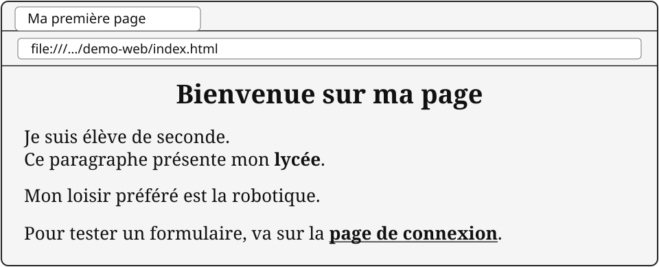
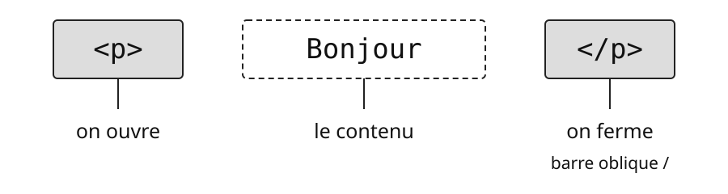
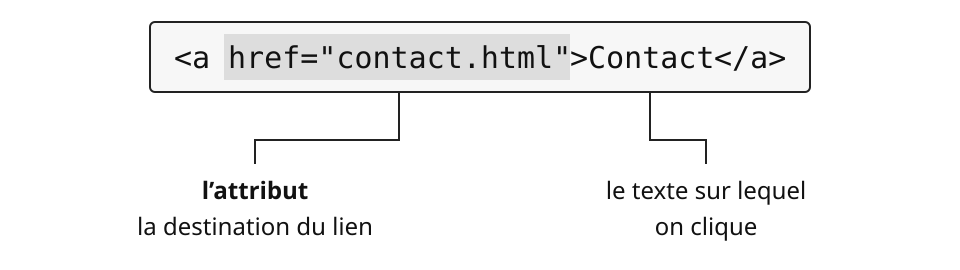
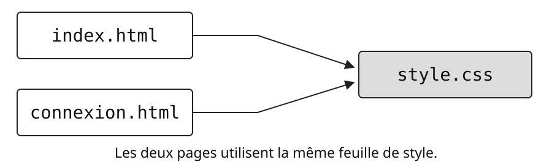
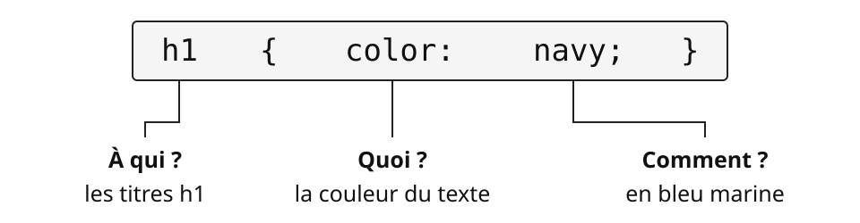

| Nom | Prénom |
|---|---|
| \_\_\_\_\_\_\_\_ | \_\_\_\_\_\_\_\_ |
| **Classe** | **Date** |
| \_\_\_\_\_\_\_\_ | \_\_\_\_\_\_\_\_ |

Ce document se remplit en classe, en même temps que le cours,
puis en autonomie pour les activités. Aujourd'hui, tu vas lire et modifier une
vraie page Web sur ordinateur. Range ce livret avec le livret 1 : tu en auras
besoin pour le bilan.

Séance 2 — HTML et CSS : écrire une page. En salle informatique.

Avant de commencer :

1. Reprends le livret 1 et refais son test d'entrée dans la colonne « Séance 2 », seul et sans regarder le cours.
2. Dans « Mes mots à éclaircir » du livret 1, coche les mots qui ont été expliqués.

## 6. Ce que je vois n'est pas la page

Une page s'affiche sur ton écran. Peux-tu la modifier ? Et si oui, qui verra ta modification ?

### Activité 2.1 — Modifier une page… pour quelques secondes

1. Dans le navigateur, ouvre la page d'accueil du site du lycée : https://www.lasallesaintdenis.com. Si la page ne s'affiche pas, ou si tu ne trouves aucun titre en texte (le titre est une image), prends une autre page, par exemple https://fr.wikipedia.org.
2. Fais un **clic droit** sur un titre de la page, puis choisis **Inspecter**. Un panneau s'ouvre à droite ou en bas du navigateur : il affiche le code HTML. Dans ce panneau, clique sur l'icône représentant **une flèche dans un carré en pointillés**, en haut à gauche. Déplace ensuite la souris sur le titre et clique dessus : la ligne HTML correspondante est surlignée.
3. Dans cette zone, fais un **double-clic** sur le texte du titre, remplace-le par ton prénom, puis appuie sur **Entrée**. Regarde la page.
4. Appuie sur **F5** pour recharger la page.

a) Qu'est devenue ta modification après F5 ?

\_\_\_\_\_\_\_\_

b) Ton voisin, qui affiche la même page, a-t-il vu ton prénom ? Pourquoi, à ton avis ?

\_\_\_\_\_\_\_\_  
\_\_\_\_\_\_\_\_

c) Que fait le navigateur quand tu appuies sur F5 ? Où se trouve, à ton avis, la page « d'origine » ?

\_\_\_\_\_\_\_\_  
\_\_\_\_\_\_\_\_

Nous verrons au livret 3 où se trouve la page d'origine et comment ton navigateur la demande. Retiens pour l'instant qu'une capture d'écran d'une page n'en prouve pas le contenu : n'importe qui peut modifier ce qu'il affiche.

## 7. Le langage HTML : décrire le contenu

Le même document doit pouvoir s'afficher sur un ordinateur, un téléphone ou une liseuse. Sous quelle forme faut-il l'écrire ?

Mots proposés : balises • texte • structure

Une page Web est un simple fichier \_\_\_\_\_\_\_\_, écrit dans le langage **HTML** (*HyperText Markup Language*). Ce n'est pas un langage de programmation : il ne fait aucun calcul. Il décrit la \_\_\_\_\_\_\_\_ de la page (un titre, un paragraphe, un lien, une image…) à l'aide de \_\_\_\_\_\_\_\_. Chaque navigateur lit ce fichier et l'affiche à sa façon, selon la taille de l'écran.

### Document 6 — Le code de la page index.html et son affichage dans le navigateur

Le fichier index.html ouvert dans l'éditeur de texte (lignes numérotées de 1 à 16) :

```{.html .numberLines}
<!DOCTYPE html>
<html lang="fr">
  <head>
    <meta charset="utf-8">
    <title>Ma première page</title>
    <link rel="stylesheet" href="style.css">
  </head>
  <body>
    <h1>Bienvenue sur ma page</h1>
    <p>Je suis élève de seconde.<br>
      Ce paragraphe présente mon <strong>lycée</strong>.</p>
    <p>Mon loisir préféré est la robotique.</p>
    <p>Pour tester un formulaire, va sur la
      <a href="connexion.html">page de connexion</a>.</p>
  </body>
</html>
```

{fig-alt="Fenêtre du navigateur : onglet Ma première page, adresse file:///…/demo-web/index.html. Le titre Bienvenue sur ma page est centré. Le mot lycée est en gras. Le lien page de connexion est en gras et souligné." width=100%}

Lignes 3 à 7 : l'**en-tête** (head), des informations *sur* la page ; seul le titre de l'onglet s'affiche.
Lignes 8 à 15 : le **corps** (body), le contenu affiché dans la fenêtre.

### Document 7 — Comment s'écrit une balise

1. **Une balise entoure un contenu.** On l'ouvre, on écrit le contenu, on la ferme avec une barre oblique `/`.

    {fig-alt="Dans <p>Bonjour</p>, <p> ouvre la balise, Bonjour est le contenu, </p> ferme la balise avec une barre oblique." width=100%}

2. **Une balise peut avoir un réglage : un attribut.** Pour un lien, l'attribut `href` indique où mène le lien.

    {fig-alt='Dans <a href="contact.html">Contact</a>, href="contact.html" est l’attribut indiquant la destination du lien. Contact est le texte sur lequel on clique.' width=100%}

3. **Quelques balises n'ont pas de balise fermante**, car elles n'entourent rien : `<br>` (passage à la ligne) et <code>&lt;img src="photo.svg" alt="Une photo du lycée"&gt;</code> (une image : `src` donne le fichier, `alt` un texte affiché si l'image manque).

### Activité 2.2 — Lire le code d'une page

1. *(Doc. 6)* Compare le code et l'affichage. Quel texte du code s'affiche dans l'onglet, et pas dans la fenêtre ?

\_\_\_\_\_\_\_\_

2. *(Doc. 6 et 7)* Compare le code et l'affichage, puis complète le rôle de chaque balise :

| Balise | Rôle |
|---|---|
| `<h1>` … `</h1>` | |
| `<p>` … `</p>` | |
| `<strong>` … `</strong>` | |
| `<a href="…">` … `</a>` | |
| `<br>` | |
| <code>&lt;img src="…" alt="…"&gt;</code> | |

::: {.callout-note title="À retenir" icon="false" appearance="simple"}

Une page Web est un fichier texte écrit en **HTML**. Les **balises** décrivent le contenu : `<p>Bonjour</p>` (on ouvre, le contenu, on ferme). Un **attribut** règle la balise, comme `href` pour la destination d'un lien. Quelques balises, comme `` et `<br>`, n'ont pas de balise fermante.

:::

### Les liens

Un lien peut-il mener ailleurs que vers un autre site ?

### Document 8 — Les trois sortes de liens

| Le lien mène… | Exemple |
|---|---|
| à un autre site | `<a href="https://fr.wikipedia.org/wiki/Web">Wikipédia</a>` |
| à une autre page du même site | `<a href="connexion.html">Connexion</a>` |
| à un endroit de la même page | `<a href="#haut">Remonter</a>` |

Pour le troisième lien, on donne d'abord un nom à l'endroit visé avec l'attribut `id` : `<h1 id="haut">`. Le signe `#`, suivi de ce nom, désigne dans l'adresse un endroit précis de la page : on l'appelle le **fragment**.

### Activité 2.3 — Modifier le contenu de la page (sur ordinateur)

Télécharge le dossier demo-web : [demo-web.zip](fichiers/demo-web.zip). Suis les étapes dans l'ordre et vérifie à chaque fois « ce que tu dois voir ».

**Étape 1. Préparer.** Télécharge le dossier demo-web. Si tu obtiens une archive, extrais-la. Place le dossier dans ton dossier personnel (à ton nom). Ouvre index.html dans le navigateur (double-clic), puis ouvre ce même fichier avec **Geany ou VS Code** (clic droit → *Ouvrir avec*). Place les deux fenêtres côte à côte.

✔ Ce que tu dois voir : la page du document 6 dans le navigateur, son code dans l'éditeur.

**Étape 2. Repérer.** Dans l'éditeur, trouve la ligne du titre principal et compte les paragraphes de la page.

\_\_\_\_\_\_\_\_

**Étape 3. Modifier une phrase.** Remplace « Ce paragraphe présente mon lycée. » par une phrase à toi sur ton lycée (garde la balise `<strong>` autour d'un mot). **Enregistre** (Ctrl+S), puis recharge la page dans le navigateur (F5).

✔ Ce que tu dois voir : ta phrase dans la page. Si rien ne change, as-tu enregistré ?

**Étape 4. Ajouter un lien vers un autre site.** Dans le deuxième paragraphe, transforme le nom de ton loisir en lien vers sa page Wikipédia, sur le modèle des documents 7 et 8. Recopie la ligne que tu as écrite.

\_\_\_\_\_\_\_\_  
\_\_\_\_\_\_\_\_

✔ Ce que tu dois voir : le mot souligné et en vert ; un clic ouvre la page Wikipédia.

**Étape 5. Insérer l'image.** Dans l'éditeur, repère la fin du deuxième paragraphe (`</p>`). Juste après, sur une nouvelle ligne, ajoute la balise `` pour afficher photo.svg, en t'aidant du document 7. Le fichier photo.svg est dans le même dossier que index.html : indique simplement son nom dans l'attribut `src`. Enregistre (Ctrl+S), puis recharge la page (F5).

✔ Ce que tu dois voir : la photo apparaît sur toute la largeur de la page. Sinon, vérifie le nom exact photo.svg et l'emplacement du fichier.

::: {.callout-note title="Si tu as terminé avant les autres." icon="false" appearance="simple"}

Crée une deuxième page consacrée à ton loisir :

1. Dans Geany ou VS Code, crée un nouveau fichier et enregistre-le sous le nom loisir.html, **dans le même dossier** que index.html et style.css.
2. En t'aidant du document 6, écris la structure d'une page HTML : `<html>`, `<head>`, `<title>` et `<body>` (avec leurs balises fermantes).
3. Dans `<body>`, ajoute un titre `<h1>` avec le nom de ton loisir et un paragraphe `<p>` qui le présente.
4. Dans `<head>`, relie la page à style.css, comme dans index.html.
5. Dans index.html, crée un lien vers loisir.html ; dans loisir.html, crée un lien de retour vers index.html.
6. Enregistre les fichiers, ouvre les pages dans le navigateur et teste les deux liens.

:::

## 8. Le langage CSS : décrire la présentation

Pour passer en bleu tous les titres d'un site de 500 pages, faut-il vraiment modifier 500 fichiers ?

Mots proposés : sépare • présentation • feuille de style

**CSS** (*Cascading Style Sheets*, « feuilles de style en cascade ») est le langage qui décrit la \_\_\_\_\_\_\_\_ d'une page Web : couleurs, tailles, alignement. HTML dit *ce qu'il y a* dans la page ; CSS dit *à quoi elle ressemble*.

On \_\_\_\_\_\_\_\_ donc le contenu (le fichier HTML) de la présentation (le fichier CSS). Un seul fichier CSS sert à tout le site : la \_\_\_\_\_\_\_\_.

### Document 9 — La feuille de style style.css

```css
body { background-color: whitesmoke; }
h1   { color: navy; text-align: center; }
p    { font-size: 18px; }
a    { color: green; }
img  { width: 100%; }
```

{fig-alt="Deux flèches partent respectivement de index.html et de connexion.html vers un seul fichier style.css : les deux pages utilisent la même feuille de style." width=100%}

**Comment lire une règle ?** `h1 { color: navy; }` : `h1` = à qui ? (les titres h1) ; `color` = quoi ? (la couleur du texte) ; `navy` = comment ? (en bleu marine).

{fig-alt="Dans h1 { color: navy; }, h1 répond à À qui ? : les titres h1. color répond à Quoi ? : la couleur du texte. navy répond à Comment ? : en bleu marine." width=100%}

`color` : couleur du texte ; `background-color` : couleur du fond ; `font-size` : taille du texte (`px` = pixels) ; `text-align: center` : centrer ; `width` : largeur. Les couleurs s'écrivent en anglais : `red`, `green`, `navy` (bleu marine)…

*(Doc. 9)* Complète le tableau à partir de la feuille de style.

| À qui ? | Quoi ? | Comment ? | Effet sur la page |
|---|---|---|---|
| `h1` | `color` | `navy` | les titres sont en bleu marine |
| `h1` | `text-align` |  |  |
| `p` |  | `18px` |  |
|  | `color` |  |  |

### Activité 2.4 — Contenu ou présentation ? (à l'oral, avec la classe)

Pour chaque modification, dis s'il faut modifier le fichier HTML ou la feuille de style CSS, et justifie.

| N° | Modification | HTML | CSS |
|---|---|:---:|:---:|
| 1 | Ajouter un paragraphe sur le club de robotique | $\square$ | $\square$ |
| 2 | Passer tous les titres en rouge | $\square$ | $\square$ |
| 3 | Insérer une photo de la façade du lycée | $\square$ | $\square$ |
| 4 | Centrer le texte de tous les paragraphes | $\square$ | $\square$ |
| 5 | Remplacer le texte d'un lien, « clique ici », par « site de l'académie » | $\square$ | $\square$ |
| 6 | Changer la couleur de tous les liens | $\square$ | $\square$ |
| 7 | Ajouter un texte de remplacement (`alt`) à une image | $\square$ | $\square$ |

### Activité 2.5 — Modifier la présentation (sur ordinateur)

**Étape 6. Changer une couleur.** Ouvre style.css dans l'éditeur. Dans la règle `h1`, remplace `navy` par `red`. Enregistre, puis recharge index.html (F5). Clique ensuite sur le lien « page de connexion ».

✔ Ce que tu dois voir : le titre en rouge sur index.html… et aussi sur connexion.html.

Explique, à l'aide du document 9, pourquoi le titre de connexion.html a changé alors que tu n'as pas ouvert ce fichier.

\_\_\_\_\_\_\_\_  
\_\_\_\_\_\_\_\_

**Étape 7. Changer l'apparence sans toucher au contenu.** Sans ouvrir index.html, change la couleur du fond et la taille du texte dans style.css. Note tes modifications, puis conclus.

\_\_\_\_\_\_\_\_  
\_\_\_\_\_\_\_\_  
\_\_\_\_\_\_\_\_

### Un même site sur tous les écrans

Comment une seule page peut-elle s'afficher correctement à la fois sur un grand écran et sur un téléphone ?

> **Document 10 — 2010 : un même site pour tous les écrans.** Avec les smartphones, les sites conçus pour un écran d'ordinateur deviennent difficiles à lire. Plutôt que d'écrire un second site « mobile », à tenir à jour en plus du premier, le concepteur américain **Ethan Marcotte** propose le 25 mai 2010 le *responsive web design* (site adaptatif) : **une seule page HTML**, et des règles CSS qui changent selon la largeur de l'écran.
>
> Source : E. Marcotte, « Responsive Web Design », *A List Apart*, 25/05/2010.

### Activité 2.6 — Un site, tous les écrans

*(Doc. 10)* Pour adapter un site au téléphone, quel fichier modifie-t-on ? Pourquoi est-ce plus simple que d'écrire un second site ?

\_\_\_\_\_\_\_\_  
\_\_\_\_\_\_\_\_

::: {.callout-note title="À retenir" icon="false" appearance="simple"}

**CSS** est le langage qui décrit la présentation des pages Web. **On sépare le contenu (HTML) de la présentation (CSS).**

- **HTML** décrit *ce que dit* la page : titres, paragraphes, liens, images. **CSS** décrit *à quoi elle ressemble* : couleurs, polices, tailles, marges.
- Une règle CSS s'écrit `sélecteur { propriété: valeur; }`, par exemple `h1 { color: red; }`.
- Une seule **feuille de style**, reliée à chaque page par `<link>`, suffit pour changer l'apparence de tout un site sans toucher à son contenu.
- **2010** : le site adaptatif (*responsive web design*) : une seule page HTML, et des règles CSS qui s'adaptent à la largeur de l'écran.
- Un lien peut mener à un autre site (URL complète), à une autre page du site ou à un endroit de la même page (`#` et `id`).

:::

**À la prochaine séance**, nous verrons où se trouve la page d'origine et comment ton navigateur la demande.
