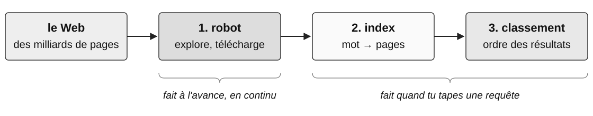
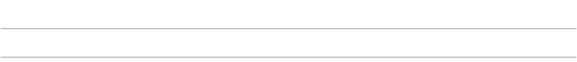
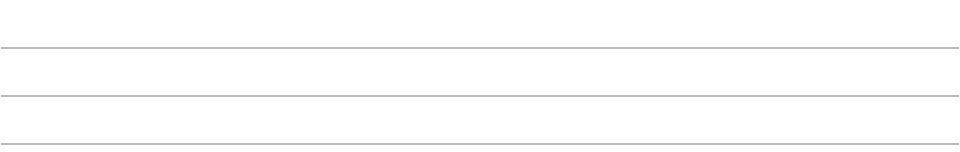
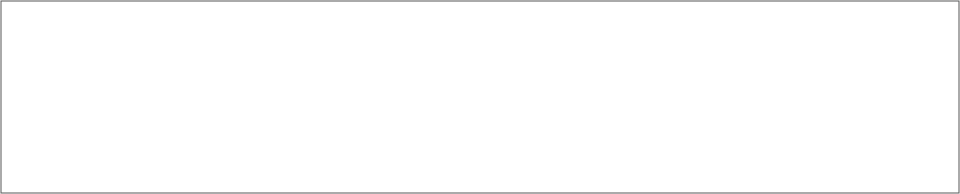

<!-- Conversion fidèle de la version élève de publication/SNT_Web_Livret4_corrige.tex.
La consigne particulière impose les titres et l’ordre de la source, plutôt que
ceux du gabarit cours. Aucune réponse ni note enseignant n’est conservée. -->

SCIENCES NUMÉRIQUES ET TECHNOLOGIE — SECONDE

**Thématique : LE WEB**

**Livret 4 — séance 4**

| **Nom :** | **Prénom :** | **Classe :** | **Date :** |
|---|---|---|---|

Ce document se remplit **en classe, en même temps que le cours**, puis en autonomie pour les activités.
Aujourd'hui, tu vas comprendre comment on retrouve une page sans connaître son adresse, ce que tu as le droit de publier, et comment te protéger : adresses trompeuses, cookies, réglages du navigateur. Le livret se termine par le **bilan de toute la thématique** : garde les livrets 1, 2 et 3 sous la main.

::: {.callout-note appearance="simple" icon="false"}

**SÉANCE 4 (1 h 30)** — Chercher, publier, se protéger   **En salle informatique**

:::

::: {.callout-note appearance="simple" icon="false"}
## Avant de commencer

1. Dans « Mes mots à éclaircir » du livret 1, coche les mots qui ont été expliqués au livret 3.

2. Relis l'encadré « À retenir » qui termine le §5 du livret 1 (HTTPS et honnêteté d'un site) : nous y revenons aujourd'hui.

:::

## 12. Les moteurs de recherche

Problème n°5 du tableau du livret 1 : il existe des milliards de pages, et tu ne connais pas l'URL de celle que tu cherches. Comment un moteur de recherche te la trouve-t-il ?

::: {.callout-tip appearance="simple" icon="false"}
## Mots proposés :

*robot • index • classement • liens entrants • publicité • référencement*

:::

Un moteur de recherche travaille en trois étapes :

1. **Exploration** : un programme appelé \_\_\_\_\_\_\_\_ (*crawler*) parcourt le Web de lien en lien et télécharge les pages.

2. **Indexation** : pour chaque mot, le moteur construit un \_\_\_\_\_\_\_\_ : la liste des pages qui contiennent ce mot, comme l'index à la fin d'un livre.

3. **Classement** : à une requête, des milliers de pages répondent. Le moteur les trie selon des centaines de critères ; l'un des plus célèbres, le **PageRank** de Google (1998), mesure la popularité d'une page par le nombre et la qualité de ses \_\_\_\_\_\_\_\_.

::: {.callout-note appearance="simple" icon="false"}
## Document 15 — Du Web à la liste de résultats

{fig-alt="Du Web à la liste de résultats : le Web, des milliards de pages ; 1. robot, explore, télécharge ; 2. index, mot vers pages ; 3. classement, ordre des résultats. Sous le robot : fait à l’avance, en continu. Sous l’index et le classement : fait quand tu tapes une requête." width="100%"}

:::

**Enjeux.** Les premiers résultats sont parfois des \_\_\_\_\_\_\_\_ (mention « Annonce » ou « Sponsorisé ») ; les entreprises pratiquent le \_\_\_\_\_\_\_\_ (SEO) pour remonter dans la liste ; les résultats sont **personnalisés** selon l'historique, la langue, la position : deux personnes qui tapent la même requête n'obtiennent pas la même liste. Enfin, ce qui est publié *peut* être indexé et devenir retrouvable : une photo mise en ligne « pour rire » peut ressortir dix ans plus tard sur une recherche de ton nom.

::: {.callout-tip appearance="simple" icon="false"}
## Vérifie que tu as compris.

Quand tu tapes une requête, le moteur parcourt-il le Web à ce moment-là ? Explique.

{fig-alt="Espace de réponse : 2 lignes." width="100%"}

:::

::: {.callout-note appearance="simple" icon="false"}
## Activité 4.1 — Indexer à la main
:::

Voici trois pages Web très courtes. Construis l'index : pour chacun des mots proposés, indique dans quelles pages il apparaît.

| Page | Contenu |
|---|---|
| P1 | Le lycée organise un tournoi de robotique en mars. Inscriptions ouvertes. |
| P2 | Club robotique : programmer un robot en Python, tous les mardis. |
| P3 | Tournoi de football du lycée : les inscriptions ferment en mars. |

| Mot | Pages | Mot | Pages |
|---|---|---|---|
| lycée | {fig-alt="Espace de réponse vide." width="1mm" height="6mm"} | robotique | {fig-alt="Espace de réponse vide." width="1mm" height="6mm"} |
| tournoi | {fig-alt="Espace de réponse vide." width="1mm" height="6mm"} | Python | {fig-alt="Espace de réponse vide." width="1mm" height="6mm"} |
| inscriptions | {fig-alt="Espace de réponse vide." width="1mm" height="6mm"} | mars | {fig-alt="Espace de réponse vide." width="1mm" height="6mm"} |

Quelles pages renvoie la requête « tournoi robotique » ? Et la requête « inscriptions mars » ? Laquelle afficher en premier, et pourquoi n'est-ce pas évident ?

{fig-alt="Espace de réponse : 3 lignes." width="100%"}

::: {.callout-note appearance="simple" icon="false"}
## Activité 4.2 — Calculer la popularité d'une page (informatique débranchée)
:::

Comme au livret 1 (§4), le Web forme un graphe orienté : les pages sont les sommets, les liens sont des flèches. Cinq pages A, B, C, D, E se font des liens : A → B, A → C, B → C, C → A, D → C, E → C, E → D.

a) Dessine le graphe (une flèche par lien).

   {fig-alt="Cadre vide pour dessiner le graphe des cinq pages." width="100%"}

b) **Première idée** : classer les pages par nombre de liens entrants. Complète : A : \_\_\_\_\_\_\_\_  B : \_\_\_\_\_\_\_\_  C : \_\_\_\_\_\_\_\_  D : \_\_\_\_\_\_\_\_  E : \_\_\_\_\_\_\_\_.

c) **Le problème** : avec cette règle, je peux tricher en créant 1 000 pages bidon qui pointent vers la mienne. **L'idée de PageRank** : un lien venant d'une page *elle-même populaire* vaut plus, et une page qui fait beaucoup de liens *partage* sa popularité entre eux. Voici une **version simplifiée en un seul tour** : chaque page part avec un score de 1, puis donne son score, divisé par son nombre de liens sortants, à chacune des pages vers lesquelles elle pointe. **Exemple guidé :** A reçoit 1 de C, car C ne pointe que vers A. Calcule les autres nouveaux scores :

   | Page | Ce qu'elle reçoit (détail) | Nouveau score |
   |---|---|---|
   | A | de C : 1/1 | 1 |
   | B | {fig-alt="Espace de réponse vide." width="1mm" height="6mm"} | {fig-alt="Espace de réponse vide." width="1mm" height="6mm"} |
   | C | {fig-alt="Espace de réponse vide." width="1mm" height="6mm"} | {fig-alt="Espace de réponse vide." width="1mm" height="6mm"} |
   | D | {fig-alt="Espace de réponse vide." width="1mm" height="6mm"} | {fig-alt="Espace de réponse vide." width="1mm" height="6mm"} |
   | E | {fig-alt="Espace de réponse vide." width="1mm" height="6mm"} | {fig-alt="Espace de réponse vide." width="1mm" height="6mm"} |

d) Quel est le classement obtenu ? A et B, qui avaient le même nombre de liens entrants, sont-ils toujours à égalité ? Explique.

   {fig-alt="Espace de réponse : 3 lignes." width="100%"}

::: {.callout-note appearance="simple" icon="false"}
## Activité 4.3 — Évaluer des sources (sur ordinateur)
:::

Tape la requête « réchauffement climatique causes » dans un moteur de recherche. Ouvre les deux premiers résultats (hors annonces) et complète le tableau.

| Question | Résultat 1 | Résultat 2 |
|-----------------------------------|----------------------|----------------------|
| Qui parle ? (auteur, organisme) | {fig-alt="Espace de réponse vide." width="1mm" height="6mm"} | {fig-alt="Espace de réponse vide." width="1mm" height="6mm"} |
| Date de publication ou de mise à jour | {fig-alt="Espace de réponse vide." width="1mm" height="5mm"} | {fig-alt="Espace de réponse vide." width="1mm" height="5mm"} |
| Des preuves ? (chiffres, références, sources citées) | {fig-alt="Espace de réponse vide." width="1mm" height="6mm"} | {fig-alt="Espace de réponse vide." width="1mm" height="6mm"} |
| Objectif de la page (informer, vendre, convaincre, divertir…) | {fig-alt="Espace de réponse vide." width="1mm" height="6mm"} | {fig-alt="Espace de réponse vide." width="1mm" height="6mm"} |

Quelle source retiendrais-tu pour un exposé, et pourquoi ? Plus généralement, pourquoi faut-il croiser plusieurs sources avant de retenir une information trouvée avec un moteur ?

{fig-alt="Espace de réponse : 3 lignes." width="100%"}

*Pour aller plus loin (facultatif, à la maison).* Refais la même recherche dans un second moteur (Qwant, DuckDuckGo, Bing, Ecosia…). Compare le nombre de résultats sponsorisés, les trois premiers sites, le type de source en première position, et ce que dit la page « confidentialité » du moteur sur l'usage de tes données.

## 13. Publier sur le Web : notions juridiques

Publier est facile ; mais tout ce qui est en ligne n'est pas libre pour autant.

::: {.callout-tip appearance="simple" icon="false"}
## Mots proposés :

*droit d'auteur • licence • droit d'usage • valeur • Creative Commons • domaine public*

:::

- Toute création originale (texte, photo, musique, code, vidéo) est protégée par le \_\_\_\_\_\_\_\_ dès sa création, sans formalité. En France, les **droits patrimoniaux** durent généralement jusqu'à 70 ans après la mort de l'auteur. Ensuite, l'œuvre entre dans le \_\_\_\_\_\_\_\_, mais le **droit moral** (respect de l'œuvre et du nom de l'auteur) demeure. Trouver une image sur Internet ne donne pas automatiquement le droit de la republier.
- L'auteur peut accorder une \_\_\_\_\_\_\_\_ : un contrat qui précise ce que les autres ont le droit de faire. Les licences \_\_\_\_\_\_\_\_ sont des licences standard (document 16).
- Acheter un morceau ou un e-book sous forme de téléchargement donne généralement un \_\_\_\_\_\_\_\_ (l'écouter, le lire) défini par les conditions de vente, sans autoriser pour autant sa redistribution libre. Le fait de posséder une copie numérique ne donne pas tous les droits sur l'œuvre.
- Un bien numérique se copie à coût nul, et pourtant il a une \_\_\_\_\_\_\_\_ : celle du travail de création, et celle des données qu'il permet de collecter. C'est ce qui explique à la fois les modèles payants (abonnement) et les modèles gratuits financés par la publicité, vus au chapitre sur les réseaux sociaux.

::: {.callout-note appearance="simple" icon="false"}
## Document 16 — Les licences Creative Commons

| Sigle | Ce que l'auteur demande |
|---|---|
| **BY** | citer l'auteur (et indiquer la licence) |
| **NC** | pas d'usage commercial |
| **ND** | pas de modification de l'œuvre |
| **SA** | si on modifie l'œuvre, partager le résultat dans les mêmes conditions |

:::

::: {.callout-note appearance="simple" icon="false"}
## Activité 4.4 — Ai-je le droit ? (à l'oral)
:::

Pour chaque situation, réponds par oui, non ou « à condition de », et justifie avec le vocabulaire de cette page.

| Situation | Réponse et justification |
|--------------------------------------|--------------------------------------|
| Mettre une photo trouvée sur Internet dans mon exposé publié sur le site du lycée | {fig-alt="Espace de réponse vide." width="1mm" height="8mm"} |
| Utiliser une photo de Wikimedia Commons sous licence CC BY-SA dans ce même exposé | {fig-alt="Espace de réponse vide." width="1mm" height="8mm"} |
| Revendre à quelqu'un la copie téléchargée d'un e-book commercial, comme on revendrait un livre papier | {fig-alt="Espace de réponse vide." width="1mm" height="8mm"} |
| Publier sur mon site un poème de Victor Hugo (mort en 1885) | {fig-alt="Espace de réponse vide." width="1mm" height="8mm"} |

## 14. Se protéger sur le Web

::: {.callout-tip appearance="simple" icon="false"}
## Mots proposés :

*hameçonnage • nom de domaine • cookie • tiers • historique • navigation privée • mise à jour • extension*

:::

### Repérer une adresse trompeuse

Au livret 1, tu as vu que HTTPS protège la communication, mais pas l'honnêteté du site. L'\_\_\_\_\_\_\_\_ consiste à imiter un site connu (banque, administration, lycée) pour te faire saisir ton mot de passe ou ton numéro de carte. Le meilleur indice est l'adresse : repère d'abord le **nom d'hôte**, situé après `https://` (ou `http://`) et avant le « / » suivant. Lis ensuite ce nom **de droite à gauche** pour identifier le \_\_\_\_\_\_\_\_ principal. Pour notre banque fictive, le domaine attendu est exactement `mabanque.example`, avec éventuellement `www.` devant. Un fraudeur peut placer ce nom au début d'un autre domaine.

::: {.callout-note appearance="simple" icon="false"}
## Document 17 — Quatre adresses pour accéder à « Ma Banque » (site fictif)

Le vrai site de la banque a pour nom de domaine `mabanque.example`. Voici quatre adresses reçues par message.

| N° | Adresse |
|---|----------------------------------------------------------------------------|
| A | `https://www.mabanque.example/compte` |
| B | `https://www.mabanque.example.connexion-securisee.example/compte` |
| C | `https://www.mabanque-securite.example/compte` |
| D | `http://www.mabanque.example/compte` |

:::

::: {.callout-note appearance="simple" icon="false"}
## Activité 4.5 — Repérer une adresse trompeuse
:::

*(Doc. 17)* Complète le tableau : repère d'abord le nom d'hôte (entre `https://` ou `http://` et le « / » suivant), puis décide s'il correspond au domaine principal attendu.

| N° | Nom d'hôte (avant le / du chemin) | Domaine attendu ? | HTTPS ? |
|---|----------------------------------|------------------|------------|
| A | {fig-alt="Espace de réponse vide." width="1mm" height="8mm"} | {fig-alt="Espace de réponse vide." width="1mm" height="8mm"} | {fig-alt="Espace de réponse vide." width="1mm" height="8mm"} |
| B | {fig-alt="Espace de réponse vide." width="1mm" height="8mm"} | {fig-alt="Espace de réponse vide." width="1mm" height="8mm"} | {fig-alt="Espace de réponse vide." width="1mm" height="8mm"} |
| C | {fig-alt="Espace de réponse vide." width="1mm" height="8mm"} | {fig-alt="Espace de réponse vide." width="1mm" height="8mm"} | {fig-alt="Espace de réponse vide." width="1mm" height="8mm"} |
| D | {fig-alt="Espace de réponse vide." width="1mm" height="8mm"} | {fig-alt="Espace de réponse vide." width="1mm" height="8mm"} | {fig-alt="Espace de réponse vide." width="1mm" height="8mm"} |

a) Quelles adresses sont en HTTPS et pourtant frauduleuses ? Que montre cet exemple ?

   {fig-alt="Espace de réponse : 2 lignes." width="100%"}

b) L'adresse D est bien celle du vrai site. Pourquoi ne faut-il pas y saisir son mot de passe ?

   {fig-alt="Espace de réponse : 2 lignes." width="100%"}

c) Tu reçois un message qui te demande de te « reconnecter » en cliquant sur un lien. Que fais-tu ?

   {fig-alt="Espace de réponse : 2 lignes." width="100%"}

::: {.callout-note appearance="simple" icon="false"}
## À retenir :

Pour vérifier une adresse, repère le nom d'hôte **après `https://` et avant le « / » du chemin**, puis identifie le domaine principal de droite à gauche. **HTTPS protège la communication, pas l'honnêteté du site** : un site frauduleux peut être en HTTPS. Dans le doute, ne clique pas sur le lien reçu et tape toi-même l'adresse.

:::

### Régler son navigateur

Tu as vu (§10) que le serveur peut déposer un \_\_\_\_\_\_\_\_ dans le navigateur pour reconnaître l'utilisateur. C'est utile (rester connecté, garder un panier). Mais les cookies \_\_\_\_\_\_\_\_, déposés par des domaines *autres* que le site visité (régies publicitaires, comme dans l'activité 3.2), permettent de suivre un internaute de site en site et de construire son profil.

Réglages importants à connaître :

- **Confidentialité** : bloquer les cookies tiers ; supprimer les cookies et l'\_\_\_\_\_\_\_\_ à la fermeture ; refuser les cookies non essentiels dans les bandeaux. Le RGPD (2018) et la CNIL (recommandation sur les cookies, septembre 2020) exigent un consentement libre : refuser doit être aussi facile qu'accepter.
- **Sécurité** : garder le navigateur à \_\_\_\_\_\_\_\_ (les failles corrigées sont publiées, donc connues des attaquants) ; ne pas installer d'\_\_\_\_\_\_\_\_ inconnue (elle *peut* lire ce que tu tapes, selon les autorisations demandées) ; vérifier l'adresse avant de saisir un mot de passe (activité 4.5) ; analyser un fichier téléchargé avant de l'ouvrir, et se méfier des doubles extensions : `facture.pdf.exe` est un programme, pas un document PDF (sous Windows, l'extension `.exe` peut être masquée).
- La \_\_\_\_\_\_\_\_ n'efface les traces que *sur ton ordinateur* : le site visité sait toujours ce que tu y fais, et le fournisseur d'accès ou le lycée voient toujours *quels sites* tu contactes (le nom de domaine), même s'ils ne peuvent pas lire le contenu des pages en HTTPS.

::: {.callout-tip appearance="simple" icon="false"}
## Vérifie que tu as compris.

Un cookie tiers est déposé par qui ? À quoi sert-il ?

{fig-alt="Espace de réponse : 2 lignes." width="100%"}

:::

::: {.callout-note appearance="simple" icon="false"}
## Activité 4.6 — Régler et observer son navigateur (sur ordinateur)
:::

a) Dans les paramètres du navigateur (Firefox : *Vie privée et sécurité*), trouve où l'on bloque les cookies tiers, où l'on efface l'historique, et où l'on gère les autorisations (caméra, micro, localisation, notifications). Note le chemin des menus.

   {fig-alt="Espace de réponse : 1 ligne." width="100%"}

b) Dans Firefox, ouvre un site, puis les outils de développement (**F12** → **Stockage** → **Cookies**). Note le nombre de cookies visibles et le ou les domaines auxquels ils sont associés. Si aucun cookie n'apparaît, note-le également : c'est une observation valable.

   {fig-alt="Espace de réponse : 2 lignes." width="100%"}

c) Dans Firefox, clique sur le **bouclier** situé à gauche de l'adresse sur deux sites différents. La protection contre le pistage indique-t-elle des éléments bloqués ? Si oui, relève un exemple. Si rien n'est signalé, écris « aucun élément signalé ».

   {fig-alt="Espace de réponse : 2 lignes." width="100%"}

## 15. Bilan de la thématique

**1. Les cinq problèmes.** Reviens au tableau du §1 du livret 1 : complète la réponse au problème 5 (retrouver un document sans connaître son adresse), puis relis les cinq réponses et corrige-les avec tes livrets. Dans « Mes mots à éclaircir », tous les mots doivent être cochés ; sinon, pose la question.

**2. La frise du Web.** Complète-la sans regarder les livrets, puis corrige avec eux.

| Année | Événement |
|------|--------------------------------------------------------------|
| 1965 | \_\_\_\_\_\_\_\_ invente le mot *hypertexte*. |
| 1989 | Naissance du Web au \_\_\_\_\_\_\_\_, sous l'impulsion de \_\_\_\_\_\_\_\_. |
| 1993 | Le Web est placé dans le \_\_\_\_\_\_\_\_ ; sortie du navigateur \_\_\_\_\_\_\_\_. |
| 1994 | Le premier achat \_\_\_\_\_\_\_\_ sur le Web : le numéro de carte bancaire circule \_\_\_\_\_\_\_\_. |
| 1995 | Apparition de \_\_\_\_\_\_\_\_ (client) et de \_\_\_\_\_\_\_\_ (serveur). |
| 2001 | Standardisation du \_\_\_\_\_\_\_\_. |
| 2010 | Le site \_\_\_\_\_\_\_\_ (*responsive web design*) : une seule page pour tous les écrans. |
| 2014 | Le nombre de sites Web dépasse un \_\_\_\_\_\_\_\_. |

**3. Trois tâches à faire seul(e), sans regarder le cours.**

1. Décompose l'URL `https://www.cnil.fr/fr/cookies?lang=fr` : protocole, nom de domaine, chemin, paramètres. La page est-elle sécurisée ?

   {fig-alt="Espace de réponse : 2 lignes." width="100%"}

2. Écris la balise HTML qui crée un lien vers `https://www.cnil.fr` avec le texte « CNIL ».

   {fig-alt="Espace de réponse : 1 ligne." width="100%"}

3. « Vérifier qu'un mot de passe est correct » : client ou serveur ? Justifie en une phrase.

   {fig-alt="Espace de réponse : 2 lignes." width="100%"}

**4. Auto-évaluation.**

| Ce que j'ai bien compris | Ce qu'il me reste à revoir |
|---|---|
| {fig-alt="Espace de réponse vide." width="1mm" height="16mm"} | {fig-alt="Espace de réponse vide." width="1mm" height="16mm"} |

::: {.callout-note appearance="simple" icon="false"}
## À retenir :

**Auto-évaluation — je sais :** distinguer Web et Internet ; citer les grandes étapes du Web ; décomposer une URL et reconnaître une page sécurisée ; distinguer HTML (contenu) et CSS (présentation) et modifier une page simple ; lire une requête HTTP et ses paramètres ; dire ce qui s'exécute côté client et côté serveur ; expliquer comment un moteur trouve et classe des pages, et évaluer une source ; connaître droit d'auteur, licence et droit d'usage ; régler cookies, historique et confidentialité de mon navigateur.

:::
