## Du texte à la page Web

**SCIENCES NUMÉRIQUES ET TECHNOLOGIE**

HTML et CSS, pas à pas

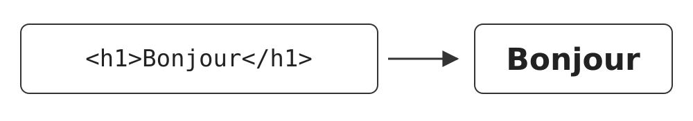{fig-alt="Le code <h1>Bonjour</h1> donne le titre Bonjour affiché par le navigateur." width=85%}

## La question de départ

**PROBLÈME CONCRET**

::: {.callout-note icon=false}
Peut-on changer ce qu'affiche un site Web sans changer le véritable site ?
:::

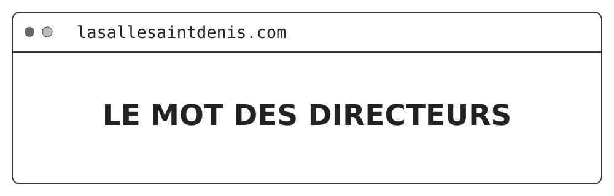{fig-alt="Fenêtre de navigateur affichant lasallesaintdenis.com et le titre LE MOT DES DIRECTEURS." width=95%}

Expérience : ouvrir le site du lycée et choisir un titre.

## Expérience : modifier un titre

::: {.callout-note icon=false}
### Dans le navigateur

1. Clic droit sur le titre, puis **Inspecter**.
2. Cliquer sur la flèche dans le **carré en pointillés**.
3. Cliquer sur le titre de la page.
4. Double-cliquer sur son texte dans le code.
5. Écrire son prénom, puis Entrée.
:::

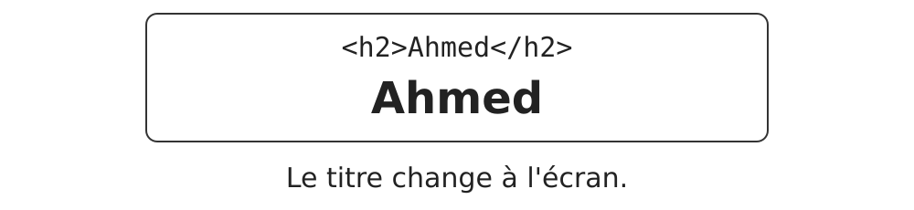{fig-alt="Le code <h2>Ahmed</h2> affiche Ahmed. Le titre change à l'écran." width=60%}

## Une prédiction avant F5

::: {.callout-note icon=false}
Si je recharge la page avec F5, le prénom restera-t-il ?
:::

1. Oui, car j'ai changé le code du site.
2. Non, car j'ai changé seulement mon affichage.
3. Tous les visiteurs verront mon prénom.

::: {.callout-note icon=false}
### À retenir

Réponse 2. F5 reconstruit la page à partir des ressources d'origine ou du cache. La modification locale disparaît.
:::

## Où se trouve la page d'origine ?

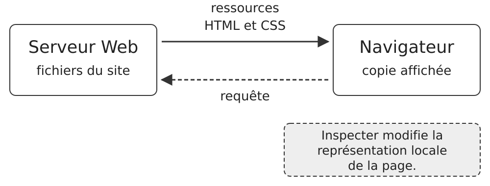{fig-alt="Le navigateur envoie une requête au serveur Web, qui contient les fichiers du site. Le serveur envoie les ressources HTML et CSS au navigateur, qui affiche une copie. Inspecter modifie la représentation locale de la page." width=100%}

::: {.callout-note icon=false}
### Pourquoi est-ce important ?

Une capture d'écran peut montrer un contenu modifié localement.
:::

## Un nouveau problème : trois phrases

::: {.callout-note icon=false}
### Un fichier texte

Bienvenue sur mon site\
Je suis élève de seconde.\
Wikipédia
:::

::: {.callout-note icon=false}
Comment le navigateur peut-il savoir ce qui est un titre, un paragraphe ou un lien ?
:::

::: {.callout-note icon=false}
### À retenir

Il faut décrire le rôle de chaque élément. C'est le principe du HTML.
:::

## HTML : donner une structure au texte

**LE FICHIER TEXTE**

```html
<h1>Bienvenue sur mon site</h1>
<p>Je suis eleve de seconde.</p>
```

**CE QUE LE NAVIGATEUR AFFICHE**

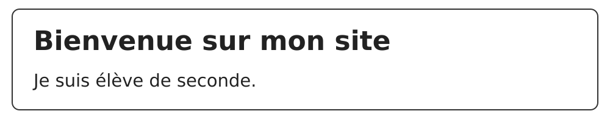{fig-alt="Le navigateur affiche Bienvenue sur mon site comme un grand titre, puis Je suis élève de seconde. comme un paragraphe." width=90%}

::: {.callout-note icon=false}
### Principe

`<h1>` annonce un titre principal. `<p>` annonce un paragraphe.
:::

## Une balise ouvre et ferme un contenu

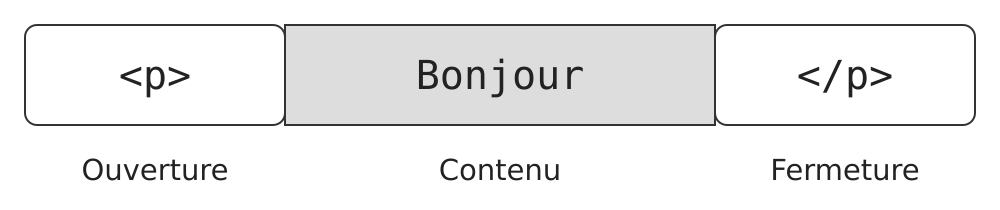{fig-alt="Le paragraphe <p>Bonjour</p> se décompose en ouverture <p>, contenu Bonjour et fermeture </p>." width=100%}

::: {.callout-note icon=false}
À quoi sert la barre oblique dans `</p>` ?
:::

::: {.callout-note icon=false}
### À retenir

Elle indique que le paragraphe se termine.
:::

## Le squelette d'une page HTML

```html
<!DOCTYPE html>
<html lang="fr">
  <head>
    <title>Ma premiere page</title>
  </head>
  <body>
    <h1>Bienvenue</h1>
    <p>Bonjour !</p>
  </body>
</html>
```

::: {.callout-note icon=false}
### `head`

Informations sur la page. Le texte de `title` apparaît dans l'onglet.
:::

::: {.callout-note icon=false}
### `body`

Contenu que le navigateur affiche dans la fenêtre.
:::

## Six balises à reconnaître

::: {.callout-note icon=false}
### Contenu

`<h1>` : titre principal\
`<p>` : paragraphe\
`<strong>` : texte important
:::

::: {.callout-note icon=false}
### Navigation et média

```text
<a href="..."> : lien
<br> : retour à la ligne
 : image
```
:::

::: {.callout-note icon=false}
### À observer

`br` et `img` n'entourent pas de contenu. Ils n'ont pas de balise fermante.
:::

## Un lien : du texte et une destination

```html
<a href="https://fr.wikipedia.org">Wikipedia</a>
```

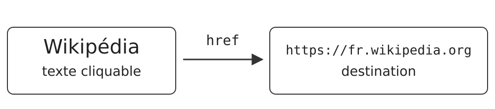{fig-alt="Le texte cliquable Wikipédia mène à la destination https://fr.wikipedia.org, indiquée par href." width=100%}

::: {.callout-note icon=false}
### Deux mots de vocabulaire

`a` est une balise. `href` est un attribut qui précise la destination.
:::

## Les trois destinations d'un lien

::: {.callout-note icon=false}
### 1. Un autre site

`href="https://fr.wikipedia.org"`
:::

::: {.callout-note icon=false}
### 2. Une page du même site

`href="connexion.html"`
:::

::: {.callout-note icon=false}
### 3. Un endroit de la page actuelle

`href="#haut"` vise un élément qui porte `id="haut"`.
:::

**QUESTION ORALE : QUELLE DESTINATION POUR `contact.html` ?**

## Changer durablement son propre fichier

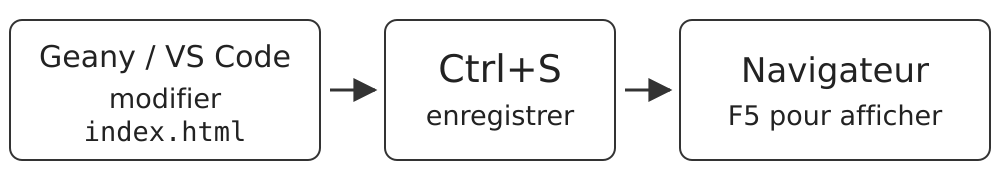{fig-alt="Dans Geany ou VS Code, modifier index.html ; utiliser Ctrl+S pour enregistrer ; dans le navigateur, utiliser F5 pour afficher." width=100%}

::: {.callout-note icon=false}
### Activité 2.3

Télécharger `demo-web`, ouvrir `index.html` dans l'éditeur et dans le navigateur, modifier une phrase, créer un lien, puis afficher `photo.jpg`.
:::

## Le problème des 500 pages

::: {.callout-note icon=false}
Un site possède 500 pages avec un titre bleu. Comment rendre tous ces titres rouges rapidement ?
:::

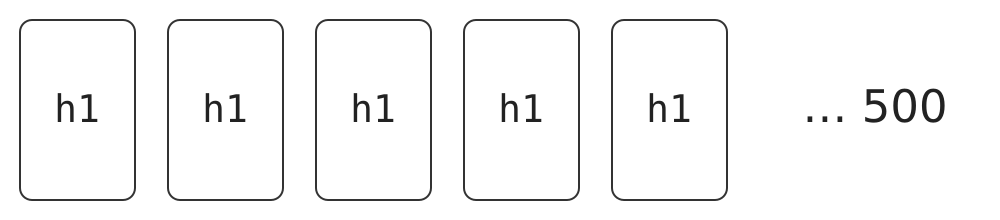{fig-alt="Cinq pages portant chacune h1 représentent une série de 500 pages." width=95%}

::: {.callout-note icon=false}
### À retenir

On écrit une règle de présentation commune dans un fichier CSS.
:::

## CSS : une règle pour la présentation

```css
h1 {
  color: red;
}
```

::: {.callout-note icon=false}
### Lire la règle

**À qui ?** `h1`, les titres\
**Quoi ?** `color`, la couleur du texte\
**Comment ?** `red`, en rouge
:::

::: {.callout-note icon=false}
Pour centrer tous les titres, change-t-on le HTML ou le CSS ?
:::

::: {.callout-note icon=false}
### À retenir

Le CSS, avec `text-align: center;`.
:::

## Le même contenu, deux présentations

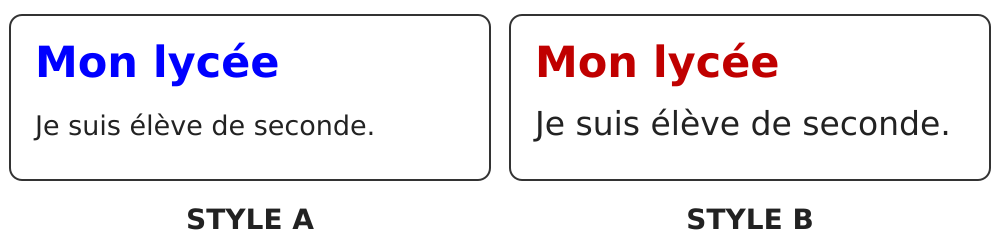{fig-alt="Style A : Mon lycée en bleu et Je suis élève de seconde. en taille normale. Style B : Mon lycée en rouge et le même paragraphe en plus grand." width=100%}

::: {.callout-note icon=false}
### Séparation des rôles

HTML décrit ce que contient la page. CSS décrit son apparence.
:::

## Une feuille de style partagée

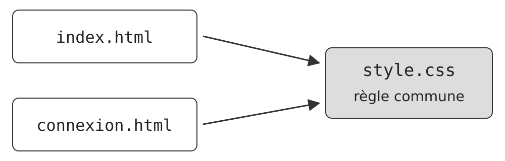{fig-alt="Les pages index.html et connexion.html utilisent toutes deux style.css, qui contient une règle commune." width=95%}

::: {.callout-note icon=false}
### Expérience

Changer `navy` en `red` dans `style.css`, enregistrer, puis recharger les deux pages.
:::

## Un site lisible sur téléphone ?

::: {.callout-note icon=false}
Faut-il créer une deuxième version de tout le site pour les petits écrans ?
:::

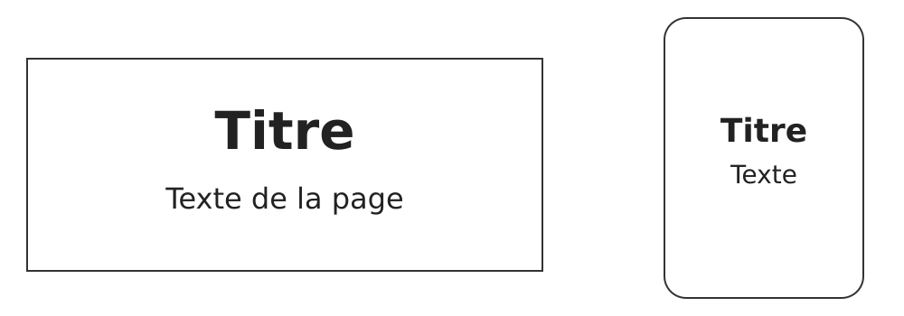{fig-alt="Un écran large affiche Titre et Texte de la page. Un téléphone affiche Titre et Texte dans une fenêtre plus étroite." width=90%}

::: {.callout-note icon=false}
### À retenir

Une seule page HTML peut utiliser des règles CSS adaptées à la largeur de l'écran. C'est le responsive web design, popularisé par Ethan Marcotte en 2010.
:::

## Mini-QCM : qui fait quoi ?

::: {.callout-note icon=false}
Pour chaque demande, choisis HTML ou CSS.
:::

1. Ajouter une photo du lycée.
2. Mettre tous les liens en vert.
3. Changer le texte d'un bouton.
4. Adapter la taille du texte au téléphone.

::: {.callout-note icon=false}
### Correction expliquée

1. HTML : ajouter du contenu.
2. CSS : modifier la couleur.
3. HTML : changer les mots.
4. CSS : adapter la présentation.
:::

## La carte mentale de la séance

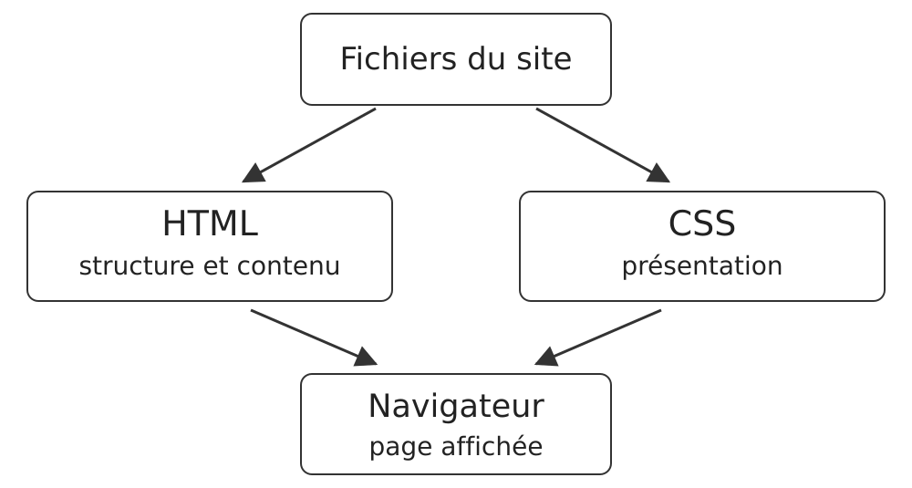{fig-alt="Les fichiers du site comprennent le HTML, structure et contenu, et le CSS, présentation. Tous deux sont utilisés par le navigateur pour produire la page affichée." width=90%}

Observer, expérimenter, comprendre.
