<!-- Conversion fidèle de publication/SNT_Web_Seance4_First_Principles.tex.
Chaque sous-section correspond à une vue, dans l'ordre de la source.
Les notes de présentation sont conservées dans les deux formats.
Durée confirmée dans publication/SNT_Web_Livret4_corrige.tex : séance 4. -->

## Chercher, publier, se protéger

**SNT · LE WEB · SÉANCE 4**

**Trois problèmes du quotidien, des règles à construire**

Recherche · droit d'auteur · hameçonnage · navigateur

## Problème n° 5 : une page sans adresse

**Comment trouver une page dont on ignore l'URL ?**

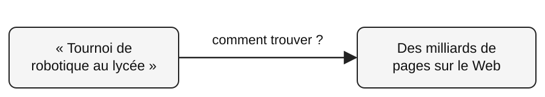{fig-alt="Une recherche « Tournoi de robotique au lycée » face à des milliards de pages sur le Web. La flèche demande : comment trouver ?" width=95%}

::: {.callout-note title="L'obstacle"}
Il serait beaucoup trop long de parcourir tout le Web au moment où l'on tape chaque recherche.
:::

**À faire formuler :** Comment se préparer à répondre très vite ?

::: {.callout-note title="Note de présentation"}
Repartir du problème 5 du livret 1. Laisser les élèves proposer une recherche à l'avance avant d'introduire les mots robot et index.
:::

## Avant la recherche : explorer

**Qui découvre les pages ?**

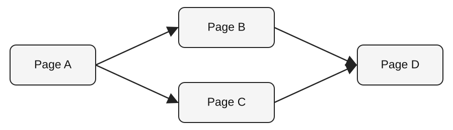{fig-alt="La page A mène aux pages B et C. Les pages B et C mènent chacune à la page D." width=90%}

::: {.callout-note title="Exploration"}
Un **robot** suit les liens et visite des pages pour recueillir leur contenu. Ce travail se poursuit en arrière-plan, indépendamment de ta recherche.
:::

## Retrouver rapidement les pages

**Comment retrouver un mot sans relire tous les documents ?**

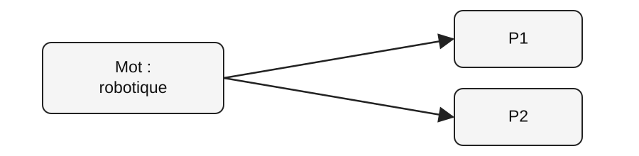{fig-alt="L'index associe le mot robotique aux pages P1 et P2." width=75%}

::: {.callout-note title="Index"}
Comme à la fin d'un livre, un **index** associe les mots aux pages qui les contiennent.
:::

**À faire formuler :** Dans quelles pages du livret apparaît le mot « tournoi » ?

## Activité 4.1 : indexer à la main

**Et si nous étions un moteur de recherche ?**

1. Lire trois mini-pages.
2. Construire la liste des pages contenant chaque mot.
3. Chercher « tournoi robotique ».
4. Comparer avec « inscriptions mars ».

**Livret 4 · Activité 4.1**

::: {.callout-note title="Note de présentation"}
Après l'activité, demander pourquoi P1 et P3 ne sont pas nécessairement ex aequo en qualité pour « inscriptions mars ». Faire émerger le classement.
:::

## L'index ne suffit pas

**Deux pages correspondent : laquelle afficher en premier ?**

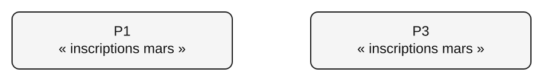{fig-alt="Les pages P1 et P3 contiennent toutes deux « inscriptions mars »." width=90%}

::: {.callout-note title="Le nouveau problème"}
Plusieurs pages peuvent contenir les mêmes mots. Il faut les **classer** en tenant compte de critères supplémentaires.
:::

**À faire formuler :** Une page citée par beaucoup d'autres serait-elle plus utile ?

## Les liens comme votes

**Une page reçoit trois liens. Une autre n'en reçoit qu'un.**

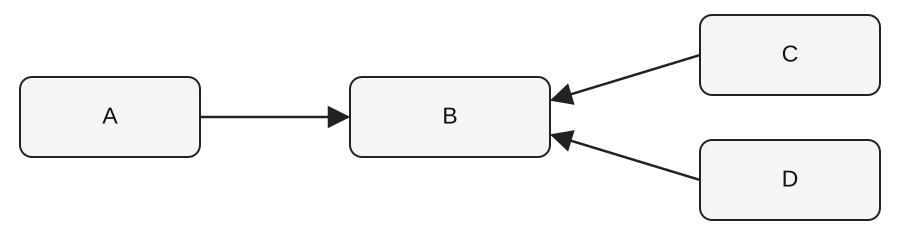{fig-alt="Trois liens entrants vers B : A vers B, C vers B et D vers B." width=90%}

::: {.callout-note title="Première intuition"}
Les **liens entrants** peuvent indiquer qu'une page est citée par d'autres. Mais tous les liens n'ont pas la même valeur.
:::

## Pourquoi compter les liens ne suffit pas

**Et si je créais 1 000 fausses pages ?**

- Le simple nombre de liens peut être manipulé.
- Un lien venant d'une page reconnue peut avoir davantage de poids.
- Une page qui crée de nombreux liens partage son poids entre eux.

::: {.callout-note title="Modèle simplifié de PageRank"}
Chaque page commence avec un score de 1, puis le partage entre ses liens sortants. Nous allons effectuer **un seul tour** de calcul.
:::

## Activité 4.2 : calcul guidé

**Qui donne du score à qui ?**

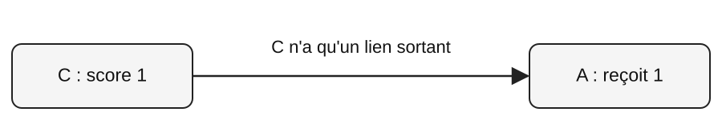{fig-alt="C, de score 1, n'a qu'un lien sortant, vers A. A reçoit 1." width=95%}

::: {.callout-note title="Méthode"}
**Contribution d'un lien** = score de départ de la page / nombre de ses liens sortants.
:::

**Calculons A ensemble, puis B, C, D et E.**

::: {.callout-note title="Note de présentation"}
L'activité se limite volontairement à un tour de partage. Le PageRank réel est itératif et inclut notamment un amortissement.
:::

## Un résultat en premier est-il vrai ?

**Le classement mesure-t-il la fiabilité ?**

- Un lien très consulté peut contenir une erreur.
- Un premier résultat peut être une annonce.
- Pour un exposé, il faut regarder **qui parle**, **quand**, et **sur quelles preuves**.

**Livret 4 · Activité 4.3**

## Une image trouvée en ligne

**Puis-je la publier sur le site du lycée ?**

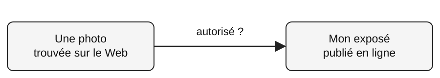{fig-alt="Une photo trouvée sur le Web est destinée à un exposé publié en ligne. La flèche demande : autorisé ?" width=95%}

::: {.callout-note title="Principe"}
Une œuvre originale bénéficie du **droit d'auteur** dès sa création. Être visible en ligne ne signifie pas « libre à réutiliser ».
:::

## Comment partager avec des règles claires ?

**L'auteur peut-il autoriser certaines réutilisations ?**

::: {.callout-note title="La licence"}
Une **licence** précise les usages autorisés et les conditions à respecter.
:::

BY
: Citer l'auteur et fournir les informations de licence.

NC
: Pas d'utilisation commerciale.

ND
: Pas de diffusion d'adaptation.

SA
: Diffuser une adaptation sous une licence compatible.

::: {.callout-note title="Note de présentation"}
Exemple : CC BY-SA. Si la photo est seulement incorporée sans modification, la clause SA ne transforme pas tout l'exposé en CC BY-SA. Voir les textes Creative Commons.
:::

## Acheter un fichier, quels droits ?

**Un e-book acheté se revend-il comme un livre papier ?**

- Pour un livre papier, je possède l'exemplaire matériel.
- Pour un téléchargement, la copie reste soumise aux droits et conditions d'utilisation applicables.
- Posséder une copie numérique ne signifie pas pouvoir la redistribuer librement.

**Livret 4 · Activité 4.4**

::: {.callout-note title="Note de présentation"}
Nuancer : les règles varient selon le type de fichier, la licence et le contrat. En droit français, les droits patrimoniaux durent en général 70 ans après la mort ; le droit moral demeure.
:::

## Le piège du faux site

**Deux adresses se ressemblent. À laquelle faire confiance ?**

::: {.callout-note title="Adresse A"}
`https://www.mabanque.example/compte`
:::

::: {.callout-note title="Adresse B"}
`https://www.mabanque.example.connexion-securisee.example/compte`
:::

**Le nom de la banque apparaît dans les deux !**

**À faire formuler :** Quelle partie indique réellement le site contacté ?

## Lire correctement une URL

**Où se trouve le nom d'hôte ?**

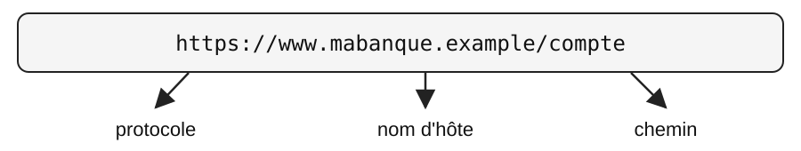{fig-alt="Décomposition de https://www.mabanque.example/compte : https:// est le protocole, www.mabanque.example est le nom d'hôte, /compte est le chemin." width=100%}

::: {.callout-note title="Méthode"}
Après `https://`, lis jusqu'au prochain `/`. Identifie ensuite le **domaine principal** en partant de la droite.
:::

::: {.callout-note title="Note de présentation"}
Les étiquettes du diagramme sont approximativement placées sous les trois parties. Insister sur le fait que « www » est un sous-domaine ; le domaine principal attendu est mabanque.example.
:::

## HTTPS garantit-il l'honnêteté ?

**Un faux site peut-il afficher le cadenas ?**

**HTTPS**

protège la **communication** avec le site

::: {.callout-note title="Mais attention"}
Un fraudeur peut lui aussi utiliser HTTPS. Il faut contrôler l'adresse et le contexte de la demande avant de saisir des informations sensibles.
:::

**Livret 4 · Activité 4.5**

## Pourquoi un site me reconnaît-il ?

**Comment rester connecté en changeant de page ?**

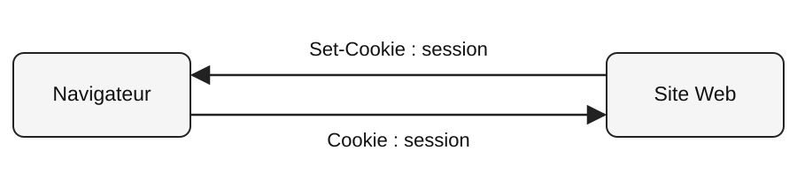{fig-alt="Le site Web envoie « Set-Cookie : session » au navigateur. Le navigateur renvoie « Cookie : session » au site Web." width=95%}

::: {.callout-note title="Cookie"}
Une petite donnée conservée par le navigateur peut aider le site à retrouver la session de l'utilisateur.
:::

## Quand le suivi dépasse un seul site

**Pourquoi un même service apparaît-il sur plusieurs sites ?**

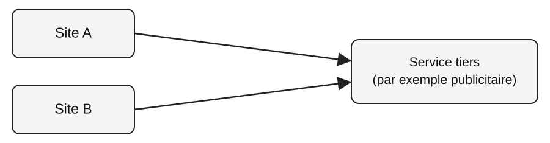{fig-alt="Les sites A et B contactent le même service tiers, par exemple publicitaire." width=95%}

::: {.callout-note title="Pistage"}
Certains services tiers peuvent reconnaître un navigateur d'un site à l'autre à l'aide de traceurs. Les protections du navigateur cherchent à limiter ce suivi.
:::

## La navigation privée et ses limites

**Qui ne voit plus mes visites ?**

- La navigation privée limite les traces conservées **sur l'appareil après la session**.
- Le site consulté reçoit toujours les requêtes.
- Le réseau utilisé peut encore observer des informations sur les connexions.

::: {.callout-note title="En classe"}
Dans Firefox : **Paramètres** puis **Vie privée et sécurité**. Observer sans modifier irréversiblement les réglages du poste.
:::

## Activité 4.6 : observer Firefox

**Que nous montre réellement le navigateur ?**

1. Trouver les options de protection et les autorisations.
2. Ouvrir **F12** puis **Stockage** pour observer les cookies visibles.
3. Cliquer sur le **bouclier** pour lire les protections signalées.

::: {.callout-note title="Important"}
Cookies stockés, domaines contactés et traqueurs bloqués sont **trois observations différentes**.
:::

## Vérification finale

**Une adresse commence par HTTPS. Est-elle forcément sûre ?**

A. Oui, le site est nécessairement honnête.
B. Non, HTTPS chiffre la communication mais ne prouve pas l'honnêteté.
C. Oui, si le nom de la banque apparaît quelque part.

::: {.callout-note title="Réponse B"}
Vérifier le véritable domaine principal et le contexte avant de saisir ses identifiants.
:::

::: {.callout-note title="Note de présentation"}
Faire voter sans montrer la dernière apparition.
:::

## Bilan du Web

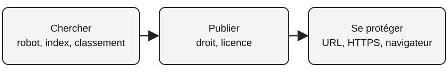{fig-alt="Chercher : robot, index, classement. Puis publier : droit, licence. Puis se protéger : URL, HTTPS, navigateur." width=100%}

**Trois questions à retenir**

Comment trouve-t-on une information ?

Quels droits a-t-on sur une œuvre ?

Comment vérifier une adresse et limiter ses traces ?

::: {.callout-note title="Note de présentation"}
Faire ensuite la frise et les trois tâches d'auto-évaluation du paragraphe 15.
:::
