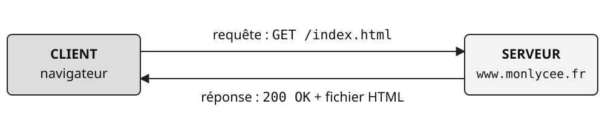
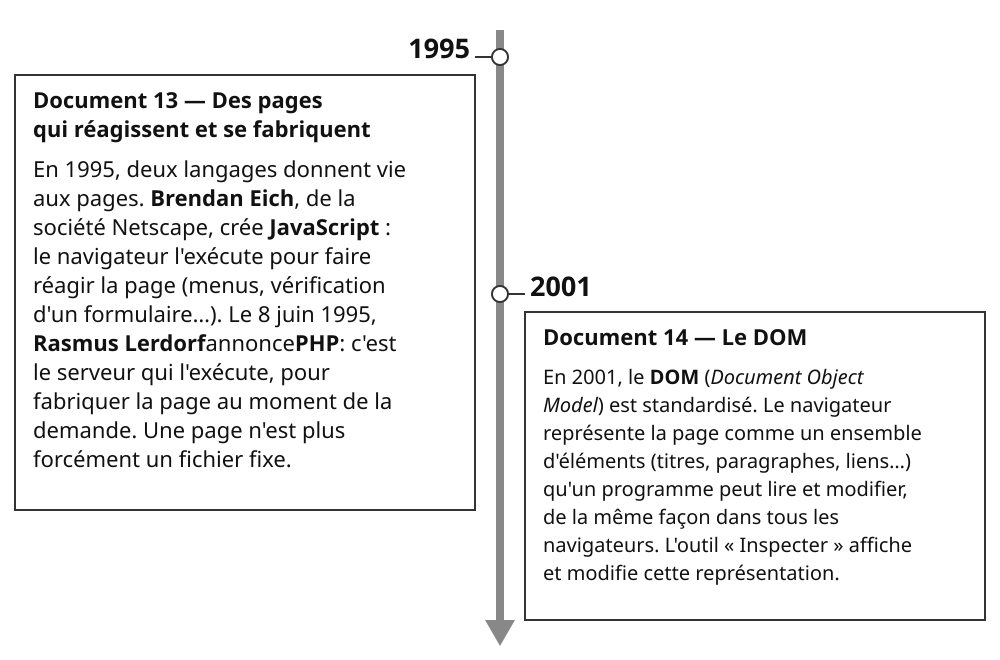

SCIENCES NUMÉRIQUES ET TECHNOLOGIE — SECONDE

**Thématique : LE WEB**  
**Livret 3 — séance 3**

| Nom : | Prénom : | Classe : | Date : |
|---|---|---|---|
| &nbsp; | &nbsp; | &nbsp; | &nbsp; |

Ce document se remplit **en classe, en même temps que le cours**, puis en autonomie pour les activités.
Aujourd'hui, tu vas découvrir qui fournit une page Web, comment ton navigateur la demande, et ce qui s'exécute chez toi ou ailleurs.
Range ce livret avec les livrets 1 et 2 : tu en auras besoin pour le bilan.

::: {.callout-note appearance="simple" icon="false"}
**SÉANCE 3 (1 h 30)** — Client, serveur et HTTP — **En salle informatique**
:::

::: {.callout-note appearance="simple" icon="false"}
### Avant de commencer

1. Dans « Mes mots à éclaircir » du livret 1, coche les mots qui ont été expliqués au livret 2.
2. Relis l'activité 2.1 du livret 2 (« Inspecter » puis F5) : la question c) est restée sans réponse. C'est elle qui ouvre la séance.
:::

## 9. Le modèle client / serveur

À l'activité 2.1, tu as modifié ce que ton navigateur affichait, et F5 a tout remis comme avant. Où se trouve donc la page d'origine, et qui la fournit ?

::: {.callout-warning appearance="simple" icon="false"}
**Mots proposés :** *client • serveur • requête • réponse • allumé*
:::

Reviens au tableau du §1 du livret 1 : le problème **1** demandait où le document est stocké. Il doit être disponible à toute heure : il est donc rangé sur un ordinateur toujours \_\_\_\_\_\_\_\_ et connecté à Internet, le \_\_\_\_\_\_\_\_. Ton navigateur est le \_\_\_\_\_\_\_\_ : il envoie une \_\_\_\_\_\_\_\_ (« donne-moi la page `/index.html` ») et le serveur renvoie une \_\_\_\_\_\_\_\_ (le fichier HTML, puis le CSS, les images…).

Un même serveur répond à des milliers de clients ; un même client interroge des dizaines de serveurs en une seule visite.

::: {.callout-note appearance="simple" icon="false"}
### Document 11 — Le dialogue entre le client et le serveur

{fig-alt="Le client, un navigateur, envoie au serveur www.monlycee.fr la requête GET /index.html. Le serveur renvoie au client la réponse 200 OK et le fichier HTML." width=100%}
:::

## 10. La requête HTTP

Le client et le serveur doivent parler le même langage, avec une forme exacte pour demander et pour répondre. C'est le rôle du protocole **HTTP** (*HyperText Transfer Protocol*).

::: {.callout-warning appearance="simple" icon="false"}
**Mots proposés :** *GET • POST • en-têtes • code • 404 • cookies*
:::

::: {.callout-note appearance="simple" icon="false"}
### Document 12 — Une requête HTTP et le début de la réponse

*Requête envoyée par le navigateur :*

```{.text .numberLines}
GET /search?q=snt+seconde&lang=fr HTTP/1.1
Host: www.moteur.fr
User-Agent: Mozilla/5.0 (Windows NT 10.0) Firefox/128.0
Accept-Language: fr-FR
Cookie: session=a8f3e2; theme=sombre

```

*Réponse du serveur :*

```{.text .numberLines}
HTTP/1.1 200 OK
Content-Type: text/html; charset=utf-8
Set-Cookie: derniere_recherche=snt

<!DOCTYPE html> <html> ...
```

Une **ligne vide** sépare les en-têtes (lignes 2 à 5 de la requête, 2 et 3 de la réponse) du reste : dans la réponse, ce qui suit la ligne vide est la page elle-même. Exemple simplifié : une vraie requête contient d'autres en-têtes.
:::

- La première ligne commence par la **méthode** : \_\_\_\_\_\_\_\_ pour demander une ressource (les paramètres sont dans l'URL, donc visibles) ; \_\_\_\_\_\_\_\_ pour envoyer des données (formulaire, mot de passe) : elles sont alors dans le corps de la requête, pas dans l'URL. Attention : POST ne chiffre rien. Les données n'apparaissent ni dans la barre d'adresse ni dans l'historique, mais seul HTTPS protège leur transmission.
- Les lignes suivantes sont les \_\_\_\_\_\_\_\_ : elles renseignent le serveur sur le client (navigateur, langue, \_\_\_\_\_\_\_\_ déjà reçus…).
- La réponse commence par un \_\_\_\_\_\_\_\_ : `200` = succès, `301` = page déplacée, \_\_\_\_\_\_\_\_ = page introuvable, `403` = accès interdit, `500` = erreur du serveur.

::: {.callout-note appearance="simple" icon="false"}
### Activité 3.1 — Décomposer une requête HTTP
:::

*(Doc. 12)* Réponds aux questions.

a) Quelle est la méthode ? Quelle ressource (chemin) est demandée ?

   {fig-alt="Espace de réponse : une ligne." width=100%}

b) Quels sont les paramètres passés, et leurs valeurs ?

   {fig-alt="Espace de réponse : une ligne." width=100%}

c) Qu'apprend le serveur sur l'utilisateur, avant même de répondre ? Cite trois informations.

   {fig-alt="Espace de réponse : deux lignes." width=100%}

d) Dans la réponse, à quoi sert la ligne `Set-Cookie` ? Que se passera-t-il à la prochaine requête vers ce site ?

   {fig-alt="Espace de réponse : deux lignes." width=100%}

::: {.callout-note appearance="simple" icon="false"}
### Activité 3.2 — Observer les vraies requêtes de son navigateur (sur ordinateur)
:::

Ouvre **Firefox** et accède au site `https://www.lasallesaintdenis.com`. Appuie sur **F12**, sélectionne l'onglet **Réseau**, puis recharge la page avec **F5**.

a) Combien de requêtes une seule page a-t-elle déclenchées ? Vers combien de serveurs (domaines) différents ? (Le résultat dépend du site : note simplement ce que tu observes.)

   {fig-alt="Espace de réponse : une ligne." width=100%}

b) Repère la requête correspondant à la page HTML principale (type `html`). Relève sa méthode HTTP et son code de réponse. Clique ensuite sur cette requête, ouvre les **En-têtes** et relève la valeur de `Content-Type`.

   {fig-alt="Espace de réponse : une ligne." width=100%}

c) Trouve une requête vers un domaine qui n'est *pas* celui du site visité. À ton avis, à quoi sert-elle ?

   {fig-alt="Espace de réponse : deux lignes." width=100%}

## 11. Ce qui s'exécute chez toi, ce qui s'exécute ailleurs

::: {.callout-warning appearance="simple" icon="false"}
**Mots proposés :** *JavaScript • PHP • source • base de données • DOM*
:::

Au début, une page Web était un simple fichier fixe. Depuis 1995, elle peut aussi contenir ou fabriquer du code :

- du code \_\_\_\_\_\_\_\_ est envoyé au navigateur et **exécuté par le client** : menus déroulants, vérification d'un formulaire, animations. On peut le lire dans le code \_\_\_\_\_\_\_\_ de la page (clic droit → « Code source de la page », ou Ctrl+U) ;
- du code (\_\_\_\_\_\_\_\_, Python…) est **exécuté par le serveur** avant l'envoi : il fabrique la page à la demande, par exemple en interrogeant une \_\_\_\_\_\_\_\_ (résultats de recherche, fil d'actualité, panier). Le client ne voit **jamais** ce code : il ne reçoit que le HTML produit.

{fig-alt="1995. Document 13 — Des pages qui réagissent et se fabriquent. En 1995, deux langages donnent vie aux pages. Brendan Eich, de la société Netscape, crée JavaScript : le navigateur l'exécute pour faire réagir la page (menus, vérification d'un formulaire…). Le 8 juin 1995, Rasmus Lerdorf annonce PHP : c'est le serveur qui l'exécute, pour fabriquer la page au moment de la demande. Une page n'est plus forcément un fichier fixe. 2001. Document 14 — Le DOM. En 2001, le DOM (Document Object Model) est standardisé. Le navigateur représente la page comme un ensemble d'éléments (titres, paragraphes, liens…) qu'un programme peut lire et modifier, de la même façon dans tous les navigateurs. L'outil « Inspecter » affiche et modifie cette représentation." width=100% height=115mm style="height: auto;"}

::: {.callout-tip appearance="simple" icon="false"}
### Vérifie que tu as compris.

a) *(Doc. 13)* Quel langage est exécuté par le navigateur ? Lequel par le serveur ?

   {fig-alt="Espace de réponse : une ligne." width=100%}

b) *(Doc. 14 et activité 2.1)* Quand tu as remplacé un titre par ton prénom avec « Inspecter », qu'as-tu modifié : le fichier du serveur ou la représentation de la page dans ton navigateur ?

   {fig-alt="Espace de réponse : deux lignes." width=100%}
:::

::: {.callout-note appearance="simple" icon="false"}
### Activité 3.3 — Inspecter le code d'une page (sur ordinateur)
:::

Dans ton dossier `demo-web`, suis les étapes dans l'ordre.

**Étape 1. Observer.** Ouvre `connexion.html` dans le navigateur. Clique sur « Se connecter » sans rien remplir.

**Ce que tu dois voir :** un message d'erreur en rouge, tout de suite, sans que la page se recharge.

Le navigateur affiche ce message *avant d'envoyer* le formulaire. Qui a fabriqué ce message : le client ou le serveur ?

{fig-alt="Espace de réponse : deux lignes." width=100%}

**Étape 2. Trouver le code client.** Affiche le code source de la page (**Ctrl+U**). Trouve la balise `<script>`. Que fait ce code, et qui l'exécute ?

{fig-alt="Espace de réponse : deux lignes." width=100%}

**Étape 3. Identifier où sont envoyées les données.** Dans le code source de `connexion.html`, repère la balise `<form>`.

a) Quelle est la valeur de l'attribut `action` ? Quel fichier recevra les données du formulaire ?
b) Quelle est la valeur de l'attribut `method` ? Quelle méthode HTTP sera utilisée pour envoyer ces données ?

{fig-alt="Espace de réponse : deux lignes." width=100%}

**Étape 4. Comprendre le rôle du serveur.** Ouvre le fichier `connexion.php` avec un éditeur de texte.

a) Ce fichier contient du code PHP. Qui exécute normalement ce code : le navigateur ou le serveur ?
b) Tu peux lire ce code parce que tu possèdes une copie du fichier sur ton ordinateur. Si ce fichier était hébergé sur un serveur Web, un visiteur pourrait-il consulter son code PHP avec **Ctrl+U** ? Explique pourquoi.

{fig-alt="Espace de réponse : trois lignes." width=100%}

::: {.callout-note appearance="simple" icon="false"}
### Activité 3.4 — Client ou serveur ? (à l'oral, avec la classe)
:::

Pour chaque opération, dis si elle est réalisée par le client (navigateur) ou par le serveur, et justifie en une phrase.

| Opération | Client | Serveur |
|:---|:---:|:---:|
| Afficher « champ obligatoire » quand on oublie de remplir son e-mail, avant l'envoi du formulaire | ☐ | ☐ |
| Vérifier que le mot de passe saisi est le bon | ☐ | ☐ |
| Calculer la liste des vidéos recommandées à un utilisateur | ☐ | ☐ |
| Agrandir une photo quand on passe la souris dessus | ☐ | ☐ |

::: {.callout-note appearance="simple" icon="false"}
**À retenir :** **Client** (navigateur) et **serveur** dialoguent selon le protocole **HTTP** : le client envoie une *requête* (méthode, ressource, paramètres, en-têtes), le serveur renvoie une *réponse* (code, en-têtes, page). Le JavaScript (1995) s'exécute dans le navigateur et se lit dans le code source ; le PHP s'exécute sur le serveur et ne se voit jamais. Un cookie est un petit fichier que le serveur demande au navigateur de garder et de lui renvoyer.
:::
