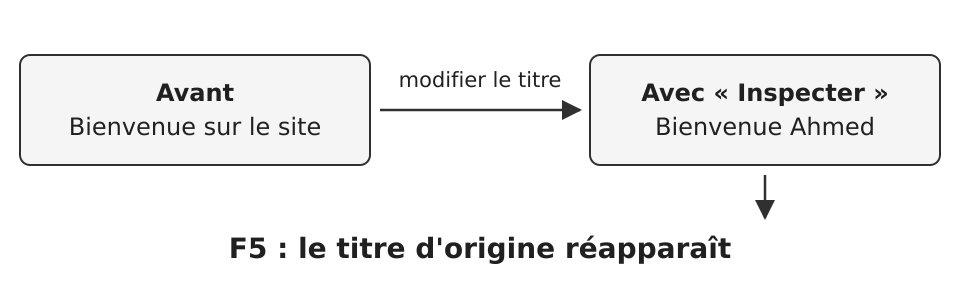
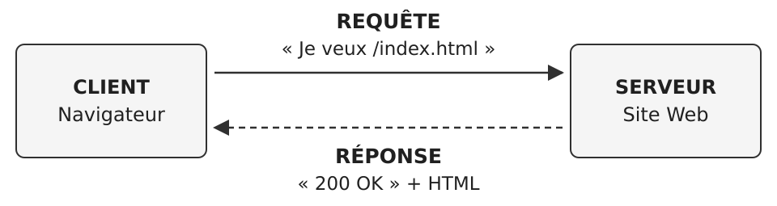
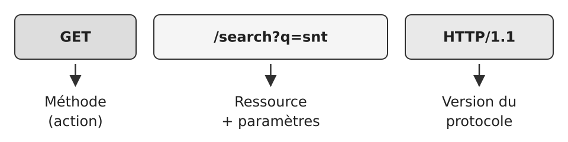
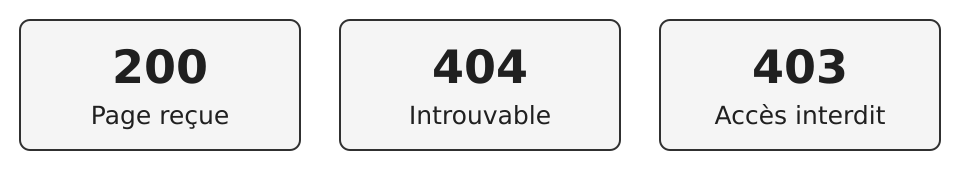
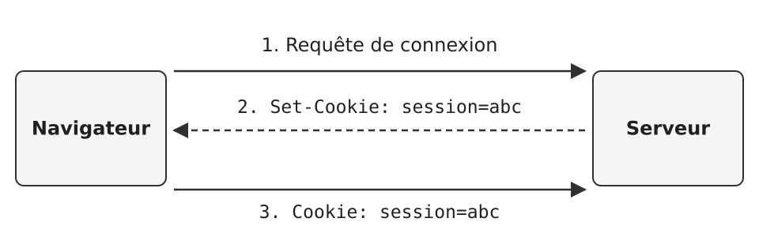
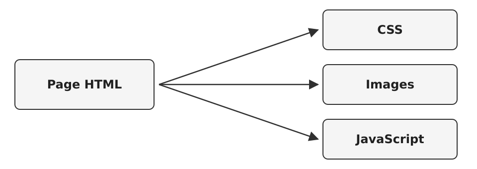
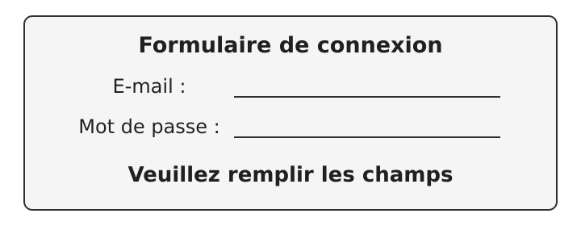
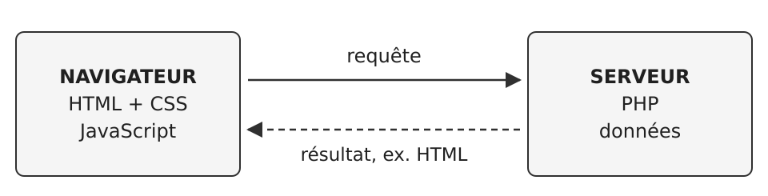
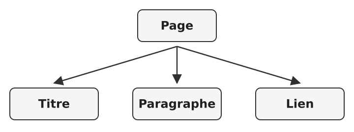
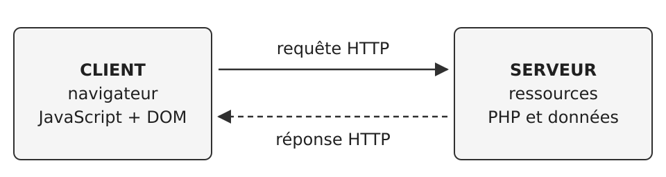

<!-- Conversion fidèle de publication/SNT_Web_Seance3_First_Principles.tex.
Les étapes d'apparition sont réunies ; les notes de l'enseignant sont conservées.
La source n'indique pas de durée. -->

## Qui fait quoi quand on visite une page Web ?

**SNT · LE WEB · SÉANCE 3**

*Une enquête à partir d'un simple F5*

Client · serveur · HTTP · JavaScript · PHP · DOM

## Le mystère du titre qui disparaît

**Pourquoi ma modification ne reste-t-elle pas ?**

{fig-alt="Avant : Bienvenue sur le site. Avec Inspecter : Bienvenue Ahmed. Après F5, le titre d'origine réapparaît."}

**À faire formuler par les élèves :** Où se trouve la version d'origine ? Qui la fournit ?

::: {.callout-note title="Note de l'enseignant"}
Faire rappeler l'activité 2.1. Laisser formuler deux ou trois hypothèses avant de poursuivre. Ne pas affirmer que F5 retélécharge toujours tout : le cache existe.
:::

## Une page pour plusieurs visiteurs

**Si toute la page était seulement chez moi...**

- Comment mon voisin pourrait-il consulter la même page ?
- Comment le site pourrait-il être disponible demain ?
- Qui conserverait la version de référence ?

::: {.callout-important title="Idée construite ensemble"}
Une machine accessible par le réseau fournit la ressource demandée : c'est le **serveur**. Mon navigateur joue le rôle de **client**.
:::

::: {.callout-note title="Note de l'enseignant"}
Faire émerger le besoin d'une ressource accessible. Un serveur désigne un rôle/service, pas nécessairement une machine unique toujours allumée. Trace écrite : section 9.
:::

## Le dialogue client–serveur

**Comment demander la page ?**

{fig-alt="Le client, un navigateur, envoie au serveur du site Web une requête : Je veux /index.html. Le serveur répond : 200 OK et HTML."}

Émettre une hypothèse : qui parle en premier ?

Le client prend l'initiative de demander.

Le serveur répond à la demande.

::: {.callout-note title="Note de l'enseignant"}
Afficher les flèches séparément. Faire verbaliser les deux sens. Un site peut charger plusieurs fichiers et contacter plusieurs serveurs.
:::

## Pourquoi faut-il des règles communes ?

**Comment le serveur comprend-il la demande ?**

::: {.callout-important title="Demande floue"}
« Bonjour, je voudrais la page, s'il vous plaît... »
:::

::: {.callout-important title="Demande structurée"}
`GET /index.html HTTP/1.1`
:::

**HTTP = un protocole**

Un ensemble de règles pour formuler les **requêtes** et les **réponses**.

**À faire formuler par les élèves :** À quoi sert le mot GET ? Et /index.html ?

## La requête HTTP, pièce par pièce

**Que signifie chaque morceau ?**

{fig-alt="GET : méthode, action. /search?q=snt : ressource et paramètres. HTTP/1.1 : version du protocole."}

::: {.callout-important title="Autre exemple"}
`POST` sert souvent à envoyer les données d'un formulaire dans le corps de la requête. **POST ne chiffre pas les données.**
:::

::: {.callout-note title="Note de l'enseignant"}
Lire la ligne de gauche à droite. Expliquer que GET peut avoir des paramètres dans l'URL et que POST peut également avoir des paramètres d'URL. HTTPS protège la transmission.
:::

## Des renseignements accompagnent la demande

**Que peut apprendre le serveur ?**

```text
GET /search?q=snt+seconde&lang=fr HTTP/1.1
Host: www.moteur.fr
User-Agent: Firefox/128.0
Accept-Language: fr-FR
Cookie: session=a8f3e2
```

**En-têtes HTTP** — Nom du site, logiciel utilisé, langue préférée, cookie éventuellement présent.

**À faire formuler par les élèves :** Quelles informations avons-nous données volontairement ?

::: {.callout-note title="Note de l'enseignant"}
Le bloc est un exemple simplifié, inspiré du document 12. Ne pas déduire l'identité de la personne du seul User-Agent.
:::

## La réponse du serveur

**Comment savoir si la demande a réussi ?**

{fig-alt="200 : Page reçue. 404 : Introuvable. 403 : Accès interdit."}

::: {.callout-important title="Une réponse HTTP contient"}
Un **code d'état**, des **en-têtes** (ex. `Content-Type: text/html`) et, souvent, un **corps** contenant la ressource.
:::

::: {.callout-note title="Note de l'enseignant"}
Mentionner 301 (redirection) et 500 (erreur du serveur) à l'oral sans surcharger. Trace écrite : section 10.
:::

## Le paradoxe de la connexion

**Comment un site se souvient-il de moi ?**

- Je me connecte au site.
- Je clique ensuite sur « Mon compte ».
- Le serveur reçoit une **nouvelle** requête HTTP.

::: {.callout-important title="Une solution : le cookie"}
Le serveur peut demander au navigateur de conserver une petite **donnée**. Pour des requêtes ultérieures compatibles avec ses règles, le navigateur la renvoie.
:::

**À faire formuler par les élèves :** Pourquoi cela aide-t-il le serveur à reconnaître une session ?

::: {.callout-note title="Note de l'enseignant"}
Expliquer oralement la question 3.1 d. Nuancer : les cookies ne sont pas forcément des fichiers distincts, et leur renvoi dépend du domaine, du chemin et des attributs du cookie.
:::

## Deux requêtes, une session

{fig-alt="Du navigateur au serveur : 1. Requête de connexion. Du serveur au navigateur : 2. Set-Cookie: session=abc. Du navigateur au serveur : 3. Cookie: session=abc."}

Le cookie peut servir d'**identifiant de session**.

::: {.callout-note title="Note de l'enseignant"}
Important : la reconnaissance repose aussi sur une session côté serveur. Les mécanismes de sécurité réels sont plus complexes.
:::

## Passage à l'activité 3.1

**Peux-tu lire une vraie structure HTTP ?**

1. Repère la méthode et le chemin.
2. Décode les paramètres `q` et `lang`.
3. Repère trois informations envoyées dans les en-têtes.
4. Pour `Set-Cookie`, nous construirons la réponse ensemble.

**Livret 3 · Activité 3.1**

## Une page, combien de requêtes ?

**Une seule page Web = une seule requête ?**

{fig-alt="La page HTML renvoie à trois sortes de ressources : CSS, Images et JavaScript."}

**Question aux élèves :** Combien de lignes verrons-nous dans Firefox ?

::: {.callout-note title="Note de l'enseignant"}
Les ressources peuvent provenir de plusieurs domaines. Certains fichiers peuvent venir du cache, et des ressources peuvent être chargées plus tard.
:::

## Firefox : voir le réseau en action

**Où observer les requêtes ?**

1. Ouvrir le site dans **Firefox**.
2. Appuyer sur **F12**, puis choisir **Réseau**.
3. Recharger avec **F5**.
4. Lire les colonnes **État**, **Méthode**, **Domaine**, **Type**.

**Livret 3 · Activité 3.2**

::: {.callout-note title="Note de l'enseignant"}
Faire une démonstration de 30 secondes. Sélectionner la ligne de type HTML, puis les En-têtes pour lire Content-Type. Les valeurs changent d'un poste à l'autre.
:::

## Une page peut réagir sans recharger

**Qui affiche « champ obligatoire » ?**

{fig-alt="Formulaire de connexion avec deux champs vides, E-mail et Mot de passe, et le message : Veuillez remplir les champs."}

::: {.callout-important title="Hypothèse à vérifier"}
Un programme exécuté **dans le navigateur** peut réagir immédiatement à une action. Ici, le **JavaScript** contrôle le formulaire.
:::

::: {.callout-note title="Note de l'enseignant"}
Faire cliquer sur « Se connecter » avec champs vides dans connexion.html. Le code spécifique de la démonstration empêche alors l'envoi. Le simple fait de ne pas recharger n'est pas une preuve universelle d'absence de réseau.
:::

## JavaScript et PHP : deux lieux d'exécution

**Qui exécute le programme ?**

{fig-alt="Navigateur : HTML, CSS et JavaScript. Serveur : PHP et données. Le navigateur envoie une requête et reçoit le résultat, par exemple du HTML."}

::: {.callout-important title="Point essentiel"}
**Ctrl+U** peut montrer le JavaScript fourni au navigateur. Sur un serveur PHP normalement configuré, le visiteur reçoit le **résultat**, pas le source PHP.
:::

## Pourquoi vérifier côté serveur ?

**Et si le navigateur mentait ?**

- Le JavaScript peut avertir : « mot de passe manquant ».
- Mais l'utilisateur contrôle son navigateur et peut modifier son comportement.
- Le serveur doit donc **vérifier lui-même** les données sensibles.

::: {.callout-important title="Exemple"}
Le navigateur améliore l'expérience de saisie. Le serveur décide si l'authentification est autorisée.
:::

::: {.callout-note title="Note de l'enseignant"}
Faire imaginer un contrôle uniquement dans le navigateur. Éviter de prétendre que tout traitement de données personnelles est toujours côté serveur.
:::

## Le DOM : la page représentée en mémoire

**Qu'a modifié l'outil « Inspecter » ?**

{fig-alt="Arbre représentant la page : le nœud Page est relié à trois éléments, Titre, Paragraphe et Lien."}

::: {.callout-important title="DOM"}
Le navigateur construit une représentation des éléments de la page. « Inspecter » peut modifier cette représentation **locale**, sans changer le fichier d'origine sur le serveur.
:::

**À faire formuler par les élèves :** Pourquoi mon voisin ne voit-il pas le nouveau titre ?

## Passage aux activités 3.3 et 3.4

**Peux-tu retrouver les deux côtés ?**

1. **3.3** : tester `connexion.html` et lire `<script>`.
2. Repérer `<form>`, `action` et `method`.
3. Ouvrir la **copie locale** de `connexion.php`.
4. **3.4** : classer chaque opération côté client ou serveur, avec une justification.

::: {.callout-note title="Note de l'enseignant"}
Le fichier PHP local est lisible car l'élève en possède une copie. Sans serveur PHP, il ne s'exécute pas simplement en ouvrant le fichier depuis le disque.
:::

## Vérification rapide

**Quelle affirmation est correcte ?**

A. POST chiffre automatiquement les mots de passe.
B. Modifier le DOM change le site pour tous les visiteurs.
C. Le navigateur peut envoyer une requête GET à un serveur.

::: {.callout-important title="Réponse : C"}
POST ne chiffre pas. Une modification locale du DOM ne modifie pas la page des autres utilisateurs. Le navigateur peut envoyer une requête `GET`.
:::

::: {.callout-note title="Note de l'enseignant"}
Faire voter A/B/C avant l'apparition de la réponse.
:::

## Le modèle à retenir

{fig-alt="Client : navigateur, JavaScript et DOM. Serveur : ressources, PHP et données. Une requête HTTP va du client au serveur ; une réponse HTTP revient du serveur au client."}

**Le navigateur demande. Le serveur répond.**

Le code peut s'exécuter **de part et d'autre**.

::: {.callout-note title="Note de l'enseignant"}
Retour à l'énigme de départ : F5 restaure une représentation issue de la ressource et/ou du cache, pas de l'édition locale faite avec Inspecter.
:::
